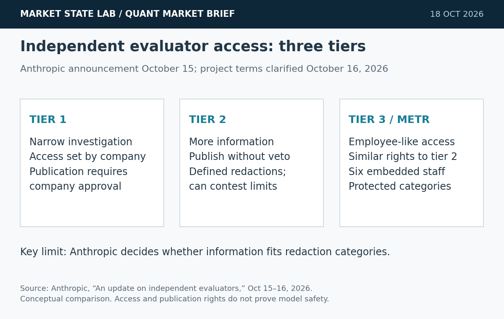
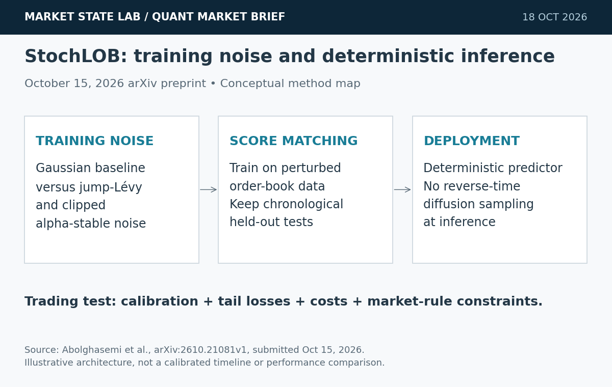
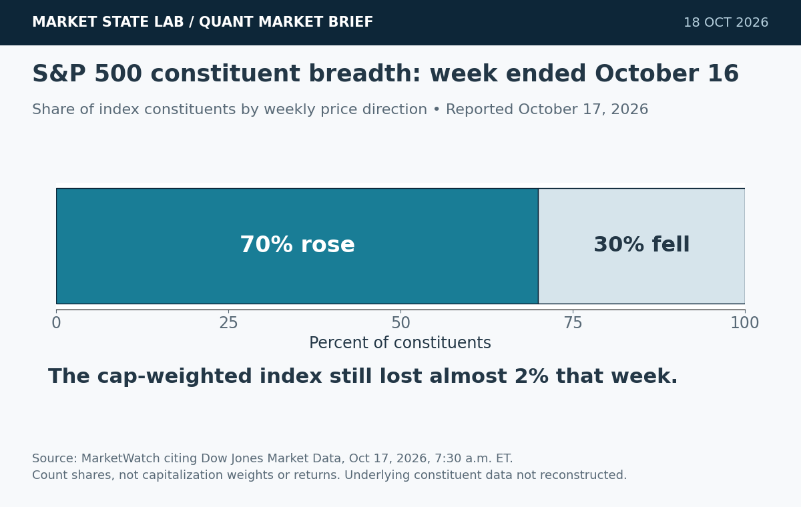
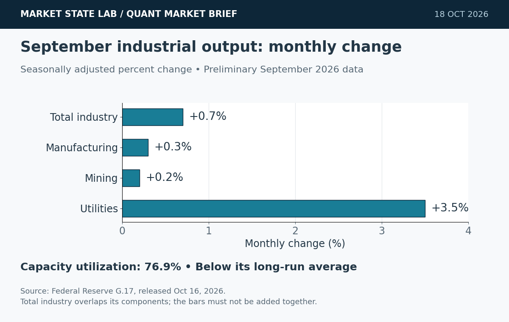
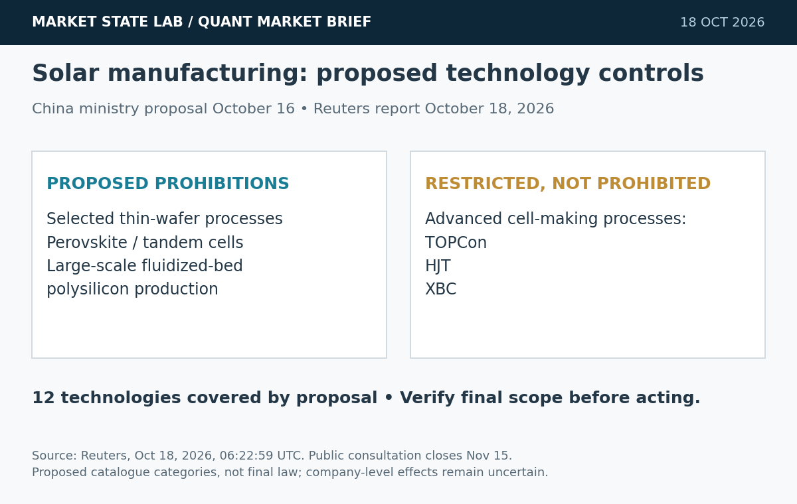

# Quant Market Brief — October 18, 2026: Market Breadth & Robust Evaluation

Research cutoff: October 18, 2026, 6:31 a.m. CT (11:31 UTC). Weekend edition: market bars, VIX and Treasury levels are October 16 prior-session observations; funding fixings are October 15. No live consolidated liquidity was verified.

[Subscribe to Quant Market Brief by email](https://market-state-lab.ghost.io/?utm_source=github&utm_medium=technical_archive&utm_campaign=qmb_2026-10-18#/portal/signup).

## 1. Anthropic gives METR embedded access for independent evaluation

*Graphic: Market State Lab; Anthropic, October 15–16, 2026. Conceptual access tiers; no safety score implied.*

**Fact:** Anthropic says six METR staff now have employee-like access to internal tools and risk-assessment resources. METR can publish assessments without an Anthropic veto, subject to predefined redaction categories; Anthropic clarified those terms October 16. [Source](https://www.anthropic.com/news/an-update-on-independent-evaluators)

**Inference:** Independent review is more useful when evaluators can examine operational evidence and publish limitations.

**Uncertainty:** This is the company’s description of access, not a completed independent safety finding. Anthropic decides whether information falls within redaction categories.

**Why it matters:** Give trading-model reviewers versioned inputs, order logs and configuration fingerprints, with explicit authority to report failed controls.

## 2. StochLOB tests heavy-tailed training noise for order-book prediction

*Graphic: Market State Lab; Abolghasemi et al., arXiv 2610.21081v1, October 15, 2026. Conceptual method map; no simulated data or performance curve.*

**Fact:** The October 15 StochLOB preprint changes the noise used during score-matching training: jump-Lévy and clipped alpha-stable alternatives replace Brownian-only Gaussian corruption. The deployed predictor remains deterministic. Authors report competitive held-out Coinbase prediction and improved several tail-window diagnostics, with an exploratory A-share transfer test. [Source](https://arxiv.org/abs/2610.21081v1)

**Inference:** A realistic training perturbation may improve stress robustness without adding sampling latency to deployment.

**Uncertainty:** Preprint evidence is not independent replication or demonstrated SPY/QQQ options profitability. Market, sampling, costs and rule constraints affect transfer.

**Why it matters:** Compare Gaussian and heavy-tailed training under identical purged folds, seeds and cost assumptions; evaluate tail losses, calibration and net fills before increasing complexity.

## 3. A weak S&P 500 week masks gains in most constituents

*Graphic: Market State Lab; MarketWatch citing Dow Jones Market Data, October 17, 2026. Weekly constituent-count shares, not returns or weights.*

**Fact:** MarketWatch reported that 70% of S&P 500 stocks gained in the week ended October 16, although the capitalization-weighted index lost almost 2%; equal weight rose for a second week. [Source](https://www.marketwatch.com/story/it-was-another-great-week-for-the-average-stock-as-market-leadership-shifts-away-from-tech-8e8516da)

**Inference:** Breadth and capitalization weights can send different signals.

**Uncertainty:** Reported breadth is not a new Sunday observation or a verified constituent reconstruction.

**Why it matters:** Compare equal-weight and capitalization-weight exposure before treating index weakness as universal selling.

## 4. September industrial production rises 0.7%; utilities lead

*Graphic: Market State Lab; Federal Reserve G.17, October 16, 2026. September monthly changes, seasonally adjusted; overlapping aggregates are not additive.*

**Fact:** The Fed’s October 16 G.17 release puts September industrial production up 0.7% monthly, manufacturing up 0.3%, mining up 0.2% and utilities up 3.5%. Capacity utilization rose to 76.9%, below its long-run average. Figures are seasonally adjusted and September is preliminary. [Source](https://www.federalreserve.gov/releases/g17/20261016/)

**Inference:** The headline gain overstates the pace in manufacturing alone.

**Uncertainty:** Utilities can reflect weather; revisions and sector composition limit any direct policy-rate inference.

**Why it matters:** Keep release-vintage data and test manufacturing separately from utilities when updating growth-sensitive signals.

## 5. China proposes new controls on solar-manufacturing technology

*Graphic: Market State Lab; Reuters, October 18, 2026, reporting October 16 ministry proposal. Proposed restrictions; not a final enacted catalogue.*

**Fact:** Reuters reports proposed Chinese export controls on 12 solar-manufacturing technologies, including prohibitions for some processes and restrictions for others. Public consultation closes November 15; the ministry described the proposal October 16. [Source](https://www.reuters.com/business/autos-transportation/china-proposes-export-controls-solar-manufacturing-technologies-2026-10-18/)

**Inference:** Technology-transfer dependence may complicate manufacturing plans.

**Uncertainty:** The catalogue is proposed; final scope and company effects remain uncertain.

**Why it matters:** Map process and licensing dependencies before assuming announced overseas capacity is deliverable.

## Quant & Market Dashboard

### Liquidity, funding and volatility

- **Sunday cutoff:** U.S. cash equities, listed equity options and the usual equity-index futures session are closed. No live futures/ETF spread, depth, overnight volume, options book or auction imbalance was verified. Friday’s volume and range are cautious context proxies, not current fillability; refresh after the Sunday futures reopen and again before Monday’s cash open.
- **October 16 completed-session ETF bars:** SPY 763.25, −1.11%, volume 64.38 million; QQQ 709.80, −2.50%, volume 66.93 million. High–low ranges: 12.61 and 18.73 price points. Source: Alpha Vantage daily OHLCV; prior-close, not live. [Data methodology](https://www.alphavantage.co/documentation/#daily).
- **Treasury context, October 16 official par yields:** 2-year 4.74%, 10-year 5.09%, 30-year 5.43%; 2s10s +35 basis points. These prior-session curve levels are not dealer depth or executable funding. [U.S. Treasury](https://home.treasury.gov/resource-center/data-chart-center/interest-rates/TextView?field_tdr_date_value=2026&type=daily_treasury_yield_curve).
- **Latest verified funding fixings, October 15:** SOFR 3.89%, EFFR 3.88%; FRED updated October 16 at 7:02 and 8:02 a.m. CT respectively. Lagged fixings cannot establish current funding stress or its absence. [SOFR](https://fred.stlouisfed.org/series/SOFR) · [EFFR](https://fred.stlouisfed.org/series/EFFR).
- **Volatility regime: High; medium confidence.** Delayed October 16 VIX close 19.99, +21.45%, intraday high 22.31, combined with wide ETF ranges. This is a qualitative risk classification, not a calibrated regime model. Current skew, VX curve, dealer gamma and liquidity degradation remain unverified. [VIX history](https://chartexchange.com/symbol/index-vix/historical/).

### Factor proxies

| Factor | ETF | October 15→16 | September 18→October 16 |
|---|---|---:|---:|
| Momentum | MTUM | -2.78% | -5.31% |
| Value | VLUE | -1.67% | -3.81% |
| Quality | QUAL | -0.79% | +2.62% |
| Size | IWM | -1.69% | -4.81% |
| Growth | IWF | -2.22% | -1.44% |
| Low volatility | SPLV | +1.04% | +2.62% |

Common endpoints; four weeks is 28 calendar days with no holiday substitution. Split-screened **price returns excluding dividends**, not pure-factor premia or total returns. All daily bars were refreshed October 18. The provider’s daily limit blocked a fresh split-history check: the [October 17 archived split snapshots](https://github.com/rsh63/market-state-lab/blob/main/2026-10-17-market-inputs.json) show no effective split in this unchanged completed-session window; future events are excluded. Values therefore remain Friday observations, not new weekend returns. Underlying prices and snapshot provenance accompany this edition. Low volatility’s relative strength and momentum’s weakness merit testing, not an assumed lasting rotation.

### Execution and microstructure

- Before Monday’s **8:30 a.m. CT** cash open, refresh quotes, event/earnings calendars and auction imbalances. Sunday reopening gaps and thin early futures depth can make apparent ETF/futures fair value unreliable; no current basis was verified.
- Reconcile Friday’s monthly-expiry exercises, assignments, residual exposure and collateral. Refresh strike mappings, open interest and quote ages; do not infer a gamma sign or pinning effect from expired contracts. [Cboe 2026 options calendar](https://cdn.cboe.com/resources/options/Cboe2026OPTIONSCalendar.pdf).
- Gate SPY/QQQ and option orders on observable spreads, depth, quote age and liquidity. Use limit prices, participation caps and explicit cancel/replace controls; stress partial fills, latency, adverse selection and nonlinear slippage. Avoid assuming midpoint fills or that displayed size will remain available through the auction.

**Watchlist:** SPY, QQQ, RSP, IWM, TLT, VIX; MTUM, VLUE, QUAL, IWF, SPLV; ES, NQ, ZN and VX futures; TAN and FSLR for solar-exposure research, with company effects unverified.

### DRL Improvements for the MATLAB System

1. Keep drawdown, exposure, concentration and liquidity constraints outside the learned reward; test deterministic shutdown and recovery, including post-expiry reconciliation.
2. Compare Gaussian versus heavy-tailed training perturbations under matched data, seeds and compute budgets. Include jump, spread-widening and missing-depth scenarios without claiming synthetic tails are empirically calibrated.
3. Reward net implementation performance after fees, spread, impact and inventory risk. Model quote withdrawal, partial fills, failed cancels and latency; penalize unnecessary turnover.
4. Use purged, embargoed walk-forward evaluation with held-out stress regimes. Freeze selection rules, report risk breaches and tail losses, and give an independent reviewer immutable inputs, configurations and order logs.

### Model hygiene

Prevent leakage and look-ahead with release-vintage, feature-availability and decision timestamps. Use point-in-time universes including delisted securities to limit survivorship bias. Reconcile splits/distributions while separating research adjustments from executable prices. Reject stale options quotes and incorrect contracts, control multiple testing, and monitor probability calibration, feature drift and policy drift. Treat paper results and independent verification as separate evidence.

### MATLAB optimization patterns

- Use time-zone-aware `timetable` data and causal `synchronize`/`retime` rules; assert that features exist before decisions.
- Vectorize feature and order-log comparisons, preallocate diagnostics and profile the environment before adding workers.
- Parallelize independent walk-forward folds or `bayesopt` trials with reproducible random streams and frozen holdouts.
- Use GPUs for sufficiently large neural batches when profiling supports them; keep data, execution, risk and agent modules separate.

### High-value quant research question

**Does heavy-tailed training improve SPY/QQQ order-book forecast calibration and tail implementation loss after realistic costs, compared with Gaussian training under identical walk-forward splits?**

It separates statistical robustness from executable economic benefit. Compare proper probability scores, stress-window loss, turnover and implementation shortfall; reject added complexity if gains vanish after costs or seed variation.

[Subscribe to Quant Market Brief by email](https://market-state-lab.ghost.io/?utm_source=github&utm_medium=technical_archive&utm_campaign=qmb_2026-10-18#/portal/signup).

*Research and education only—not individualized financial advice. Market and model risk remain; no trading performance is promised.*
