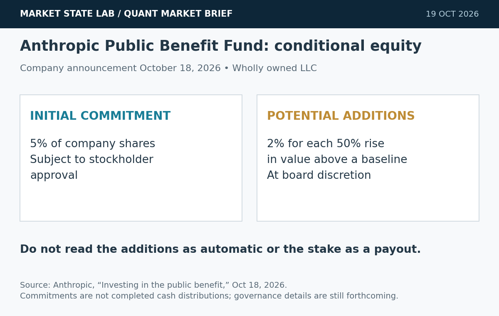
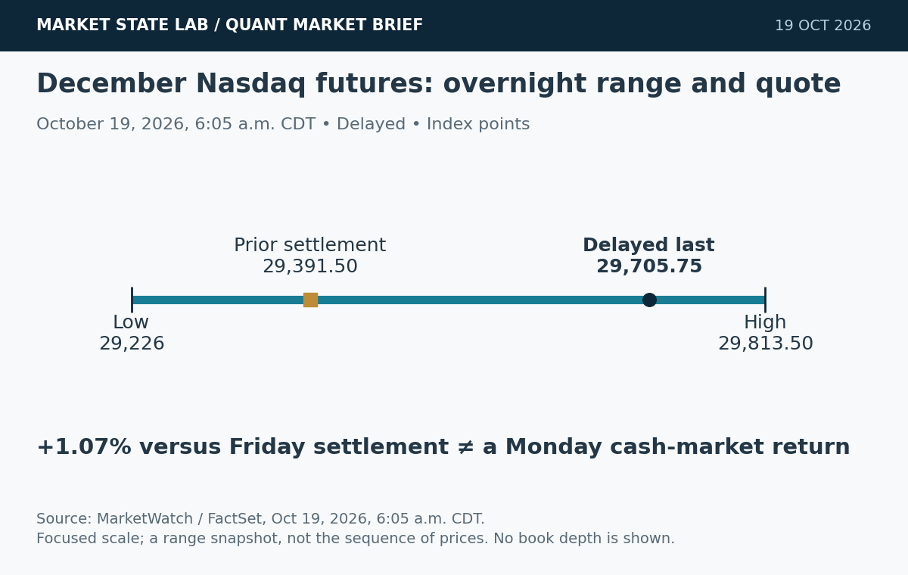
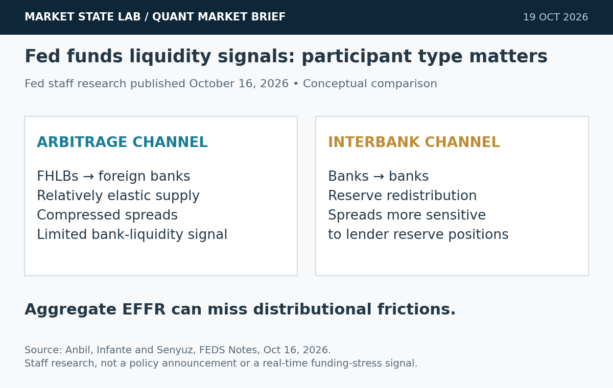
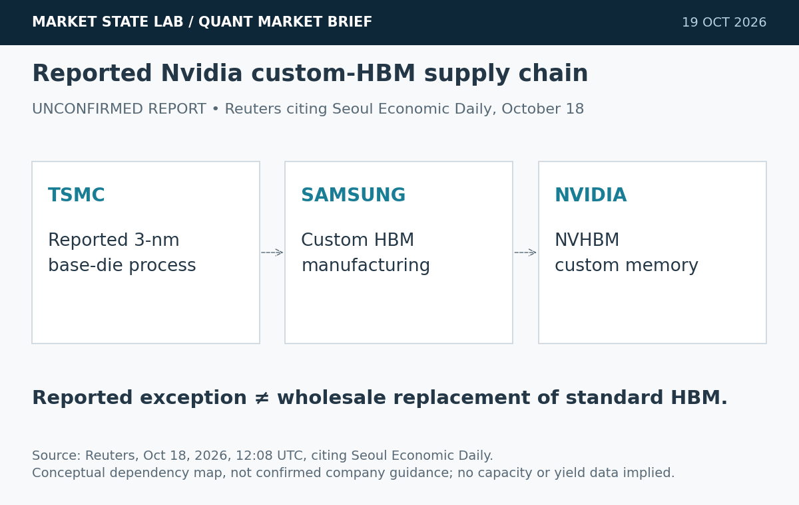

# Quant Market Brief — October 19, 2026: Rebound Risk & Stale Quotes

Research cutoff: October 19, 2026, 6:34 a.m. CT (11:34 UTC). Futures and VIX observations are delayed with distinct timestamps; ETF/factor/Treasury observations are October 16 prior-session; funding fixings are October 15. No live consolidated liquidity was verified.

[Subscribe to Quant Market Brief by email](https://market-state-lab.ghost.io/?utm_source=github&utm_medium=technical_archive&utm_campaign=qmb_2026-10-19#/portal/signup).

## 1. Anthropic proposes a share-funded public-benefit vehicle

*Graphic: Market State Lab; Anthropic, October 18, 2026. Conditional commitments, not completed cash distributions.*

**Fact:** Anthropic’s October 18 announcement commits an initial 5% of shares to a wholly owned public-benefit LLC, subject to stockholder approval. Further 2% additions for each 50% valuation increase above a baseline are at the board’s discretion. [Source](https://www.anthropic.com/news/public-benefit-fund)

**Inference:** Equity allocation and governance can matter separately from product capability.

**Uncertainty:** The announcement does not establish completed distributions, beneficiary eligibility or a payout schedule; more governance details are promised.

**Why it matters:** Track approval and governance milestones before treating a headline equity commitment as realized social spending.

## 2. New preprint quantifies the cost of stale quotes

*Graphic: Market State Lab; Adadurov et al., arXiv 2610.21510v1, October 15, 2026. Reported lower-bound calibration; not an equity-market estimate.*

**Fact:** An October 15 preprint studies repricing speed versus screening informed flow. Using four USDC–WETH pools against Binance data from June–August 2026, the authors estimate a slow maker needs at least 84.5% screening to match a one-second venue; the Gaussian benchmark gives 71.1%. [Source](https://arxiv.org/abs/2610.21510v1)

**Inference:** A diffusion-only simulator may understate the protection needed against stale-quote selection.

**Uncertainty:** This is a model-conditioned preprint calibration, not replicated equity/options evidence. Screening is not free, and lawful venue rules differ.

**Why it matters:** Test quote-age gates against faster repricing under matched spreads, fees and inventory constraints; measure net fills and adverse selection, not prediction accuracy alone.

## 3. Nasdaq futures rebound before Monday’s cash open

*Graphic: Market State Lab; MarketWatch/FactSet, October 19, 2026, 6:05 a.m. CDT, delayed. Range-to-quote snapshot, not a time-series path.*

**Fact:** MarketWatch’s delayed October 19, 6:05 a.m. CDT snapshot shows December Nasdaq-100 futures at 29,705.75, up 1.07% from Friday’s settlement. The displayed overnight range is 29,226–29,813.50. [Source](https://www.marketwatch.com/investing/future/nq00)

**Inference:** The rebound does not establish durable risk appetite or executable ETF liquidity.

**Uncertainty:** This is a delayed futures observation, not Monday’s cash return; spreads, queue depth and current options positioning were not verified.

**Why it matters:** Refresh basis and auction imbalances before SPY/QQQ orders; avoid translating a futures bounce into an assumed low-slippage open.

## 4. Fed staff note: who lends can reveal hidden liquidity frictions

*Graphic: Market State Lab; Anbil, Infante and Senyuz, FEDS Notes, October 16, 2026. Conceptual comparison of research findings, not current stress readings.*

**Fact:** An October 16 Fed staff note distinguishes nonbank arbitrage lending from interbank liquidity management. The latter’s spreads are more sensitive to lenders’ reserves, so aggregate EFFR can mask distributional frictions. [Source](https://www.federalreserve.gov/econres/notes/feds-notes/ripples-in-the-reserve-pool-unveiling-liquidity-signals-from-the-federal-funds-market-20261016.html)

**Inference:** A stable headline funding rate is insufficient evidence that every institution has comfortable liquidity.

**Uncertainty:** This is staff research, not a new policy decision or a finding that current funding markets are stressed. The note’s Figure 1 averages October 2015–January 2024.

**Why it matters:** Pair aggregate funding fixings with participant-level spreads and reserve-distribution evidence when available; label missing granularity explicitly.

## 5. Report links Samsung’s custom Nvidia memory to TSMC base dies

*Graphic: Market State Lab; Reuters citing Seoul Economic Daily, October 18, 2026. Reported arrangement; not independently confirmed company guidance.*

**Fact:** Reuters, citing Seoul Economic Daily on October 18, reports Samsung will use TSMC’s 3-nanometre process for base dies in Nvidia’s custom HBM. The newspaper says Samsung plans to keep in-house production for standard HBM. [Source](https://www.reuters.com/world/asia-pacific/samsung-use-tsmc-technology-nvidias-next-generation-memory-chips-seoul-newspaper-2026-10-18/)

**Inference:** Custom memory can create dependencies across suppliers that also compete.

**Uncertainty:** Reported arrangement, not independently verified company guidance; capacity, yields and commercial effects remain uncertain.

**Why it matters:** Map base-die bottlenecks separately from memory demand before changing supplier assumptions.

## Quant & Market Dashboard

### Liquidity, funding and volatility

- **Overnight:** Futures are trading; U.S. cash equities and listed equity options have not opened. The delayed Nasdaq snapshot in story 3 shows a rebound, but no reliable live ETF/futures spreads, order-book depth, auction imbalance, consolidated overnight volume or options book was verified. Do not equate direction with liquidity. Use Friday’s ETF ranges and volume only as cautious context, not current fillability.
- **Completed session, October 16:** SPY 763.25, −1.11%, volume 64.38 million; QQQ 709.80, −2.50%, volume 66.93 million. High–low ranges 12.61 and 18.73 price points. Alpha Vantage daily OHLCV, refreshed October 19; prior-close, not live. [Data specification](https://www.alphavantage.co/documentation/#daily).
- **Treasury context, October 16 official par yields:** 2-year 4.74%, 10-year 5.09%, 30-year 5.43%; 2s10s +35 basis points. Prior-session curve levels are not executable funding or dealer depth. [Treasury source](https://home.treasury.gov/resource-center/data-chart-center/interest-rates/TextView?field_tdr_date_value=2026&type=daily_treasury_yield_curve).
- **Latest verified funding fixings, October 15:** SOFR 3.89%, EFFR 3.88%; FRED updated October 16 at 7:02 and 8:02 a.m. CT. These lagged aggregate fixings cannot confirm current stress or its absence; story 4 explains the distributional limitation. [SOFR](https://fred.stlouisfed.org/series/SOFR) · [EFFR](https://fred.stlouisfed.org/series/EFFR).
- **Volatility regime: Moderate, with elevated transition risk; medium confidence.** ChartExchange’s delayed October 19, 6:34 a.m. EDT VIX reading is 18.68, down 6.55% from Friday’s 19.99 close. Friday’s 22.31 intraday high and wide ETF ranges argue against treating this as a settled low-volatility regime. Classification is qualitative, not a fitted model. Current skew, VX term structure and dealer gamma remain unverified. [VIX source](https://chartexchange.com/symbol/index-vix/historical/).

### Factor proxies

| Factor | ETF | October 15→16 | September 18→October 16 |
|---|---|---:|---:|
| Momentum | MTUM | -2.78% | -5.31% |
| Value | VLUE | -1.67% | -3.81% |
| Quality | QUAL | -0.79% | +2.62% |
| Size | IWM | -1.69% | -4.81% |
| Growth | IWF | -2.22% | -1.44% |
| Low volatility | SPLV | +1.04% | +2.62% |

Common completed-session endpoints; four weeks = 28 calendar days. Split-screened **price returns excluding dividends**, not pure-factor premia or total returns. Prices and split histories refreshed October 19; no effective split in this window. Future November 5 events are excluded. Low volatility leads momentum over both horizons, but this is Friday’s cross-section—not Monday’s live factor performance. See archived inputs and [methodology](https://github.com/rsh63/market-state-lab/blob/main/METHODOLOGY.md).

### Execution and microstructure

- **8:30 a.m. CT cash open:** refresh SPY/QQQ NBBO, quote age, book depth, futures basis and opening-auction imbalance. A gap after a volatile week can expose stops and market orders to slippage; displayed size may disappear before execution. No opening imbalance was available at cutoff.
- Reconcile October 16 monthly-expiry exercises, assignments, residual delta and collateral. Rebuild current strikes, maturities and open interest; do not carry expired-contract gamma or pinning assumptions into Monday. Dealer gamma sign is unknown. [Cboe calendar](https://cdn.cboe.com/resources/options/Cboe2026OPTIONSCalendar.pdf).
- Refresh the economic/earnings calendar before orders. October housing sentiment is reported as due **9:00 a.m. CT / 10:00 a.m. ET**; verify the release feed immediately before execution. No result is assumed here. [MarketWatch calendar context](https://www.marketwatch.com/livecoverage/stock-market-today-dow-s-p-500-nasdaq-bounce-back-teach-earnings-third-quarter/card/nasdaq-to-climb-350-points-as-tech-stocks-rebound-2kUMalwnw3j1nchYqGX7).
- Gate orders on spreads, depth and quote freshness; cap participation and cancel latency. Stress partial fills, failed cancels, adverse selection and nonlinear impact. For options, reject crossed/stale books and untradeable midpoints; use bounded limit prices and account for spread widening near releases. Thin premarket books and a rising futures print can be liquidity traps.

**Watchlist:** SPY, QQQ, RSP, IWM, TLT, VIX; MTUM, VLUE, QUAL, IWF, SPLV; ES, NQ, ZN and VX futures; NVDA, TSM and MU for supplier-exposure research, with reported company effects unconfirmed.

### DRL Improvements for the MATLAB System

1. Keep drawdown, exposure, concentration and liquidity limits outside the reward. Test deterministic shutdown/recovery and post-expiry reconciliation across regimes.
2. Add quote age, spread, available depth and cancel latency to state. Compare quote-age gates with faster repricing while keeping inventory and venue-rule constraints fixed; do not assume screening is feasible in every market.
3. Reward net implementation performance after fees, spread, impact and inventory risk. Include missed fills, adverse selection, partial execution and cancel failures; avoid rewarding turnover or midpoint-fill artifacts.
4. Use purged, embargoed walk-forward folds, reproducible seeds and untouched stress holdouts. Compare empirical and Gaussian innovations with matched compute, then report risk breaches, tail shortfall and calibration—not just average reward.

### Model hygiene

Prevent leakage and look-ahead through release-vintage, feature-availability and decision timestamps. Use point-in-time universes including delisted securities to control survivorship bias. Reconcile splits/distributions and contract expiries; distinguish research-adjusted from executable prices. Reject stale options quotes and mismatched timestamps. Control multiple testing, calibrate probabilities out of sample, and monitor feature, cost-model and policy drift.

### MATLAB optimization patterns

- Use time-zone-aware `timetable` inputs and causal `synchronize`/`retime`; assert availability before each decision.
- Vectorize quote-age and implementation-shortfall calculations; preallocate arrays and profile before optimizing.
- Parallelize independent walk-forward or `bayesopt` trials with reproducible random streams and a frozen holdout.
- Use GPUs only for neural batches large enough to amortize transfer costs; keep data, execution, risk and agent modules separate.

### High-value quant research question

**Does a quote-age gate reduce SPY/QQQ implementation shortfall more efficiently than faster repricing after accounting for missed fills, cancel latency and adverse selection?**

It tests whether stale-quote protection transfers from theory to executable equities. Use identical signals, inventory limits and purged folds; compare net shortfall, fill rate, tail loss and risk breaches across calm and stressed sessions.

[Subscribe to Quant Market Brief by email](https://market-state-lab.ghost.io/?utm_source=github&utm_medium=technical_archive&utm_campaign=qmb_2026-10-19#/portal/signup).

*Research and education only—not individualized financial advice. Market and model risk remain; no trading performance is promised.*
