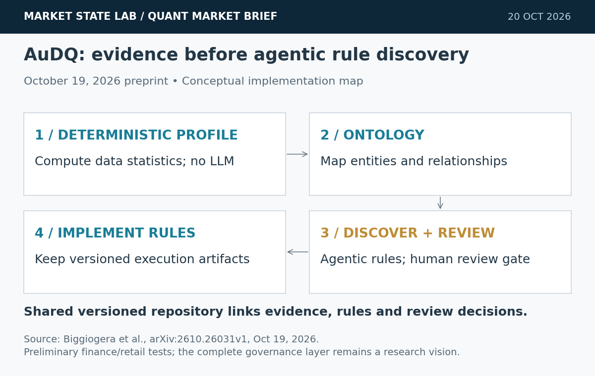
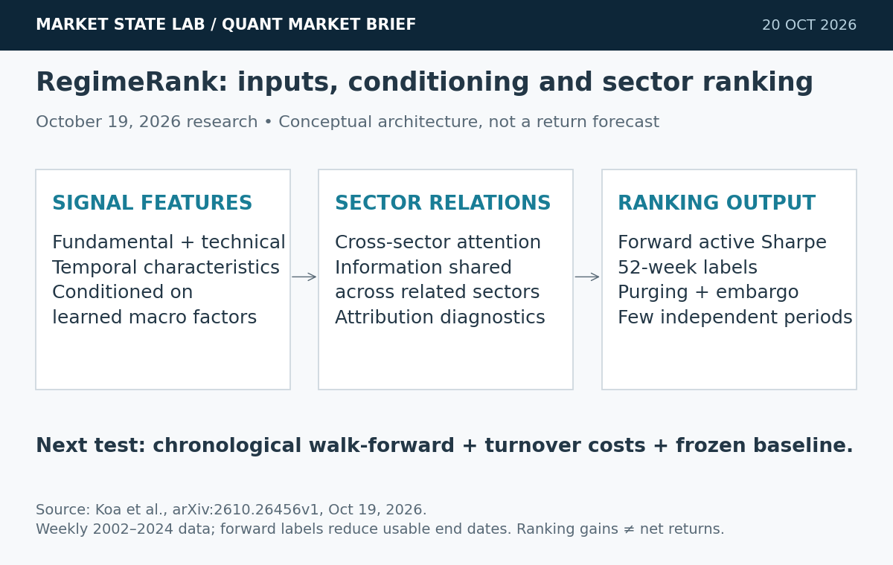
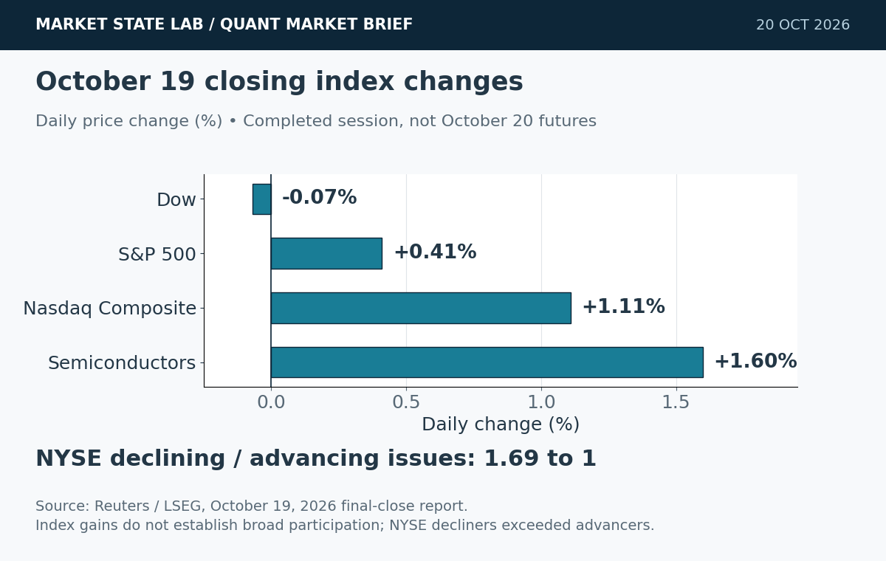
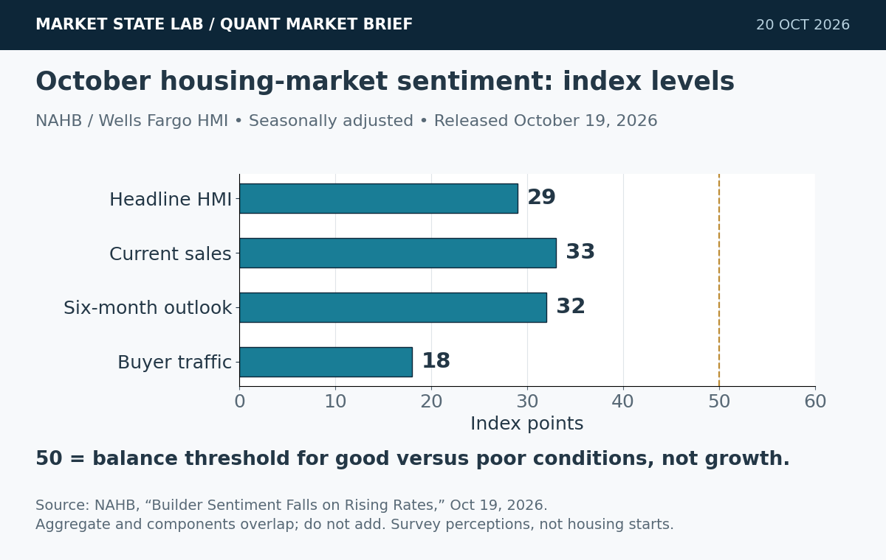
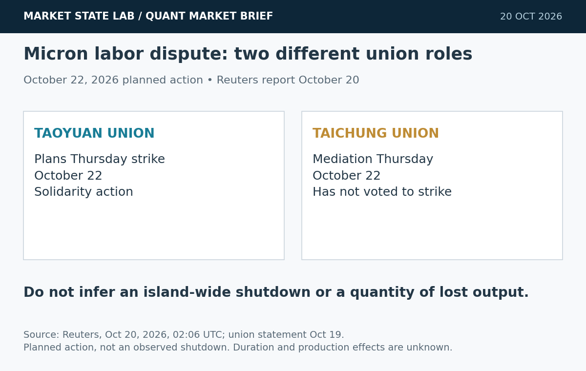

# Quant Market Brief — October 20, 2026: Auditable AI & Sector Rotation

Research cutoff: October 20, 2026, 6:37 a.m. CT (11:37 UTC). Futures and VIX are delayed with distinct timestamps; ETFs/factors/Treasuries are October 19 prior-session observations; funding fixings are October 16. No live consolidated liquidity was verified.

[Subscribe to Quant Market Brief by email](https://market-state-lab.ghost.io/?utm_source=github&utm_medium=technical_archive&utm_campaign=qmb_2026-10-20#/portal/signup).

## 1. AuDQ makes data-quality rules auditable research artifacts

*Graphic: Market State Lab; Biggiogera et al., arXiv 2610.26031v1, October 19, 2026. Conceptual implementation map, not a measured performance chart.*

**Fact:** The October 19 AuDQ preprint presents agentic rule discovery with guided and full-agentic modes, human review and repository-mediated artifacts. A deterministic statistical profiler supplies evidence before LLM reasoning. Initial evaluation uses two industry datasets in finance and retail. [Source](https://arxiv.org/abs/2610.26031)

**Inference:** Rules become easier to review when their source, version and execution evidence are explicit.

**Uncertainty:** Preliminary research, not an independently validated production control. The broader end-to-end governance vision should not be confused with the implemented discovery core.

**Why it matters:** Store split-date, quote-age and return-arithmetic checks as versioned tests; require human approval before promoting newly proposed rules into a trading-data pipeline.

## 2. RegimeRank tests interpretable, macro-conditioned sector ranking

*Graphic: Market State Lab; Koa et al., arXiv 2610.26456v1, October 19, 2026. Conceptual architecture; ranking results are not live trading returns.*

**Fact:** RegimeRank combines temporal signal characteristics, macro conditioning and cross-sector relationships. Authors report stronger ranking metrics on weekly S&P 500 sector data spanning 2002–2024 under combinatorial purged cross-validation. Its labels use 52-week forward active Sharpe ratios. [Source](https://arxiv.org/abs/2610.26456v1)

**Inference:** Regime-conditioned ranking is worth comparing with simpler momentum and linear rankings.

**Uncertainty:** Ranking metrics are not executable net returns. Overlapping annual labels leave few independent periods; CPCV is not a substitute for a strictly chronological deployment test. Attention diagnostics do not prove causality.

**Why it matters:** Run a small point-in-time sector-ETF comparison with realistic turnover costs, chronological walk-forward folds and a frozen momentum baseline.

## 3. Monday’s index rebound leaves breadth weak

*Graphic: Market State Lab; Reuters/LSEG, October 19, 2026 close. Daily index returns, not October 20 futures or ETF returns.*

**Fact:** Monday closed with the S&P 500 +0.41%, Nasdaq +1.11% and Dow −0.07%; semiconductors gained 1.6%. NYSE decliners still outnumbered advancers 1.69 to one. [Source](https://www.reuters.com/business/wall-st-futures-climb-ai-stocks-rebound-oil-yields-fall-2026-10-19/)

**Inference:** Index strength did not establish broad participation.

**Uncertainty:** Completed-session evidence, not Tuesday’s cash result or a forecast.

**Why it matters:** Check equal-weight participation and executable depth before following headline gains.

## 4. October builder confidence falls to 29

*Graphic: Market State Lab; NAHB/Wells Fargo HMI, released October 19, 2026. Seasonally adjusted index levels, not percent changes; aggregate and components overlap.*

**Fact:** NAHB’s October 19 release puts October builder confidence at 29, down three points. Current sales scored 33, six-month expectations 32 and buyer traffic 18. The headline reading is the lowest since June 2012; 43% of surveyed builders reported price cuts. [Source](https://www.nahb.org/news-and-economics/press-releases/2026/10/builder-sentiment-falls-on-rising-rates)

**Inference:** Rate-sensitive housing remains weak even when selected equity indexes rebound.

**Uncertainty:** HMI measures perceptions, not housing starts or realized sales. Components overlap and must not be added; the next construction release is separate evidence.

**Why it matters:** Keep survey sentiment, borrowing costs and actual activity separate in macro features; refresh the data vintage around scheduled housing releases.

## 5. Micron’s Taoyuan union plans Thursday strike

*Graphic: Market State Lab; Reuters, October 20, 2026. Planned action, not an observed shutdown or production-loss estimate.*

**Fact:** Reuters reports Micron’s Taoyuan union plans an October 22 strike alongside Taichung mediation over bonuses. Taichung has not voted to strike; duration is unspecified. [Source](https://www.reuters.com/business/world-at-work/micron-union-taiwan-launch-strike-bonus-dispute-escalates-2026-10-20/)

**Inference:** Labor developments add operational uncertainty.

**Uncertainty:** Planned action, not an observed shutdown; production effects are unknown.

**Why it matters:** Monitor mediation and staffing evidence without inventing lost chip output or treating all Taiwan operations as halted.

## Quant & Market Dashboard

### Liquidity, funding and volatility

- **Overnight context:** Delayed December Nasdaq futures were 29,588.75, −0.45% at October 20, 5:55 a.m. CDT; displayed session volume 126.98 thousand contracts. That accumulated activity is not depth or available size. No live SPY/QQQ spreads, futures/ETF basis, auction imbalance, options depth or consolidated overnight volume was verified. [MarketWatch/FactSet](https://www.marketwatch.com/investing/future/nq00).
- **October 19 completed-session ETF bars:** SPY 766.48, +0.42%, volume 38.68 million; QQQ 718.36, +1.21%, volume 37.20 million. High–low ranges 4.636 and 7.98 price points. Alpha Vantage daily OHLCV refreshed October 20; prior-close, not live. Activity and ranges are cautious proxies, not current fillability. [Data specification](https://www.alphavantage.co/documentation/#daily).
- **Treasury context, October 19 official par yields:** two-year 4.77%, ten-year 5.15%, thirty-year 5.48%; 2s10s +38 basis points. Prior-session yields are not executable financing rates or order-book depth. [Treasury](https://home.treasury.gov/resource-center/data-chart-center/interest-rates/TextView?field_tdr_date_value=2026&type=daily_treasury_yield_curve).
- **Latest verified funding fixings, October 16:** SOFR 3.88%, EFFR 3.88%; FRED updated October 19 at 7:02 and 8:01 a.m. CT. Lagged, aggregate fixings cannot establish current funding stress or its absence. [SOFR](https://fred.stlouisfed.org/series/SOFR) · [EFFR](https://fred.stlouisfed.org/series/EFFR).
- **Volatility regime: Moderate, with elevated transition risk; medium confidence.** Delayed VIX 18.73 at October 20, 6:58 a.m. EDT, versus Monday’s 18.44 close. The easing from Friday’s 19.99 is not proof of a stable low-volatility regime, especially with weak breadth and overnight futures softness. Qualitative classification; current skew, VX curve and dealer gamma are unverified. [VIX history](https://chartexchange.com/symbol/index-vix/historical/).

### Factor proxies

| Factor | ETF | October 16→19 | September 21→October 19 |
|---|---|---:|---:|
| Momentum | MTUM | +0.87% | -6.49% |
| Value | VLUE | +0.20% | -4.61% |
| Quality | QUAL | +0.13% | +1.03% |
| Size | IWM | +0.31% | -5.01% |
| Growth | IWF | +0.93% | -2.88% |
| Low volatility | SPLV | -1.22% | +1.93% |

Common endpoints; four weeks = 28 calendar days. Split-screened **price returns excluding dividends**, not pure-factor premia or total returns. Daily bars and split histories refreshed October 20; no effective splits in this comparison window. Future November 5 events are excluded. Growth/momentum recovered Monday while low volatility fell; four-week momentum and size remain weak. These are prior-close proxies, not current factor positioning. See archived inputs and [methodology](https://github.com/rsh63/market-state-lab/blob/main/METHODOLOGY.md).

### Execution and microstructure

- **7:30 a.m. CT / 8:30 a.m. ET:** Census schedules September housing starts, permits and completions. Cutoff precedes release; no result is assumed. Recheck schedule/feed immediately before orders. [Census release calendar](https://www.census.gov/construction/bps/schedule.html).
- **8:30 a.m. CT cash open:** refresh SPY/QQQ NBBO, quote ages, futures basis, depth and auction imbalances. Overnight prints do not guarantee available size at the auction; use limit prices and participation caps, not assumed midpoint fills.
- Reconcile residual October 16 expiry assignments and current contract mappings. October 21 is the calendar’s VIX expiration date; check the exact series and settlement mechanics. No dealer-gamma sign or pinning level was verified. [Cboe calendar](https://cdn.cboe.com/resources/options/Cboe2026OPTIONSCalendar.pdf).
- Model spread widening, stale options quotes, partial fills, failed cancels, latency and nonlinear impact. Avoid liquidity traps from thin premarket books, disappearing displayed depth, and headline index strength without broad participation. Refresh earnings timing before carrying exposure through the close.

**Watchlist:** SPY, QQQ, RSP, IWM, TLT, VIX; ES, NQ, ZN, VX; MTUM, VLUE, QUAL, IWF, SPLV; sector ETFs XLK, XLF, XLY, XLU, XHB; MU for labor-event research without an assumed production loss.

### DRL Improvements for the MATLAB System

1. Keep drawdown, exposure, concentration and liquidity limits outside the reward. Validate shutdown/recovery and reject actions when input quality or freshness gates fail.
2. Compare regime-conditioned and unconditioned policies using identical features, action limits and random seeds. Fit regime transformations only inside training folds; do not let future labels define contemporaneous states.
3. Reward performance after fees, spread, impact, inventory risk and missed fills. Penalize unnecessary turnover and stress worsening costs around releases and auctions.
4. Use purged, embargoed chronological walk-forward tests and untouched stress holdouts. Match purge lengths to label horizons; report tail loss, calibration, turnover and risk breaches alongside reward.

### Model hygiene

Prevent leakage, look-ahead and survivorship bias with point-in-time universes, release vintages and feature-availability timestamps. Reconcile corporate actions without allowing future effective dates into historical returns. Reject stale options quotes and mismatched expiries. Version data-quality rules and configuration fingerprints; control multiple testing, calibrate out of sample and monitor data, regime and cost-model drift.

### MATLAB optimization patterns

- Use time-zone-aware `timetable` inputs and causal `synchronize`/`retime`; assert that every feature exists before its decision.
- Vectorize rule checks and rolling features, preallocate diagnostics, and profile before adding complexity.
- Parallelize independent folds or `bayesopt` trials with reproducible random streams and frozen holdouts.
- Use GPUs only for sufficiently large neural batches; keep data validation, execution, risk and agent environments modular.

### High-value quant research question

**Does macro-conditioned sector ranking beat a frozen momentum baseline after realistic turnover costs in strictly chronological walk-forward tests?**

It separates better ranking metrics from implementable portfolio value. Use point-in-time sector ETFs, training-only regime estimation and identical risk limits; compare net active return, drawdown, turnover and rank stability, with an ablation removing macro conditioning.

[Subscribe to Quant Market Brief by email](https://market-state-lab.ghost.io/?utm_source=github&utm_medium=technical_archive&utm_campaign=qmb_2026-10-20#/portal/signup).

*Research and education only—not individualized financial advice. Market and model risk remain; no trading performance is promised.*
