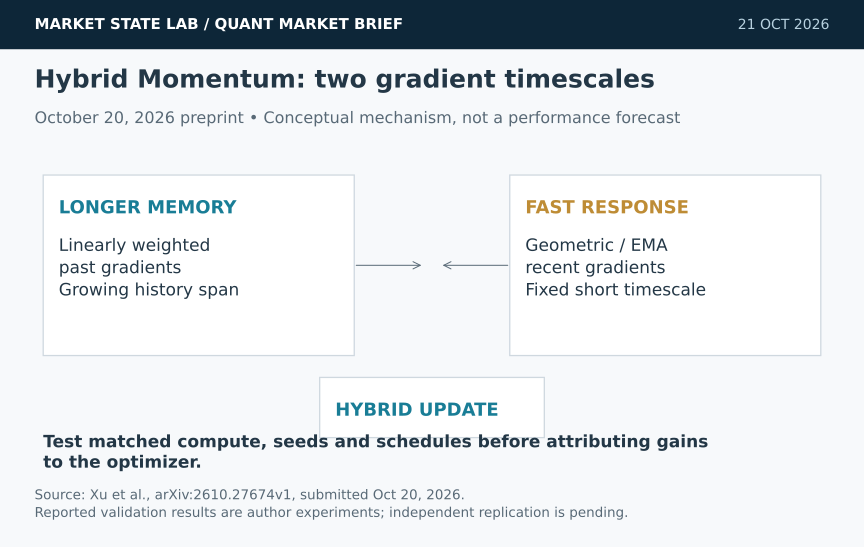
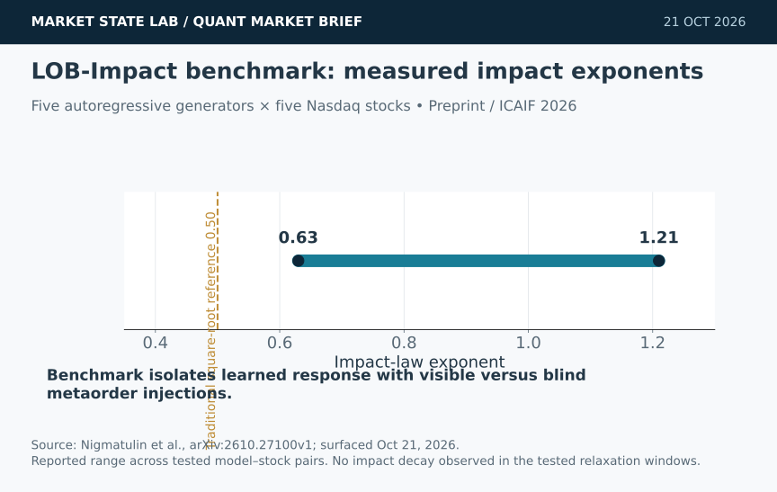
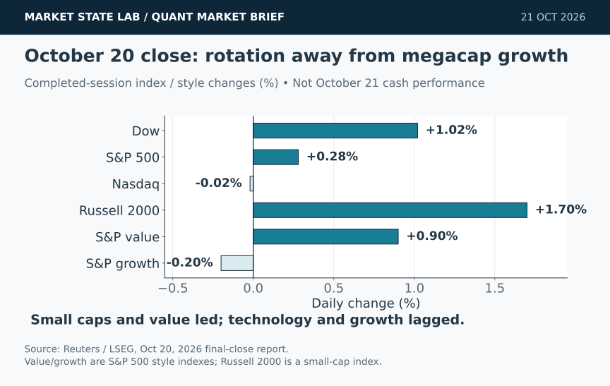
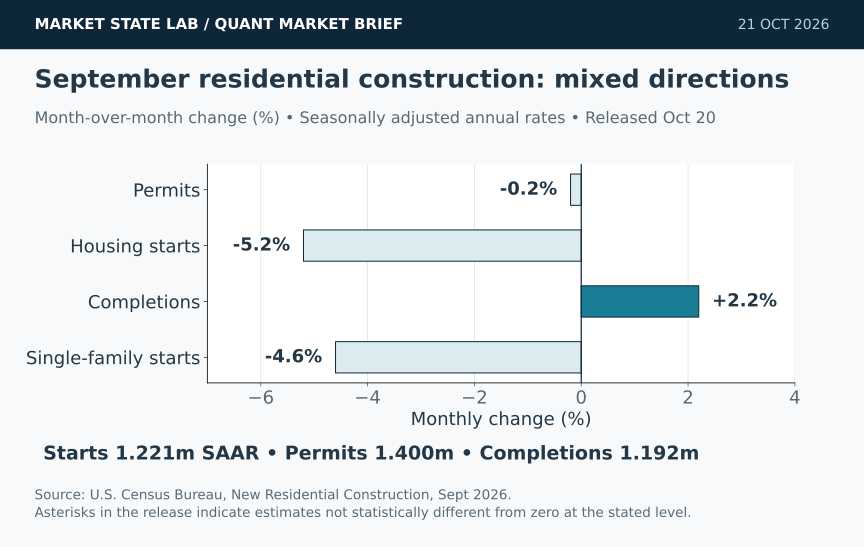
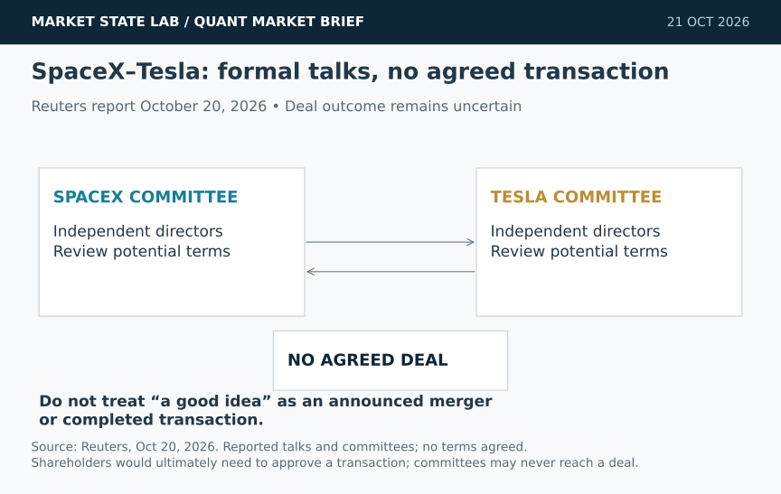

# Quant Market Brief — October 21, 2026: Hybrid Momentum & Market Impact

Research cutoff: **October 21, 2026, 6:32 a.m. CT (11:32 UTC)**. Futures and VIX are delayed snapshots; ETFs, factor proxies and Treasury yields are prior-close; funding fixings lag by one business day. No live consolidated liquidity was verified.

[Subscribe to Quant Market Brief by email](https://market-state-lab.ghost.io/?utm_source=github&utm_medium=technical_archive&utm_campaign=qmb_2026-10-21#/portal/signup).

## 1. Hybrid Momentum blends long-memory and fast gradient updates

*Graphic: Market State Lab; Xu et al., arXiv 2610.27674v1, submitted October 20, 2026. Conceptual mechanism—not a performance forecast.*

**Fact:** The October 20 HyM preprint combines a linearly weighted average of past gradients with a fast exponential-moving-average momentum. The authors report matched or improved results across image classification, machine translation and language modeling; their LLaMA-1.3B C4 run ended at validation loss 2.777 versus 2.903 for Muon. [Direct source](https://arxiv.org/abs/2610.27674)

**Inference:** Two-timescale gradient memory may help when older gradients remain informative but recent adaptation still matters.

**Uncertainty:** Author-reported preprint experiments are not independent replication. Different schedules, compute or tuning budgets can explain optimizer comparisons.

**Why it matters:** For MATLAB-linked training, freeze data order, learning-rate schedules, compute budgets and random streams; compare validation loss, wall-clock cost and run-to-run dispersion before adopting the optimizer.

## 2. LOB-Impact tests whether generative order books learn market impact

*Graphic: Market State Lab; Nigmatulin et al., arXiv 2610.27100v1, surfaced October 21, 2026. Range reported across tested model–stock pairs.*

**Fact:** LOB-Impact injects execution-style metaorders into five autoregressive limit-order-book generators across five Nasdaq stocks. Reported impact exponents span 0.63–1.21, above the traditional square-root reference of 0.5; the study did not observe decay in its post-execution windows. [Direct source](https://arxiv.org/abs/2610.27100)

**Inference:** A simulator can match unconditional message distributions yet still misprice an agent’s own counterfactual impact.

**Uncertainty:** This is a new research benchmark, not proof that any tested generator produces executable profits. The authors tentatively link absent decay to short context windows.

**Why it matters:** Before training execution agents, validate free-generation dynamics, visible-versus-blind metaorder response and relaxation. Reject simulators whose impact amplitude, exponent or persistence is implausible.

## 3. Small caps and value lead while Nasdaq finishes flat

*Graphic: Market State Lab; Reuters/LSEG, October 20, 2026 final close. Completed-session index/style returns—not October 21 cash performance.*

**Fact:** Tuesday closed with the Dow +1.02%, S&P 500 +0.28%, Nasdaq −0.02% and Russell 2000 +1.7%. The S&P 500 value index gained 0.9% while its growth counterpart fell 0.2%; Nasdaq advancers outnumbered decliners 2.02 to one. [Direct source](https://www.reuters.com/world/asia-pacific/nasdaq-futures-dip-oil-prices-climb-earnings-loom-2026-10-20/)

**Inference:** The session reflected rotation away from megacap growth rather than broad risk-off selling.

**Uncertainty:** One completed session does not establish a durable factor regime. Premarket strength can reverse, and index returns do not reveal current executable depth.

**Why it matters:** Track RSP/SPY, IWM/SPY and value/growth relative strength, but gate orders on fresh spread, depth and auction evidence rather than extrapolating Tuesday’s close.

## 4. September housing starts fall 5.2% as completions rise

*Graphic: Market State Lab; U.S. Census Bureau, September New Residential Construction, released October 20, 2026. Seasonally adjusted annual rates; sampling uncertainty applies.*

**Fact:** September housing starts ran at a 1.221 million seasonally adjusted annual rate, down 5.2% from revised August and 7.4% year over year. Permits were 1.400 million, down 0.2% monthly; completions were 1.192 million, up 2.2% monthly. [Direct source](https://www.census.gov/construction/nrc/current/index.html)

**Inference:** The flow into construction weakened even as completions rose, consistent with a constrained rate-sensitive pipeline.

**Uncertainty:** Census marks the monthly starts, single-family starts and completions changes as not statistically different from zero at the stated confidence level; estimates are revised.

**Why it matters:** Store estimate, revision vintage and margin-of-error flags separately. Do not train on a point change as a certain directional macro signal.

## 5. SpaceX and Tesla form committees to consider a merger

*Graphic: Market State Lab; Reuters, October 20, 2026. Reported formal talks; no transaction terms are agreed.*

**Fact:** Elon Musk said SpaceX and Tesla formed special committees to discuss a combination. Reuters reported talks began in recent weeks and could result in SpaceX acquiring Tesla; shareholders would ultimately need to approve a deal. [Direct source](https://www.reuters.com/business/media-telecom/spacex-quarterly-revenue-jumps-beats-estimates-ai-business-surges-2026-10-20/)

**Inference:** A transaction could reshape capital allocation across launch, connectivity, compute, chips, robotics and vehicles.

**Uncertainty:** No terms are agreed, the committees may never reach a deal, and Musk said assuming a merger would be premature. Reported potential structure is not confirmation.

**Why it matters:** Separate committee formation from deal probability. Scenario-test governance, financing, dilution and cross-company dependency without assigning a merger outcome.

## Quant & Market Dashboard

### Liquidity, funding and volatility

- **Futures, delayed:** at **5:42 a.m. ET / 4:42 a.m. CT**, Reuters reported Dow e-minis +0.07%, S&P 500 e-minis +0.24% and Nasdaq-100 e-minis +0.50%. Direction does not establish spread, depth, displayed-size durability or ETF basis. [Reuters](https://www.reuters.com/legal/transactional/nasdaq-futures-lead-gains-spacex-super-micro-results-lift-ai-trade-2026-10-21/).
- **October 20 ETF bars, prior close:** SPY 769.05, +0.34%, volume 35.05 million, high–low range 8.04 points; QQQ 717.63, −0.10%, volume 30.52 million, range 12.36 points. Activity and range are cautious proxies—not current fillability. [SPY history](https://chartexchange.com/symbol/nyse-spy/historical/) · [QQQ history](https://chartexchange.com/symbol/nasdaq-qqq/historical/).
- **Treasury, October 20 official par yields:** two-year 4.79%, ten-year 5.12%, thirty-year 5.42%; 2s10s +33 basis points. Prior-close yields are not executable financing rates. [U.S. Treasury](https://home.treasury.gov/resource-center/data-chart-center/interest-rates/TextView?field_tdr_date_value=2026&type=daily_treasury_yield_curve).
- **Latest verified funding fixings, October 19:** SOFR 3.87%, EFFR 3.88%. These aggregate, lagged fixings cannot prove current funding ease or stress. [SOFR](https://fred.stlouisfed.org/series/SOFR) · [EFFR](https://fred.stlouisfed.org/series/EFFR).
- **Volatility regime: Moderate; medium confidence.** Delayed VIX was **17.36 at 6:15 a.m. CT**, versus Tuesday’s 17.31 close and a 17.13–17.58 displayed range. The level is below Friday’s 19.99 spike, but current skew, VX curve and dealer gamma are unverified. [MarketWatch](https://www.marketwatch.com/investing/index/vix).

### Factor proxies

| Factor | ETF | October 20 daily | September 21→October 20 |
|---|---|---:|---:|
| Momentum | MTUM | +0.05% | -6.45% |
| Value | VLUE | +0.56% | -4.05% |
| Quality | QUAL | +0.20% | +1.24% |
| Size | IWM | +1.66% | -3.43% |
| Growth | IWF | -0.15% | -3.04% |
| Low volatility | SPLV | +1.29% | +3.27% |

Price-return proxies excluding dividends—not pure-factor premia or total returns. The uniform Alpha Vantage refresh was rate-limited; daily values use displayed latest/completed-session changes and the medium horizon uses September 21 archived closes. **MTUM’s daily value is indicative because its retrieved timestamp was overnight rather than a uniform closing-series pull.** Directional read: size, value and low volatility led Tuesday; medium-horizon momentum remains weak. Do not fabricate precision from mixed timestamps.

### Execution and microstructure

- At the **8:30 a.m. CT cash open**, refresh SPY/QQQ NBBO, futures/ETF basis, depth, quote age and auction imbalances. Use bounded limits and participation caps; stress spread widening, partial fills, cancel latency and nonlinear impact.
- VIX expiration is today. Reconcile the exact series and settlement mechanics before using volatility options or futures; no dealer-gamma sign, pinning level or reliable aggregate exposure was verified. [Cboe 2026 calendar](https://cdn.cboe.com/resources/options/Cboe2026OPTIONSCalendar.pdf).
- Meta and Tesla report after the close. Treat scheduled earnings as event-timing risk; recheck calendars and chain freshness before carrying short-dated optionality. Thin premarket books and disappearing displayed size are liquidity traps.
- For simulator-driven execution, validate response to the agent’s own orders. Unconditional distribution matching is insufficient when simulated market impact or relaxation is wrong.

**Watchlist:** SPY, QQQ, RSP, IWM, TLT, VIX; ES, NQ, ZN, VX; MTUM, VLUE, QUAL, IWF, SPLV; XLV, XLK, XLRE, XLU; SPCX and TSLA for event-risk research without an assumed merger.

### DRL Improvements for the MATLAB System

1. Enforce drawdown, exposure, concentration and liquidity limits outside the learned reward; reject actions when quote freshness or data-quality checks fail.
2. Add counterfactual market-impact tests to the environment: compare visible metaorders with blind controls, then stress persistence and missing decay across participation rates.
3. Reward performance after fees, spread, impact, inventory risk, missed fills and cancel latency. Penalize unnecessary turnover around auctions, expiries and earnings.
4. Use purged, embargoed chronological walk-forward tests with untouched stress regimes. Fit optimizer and regime choices only inside training folds and compare matched seeds, schedules and compute budgets.

### Model hygiene

Prevent leakage, look-ahead and survivorship bias with point-in-time universes, feature-availability timestamps and release vintages. Reconcile corporate actions without using future-effective events. Reject stale options quotes and mismatched expiries. Control multiple testing, validate calibration, preserve simulator versions and monitor feature, regime and cost-model drift.

### MATLAB optimization patterns

- Use time-zone-aware `timetable` inputs and causal `synchronize`/`retime`; assert availability before every decision.
- Vectorize rolling features and simulator diagnostics, preallocate logs and profile bottlenecks before parallelizing.
- Parallelize independent folds or `bayesopt` trials with reproducible random streams and frozen holdouts.
- Use GPUs only for sufficiently large neural batches; keep data validation, execution, risk and agent environments modular.

### High-value quant research question

**Does enforcing realistic counterfactual market impact in a generative LOB simulator reduce live-paper implementation shortfall versus a distribution-matched simulator without impact constraints?**

It tests whether better simulator physics changes policy quality. Hold signals, risk limits and data constant; compare fill rate, net shortfall, impact persistence, turnover and tail loss under matched walk-forward periods.

[Subscribe to Quant Market Brief by email](https://market-state-lab.ghost.io/?utm_source=github&utm_medium=technical_archive&utm_campaign=qmb_2026-10-21#/portal/signup).

*Research and education only—not individualized financial advice. Market, model, liquidity and event risks remain; no trading performance is promised.*
