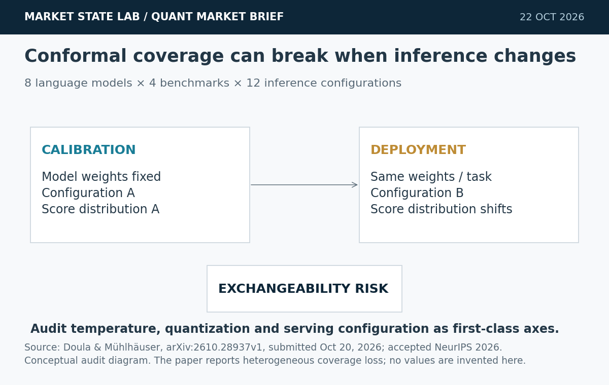
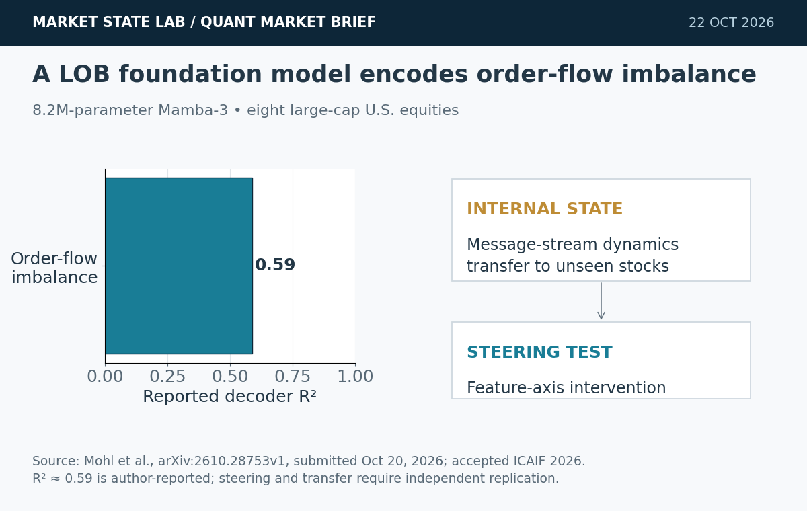
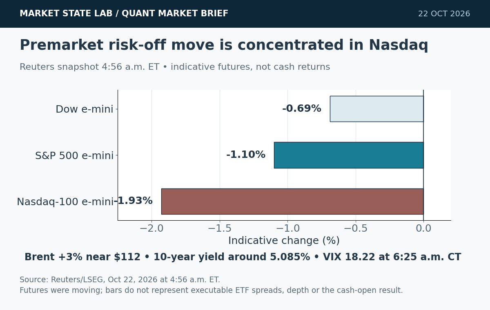
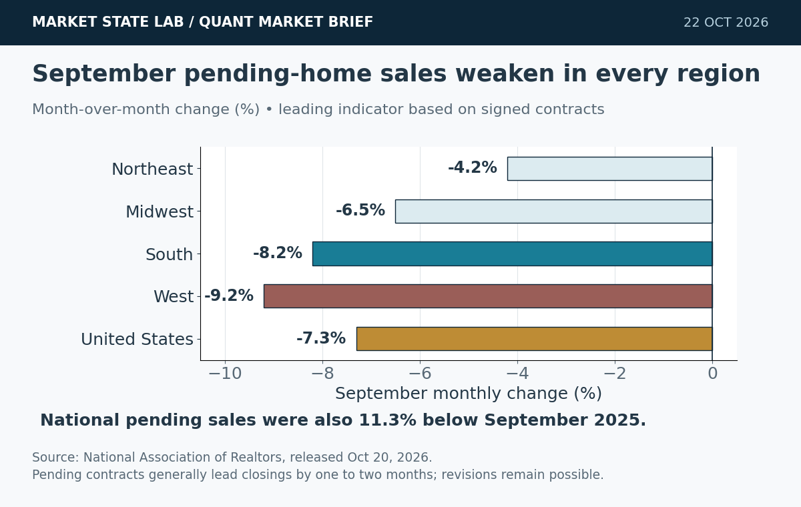
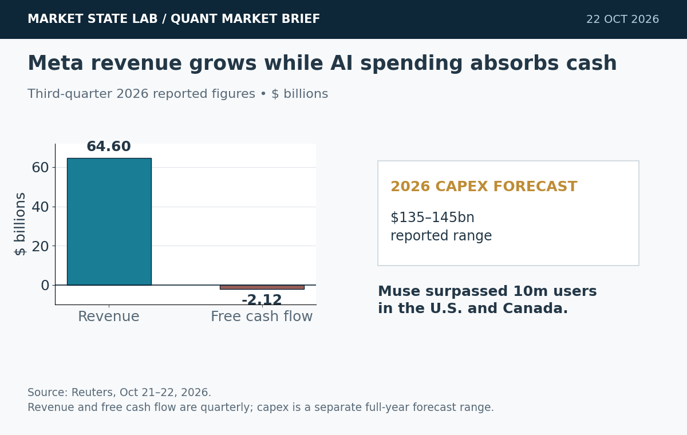

# Quant Market Brief — October 22, 2026: Inference Shift & AI-Capex Risk

Research cutoff: **October 22, 2026, 6:26 a.m. CT (11:26 UTC)**. Futures and VIX are indicative snapshots; ETFs, factor proxies and Treasury yields are prior-close; funding fixings lag. No live consolidated order-book, options-skew or dealer-gamma feed was verified.

[Subscribe to Quant Market Brief by email](https://market-state-lab.ghost.io/?utm_source=github&utm_medium=technical_archive&utm_campaign=qmb_2026-10-22#/portal/signup).

## 1. Conformal guarantees can fail when inference configuration changes

*Graphic: Market State Lab; Doula & Mühlhäuser, arXiv 2610.28937v1, submitted October 20, 2026; accepted NeurIPS 2026. Conceptual audit diagram.*

**Fact:** A NeurIPS 2026 paper evaluates conformal prediction across eight language models, four finite-label benchmarks and 12 inference configurations. The authors find that changing inference settings such as quantization or temperature can shift score distributions and make matched calibration substantially overstate deployment coverage. [Direct source](https://arxiv.org/abs/2610.28937)

**Inference:** Serving configuration is part of the statistical data-generating process even when model weights and task data are unchanged.

**Uncertainty:** This is one accepted research study, not a universal failure rate. Coverage loss is heterogeneous across models and datasets, and the abstract does not provide one portable correction factor.

**Why it matters:** Treat quantization, decoding temperature and runtime policy as versioned calibration inputs. Recalibrate—or at least run coverage audits—after serving changes before trusting uncertainty gates.

## 2. State-space LOB model learns a steerable representation of market dynamics

*Graphic: Market State Lab; Mohl et al., arXiv 2610.28753v1, submitted October 20, 2026; accepted ICAIF 2026. R² is author-reported.*

**Fact:** The authors trained an 8.2-million-parameter Mamba-3 model on tokenized messages from eight large-cap U.S. equities. Order-flow imbalance was decodable from the learned state at approximately R² 0.59; reported transfer extended to unseen stocks and other measures including volume and volatility. [Direct source](https://arxiv.org/abs/2610.28753)

**Inference:** The model may be learning a reusable microstructure state rather than only memorizing ticker-specific message patterns.

**Uncertainty:** The results are author-reported and require independent replication. Decodability and causal steering do not establish realistic fills, market impact or profitable trading.

**Why it matters:** Add representation probes to simulator validation, but keep execution realism separate: test impact, queue position, cancellation latency and cross-regime transfer before using the model for policy training.

## 3. Nasdaq futures fall 1.9% as AI-cost concerns and oil shock hit risk appetite

*Graphic: Market State Lab; Reuters/LSEG snapshot at 4:56 a.m. ET on October 22, 2026. Indicative futures—not cash-market returns.*

**Fact:** At 4:56 a.m. ET, Reuters reported Dow e-minis −0.69%, S&P 500 e-minis −1.10% and Nasdaq-100 e-minis −1.93%. Brent was up more than 3% near $112, while the 10-year Treasury yield was around 5.085%; Meta, Tesla and major chip shares were lower premarket. [Direct source](https://www.reuters.com/business/nasdaq-futures-drop-over-1-ai-worries-resurface-oil-climbs-2026-10-22/)

**Inference:** The early move combined duration-sensitive AI-capex repricing with an inflationary oil shock, concentrating downside in technology.

**Uncertainty:** Futures are indicative and can reverse before or after the cash open. Consolidated ETF spreads, displayed depth, auction imbalances and options gamma were not reliably available at the cutoff.

**Why it matters:** Avoid extrapolating the futures move into market orders. Refresh ES/NQ–SPY/QQQ basis, NBBO depth, quote age and opening imbalance; use bounded limits and smaller participation until books stabilize.

## 4. September pending-home sales drop 7.3% across all U.S. regions

*Graphic: Market State Lab; National Association of Realtors, released October 20, 2026. Signed-contract indicator; financing and closing outcomes remain uncertain.*

**Fact:** NAR reported pending-home sales fell 7.3% from August and 11.3% from a year earlier in September. All four regions declined monthly: Northeast −4.2%, Midwest −6.5%, South −8.2% and West −9.2%. [Direct source](https://www.nar.realtor/newsroom/pending-home-sales-decreased-7-3-percent-in-september)

**Inference:** High borrowing costs are suppressing housing demand even before signed contracts convert into closings, reinforcing rate sensitivity outside AI-led investment.

**Uncertainty:** This is an industry association series based on contracts, not completed sales. Financing, appraisal and inspection failures can alter the mapping to final closings, and later revisions are possible.

**Why it matters:** Use the release as a leading housing feature with publication timestamps and vintages. Pair it with mortgage rates and applications; do not treat one monthly print as a direct Fed decision rule.

## 5. Meta couples strong revenue with heavier AI financing and negative free cash flow

*Graphic: Market State Lab; Reuters, October 21–22, 2026. Quarterly revenue/free cash flow and full-year capex forecast are shown on separate visual elements.*

**Fact:** Meta reported third-quarter revenue of $64.6 billion and said Muse surpassed 10 million users in the U.S. and Canada. Reuters reported negative quarterly free cash flow of $2.12 billion, a 2026 capital-spending forecast of $135–145 billion and a planned new non-voting share class to help fund AI investment. [Direct source](https://www.reuters.com/business/meta-issue-new-class-shares-it-tightens-ai-spending-forecast-2026-10-21/)

**Inference:** User adoption is scaling faster than near-term cash generation, making financing structure and capital efficiency central to the AI thesis.

**Uncertainty:** Muse monetization is prospective, the new shares are planned rather than already issued, and legal liabilities add uncertainty. Strong revenue does not prove acceptable returns on AI capital.

**Why it matters:** For tech-factor models, separate demand indicators from capital intensity. Track revenue, free cash flow, capex revisions and financing actions as distinct state variables rather than collapsing them into a single “AI growth” signal.

## Quant & Market Dashboard

### Liquidity, funding and volatility

- **Futures, indicative:** at **4:56 a.m. ET / 3:56 a.m. CT**, Dow e-minis were −0.69%, S&P 500 e-minis −1.10% and Nasdaq-100 e-minis −1.93%. Reuters reported a risk-off move led by technology; direction does not establish executable spread, depth or ETF basis. [Reuters](https://www.reuters.com/business/nasdaq-futures-drop-over-1-ai-worries-resurface-oil-climbs-2026-10-22/).
- **October 21 ETF bars, prior close:** SPY 773.09, +0.53%, volume 31.94 million, range 6.04 points; QQQ 725.20, +1.06%, volume 32.48 million, range 8.24 points. These completed bars are liquidity proxies—not current fillability. [SPY history](https://chartexchange.com/symbol/nyse-spy/historical/) · [QQQ history](https://chartexchange.com/symbol/nasdaq-qqq/historical/).
- **Treasury, prior close:** public curve snapshots for October 21 showed the two-year near 4.81%, ten-year 5.13% and thirty-year 5.42%; 2s10s about +32 basis points. Reuters reported the ten-year around 5.085% premarket as safe-haven buying emerged. [U.S. Treasury](https://home.treasury.gov/resource-center/data-chart-center/interest-rates/TextView?field_tdr_date_value=2026&type=daily_treasury_yield_curve).
- **Latest verified funding fixings, October 20:** SOFR 3.88% and EFFR 3.88%. Aggregate lagged fixings cannot prove current funding ease or stress. [SOFR](https://fred.stlouisfed.org/series/SOFR) · [EFFR](https://fred.stlouisfed.org/series/EFFR).
- **Volatility regime: Moderate, leaning high; medium confidence.** Cboe showed spot VIX **18.22 at 6:25 a.m. CT**, +9.23% from the 16.68 prior close. The level remained below 20, while the tech-led futures drawdown and oil shock raised opening-gap risk. Current skew, term structure and dealer gamma were not verified. [Cboe](https://www.cboe.com/tradable-products/vix/).

### Factor proxies

| Factor | ETF | October 21 daily | Approx. September 21→October 21 |
|---|---|---:|---:|
| Momentum | MTUM | +1.26% | -5.27% |
| Value | VLUE | +0.37% | -3.70% |
| Quality | QUAL | +0.17% | +1.41% |
| Size | IWM | +0.25% | -3.19% |
| Growth | IWF | +0.92% | -2.15% |
| Low volatility | SPLV | -0.01% | +3.25% |

Price-return proxies excluding dividends—not pure-factor premia or total returns. Daily values come from completed-session/latest snapshots with mixed timestamps. The medium horizon updates the prior common-endpoint proxy using October 21 moves, so treat it as directional rather than institutional-grade. Read: momentum and growth led Wednesday’s relief rally; low volatility remains strongest on the approximate four-week horizon, while momentum remains weak.

### Execution and microstructure

- At the **8:30 a.m. CT cash open**, refresh SPY/QQQ NBBO, ES/NQ basis, auction imbalances, depth and quote age. Use bounded limit orders, participation caps and a no-trade gate when spreads or cancellation rates exceed training support.
- A premarket technology gap plus rising VIX can make first prints and short-dated options especially vulnerable to stale quotes, wide markets and adverse selection. Do not infer gamma sign or pinning from spot VIX alone.
- Recheck the economic calendar after the cutoff: weekly jobless claims, the Leading Economic Index and the Kansas City Fed survey were scheduled later. Do not train or trade on unreleased values.
- Earnings-linked names can contaminate factor baskets. Isolate META/TSLA single-name shocks from broad QQQ and semiconductor exposure; validate chain timestamps and corporate-action metadata.

**Watchlist:** SPY, QQQ, RSP, IWM, TLT, VIX; ES, NQ, ZN, VX; MTUM, VLUE, QUAL, IWF, SPLV; XLK, SOXX, XLE; META and TSLA for event-risk research.

### DRL Improvements for the MATLAB System

1. Keep drawdown, exposure, concentration and liquidity constraints outside the learned reward; block actions when quotes, macro releases or corporate-action states are stale.
2. Add a reward term for calibration integrity: penalize policies whose uncertainty gate fails after inference-temperature, quantization or runtime changes.
3. Train with spread, nonlinear impact, queue uncertainty, missed fills, cancel latency and opening-auction slippage; randomize these costs within empirically supported regimes.
4. Use purged, embargoed walk-forward tests with untouched gap-risk periods and paired seeds. Require robustness across both the low-volatility prior close and the higher-volatility premarket state.

### Model hygiene

Prevent leakage, look-ahead and survivorship bias with point-in-time universes, feature-availability timestamps and release vintages. Reconcile splits, dividends and corporate actions causally. Reject stale options quotes and mismatched expiries. Control multiple testing, audit calibration after serving changes and monitor feature, regime and cost-model drift.

### MATLAB optimization patterns

- Use time-zone-aware `timetable` inputs and causal `synchronize`/`retime`; assert availability before each decision.
- Vectorize rolling features and representation probes; preallocate logs and profile before parallelizing.
- Parallelize independent walk-forward folds or `bayesopt` trials with reproducible random streams and frozen holdouts.
- Use GPUs only for sufficiently large neural batches; keep data validation, execution, risk and environment modules separable.

### High-value quant research question

**Does recalibrating an execution policy’s uncertainty gate after inference-configuration changes reduce tail slippage without suppressing too many valid trades?**

This tests whether deployment-time model shift is economically meaningful. Hold signals and risk limits fixed; compare calibration error, abstention rate, fill quality, implementation shortfall and tail loss across matched walk-forward periods.

[Subscribe to Quant Market Brief by email](https://market-state-lab.ghost.io/?utm_source=github&utm_medium=technical_archive&utm_campaign=qmb_2026-10-22#/portal/signup).

*Research and education only—not individualized financial advice. Market, model, liquidity and event risks remain; no trading performance is promised.*
