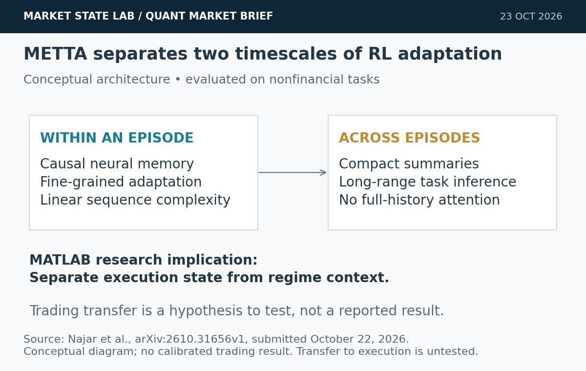
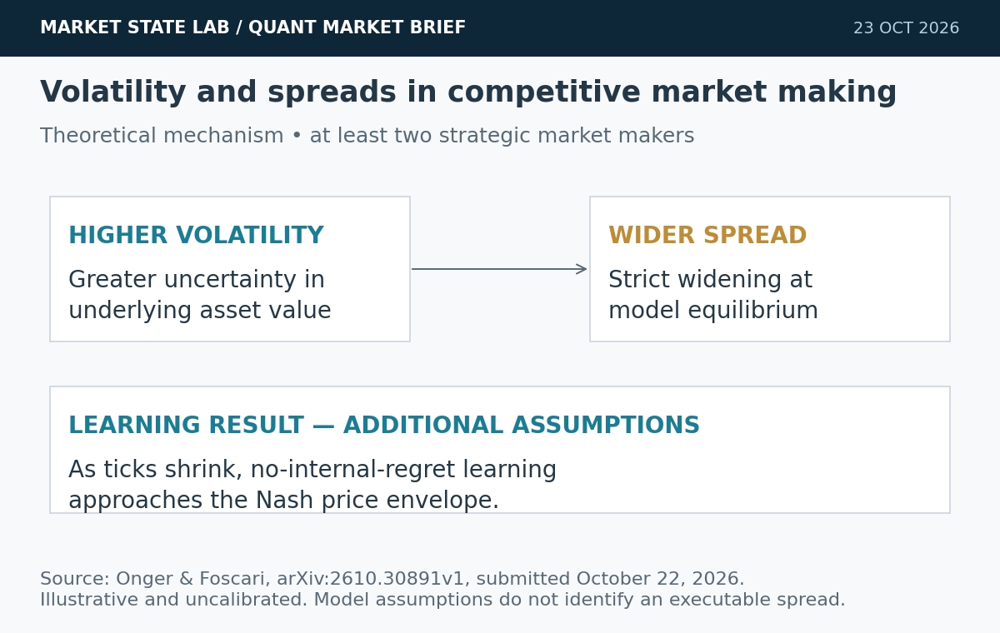
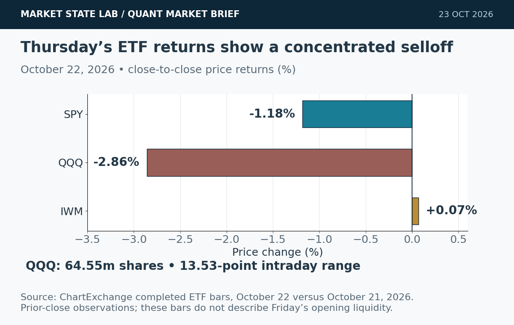
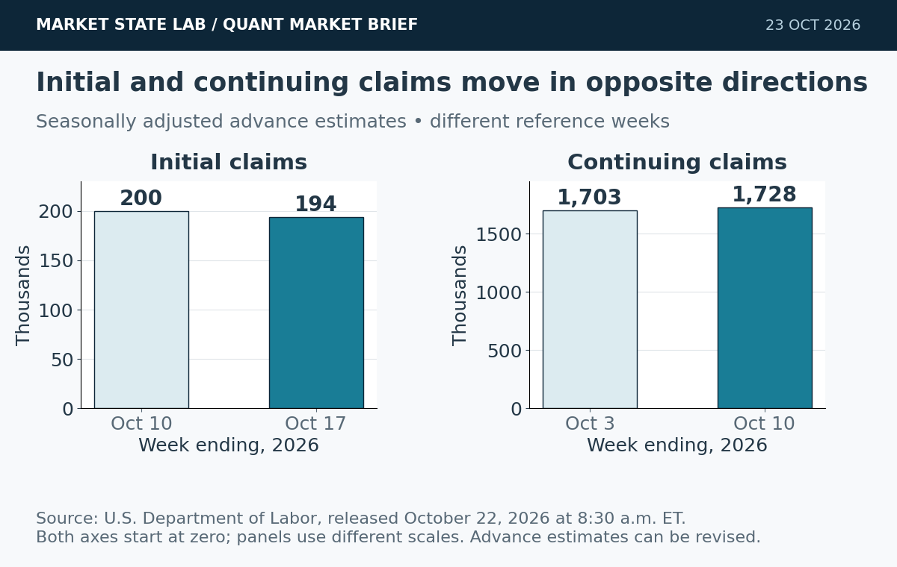
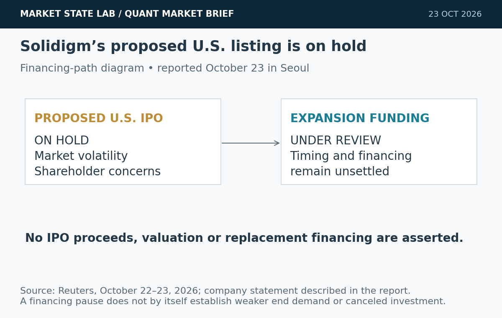

# Quant Market Brief — October 23, 2026: Adaptive Memory & Tech Rotation

Research cutoff: **October 23, 2026, 6:41 a.m. CT (11:41 UTC)**. ETF/factor/VIX data are **October 22 prior-close**; futures are **indicative**; funding fixings lag. No live consolidated depth, options-skew or dealer-gamma feed was verified.

[Subscribe to Quant Market Brief by email](https://market-state-lab.ghost.io/?utm_source=github&utm_medium=technical_archive&utm_campaign=qmb_2026-10-23#/portal/signup).

## 1. METTA splits RL adaptation into within-episode memory and cross-episode summaries

*Graphic: Market State Lab; Najar et al., arXiv:2610.31656v1, October 22, 2026. Conceptual mechanism; no calibrated trading result.*

**Date:** Submitted October 22, 2026, 17:58 UTC.

**Fact:** The new METTA preprint combines causal neural memory with compact episode summaries to support two timescales of meta-RL adaptation. The authors report linear sequence complexity for within-episode memory and evaluate held-out Meta-World and sparse-reward PointMaze tasks. [Direct source](https://arxiv.org/abs/2610.31656)

**Inference:** Separate short-lived execution state from persistent regime context when designing a MATLAB agent.

**Uncertainty:** This is a preprint tested on nonfinancial tasks. Its reported adaptation results do not establish trading performance or safe online policy updates.

**Why it matters:** Prototype the memory architecture in a frozen simulator; compare it with a recurrent baseline using identical information, costs and risk limits before allowing adaptation in production.

## 2. Competitive market-making model links volatility to wider equilibrium spreads

*Graphic: Market State Lab; Onger & Foscari, arXiv:2610.30891v1, October 22, 2026. Theoretical mechanism, illustrative and uncalibrated.*

**Date:** Submitted October 22, 2026, 08:09 UTC.

**Fact:** A new preprint studies at least two strategic market makers facing one representative trader. It proves existence of a pure-strategy Nash equilibrium under stated assumptions and a strictly wider equilibrium spread as asset-value volatility rises. Its discretized learning result requires an additional regularity condition. [Direct source](https://arxiv.org/abs/2610.30891)

**Inference:** Fixed-spread execution simulators can understate costs precisely when uncertainty rises.

**Uncertainty:** This is a stylized theoretical model with numerical simulations, not a calibrated SPY/QQQ order book or evidence that learned quoting will be profitable.

**Why it matters:** Condition simulated spreads and fill probabilities on measured volatility and competition. Stress-test tick size, adverse selection and cancellation latency rather than treating the theorem as a quoting rule.

## 3. Thursday’s tech selloff leaves SPY down 1.18% and QQQ down 2.86%

*Graphic: Market State Lab; ChartExchange completed October 22, 2026 ETF bars. Price returns versus October 21; not futures or intraday quotes.*

**Date:** October 22 close; Reuters report updated 4:48 p.m. ET.

**Fact:** Reuters reported the Nasdaq Composite fell 2.60%, the S&P 500 1.21%, while the Dow edged up 0.02% on October 22. Completed ETF bars show SPY at 763.96 (−1.181%), QQQ at 704.47 (−2.859%) and IWM at 276.67 (+0.069%). [Direct source](https://www.marketscreener.com/news/s-p-500-nasdaq-end-sharply-lower-as-revived-ai-doubts-ignite-tech-selloff-ce785cdedc80ff25)

**Inference:** The selloff was concentrated: cap-weighted technology exposure obscured resilience elsewhere.

**Uncertainty:** These are prior-close observations. They do not identify Friday’s opening-auction liquidity, executable ETF basis or dealer positioning.

**Why it matters:** Decompose index risk by concentration and factor exposure. Refresh ETF/futures basis and the opening book; Thursday’s volume does not guarantee Friday’s fill quality.

## 4. Initial claims fall to 194,000 while continuing claims rise

*Graphic: Market State Lab; U.S. Department of Labor, October 22, 2026. Seasonally adjusted advance estimates; panels have separate scales and reference weeks.*

**Date:** Released October 22, 2026, 8:30 a.m. ET.

**Fact:** DOL reported seasonally adjusted initial claims of 194,000 for the week ending October 17, down 6,000 from a revised 200,000. Continuing claims increased 25,000 to 1.728 million for the week ending October 10; the four-week initial-claims average was 197,750. [Direct source](https://www.dol.gov/sites/dolgov/files/OPA/newsreleases/ui-claims/20261613.pdf)

**Inference:** Low layoffs can coexist with slower re-employment; the two series measure different parts of labor-market adjustment.

**Uncertainty:** Both advance estimates can be revised, and their reference weeks differ. Claims alone do not establish hiring strength or a Federal Reserve decision.

**Why it matters:** Store release vintages and separate layoff pressure from re-employment duration. Do not combine the two weeks as if they were synchronous observations.

## 5. SK Hynix pauses Solidigm’s proposed U.S. listing

*Graphic: Market State Lab; Reuters, October 22–23, 2026. Financing-path diagram; no IPO proceeds or valuation are asserted.*

**Date:** Reported October 23 in Seoul; Reuters timestamp October 22, 21:57 UTC.

**Fact:** SK Hynix said it put Solidigm’s proposed U.S. IPO on hold amid market volatility and shareholder concerns. The company said it would keep reviewing expansion financing. [Direct source](https://www.reuters.com/world/asia-pacific/sk-hynix-drops-us-ipo-plan-solidigm-newspaper-reports-2026-10-22/)

**Inference:** Capital access and AI demand should be modeled separately.

**Uncertainty:** Alternative funding and timing remain unsettled.

**Why it matters:** Stress-test semiconductor exposures for financing delays without assuming weaker end demand.

## Quant & Market Dashboard

### Liquidity, funding and volatility

- **Overnight, indicative:** at **6:35 a.m. ET / 5:35 a.m. CT on October 23**, reported Dow futures were −0.6%, S&P 500 futures −0.2% and Nasdaq-100 futures −0.01%. The ten-year Treasury yield was near 4.97%. These are dated press snapshots, not live executable quotes. [Market snapshot](https://markets.businessinsider.com/news/stocks/stock-market-futures-brent-crude-oil-price-nasdaq-tech-ai-2026-10).
- **Completed October 22 ETF liquidity proxies:** SPY volume **54.12m**, range **6.55 points**; QQQ volume **64.55m**, range **13.53 points**. QQQ volume was about twice October 21’s 32.48m. High volume alongside a wide range can reflect adverse selection rather than easy execution. [SPY history](https://chartexchange.com/symbol/nyse-spy/historical/) · [QQQ history](https://chartexchange.com/symbol/nasdaq-qqq/historical/).
- **Funding, October 21 fixings:** SOFR **3.88%**, EFFR **3.88%**. Stable aggregate lagged fixings are a cautious proxy; they cannot establish current repo depth, dealer balance-sheet availability or absence of funding stress. [FRED SOFR](https://fred.stlouisfed.org/series/SOFR) · [FRED EFFR](https://fred.stlouisfed.org/series/EFFR).
- **Volatility regime: Moderate, with elevated gap/execution risk; medium confidence.** October 22 VIX closed **19.03**, up **14.09%**, after an intraday high of **20.31**. This house classification uses the sub-20 close together with a rising volatility level and a sharp tech drawdown; it is not a Cboe regime label. Friday’s current VIX, term structure, skew and dealer gamma were not verified. [VIX history](https://chartexchange.com/symbol/index-vix/historical/).
- **Unavailable:** reliable current futures/ETF spreads, displayed depth, overnight volume, opening imbalances and option-chain liquidity. Use the completed bars above as historical context; require fresh broker/venue quotes before an execution decision. Alpha Vantage requests returned rate-limit/entitlement errors.

### Factor performance proxies

| Factor | Proxy | October 22 daily | September 23→October 22 |
|---|---|---:|---:|
| Momentum | [MTUM](https://stockanalysis.com/etf/mtum/history/) | -3.67% | -8.95% |
| Value | [VLUE](https://stockanalysis.com/etf/vlue/history/) | -0.35% | -3.63% |
| Quality | [QUAL](https://stockanalysis.com/etf/qual/history/) | -0.65% | +1.10% |
| Size | [IWM](https://stockanalysis.com/etf/iwm/history/) | +0.07% | -1.86% |
| Growth | [IWF](https://stockanalysis.com/etf/iwf/history/) | -2.79% | -4.23% |
| Low volatility | [SPLV](https://stockanalysis.com/etf/splv/history/) | +2.19% | +6.76% |

All returns are recomputed from displayed completed-session **unadjusted closes**, excluding cash distributions. The common medium window spans roughly four weeks. These are ETF exposures, not isolated factor premia or total returns. The medium SPLV return excludes its intervening distribution. Read: momentum/growth bore the daily drawdown; low volatility gained and also led this medium window. Quality was positive over the medium window despite Thursday’s loss. Future-effective corporate actions must not be applied early.

### Execution and microstructure

- **8:30 a.m. CT cash open:** refresh SPY/QQQ NBBO, ES/NQ basis, auction imbalances, quote age and depth. Prefer bounded limit orders and capped participation; wait when spreads, cancellations or impact exceed the model’s supported range. A stable indicative future can coexist with a fragile ETF opening book.
- **8:45 a.m. CT flash PMIs; 9:00 a.m. CT Michigan final sentiment:** scheduled release windows, not known results at this cutoff. Refresh the calendar immediately before trading and isolate pre-/post-release observations. [Calendar reporting](https://www.marketwatch.com/livecoverage/stock-market-today-s-p-500-nasdaq-tech-selloff-dow-oil-prices-higher/card/nasdaq-set-to-rise-after-700-point-drop-on-tech-selloff-qkRqm6sBT9dHq0e0LXbP).
- Friday short-dated expiries can amplify local hedging flows, but expiry alone does not reveal gamma sign, pinning or likely direction. Check each contract’s expiration, exercise/settlement terms, current bid/ask, size and timestamp. Use combo limits for spreads; stale marks and last-sale prices are liquidity traps.
- Separate concentrated tech shocks from broad market state. Re-estimate costs after a volatility jump and validate passive-fill assumptions against adverse selection, queue position and cancel latency.

**Research watchlist:** SPY, QQQ, RSP, IWM, TLT; ES, NQ, ZN, VX; MTUM, VLUE, QUAL, IWF, SPLV; SOXX, XLK, XLU. Symbols indicate monitoring scope, not trade recommendations.

### DRL Improvements for the MATLAB System

1. Enforce drawdown, exposure, concentration and liquidity limits outside the policy; add a stale-data and unsupported-regime action gate to preserve capital.
2. Separate fast execution memory from slower regime summaries. Freeze policy weights during the evaluation window and compare adaptive state updates with a matched recurrent baseline.
3. Reward net execution quality after spread, impact, missed fills, latency and inventory risk. Condition cost distributions on volatility and quote competition, using observed ranges rather than an assumed constant spread.
4. Use purged, embargoed walk-forward tests with paired seeds and untouched gap days. Require robustness across calm, transition and volatile regimes before promoting a policy.

### Model hygiene

Use point-in-time universes and release vintages to prevent leakage, survivorship and look-ahead bias. Align features by availability, not reference date; adjust splits/dividends causally. Reject stale options quotes and crossed timestamp/expiry joins. Control multiple testing and report confidence intervals. Audit calibration, state-memory carryover and feature/cost drift; reset or quarantine memory at walk-forward boundaries.

### MATLAB optimization patterns

- Use timezone-aware `timetable` data with causal `synchronize`/`retime`; assert feature availability at every decision.
- Vectorize rolling features, preallocate trajectory logs and profile memory/state updates before parallelization.
- Parallelize independent folds or `bayesopt` trials with reproducible random streams; keep holdouts immutable.
- Use GPUs for sufficiently large neural batches; keep data, memory, environment, execution and risk-control modules independently testable.

### High-value quant research question

**Does volatility-conditioned spread and fill modeling change the out-of-sample ranking of adaptive-memory and recurrent execution policies?**

It is worth testing because an apparent memory advantage may come from misspecified execution costs. Hold signals, risk limits and information timing fixed; compare net implementation shortfall, fill rate, turnover and tail loss across purged walk-forward folds.

[Subscribe to Quant Market Brief by email](https://market-state-lab.ghost.io/?utm_source=github&utm_medium=technical_archive&utm_campaign=qmb_2026-10-23#/portal/signup).

*Research and education only—not individualized financial advice. No trading performance is promised. Market, model, liquidity and event risks remain.*
