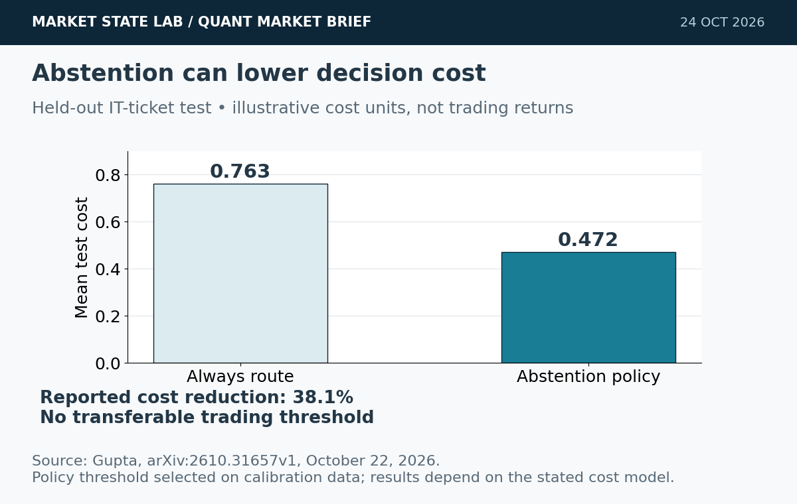
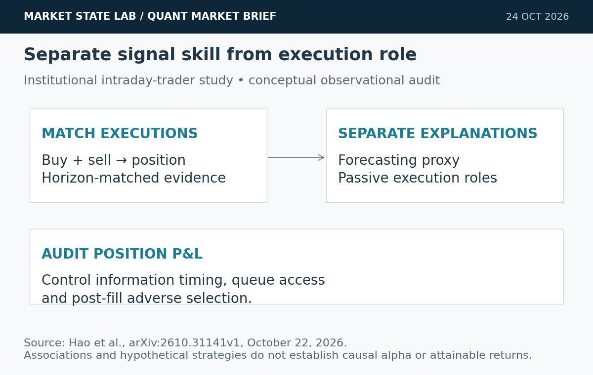
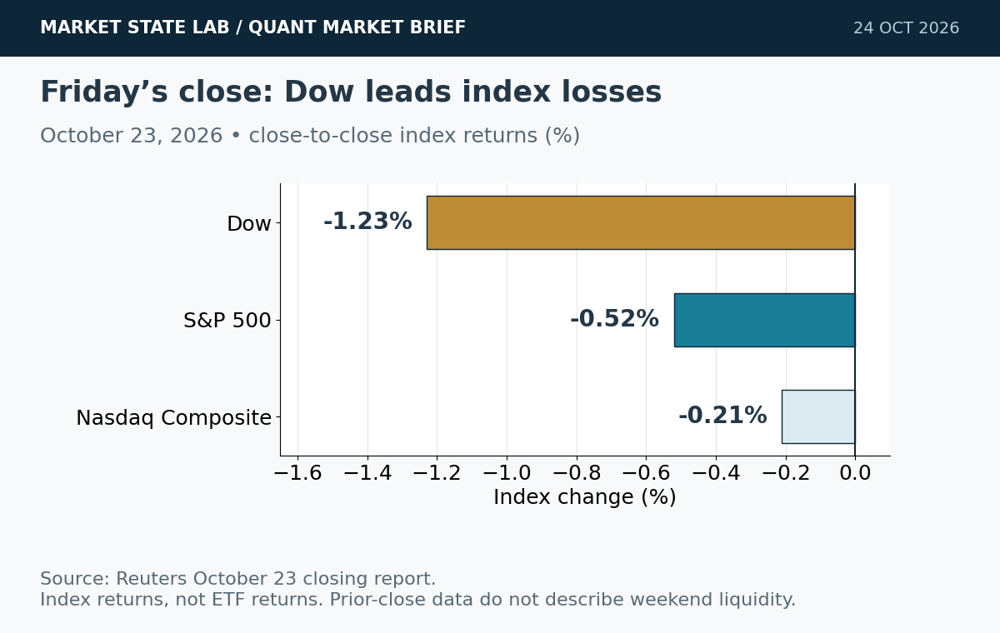
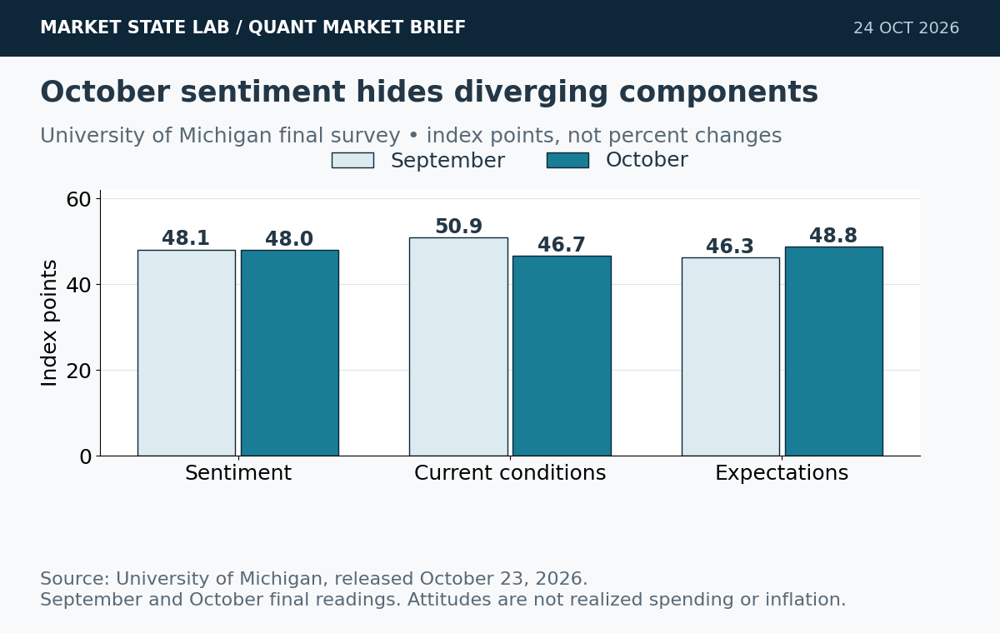
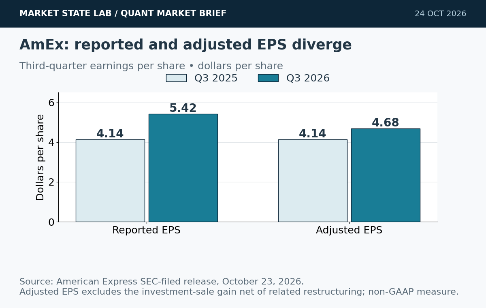

# Quant Market Brief — October 24, 2026: Cost-Aware AI & Consumer Divergence

Research cutoff: **October 24, 2026, 6:38 a.m. CT (11:38 UTC)**. U.S. cash markets are closed for the weekend. ETF, index and VIX figures are **October 23 prior-close**, not live weekend quotes; funding fixings lag.

[Subscribe by email](https://market-state-lab.ghost.io/?utm_source=github&utm_medium=technical_archive&utm_campaign=qmb_2026-10-24#/portal/signup).

## 1. Cost-aware abstention beats automatic routing in a new AI evaluation

*Graphic: Market State Lab; Gupta, arXiv:2610.31657v1, October 22, 2026. Illustrative IT-ticket cost model; not trading returns.*

**Date:** Submitted October 22; listed October 23, 2026.

**Fact:** An ICTAI-accepted paper evaluates frozen, calibration-selected routing policies on an IT-ticket dataset. Under its illustrative cost model, logistic regression with abstention reduced held-out test cost from 0.763 to 0.472, a reported 38.1% reduction. Calibration quality alone did not guarantee useful discrimination. [Direct source](https://arxiv.org/abs/2610.31657)

**Inference:** A no-action gate can be economically useful even without a more complex predictor.

**Uncertainty:** Results are dataset- and cost-specific; they are not trading performance or a universal threshold.

**Why it matters:** Select abstention thresholds using validation-only execution costs, then freeze them for an untouched trading test.

## 2. Institutional-trader study separates forecasting skill from liquidity provision

*Graphic: Market State Lab; Hao et al., arXiv:2610.31141v1, October 22, 2026. Conceptual observational-study map; no causal claim.*

**Date:** Submitted October 22; listed October 23, 2026.

**Fact:** A new preprint matches institutional buy/sell executions into positions and relates profitability to horizon-matched forecasting proxies and passive-execution roles. Its regressions associate both forecasting ability and greater passive participation with higher position profitability. [Direct source](https://arxiv.org/abs/2610.31141)

**Inference:** Execution role can confound a model’s apparent signal advantage.

**Uncertainty:** Observational associations and hypothetical flow-following results are not causal proof or a reproducible retail trading edge; queue access and information timing matter.

**Why it matters:** Log aggressive/passive roles, quote age and post-fill markouts. Compare signal quality after accounting for execution role and selection effects.

## 3. Friday closes lower as the Dow leads losses and technology steadies

*Graphic: Market State Lab; Reuters October 23, 2026 closing report. Index returns, not ETF returns or weekend quotes.*

**Date:** October 23, 2026 completed U.S. cash session.

**Fact:** Friday’s Dow fell 1.23%, S&P 500 0.52% and Nasdaq Composite 0.21%. Completed ETF bars show SPY 759.97 (−0.522%) and QQQ 704.40 (−0.010%). These are different indexes and instruments, so their returns need not match. [Direct source](https://www.reuters.com/business/wall-street-futures-dip-after-ai-rout-telecoms-slide-2026-10-23/)

**Inference:** Friday’s near-flat QQQ close suggests stabilization after Thursday’s sharp decline, not a confirmed recovery.

**Uncertainty:** Prior-close prices cannot establish weekend executable liquidity or Monday’s opening gap.

**Why it matters:** Preserve Friday’s close as the reference state, then reprice futures basis, ETF spreads and options on reopening.

## 4. October sentiment stays depressed as inflation expectations rise

*Graphic: Market State Lab; University of Michigan final October 2026 survey, released October 23. Index points, not percentage changes.*

**Date:** Final October survey released October 23, 2026.

**Fact:** Michigan’s final sentiment index was 48.0 versus September’s 48.1. Current conditions fell to 46.7 from 50.9 while expectations rose to 48.8 from 46.3. One-year inflation expectations increased to 4.7% from 4.6%; long-run expectations rose to 3.5% from 3.4%. [Direct source](https://www.sca.isr.umich.edu/)

**Inference:** Weak household sentiment and rising inflation expectations complicate a simple growth-versus-inflation policy signal.

**Uncertainty:** Survey attitudes are not realized spending or inflation; the final 48.0 supersedes the preliminary 46.3.

**Why it matters:** Version preliminary and final releases separately and retain component detail rather than training on a revised headline as if it were known earlier.

## 5. American Express raises EPS guidance; reported and adjusted growth differ

*Graphic: Market State Lab; American Express SEC-filed October 23, 2026 release. Reported and adjusted EPS are separate measures.*

**Date:** Third-quarter results released October 23, 2026.

**Fact:** American Express reported revenue of 20.1 billion dollars, up 9%, and EPS of 5.42 dollars versus 4.14 a year earlier. Adjusted EPS was 4.68 dollars, up 13%, excluding the net impact of its Global Business Travel investment-sale gain and related restructuring. It raised full-year EPS guidance. [Direct source](https://www.sec.gov/Archives/edgar/data/4962/000000496226000405/q326exhibit991.htm)

**Inference:** Premium-customer spending can remain resilient while aggregate household sentiment is weak.

**Uncertainty:** The customer base is not representative of all consumers, and reported EPS includes discrete items.

**Why it matters:** Separate recurring growth from gains and restructuring; do not use one issuer’s results as a broad consumption proxy.

## Quant & Market Dashboard

### Liquidity, funding and volatility

- **Weekend liquidity:** No live consolidated futures/ETF spread, depth, overnight volume or auction feed was verified. Treat Friday’s data as historical context. Traditional U.S. cash trading is closed; verify venue-specific futures and overnight-ETF reopening hours before submitting orders. Do not carry Friday’s quote forward as executable liquidity.
- **October 23 completed ETF bars:** SPY volume **33.42m**, range **4.79 points**; QQQ volume **30.22m**, range **8.14 points**. Volumes fell from Thursday’s 54.12m/64.55m, but lower volume does not prove lower impact. [SPY](https://chartexchange.com/symbol/nyse-spy/historical/) · [QQQ](https://chartexchange.com/symbol/nasdaq-qqq/historical/).
- **Funding, October 22 fixings:** SOFR **3.90%**, up two basis points; EFFR **3.88%**, unchanged. A two-basis-point aggregate move is not sufficient evidence of funding stress. [SOFR](https://fred.stlouisfed.org/series/SOFR) · [EFFR](https://fred.stlouisfed.org/series/EFFR).
- **Treasury proxy:** Reuters reported the ten-year yield around **4.99%** Friday. This dated yield signal supplies no current Treasury spread or depth information. [Reuters](https://www.reuters.com/world/china/global-markets-global-markets-2026-10-23/).
- **Volatility regime: Moderate with elevated reopening-gap risk; medium confidence.** VIX closed **19.45**, up **2.21%**, after reaching **20.66** Friday. This is a house classification based on the sub-20 close and elevated recent swings. Current term structure, skew and dealer gamma were unavailable. [VIX history](https://chartexchange.com/symbol/index-vix/historical/).

### Factor performance proxies

| Factor | ETF | October 23 daily | September 23→October 23 |
|---|---|---:|---:|
| Momentum | [MTUM](https://stockanalysis.com/etf/mtum/history/) | +0.30% | -8.68% |
| Value | [VLUE](https://stockanalysis.com/etf/vlue/history/) | -0.31% | -3.93% |
| Quality | [QUAL](https://stockanalysis.com/etf/qual/history/) | -0.78% | +0.31% |
| Size | [IWM](https://stockanalysis.com/etf/iwm/history/) | -0.33% | -2.19% |
| Growth | [IWF](https://stockanalysis.com/etf/iwf/history/) | -0.40% | -4.61% |
| Low volatility | [SPLV](https://stockanalysis.com/etf/splv/history/) | -0.98% | +5.70% |

Price returns recomputed from unadjusted closes, excluding cash distributions; these are ETF exposures, not isolated factor premia or total returns. September 23 starting closes are preserved in the dated inputs and October 23 endpoints were freshly checked. Low volatility still led the medium window despite Friday’s loss; momentum’s small rebound left it substantially negative over that window. No future-effective split is applied.

### Execution and microstructure

- At reopening, refresh ES/NQ basis, SPY/QQQ NBBO, quote age, displayed size and auction imbalances. Use bounded limits and capped participation; a quiet prior close does not remove adverse selection or gap risk.
- Friday-expiring options quotes are expired history. Validate Monday’s chain, contract lifecycle, exercise/assignment notices and settlement terms. Reject stale last-sale marks and crossed or one-sided markets; use combo limits for spreads.
- Refresh next week’s macro/earnings calendar before trading. Do not infer dealer-gamma sign or pinning from spot VIX or expiry dates. Test slippage with spreads, missed fills, queue uncertainty and cancellations rather than assuming every passive order fills.

**Research watchlist:** SPY, QQQ, IWM, RSP, TLT; ES, NQ, ZN, VX; MTUM, VLUE, QUAL, IWF, SPLV; SOXX, XLE, AXP. Monitoring scope, not trade recommendations.

### DRL Improvements for the MATLAB System

1. Keep drawdown, exposure and liquidity limits outside the policy; block stale inputs and unsupported market states to preserve capital.
2. Calibrate a cost-aware no-action gate on validation data only; freeze the gate before each untouched walk-forward test.
3. Condition fill probability, adverse selection and spread/impact costs on execution role and volatility. Charge missed fills and cancellation latency realistically.
4. Purge and embargo overlapping labels, use paired random seeds and hold out reopening-gap regimes; compare net shortfall, coverage and tail loss.

### Model hygiene

Use point-in-time universes, availability timestamps and release vintages to prevent leakage, survivorship and look-ahead bias. Reconcile corporate actions causally and retain the unadjusted/adjusted basis explicitly. Reject stale options and expired contracts. Control multiple testing; distinguish calibration from discrimination; monitor feature, cost and policy drift.

### MATLAB optimization patterns

- Use timezone-aware `timetable` inputs and causal `synchronize`/`retime` operations.
- Vectorize rolling features, preallocate logs and profile before parallelization.
- Run independent walk-forward folds or `bayesopt` trials in parallel with reproducible random streams and immutable holdouts.
- Use GPUs for sufficiently large neural batches; separate risk, execution, calibration and environment modules.

### High-value quant research question

**Does a validation-frozen, cost-aware abstention gate improve net execution shortfall and tail loss after realistic passive-fill selection is included?**

This tests whether avoiding low-quality opportunities adds value beyond headline prediction accuracy. Keep signals and risk limits fixed; report trade coverage, rejected opportunities, fill quality and confidence intervals across purged walk-forward folds.

[Subscribe by email](https://market-state-lab.ghost.io/?utm_source=github&utm_medium=technical_archive&utm_campaign=qmb_2026-10-24#/portal/signup).

*Research and education only—not individualized financial advice. No trading performance is promised. Market, model, liquidity and event risks remain.*
