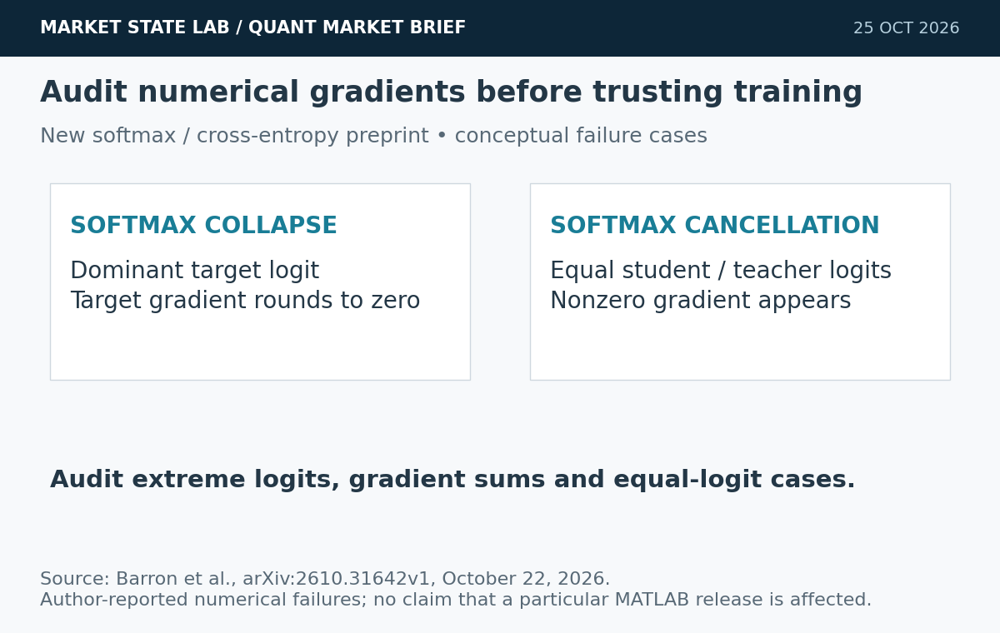
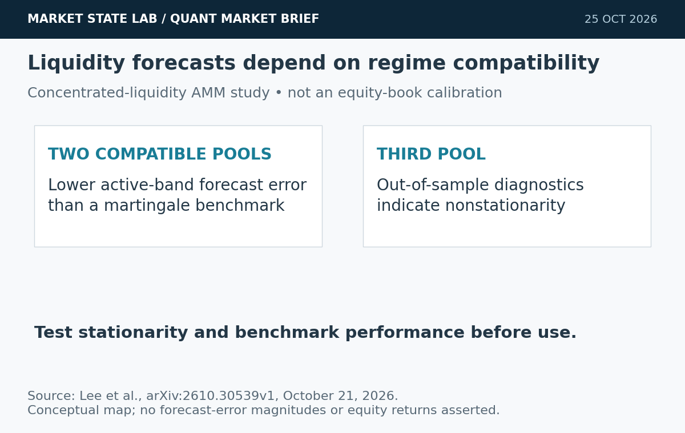
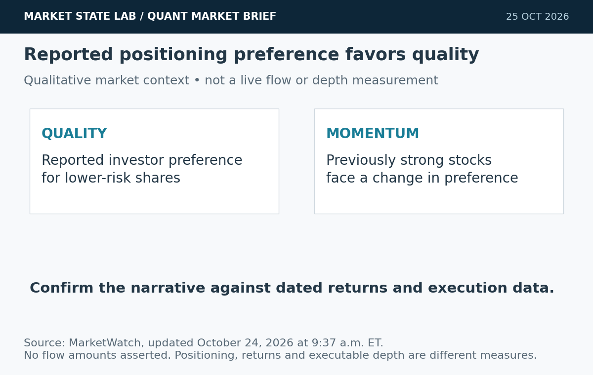
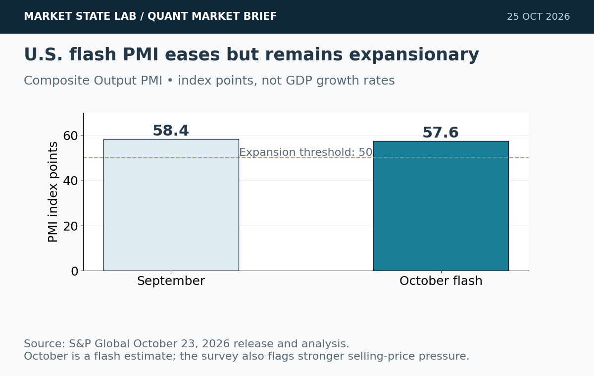
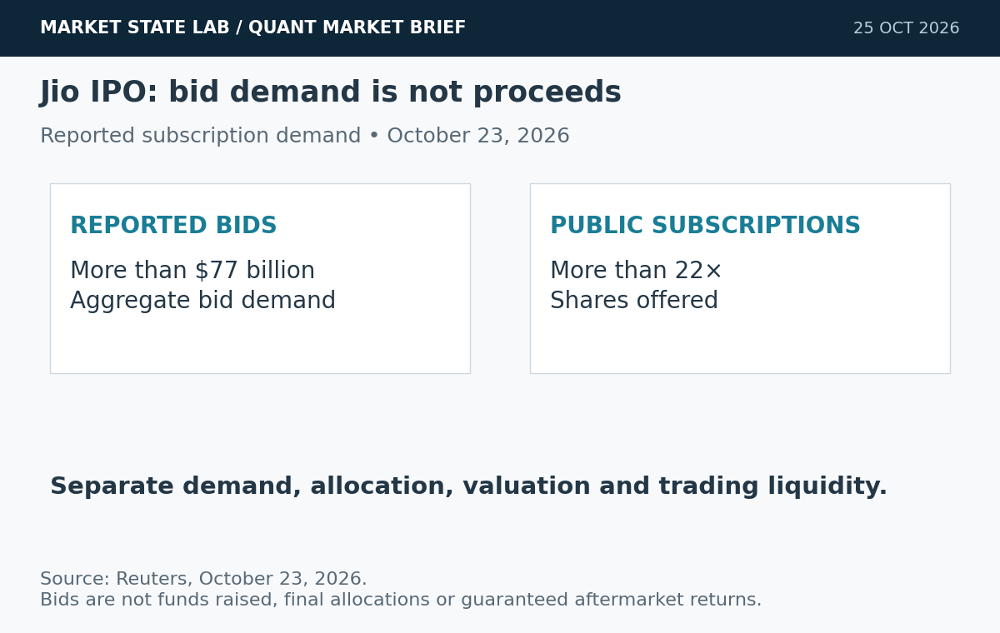

# Quant Market Brief — October 25, 2026: Gradient Integrity & PMI Pressure

Research cutoff: **October 25, 2026, 6:32 a.m. CT (11:32 UTC)**. U.S. cash markets are closed for the weekend. ETF, index and VIX figures are **October 23 prior-close**, not live weekend quotes; funding fixings lag.

[Subscribe by email](https://market-state-lab.ghost.io/?utm_source=github&utm_medium=technical_archive&utm_campaign=qmb_2026-10-25#/portal/signup).

## 1. New softmax paper identifies two numerical gradient failures

*Graphic: Market State Lab; Barron et al., arXiv:2610.31642v1, October 22, 2026. Conceptual numerical-audit diagram.*

**Date:** Submitted October 22, 2026.

**Fact:** A new preprint describes Softmax Collapse, where a dominant target logit can produce a zero target gradient, and Softmax Cancellation, where equal student and teacher logits can produce nonzero gradients. The authors propose corrected implementations and report improvements in their experiments. [Direct source](https://arxiv.org/abs/2610.31642)

**Inference:** Numerical integrity can be a hidden source of training instability.

**Uncertainty:** These are author-reported findings; they do not establish that a particular MATLAB release or your model has either defect.

**Why it matters:** Test extreme logits, gradient-sum consistency and equal teacher/student cases before changing an implementation.

## 2. Concentrated-liquidity model improves forecasts only in compatible regimes

*Graphic: Market State Lab; Lee et al., arXiv:2610.30539v1, October 21, 2026. Conceptual validation map; no calibrated equity-book curve.*

**Date:** Submitted October 21; listed October 23, 2026.

**Fact:** A preprint models concentrated-liquidity profiles with a stochastic partial integro-differential equation. Calibration on three Uniswap pools improved active-band forecasting versus a martingale benchmark on two pools compatible with the stationary specification; the third showed out-of-sample nonstationarity. [Direct source](https://arxiv.org/abs/2610.30539)

**Inference:** Liquidity level, slope and curvature may be useful states, provided regime compatibility is checked.

**Uncertainty:** This AMM study does not validate a U.S. equity order-book model or establish profitable trading.

**Why it matters:** Compare structural forecasts with a simple benchmark and quarantine a model when stationarity diagnostics fail.

## 3. Investors’ preference shifts toward quality over momentum

*Graphic: Market State Lab; MarketWatch analysis, updated October 24, 2026. Qualitative positioning schematic; no flow amounts asserted.*

**Date:** MarketWatch analysis updated October 24, 2026, 9:37 a.m. ET.

**Fact:** MarketWatch reports a recent investor preference for quality shares over previously strong momentum stocks. [Direct source](https://www.marketwatch.com/story/investors-recent-money-moves-show-a-preference-for-quality-over-momentum-within-the-s-p-500-ed6b5149)

**Inference:** Portfolio demand can change before a factor’s longer-term performance ranking reverses.

**Uncertainty:** The accessible report does not establish current SPY/QQQ depth or synchronized flows for our proxy ETFs.

**Why it matters:** Separate flow narratives from measured returns and execution conditions.

## 4. Flash PMI remains strong as selling-price pressures intensify

*Graphic: Market State Lab; S&P Global, October 23, 2026. Composite Output PMI index points; October is a flash estimate.*

**Date:** S&P Global October flash release and analysis, October 23, 2026.

**Fact:** S&P Global’s flash U.S. Composite Output PMI eased to 57.6 from September’s 58.4, remaining above the 50 expansion threshold. Its analysis also reported intensifying supply constraints and the sharpest selling-price increase in more than four years. [Direct source](https://www.spglobal.com/market-intelligence/en/news-insights/research/2026/10/us-flash-pmi-signals-sustained-strong-growth-but-also-further-inflation-uplift-in-october)

**Inference:** Growth resilience and inflation pressure can coexist, complicating a simple easing narrative.

**Uncertainty:** Flash survey estimates are revisable and are not realized GDP or CPI.

**Why it matters:** Retain output and price components separately and use release-time vintages in macro-conditioned models.

## 5. Jio’s IPO attracts more than $77 billion in bids

*Graphic: Market State Lab; Reuters, October 23, 2026. Bid demand and subscription multiple are separate measures.*

**Date:** Reuters report updated October 23, 2026.

**Fact:** Reuters reported more than $77 billion in bids for Jio Platforms’ IPO and public subscriptions exceeding 22 times the shares offered. [Direct source](https://www.reuters.com/business/finance/ambanis-32-billion-jio-indian-ipo-lures-investors-bids-surge-final-day-2026-10-23/)

**Inference:** Demand for a large digital platform can remain strong despite pressure elsewhere in technology.

**Uncertainty:** Bids are not proceeds or guaranteed aftermarket returns.

**Why it matters:** Separate subscription demand, allocation, valuation and post-listing liquidity.

## Quant & Market Dashboard

### Liquidity, funding and volatility

- **Weekend liquidity:** No live consolidated futures/ETF spread, depth, overnight volume or auction feed was verified. Treat Friday’s data as historical context. Traditional U.S. cash trading is closed; verify venue-specific futures and overnight-ETF reopening hours before submitting orders. Do not carry Friday’s quote forward as executable liquidity.
- **October 23 completed ETF bars:** SPY volume **33.42m**, range **4.79 points**; QQQ volume **30.22m**, range **8.14 points**. Volumes fell from Thursday’s 54.12m/64.55m, but lower volume does not prove lower impact. [SPY](https://chartexchange.com/symbol/nyse-spy/historical/) · [QQQ](https://chartexchange.com/symbol/nasdaq-qqq/historical/).
- **Funding, October 22 fixings:** SOFR **3.90%**, up two basis points; EFFR **3.88%**, unchanged. A two-basis-point aggregate move is not sufficient evidence of funding stress. [SOFR](https://fred.stlouisfed.org/series/SOFR) · [EFFR](https://fred.stlouisfed.org/series/EFFR).
- **Treasury proxy:** Reuters reported the ten-year yield around **4.99%** Friday. This dated yield signal supplies no current Treasury spread or depth information. [Reuters](https://www.reuters.com/world/china/global-markets-global-markets-2026-10-23/).
- **Volatility regime: Moderate with elevated reopening-gap risk; medium confidence.** VIX closed **19.45**, up **2.21%**, after reaching **20.66** Friday. This is a house classification based on the sub-20 close and elevated recent swings. Current term structure, skew and dealer gamma were unavailable. [VIX history](https://chartexchange.com/symbol/index-vix/historical/).

### Factor performance proxies

| Factor | ETF | October 23 daily | September 23→October 23 |
|---|---|---:|---:|
| Momentum | [MTUM](https://stockanalysis.com/etf/mtum/history/) | +0.30% | -8.68% |
| Value | [VLUE](https://stockanalysis.com/etf/vlue/history/) | -0.31% | -3.93% |
| Quality | [QUAL](https://stockanalysis.com/etf/qual/history/) | -0.78% | +0.31% |
| Size | [IWM](https://stockanalysis.com/etf/iwm/history/) | -0.33% | -2.19% |
| Growth | [IWF](https://stockanalysis.com/etf/iwf/history/) | -0.40% | -4.61% |
| Low volatility | [SPLV](https://stockanalysis.com/etf/splv/history/) | -0.98% | +5.70% |

Price returns recomputed from unadjusted closes, excluding cash distributions; these are ETF exposures, not isolated factor premia or total returns. This factor snapshot is carried forward from the October 24 archive because no newer U.S. cash session has occurred. SPY/QQQ, VIX and funding observations were freshly rechecked; no new factor returns are implied. Low volatility still led the medium window despite Friday’s loss; momentum’s small rebound left it substantially negative over that window. No future-effective split is applied.

### Execution and microstructure

- At reopening, refresh ES/NQ basis, SPY/QQQ NBBO, quote age, displayed size and auction imbalances. Use bounded limits and capped participation; a quiet prior close does not remove adverse selection or gap risk.
- Friday-expiring options quotes are expired history. Sunday reopening can reset basis before Monday’s cash auction. Validate Monday’s chain, contract lifecycle, exercise/assignment notices and settlement terms. Reject stale last-sale marks and crossed or one-sided markets; use combo limits for spreads.
- Refresh next week’s macro/earnings calendar before trading. Do not infer dealer-gamma sign or pinning from spot VIX or expiry dates. Test slippage with spreads, missed fills, queue uncertainty and cancellations rather than assuming every passive order fills.

**Research watchlist:** SPY, QQQ, IWM, RSP, TLT; ES, NQ, ZN, VX; MTUM, VLUE, QUAL, IWF, SPLV; SOXX, XLE, AXP. Monitoring scope, not trade recommendations.

### DRL Improvements for the MATLAB System

1. Keep drawdown, exposure and liquidity limits outside the policy; block stale inputs and unsupported market states to preserve capital.
2. Add targeted numerical-loss checks for extreme logits, gradient sums and equal student/teacher logits; investigate failures before altering the training stack.
3. Test liquidity-profile level, slope and curvature as state features; require regime-compatibility gates and realistic spreads, impact, missed fills and latency.
4. Purge and embargo overlapping labels, use paired random seeds and hold out reopening-gap regimes; compare net shortfall, coverage and tail loss.

### Model hygiene

Use point-in-time universes, availability timestamps and release vintages to prevent leakage, survivorship and look-ahead bias. Reconcile corporate actions causally and retain the unadjusted/adjusted basis explicitly. Reject stale options and expired contracts. Control multiple testing; distinguish calibration from discrimination; monitor feature, cost and policy drift.

### MATLAB optimization patterns

- Use timezone-aware `timetable` inputs and causal `synchronize`/`retime` operations.
- Vectorize rolling features, preallocate logs and profile before parallelization.
- Run independent walk-forward folds or `bayesopt` trials in parallel with reproducible random streams and immutable holdouts.
- Use GPUs for sufficiently large neural batches; separate risk, execution, calibration and environment modules.

### High-value quant research question

**Do numerical gradient checks and regime-compatibility gates improve policy stability after liquidity shifts?**

Separate numerical failure from distribution shift. Hold architecture, data and risk limits fixed; compare gradient diagnostics, policy drift, net shortfall and tail loss across purged walk-forward folds.

[Subscribe by email](https://market-state-lab.ghost.io/?utm_source=github&utm_medium=technical_archive&utm_campaign=qmb_2026-10-25#/portal/signup).

*Research and education only—not individualized financial advice. No trading performance is promised. Market, model, liquidity and event risks remain.*
