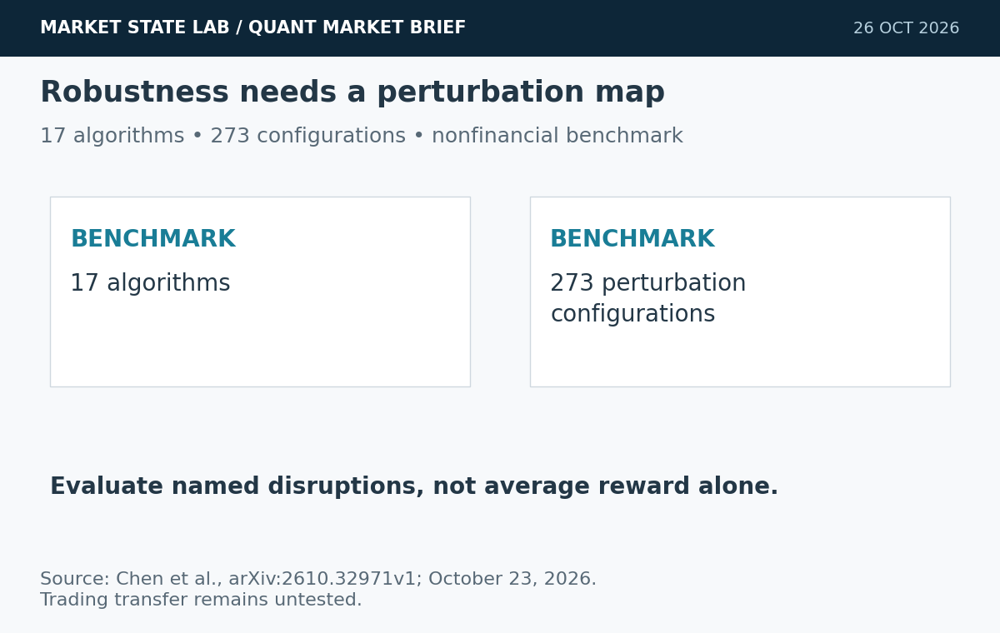
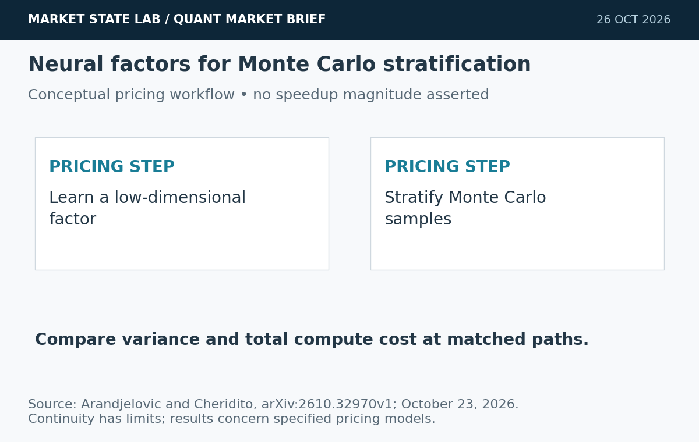
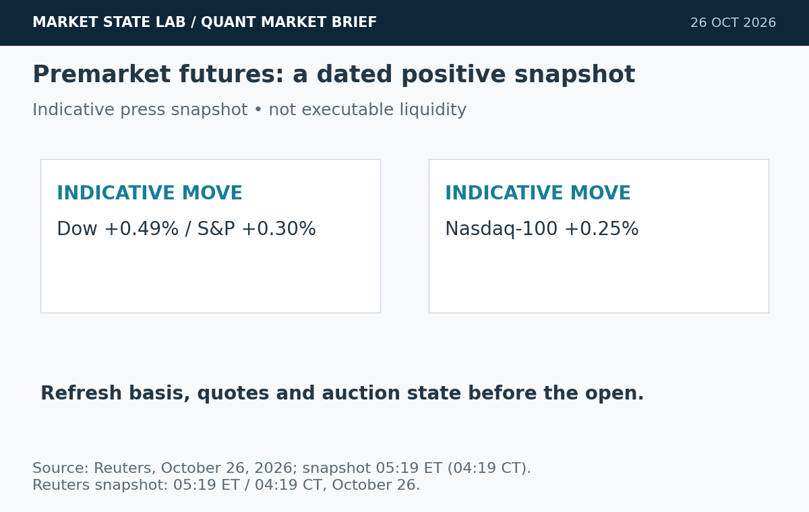
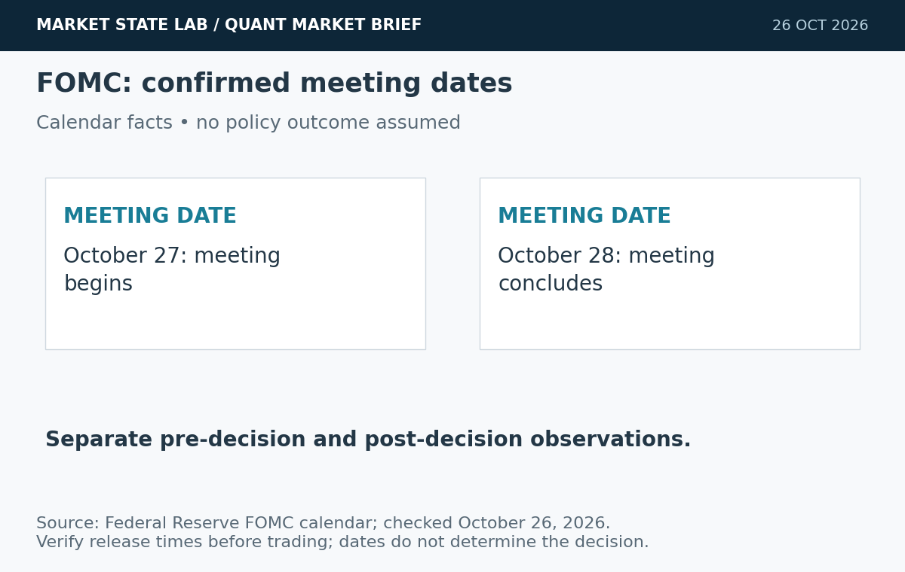
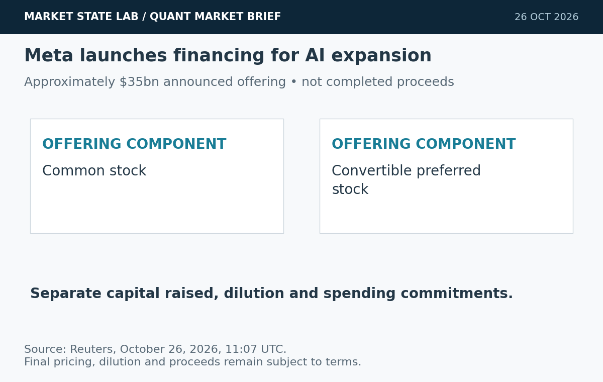

# Quant Market Brief — October 26, 2026: Robust RL & AI Financing

Research cutoff: **October 26, 2026, 6:33 a.m. CT (11:33 UTC)**. Futures are dated indicative press snapshots; ETF/factor figures are **October 23 prior-close**; VIX is delayed and funding fixings lag. No live depth or spread feed verified.

[Subscribe by email](https://market-state-lab.ghost.io/?utm_source=github&utm_medium=technical_archive&utm_campaign=qmb_2026-10-26#/portal/signup).

## 1. RobustRLlib maps the limits of robust reinforcement learning

*Graphic: Market State Lab; Chen et al., arXiv:2610.32971v1; October 23, 2026. Conceptual evidence panel.*

**Date:** Submitted October 23; listed October 26.

**Fact:** The preprint integrates 17 robust online, offline and safe RL algorithms and evaluates 273 perturbation configurations, identifying both strengths and remaining robustness gaps. [Direct source](https://arxiv.org/abs/2610.32971)

**Inference:** Robustness should be evaluated across named disruptions rather than summarized by one average reward.

**Uncertainty:** The benchmark includes nonfinancial tasks; it does not validate a trading policy or supply a MATLAB implementation.

**Why it matters:** Build a reproducible perturbation matrix for costs, latency, missing observations and regime shifts.

## 2. Neural stratification targets lower-variance derivative pricing

*Graphic: Market State Lab; Arandjelovic and Cheridito, arXiv:2610.32970v1; October 23, 2026. Conceptual evidence panel.*

**Date:** Submitted October 23; listed October 26.

**Fact:** A preprint establishes continuity results and an approximation theorem for admissible neural stratification factors, with counterexamples limiting the theory. Learned factors outperform the considered benchmarks in two derivative-pricing experiments. [Direct source](https://arxiv.org/abs/2610.32970)

**Inference:** Learned low-dimensional factors may improve Monte Carlo efficiency.

**Uncertainty:** The results concern specified pricing models and proportional allocation, not universal speedups or trading alpha.

**Why it matters:** Compare estimator variance and total compute cost at matched paths, including training overhead.

## 3. Stock futures edge higher ahead of a dense earnings week

*Graphic: Market State Lab; Reuters, October 26, 2026; snapshot 05:19 ET (04:19 CT). Conceptual evidence panel.*

**Date:** Reuters October 26, 10:02 UTC; quote snapshot 05:19 ET.

**Fact:** At 05:19 a.m. ET, Reuters reported Dow futures +0.49%, S&P 500 futures +0.30% and Nasdaq-100 futures +0.25%, alongside easing oil prices. [Direct source](https://www.reuters.com/business/us-stock-futures-edge-up-oil-falls-heading-into-earnings-barrage-2026-10-26/)

**Inference:** An early rebound can coexist with substantial opening-gap and event risk.

**Uncertainty:** These are indicative press snapshots, not current executable prices or measured order-book depth.

**Why it matters:** Refresh futures basis, ETF quotes and auction imbalances before sizing opening orders.

## 4. Fed meeting approaches with October 27–28 dates confirmed

*Graphic: Market State Lab; Federal Reserve FOMC calendar; checked October 26, 2026. Conceptual evidence panel.*

**Date:** Federal Reserve calendar checked October 26.

**Fact:** The official calendar schedules the next FOMC meeting for October 27–28. No October policy decision has yet been released. [Direct source](https://www.federalreserve.gov/monetarypolicy/fomccalendars.htm)

**Inference:** Policy communication can reset rates and equity risk during the coming event window.

**Uncertainty:** The calendar confirms meeting dates, not the decision; market expectations are not a commitment by the Fed.

**Why it matters:** Tag pre-decision and post-decision observations separately and verify release times before execution.

## 5. Meta launches an approximately $35 billion offering

*Graphic: Market State Lab; Reuters, October 26, 2026, 11:07 UTC. Conceptual evidence panel.*

**Date:** Reuters October 26, 11:07 UTC.

**Fact:** Reuters reports that Meta launched roughly $35 billion in common-stock and convertible-preferred offerings to finance AI expansion. [Direct source](https://www.reuters.com/legal/transactional/meta-launches-35-billion-stock-offering-fund-ai-expansion-2026-10-26/)

**Inference:** Financing structure and dilution can matter alongside demand for AI services.

**Uncertainty:** Announced offerings are not confirmed completed proceeds; pricing and final terms matter.

**Why it matters:** Separate capital raised, dilution and future spending commitments in valuation scenarios.

## Quant & Market Dashboard

### Liquidity, funding and volatility

- **Overnight, indicative:** Reuters' 04:19 a.m. CT snapshot showed Dow/S&P/Nasdaq-100 futures +0.49%/+0.30%/+0.25%. No reliable current ETF/futures spreads, depth, overnight volume or auction imbalances were verified. Direction is not liquidity. [Reuters](https://www.reuters.com/business/us-stock-futures-edge-up-oil-falls-heading-into-earnings-barrage-2026-10-26/).
- **October 23 completed ETF bars:** SPY volume **33.42m**, range **4.79 points**; QQQ volume **30.22m**, range **8.14 points**. Volumes fell from Thursday’s 54.12m/64.55m, but lower volume does not prove lower impact. [SPY](https://chartexchange.com/symbol/nyse-spy/historical/) · [QQQ](https://chartexchange.com/symbol/nasdaq-qqq/historical/).
- **Funding, October 22 fixings:** SOFR **3.90%**, up two basis points; EFFR **3.88%**, unchanged. A two-basis-point aggregate move is not sufficient evidence of funding stress. [SOFR](https://fred.stlouisfed.org/series/SOFR) · [EFFR](https://fred.stlouisfed.org/series/EFFR).
- **Treasury signal:** Current executable Treasury spread/depth unavailable. Funding fixings are lagged aggregate proxies, not an order-book measure.
- **Volatility regime: Moderate with elevated reopening-gap risk; medium confidence.** Delayed VIX was **19.56 at 6:29 a.m. ET (5:29 CT)** October 26. Friday VIX closed **19.45**, up **2.21%**, after reaching **20.66** Friday. This is a house classification based on the delayed sub-20 reading and recent swings. Current term structure, skew and dealer gamma were unavailable. [VIX history](https://chartexchange.com/symbol/index-vix/historical/).

### Factor performance proxies

| Factor | ETF | October 23 daily | September 23→October 23 |
|---|---|---:|---:|
| Momentum | [MTUM](https://stockanalysis.com/etf/mtum/history/) | +0.30% | -8.68% |
| Value | [VLUE](https://stockanalysis.com/etf/vlue/history/) | -0.31% | -3.93% |
| Quality | [QUAL](https://stockanalysis.com/etf/qual/history/) | -0.78% | +0.31% |
| Size | [IWM](https://stockanalysis.com/etf/iwm/history/) | -0.33% | -2.19% |
| Growth | [IWF](https://stockanalysis.com/etf/iwf/history/) | -0.40% | -4.61% |
| Low volatility | [SPLV](https://stockanalysis.com/etf/splv/history/) | -0.98% | +5.70% |

Price returns recomputed from unadjusted closes, excluding cash distributions; these are ETF exposures, not isolated factor premia or total returns. This factor snapshot is carried forward from the October 24 archive because no newer U.S. cash session has occurred. SPY/QQQ historical rows, delayed VIX and available funding observations were freshly rechecked; no new factor returns are implied. Low volatility still led the medium window despite Friday’s loss; momentum’s small rebound left it substantially negative over that window. No future-effective split is applied.

### Execution and microstructure

- Before the 8:30 a.m. CT cash open, refresh ES/NQ basis, SPY/QQQ NBBO, quote age, displayed size and auction imbalances. Use bounded limits and capped participation; a quiet prior close does not remove adverse selection or gap risk.
- Friday-expiring options quotes are expired history. Overnight basis can differ from Monday’s cash auction. Validate Monday’s chain, contract lifecycle, exercise/assignment notices and settlement terms. Reject stale last-sale marks and crossed or one-sided markets; use combo limits for spreads.
- Refresh this week’s macro/earnings calendar before trading. Do not infer dealer-gamma sign or pinning from spot VIX or expiry dates. Test slippage with spreads, missed fills, queue uncertainty and cancellations rather than assuming every passive order fills.

**Research watchlist:** SPY, QQQ, IWM, RSP, TLT; ES, NQ, ZN, VX; MTUM, VLUE, QUAL, IWF, SPLV; SOXX, XLE, META, MSFT, GOOGL, AMZN. Monitoring scope, not trade recommendations.

### DRL Improvements for the MATLAB System

1. Keep drawdown, exposure and liquidity limits outside the policy; block stale inputs and unsupported market states to preserve capital.
2. Evaluate a fixed perturbation matrix for missing observations, volatility shifts, latency and liquidity; report worst-case risk and coverage alongside mean reward.
3. Reward results after realistic spreads, impact, missed fills and cancellation delays; retain independent capital-preservation guards.
4. Use purged, embargoed walk-forward folds and paired random seeds; freeze perturbation choices before held-out evaluation.

### Model hygiene

Use point-in-time universes, availability timestamps and release vintages to prevent leakage, survivorship and look-ahead bias. Reconcile corporate actions causally and retain the unadjusted/adjusted basis explicitly. Reject stale options and expired contracts. Control multiple testing; distinguish calibration from discrimination; monitor feature, cost and policy drift.

### MATLAB optimization patterns

- Use timezone-aware `timetable` inputs and causal `synchronize`/`retime` operations.
- Vectorize rolling features, preallocate logs and profile before parallelization.
- Run independent walk-forward folds or `bayesopt` trials in parallel with reproducible random streams and immutable holdouts.
- Use GPUs for sufficiently large neural batches; separate risk, execution, calibration and environment modules.

### High-value quant research question

**Does a validation-frozen perturbation suite change the ranking of robust and ordinary trading policies after realistic costs?**

Report coverage, net shortfall and tail loss on untouched folds. This tests whether robustness survives execution friction instead of merely reducing trading activity.

[Subscribe by email](https://market-state-lab.ghost.io/?utm_source=github&utm_medium=technical_archive&utm_campaign=qmb_2026-10-26#/portal/signup).

*Research and education only—not individualized financial advice. No trading performance is promised.*
