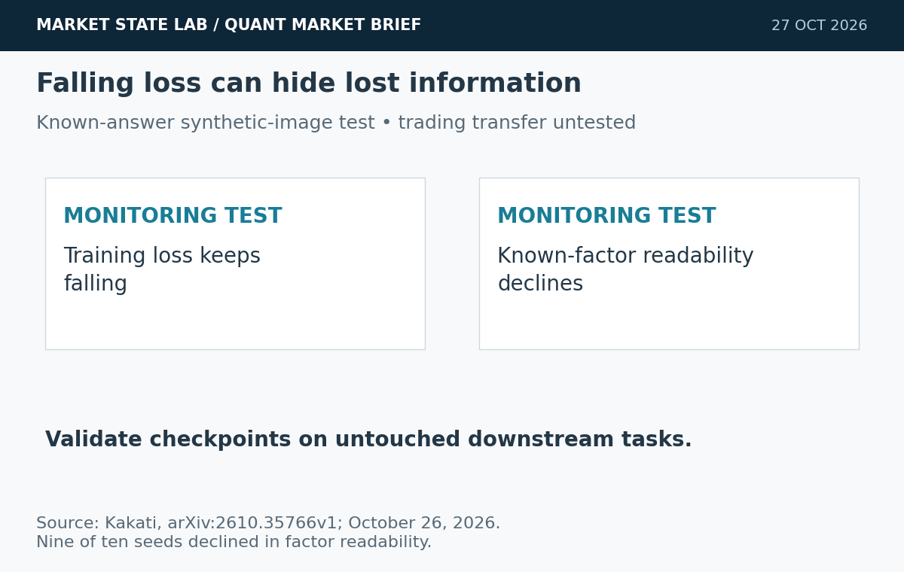
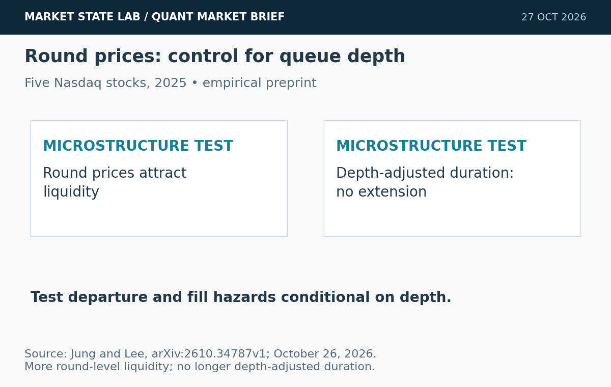
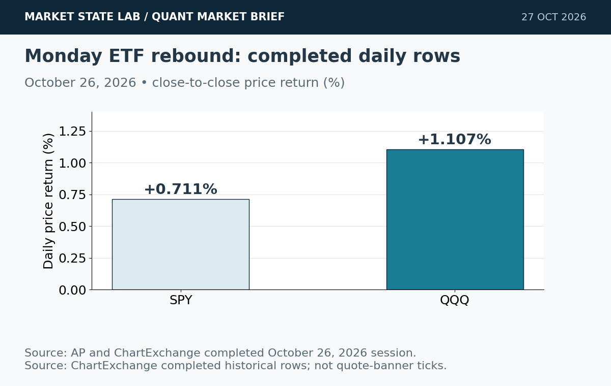
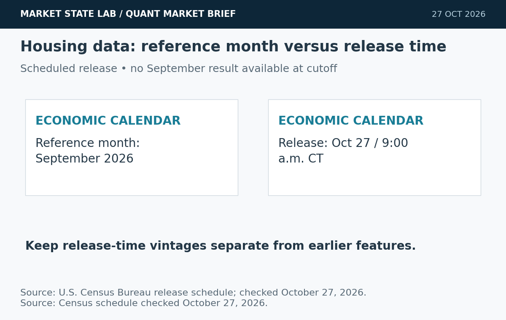
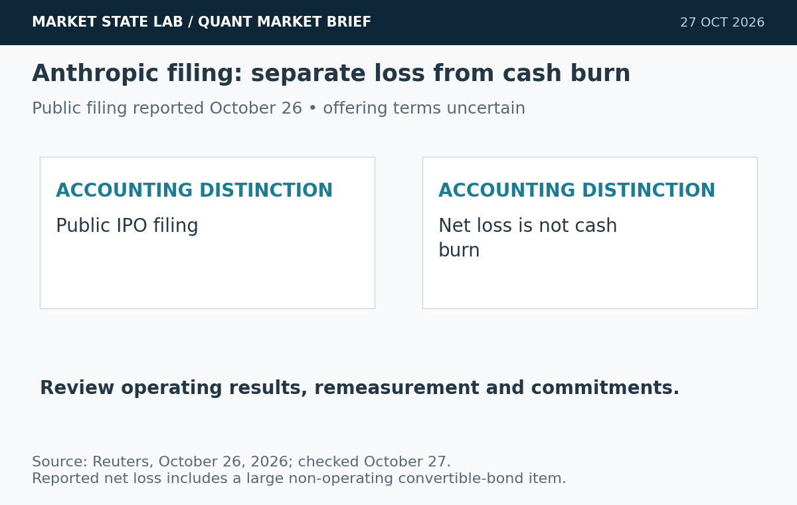

# Quant Market Brief — October 27, 2026: Monitoring Blind Spots & Queue Depth

Research cutoff: **October 27, 2026, 6:32 a.m. CT (11:32 UTC)**. ETF/factor data are **October 26 prior-close**; VIX is delayed; funding fixings lag. No live consolidated spread/depth or options-positioning feed verified.

[Subscribe by email](https://market-state-lab.ghost.io/?utm_source=github&utm_medium=technical_archive&utm_campaign=qmb_2026-10-27#/portal/signup).

## 1. Improving training signals can miss a declining encoder

*Graphic: Market State Lab; Kakati, arXiv:2610.35766v1; October 26, 2026. Evidence graphic; chart units and schematic limits appear in the image.*

**Date:** Submitted October 26; listed October 27.

**Fact:** A synthetic-image LeJEPA study found persistent factor-readability declines in nine of ten seeds while loss kept falling and most tracked label-free signals improved. [Direct source](https://arxiv.org/abs/2610.35766)

**Inference:** Training diagnostics can look healthy while economically useful information deteriorates.

**Uncertainty:** This is one controlled synthetic-image setting, not a demonstrated failure of a MATLAB trading encoder.

**Why it matters:** Test checkpoint selection with untouched downstream tasks and known-answer controls.

## 2. Round-number clustering does not establish a price barrier

*Graphic: Market State Lab; Jung and Lee, arXiv:2610.34787v1; October 26, 2026. Evidence graphic; chart units and schematic limits appear in the image.*

**Date:** Submitted October 26; listed October 27.

**Fact:** Using five Nasdaq stocks during 2025, a preprint finds more liquidity at round prices but no longer depth-adjusted durations; Intel and SoFi show directional departure effects. [Direct source](https://arxiv.org/abs/2610.34787)

**Inference:** Queue depth can explain apparent price stickiness without a universal support/resistance rule.

**Uncertainty:** Five stocks and one year do not establish a universal result, an executable edge or options pinning.

**Why it matters:** Condition departure hazards and fill tests on displayed depth before adding round-price features.

## 3. Monday’s rebound lifts technology and broad equities

*Graphic: Market State Lab; AP and ChartExchange completed October 26, 2026 session. Evidence graphic; chart units and schematic limits appear in the image.*

**Date:** October 26 completed session; reports checked October 27.

**Fact:** AP reports Monday gains of 0.7% for the S&P 500, 0.8% for Nasdaq Composite and 0.3% for the Dow. Completed ETF rows show SPY +0.711% and QQQ +1.107%. [Direct source](https://apnews.com/article/wall-street-stocks-dow-nasdaq-693ac6c4e67da0332045e66804780be7)

**Inference:** A rebound is a new observation, not confirmation that recent volatility has ended.

**Uncertainty:** Index and ETF returns are different instruments; prior-close observations do not establish Tuesday liquidity.

**Why it matters:** Refresh basis, quotes and opening-auction imbalances before sizing orders.

## 4. September new-home sales are scheduled for this morning

*Graphic: Market State Lab; U.S. Census Bureau release schedule; checked October 27, 2026. Evidence graphic; chart units and schematic limits appear in the image.*

**Date:** Census schedule checked October 27 before release.

**Fact:** The Census schedule places September new residential sales on October 27 at 10:00 a.m. ET, or 9:00 a.m. CT. The result was not available at this cutoff. [Direct source](https://www.census.gov/construction/soc/schedule.html)

**Inference:** Rate-sensitive housing data can alter intraday macro expectations.

**Uncertainty:** This is a scheduled release, not a reported result; initial estimates and earlier months may be revised.

**Why it matters:** Keep pre-release features separate from the released vintage and monitor execution around 9:00 CT.

## 5. Anthropic’s IPO filing opens its finances to public scrutiny

*Graphic: Market State Lab; Reuters, October 26, 2026; checked October 27. Evidence graphic; chart units and schematic limits appear in the image.*

**Date:** Reuters October 26 report, checked October 27.

**Fact:** Anthropic made its U.S. IPO filing public on Monday. Reuters reports a first-half net loss of $80.7 billion, largely reflecting a non-operating convertible-bond-related item. [Direct source](https://www.reuters.com/legal/transactional/anthropic-opens-books-ais-explosive-growth-staggering-costs-2026-10-26/)

**Inference:** Accounting composition matters when assessing the economics of AI businesses.

**Uncertainty:** The net loss is not equivalent to cash burn; offering valuation, timing and final terms remain uncertain.

**Why it matters:** Separate operating performance, noncash remeasurement, commitments and dilution.

## Quant & Market Dashboard

### Liquidity, funding and volatility

- **Overnight:** No reliable current futures/ETF spread, depth, overnight-volume or auction-imbalance feed was verified. MarketWatch describes steady S&P/Dow futures and Nasdaq-100 futures -0.2%; its page supplies a relative timestamp only, so this is qualitative premarket context rather than a synchronized quote. [MarketWatch](https://www.marketwatch.com/livecoverage/stock-market-today-s-p-500-nasdaq-dow-mixed-tech-stocks-fall-after-rebound/card/nasdaq-set-to-fall-as-tech-stocks-retreat-YkGmRZ0ON3Sh3Pd4Dw1U).
- **October 26 completed ETF rows:** SPY close **765.37**, volume **31.74m**, range **6.10 points**; QQQ close **712.20**, volume **33.11m**, range **9.67 points**. The sites' quote banners differ from the daily rows; this edition consistently uses completed historical rows, not banner ticks. Volume is not a depth or slippage estimate. [SPY](https://chartexchange.com/symbol/nyse-spy/historical/) · [QQQ](https://chartexchange.com/symbol/nasdaq-qqq/historical/).
- **Funding:** Latest verified October 23 SOFR **3.92%** versus 3.90% previously; EFFR **3.88%**, unchanged. Lagged aggregate fixings do not establish current funding stress. Current executable Treasury spread/depth unavailable. [SOFR](https://fred.stlouisfed.org/series/SOFR) · [EFFR](https://fred.stlouisfed.org/series/EFFR).
- **Volatility: Moderate, elevated event risk; medium confidence.** Delayed VIX **17.87 at 7:00 a.m. ET / 6:00 CT October 27**; Monday close **18.39**, -5.45%. House classification reflects sub-20 readings and recent large swings. Term structure, skew and dealer gamma unverified. [VIX](https://chartexchange.com/symbol/index-vix/historical/).

### Factor performance proxies

| Factor | ETF | October 26 daily | September 23→October 26 |
|---|---|---:|---:|
| Momentum | [MTUM](https://stockanalysis.com/etf/mtum/history/) | +1.77% | -7.06% |
| Value | [VLUE](https://stockanalysis.com/etf/vlue/history/) | +0.76% | -3.20% |
| Quality | [QUAL](https://stockanalysis.com/etf/qual/history/) | +0.33% | +0.63% |
| Size | [IWM](https://stockanalysis.com/etf/iwm/history/) | +0.45% | -1.75% |
| Growth | [IWF](https://stockanalysis.com/etf/iwf/history/) | +1.07% | -3.59% |
| Low volatility | [SPLV](https://stockanalysis.com/etf/splv/history/) | +0.13% | +5.84% |

Unadjusted close-to-close price returns exclude distributions. These are ETF exposures, not isolated factor premia or total returns. October26 endpoints were freshly checked; September23 anchors are preserved from the dated archive. No future-effective split is applied. Momentum led Monday's proxy gains, while low volatility retained the strongest medium-window return.

### Execution and microstructure

- At the **8:30 a.m. CT cash open**, refresh SPY/QQQ NBBO, quote age, displayed depth, ES/NQ basis and auction imbalances. Use bounded limits and capped participation.
- Monitor the **9:00 a.m. CT housing-release window**. Verify the full macro/earnings calendar and avoid assuming pre-release spreads persist afterward.
- For options, validate expiry, exercise/assignment and settlement terms. Reject stale, crossed and one-sided quotes; use combo limits for verticals. Neither round prices nor expiry dates establish dealer-gamma sign or pinning.
- Stress slippage, adverse selection, queue uncertainty, cancellations and missed fills. A deep queue can delay both price departures and passive fills.

**Research watchlist:** SPY, QQQ, IWM, RSP, TLT; ES, NQ, ZN, VX; MTUM, VLUE, QUAL, IWF, SPLV; INTC, SOFI, SOXX. Monitoring scope, not trade recommendations.

### DRL Improvements for the MATLAB System

1. Enforce drawdown, exposure and liquidity constraints outside the policy; reject stale inputs and unsupported states.
2. Validate checkpoint selection on untouched downstream tasks; a falling loss is insufficient evidence of preserved useful information.
3. Condition fill and departure models on queue depth, with realistic spreads, impact, latency, cancellations and missed fills.
4. Use purged, embargoed walk-forward folds and paired random seeds; report risk, coverage and execution costs across held-out regimes.

### Model hygiene

Use point-in-time universes and availability timestamps; prevent leakage, survivorship and look-ahead bias. Reconcile corporate actions causally and preserve adjusted/unadjusted basis. Reject stale options and expired contracts. Control multiple testing, distinguish calibration from discrimination, and monitor feature, cost and policy drift. Keep revised economic vintages separate.

### MATLAB optimization patterns

- Use timezone-aware timetables and causal synchronize/retime alignment.
- Vectorize features, preallocate logs and profile before parallelization.
- Parallelize independent walk-forward folds or Bayesian optimization trials with reproducible random streams and immutable holdouts.
- Use GPUs for sufficiently large batches; keep risk, execution and environment modules separate.

### High-value quant research question

**Does conditioning on queue depth remove the apparent value of round-price features after realistic fill costs?**

Compare models with and without round-level indicators under identical depth controls, purged folds and cost assumptions. This separates mechanical liquidity effects from incremental predictive information.

[Subscribe by email](https://market-state-lab.ghost.io/?utm_source=github&utm_medium=technical_archive&utm_campaign=qmb_2026-10-27#/portal/signup).

*Research and education only—not individualized financial advice. No trading performance is promised.*
