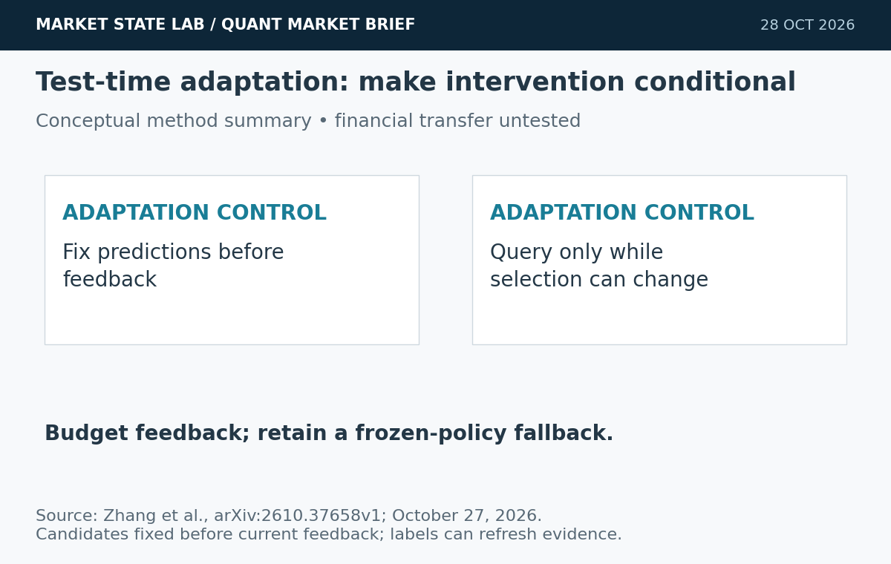
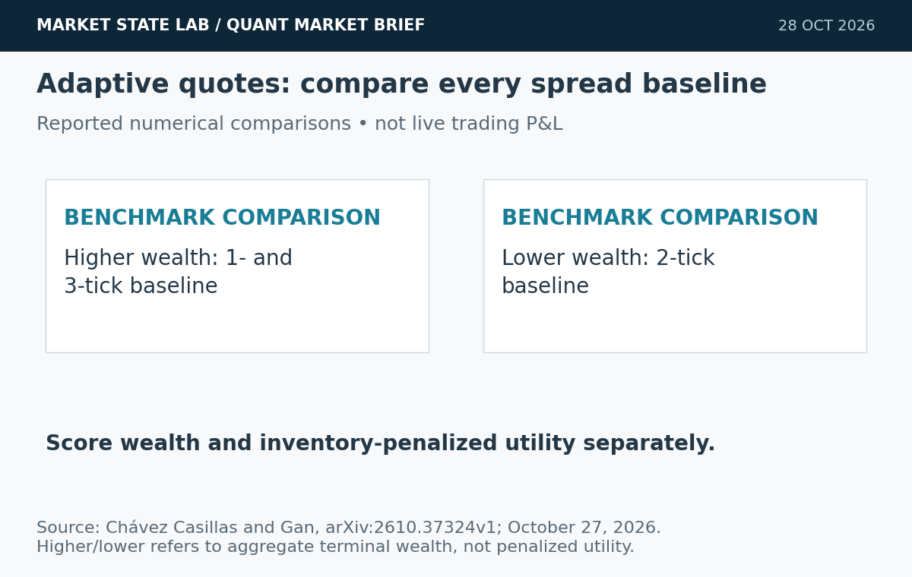
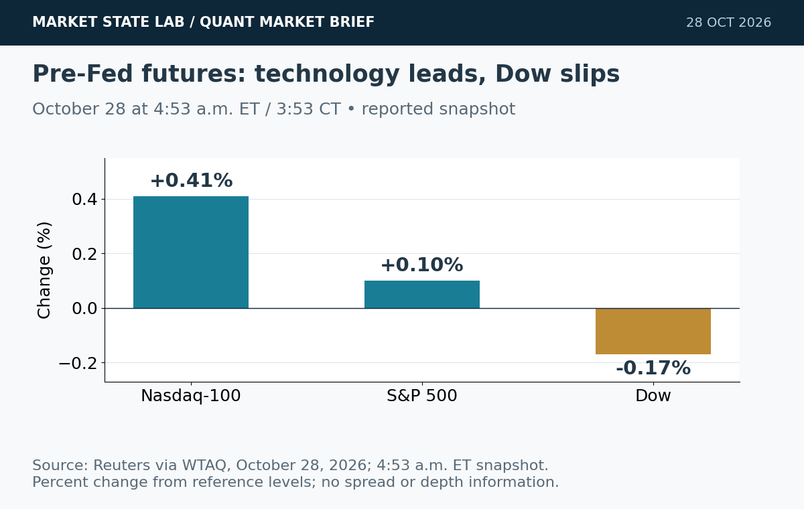
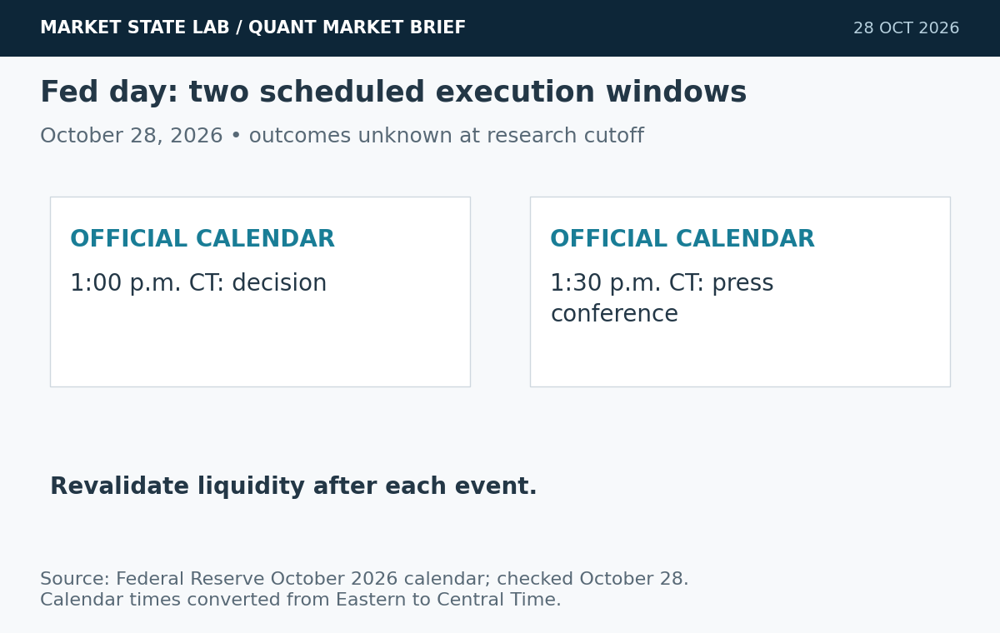
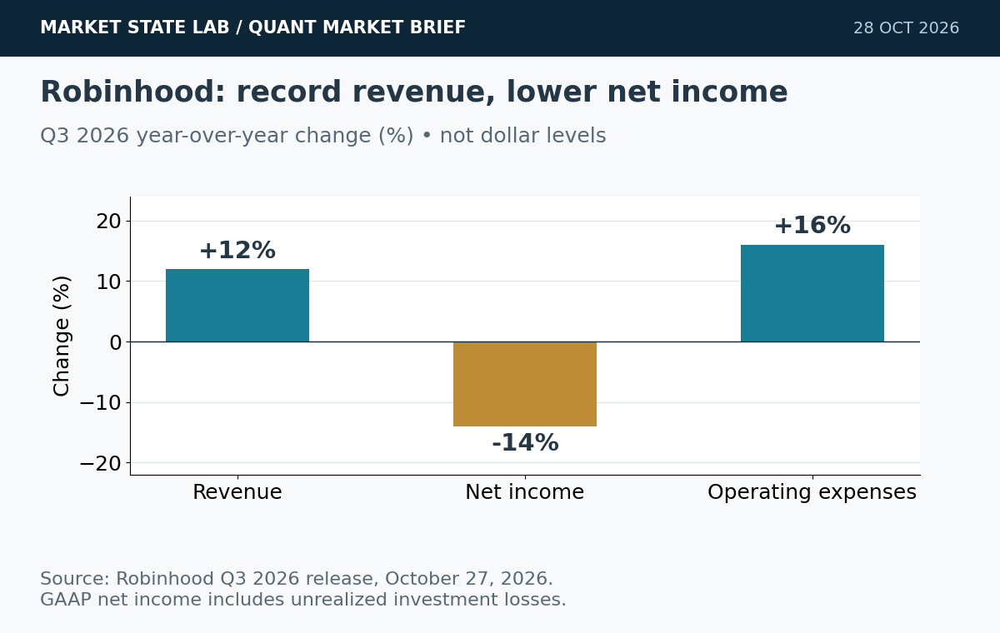

# Quant Market Brief — October 28, 2026: Fed Decision & Adaptive Execution

Research cutoff: **October 28, 2026, 6:36 a.m. CT (11:36 UTC)**. Futures are a reported early snapshot, ETF/factor data **October 27 prior-close**, VIX delayed, and funding fixings lagged. No live spread/depth or options-positioning feed verified.

[Subscribe by email](https://market-state-lab.ghost.io/?utm_source=github&utm_medium=technical_archive&utm_campaign=qmb_2026-10-28#/portal/signup).

## 1. PORTAL asks when a model should adapt at test time

*Graphic: Market State Lab; Zhang et al., arXiv:2610.37658v1; October 27, 2026. Evidence summary or quantitative chart as labeled; no simulated curves.*

**Date:** Submitted October 27; listed October 28.

**Fact:** PORTAL selects among fixed prediction candidates using shared label feedback and stops querying when additional labels cannot change the choice or justify their cost. Its experiments address harmful test-time interventions and changing input streams. [Direct source](https://arxiv.org/abs/2610.37658)

**Inference:** A controller can make adaptation conditional on evidence rather than always updating.

**Uncertainty:** This is a preprint; reported image-task results do not establish trading performance, and financial labels arrive with delay.

**Why it matters:** Test gated adaptation against a frozen policy using availability-aware labels and an explicit feedback budget.

## 2. Adaptive quote placement does not beat every fixed spread

*Graphic: Market State Lab; Chávez Casillas and Gan, arXiv:2610.37324v1; October 27, 2026. Evidence summary or quantitative chart as labeled; no simulated curves.*

**Date:** Submitted October 27; listed October 28.

**Fact:** A state-dependent Hawkes order-book preprint derives inventory-dependent quotes with a terminal inventory penalty. In LOBSTER numerical experiments, aggregate terminal wealth exceeds one- and three-tick fixed-spread benchmarks, but trails the two-tick benchmark. [Direct source](https://arxiv.org/abs/2610.37324)

**Inference:** Benchmark choice and the inventory-penalized objective can change the interpretation of success.

**Uncertainty:** Numerical terminal wealth is not live profitability or proof of superior risk-adjusted utility.

**Why it matters:** Compare all spread baselines under identical fills, costs and inventory constraints.

## 3. Nasdaq futures lead a mixed pre-Fed market

*Graphic: Market State Lab; Reuters via WTAQ, October 28, 2026; 4:53 a.m. ET snapshot. Evidence summary or quantitative chart as labeled; no simulated curves.*

**Date:** Reuters October 28; quotes at 4:53 a.m. ET / 3:53 CT.

**Fact:** Reuters reported Nasdaq-100 E-minis +0.41%, S&P 500 E-minis +0.10% and Dow E-minis -0.17% at 4:53 a.m. ET, with memory-chip stocks supporting technology. [Direct source](https://wtaq.com/2026/10/28/nasdaq-futures-rise-as-sk-hynix-boosts-chips-before-fed-decision-earnings/)

**Inference:** Index divergence warrants checking sector concentration before treating futures strength as broad risk appetite.

**Uncertainty:** This is an early reported snapshot, not a live executable quote, spread or depth measurement.

**Why it matters:** Refresh ES/NQ basis and SPY/QQQ quotes before the cash open.

## 4. Fed decision and press conference create two execution windows

*Graphic: Market State Lab; Federal Reserve October 2026 calendar; checked October 28. Evidence summary or quantitative chart as labeled; no simulated curves.*

**Date:** Official October 28 calendar, checked before the decision.

**Fact:** The Fed calendar schedules the October 27–28 meeting decision at 2:00 p.m. ET and the press conference at 2:30 p.m. ET today: 1:00 and 1:30 p.m. CT. [Direct source](https://www.federalreserve.gov/newsevents/2026-october.htm)

**Inference:** The statement and subsequent answers can produce distinct repricing episodes.

**Uncertainty:** No October decision or press-conference outcome was available at the research cutoff.

**Why it matters:** Gate participation around both windows and revalidate quotes after each.

## 5. Robinhood’s record revenue comes with lower net income

*Graphic: Market State Lab; Robinhood Q3 2026 release, October 27, 2026. Evidence summary or quantitative chart as labeled; no simulated curves.*

**Date:** Company release October 27; quarter ended September 30.

**Fact:** Robinhood reported Q3 revenue of 1.42 billion, up 12% year over year, while net income fell 14% to 476 million and operating expenses rose 16%. All amounts are U.S. dollars. [Direct source](https://investors.robinhood.com/news-releases/news-release-details/robinhood-reports-third-quarter-2026-results)

**Inference:** Revenue growth alone does not establish improving earnings quality or operating leverage.

**Uncertainty:** GAAP net income includes unrealized investment losses; these figures do not isolate recurring operating performance.

**Why it matters:** Separate transaction mix, interest income, expenses and non-operating items.

## Quant & Market Dashboard

### Liquidity, funding and volatility

- **Overnight:** Reuters' 3:53 a.m. CT futures snapshot is indicative historical context; see story 3. Current futures/ETF spreads, depth, overnight volume, funding transactions and auction imbalances were not reliably verified. Do not infer liquidity from direction.
- **October 27 completed ETF rows:** SPY close **769.66**, volume **28.63m**, range **5.93 points**; QQQ close **721.25**, volume **30.94m**, range **9.28 points**. Quote banners differ slightly from daily rows; this edition consistently uses completed historical rows. Volume is a cautious activity proxy, not depth or expected slippage. [SPY](https://chartexchange.com/symbol/nyse-spy/historical/) · [QQQ](https://chartexchange.com/symbol/nasdaq-qqq/historical/).
- **Funding:** Latest verified October 26 SOFR **3.93%** versus 3.92% previously; EFFR **3.88%**, unchanged. The five-basis-point gap is a lagged aggregate proxy, not evidence of current stress. Current executable Treasury spread/depth unavailable. [SOFR](https://fred.stlouisfed.org/series/SOFR) · [EFFR](https://fred.stlouisfed.org/series/EFFR).
- **Volatility: Moderate, elevated event risk; medium confidence.** Delayed VIX **17.49 at 6:59 a.m. ET / 5:59 CT October 28**; Tuesday close **17.52**, -4.731%. House classification reflects sub-20 readings with a known Fed event ahead. Term structure, skew and dealer-gamma exposures unverified. [VIX](https://chartexchange.com/symbol/index-vix/historical/).

### Factor performance proxies

| Factor | ETF | October 27 daily | September 23→October 27 |
|---|---|---:|---:|
| Momentum | [MTUM](https://stockanalysis.com/etf/mtum/history/) | +1.69% | -5.50% |
| Value | [VLUE](https://stockanalysis.com/etf/vlue/history/) | +1.04% | -2.20% |
| Quality | [QUAL](https://stockanalysis.com/etf/qual/history/) | -0.17% | +0.47% |
| Size | [IWM](https://stockanalysis.com/etf/iwm/history/) | +1.15% | -0.62% |
| Growth | [IWF](https://stockanalysis.com/etf/iwf/history/) | +1.12% | -2.50% |
| Low volatility | [SPLV](https://stockanalysis.com/etf/splv/history/) | -0.17% | +5.66% |

Unadjusted close-to-close price returns exclude distributions. These are ETF exposures, not isolated factor premia or total returns. October27 endpoints freshly checked; September23 anchors preserved from the dated archive. No future-effective split applied. Momentum led daily proxy gains; low volatility led the medium window despite a negative daily return.

### Execution and microstructure

- At the **8:30 a.m. CT cash open**, refresh SPY/QQQ NBBO, quote age, displayed depth, ES/NQ basis and opening-auction imbalances. Use bounded limits and capped participation; thin displayed size may disappear.
- For the **1:00 and 1:30 p.m. CT Fed windows**, throttle or pause participation until quotes stabilize. Do not let a pre-event liquidity estimate govern post-event sizing.
- Options: verify each contract's expiry, settlement and exercise/assignment rules. Reject stale, crossed or one-sided quotes; use combo limits where appropriate. Short-dated gamma and post-event implied-volatility changes can alter risk; dealer-gamma sign and pinning are unverified.
- Stress slippage, adverse selection, queue uncertainty, cancellations and missed fills. Avoid liquidity traps caused by stale indicative prices and optimistic passive-fill assumptions.

**Research watchlist:** SPY, QQQ, IWM, RSP, TLT; ES, NQ, ZN, VX; MTUM, VLUE, QUAL, IWF, SPLV; SOXX, HOOD. Monitoring scope, not trade recommendations.

### DRL Improvements for the MATLAB System

1. Enforce drawdown, exposure, participation and liquidity constraints outside the learned policy; preserve a safe fallback for stale data and unfamiliar states.
2. Penalize turnover, spread, impact, tail losses and missed fills in the reward; compare wealth and inventory-penalized utility separately.
3. Gate adaptation with predictions frozen before feedback arrives; use only labels available at decision time and budget feedback explicitly.
4. Use purged, embargoed walk-forward folds, matched seeds and held-out regimes; stress event-time gaps, cancellations, latency and spread widening against multiple fixed-spread baselines.

### Model hygiene

Use point-in-time universes and availability timestamps; prevent leakage, survivorship and look-ahead bias. Reconcile corporate actions causally and preserve adjusted/unadjusted basis. Reject stale options and expired contracts. Control multiple testing, test calibration, and monitor feature, cost and policy drift. Preserve unrevised economic vintages and delayed financial labels.

### MATLAB optimization patterns

- Use timezone-aware timetables with causal synchronize/retime alignment.
- Vectorize features, preallocate logs and profile before parallelization.
- Parallelize independent walk-forward folds or Bayesian optimization trials with reproducible random streams and immutable holdouts.
- Use GPUs for sufficiently large training batches; keep environment, risk and execution modules modular.

### High-value quant research question

**Does event-aware gated adaptation improve inventory-penalized out-of-sample utility after realistic fill costs versus a frozen policy and one-, two- and three-tick baselines?**

Run paired, purged walk-forward tests with identical order flow and risk limits. This tests whether adaptation adds economic value rather than merely winning a convenient benchmark.

[Subscribe by email](https://market-state-lab.ghost.io/?utm_source=github&utm_medium=technical_archive&utm_campaign=qmb_2026-10-28#/portal/signup).

*Research and education only—not individualized financial advice. No trading performance is promised.*
