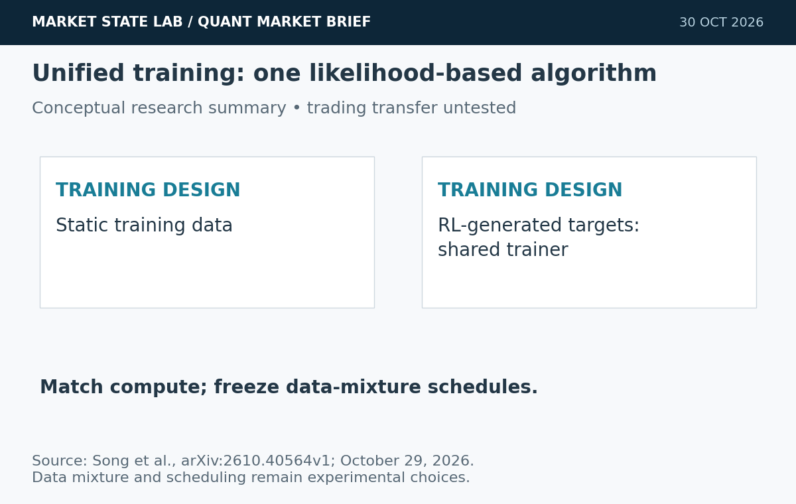
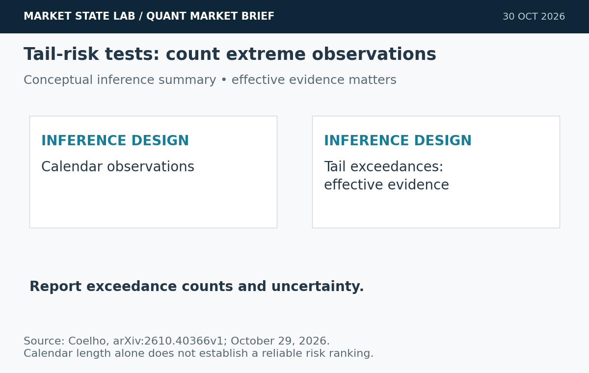
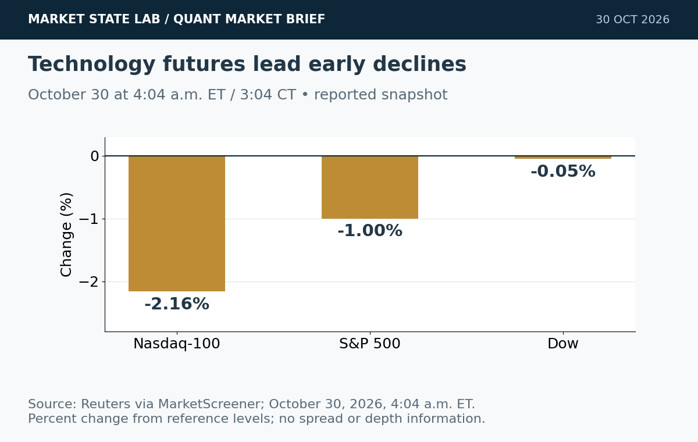
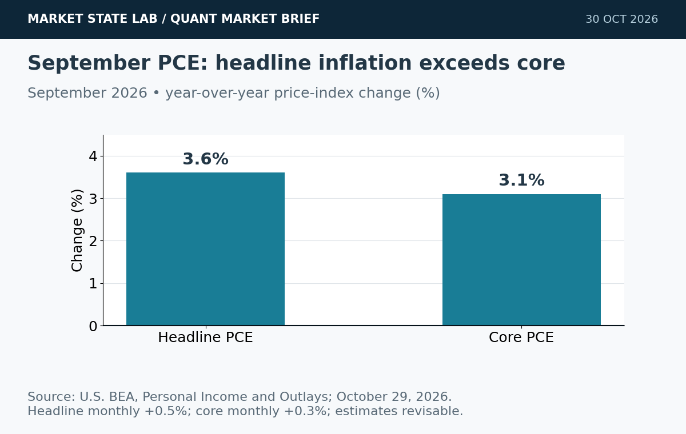
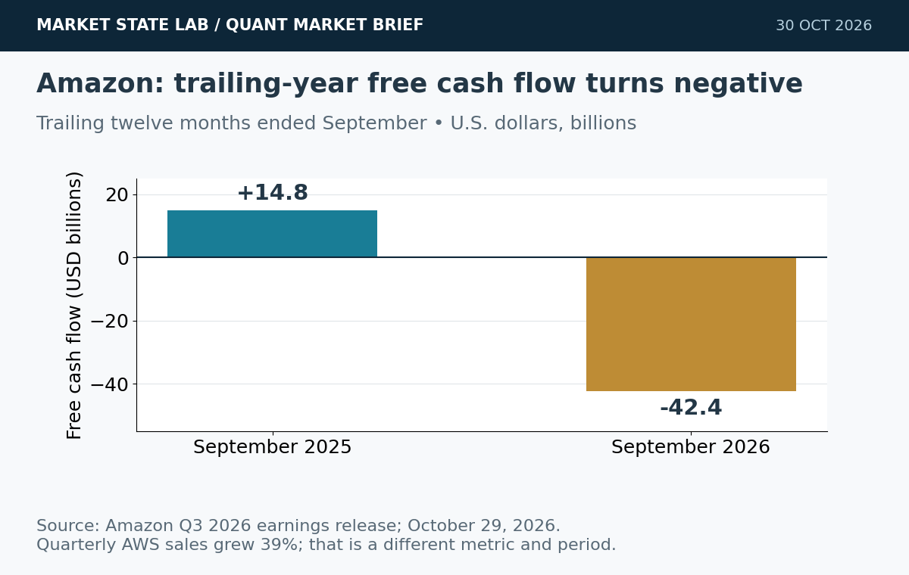

# Quant Market Brief — October 30, 2026: Tail-Risk Evidence & Tech Selloff

Research cutoff: **October 30, 2026, 6:38 a.m. CT (11:38 UTC)**. Futures are a reported early snapshot, ETF/factor data **October 29 prior-close**, VIX delayed, and funding fixings lagged. No live spread/depth or options-positioning feed verified.

[Subscribe by email](https://market-state-lab.ghost.io/?utm_source=github&utm_medium=technical_archive&utm_campaign=qmb_2026-10-30#/portal/signup).

## 1. Unified training puts model stages under one algorithm

*Graphic: Market State Lab; Song et al., arXiv:2610.40564v1; October 29, 2026. Evidence summary or quantitative chart as labeled; no simulated curves.*

**Date:** Submitted October 29; listed October 30.

**Fact:** A preprint reformulates suitable RL objectives as likelihood fitting and combines static data with RL generations in one trainer. The authors report improved accuracy–compute tradeoffs in their experiments. [Direct source](https://arxiv.org/abs/2610.40564)

**Inference:** Data composition and scheduling become central experimental choices.

**Uncertainty:** Foundation-model results do not establish a benefit for a financial policy or a MATLAB implementation.

**Why it matters:** Test fixed data-mixture schedules against staged training at matched compute.

## 2. Tail-forecast comparisons depend on exceedances

*Graphic: Market State Lab; Coelho, arXiv:2610.40366v1; October 29, 2026. Evidence summary or quantitative chart as labeled; no simulated curves.*

**Date:** Submitted October 29; listed October 30.

**Fact:** A preprint identifies exceedances as the effective sample size for comparing tail forecasts. It shows that scarce exceedances can distort standard Diebold–Mariano comparisons and studies alternative inference procedures. [Direct source](https://arxiv.org/abs/2610.40366)

**Inference:** Long backtests may still contain little evidence about extreme losses.

**Uncertainty:** Theoretical conditions and the selected score matter; changing a test alone does not validate a risk model.

**Why it matters:** Report exceedance counts, uncertainty and sensitivity before ranking tail forecasts.

## 3. Nasdaq futures fall more than 2% before the open

*Graphic: Market State Lab; Reuters via MarketScreener; October 30, 2026, 4:04 a.m. ET. Evidence summary or quantitative chart as labeled; no simulated curves.*

**Date:** Reuters October 30; 4:04 a.m. ET / 3:04 CT snapshot.

**Fact:** Reuters reported Nasdaq-100 E-minis -2.16%, S&P 500 E-minis -1.00% and Dow E-minis -0.05% at 4:04 a.m. ET, with technology under pressure. [Direct source](https://www.marketscreener.com/news/nasdaq-futures-tumble-as-amazon-intel-results-deepen-ai-spending-woes-ce785fdbd880f125)

**Inference:** Concentrated technology exposure can create opening gaps beyond broad-index risk estimates.

**Uncertainty:** This early snapshot is not a live quote, spread or depth measurement.

**Why it matters:** Reprice QQQ and SPY opening-risk assumptions using fresh quotes and auction data.

## 4. September PCE inflation rises to 3.6% year over year

*Graphic: Market State Lab; U.S. BEA, Personal Income and Outlays; October 29, 2026. Evidence summary or quantitative chart as labeled; no simulated curves.*

**Date:** BEA release October 29; September reference month.

**Fact:** September PCE inflation was 3.6% year over year and 0.5% month over month. Core PCE rose 3.1% year over year and 0.3% monthly; real spending increased less than 0.1%. [Direct source](https://www.bea.gov/news/2026/personal-income-and-outlays-september-2026)

**Inference:** Separate nominal spending growth from inflation-adjusted demand.

**Uncertainty:** The release is revisable and does not determine the next Fed decision.

**Why it matters:** Preserve release vintages and model headline, core and real spending separately.

## 5. Amazon cloud growth accompanies negative free cash flow

*Graphic: Market State Lab; Amazon Q3 2026 earnings release; October 29, 2026. Evidence summary or quantitative chart as labeled; no simulated curves.*

**Date:** Company release October 29; quarter ended September 30.

**Fact:** Amazon reported AWS sales of $46.0 billion, up 39%, and a trailing-twelve-month free-cash-flow outflow of $42.4 billion, versus a $14.8 billion inflow a year earlier. [Direct source](https://ir.aboutamazon.com/news-release/news-release-details/2026/Amazon-com-Announces-Third-Quarter-Results/)

**Inference:** Operating growth and infrastructure cash requirements need separate valuation scenarios.

**Uncertainty:** Quarterly AWS revenue and trailing-year free cash flow use different periods; free cash flow is not net income.

**Why it matters:** Compare cash generation, investment commitments and financing needs without mixing periods.

## Quant & Market Dashboard

### Liquidity, funding and volatility

- **Overnight:** Reuters' 3:04 a.m. CT futures snapshot is indicative historical context; see story 3. Current futures/ETF spreads, depth, overnight volume, funding transactions and auction imbalances were not reliably verified. Do not infer liquidity from direction.
- **October 29 completed ETF rows:** SPY close **769.36**, volume **40.30m**, range **4.14 points**; QQQ close **715.34**, volume **38.25m**, range **6.45 points**. Quote banners differ slightly from daily rows; this edition consistently uses completed historical rows. Volume is a cautious activity proxy, not depth or expected slippage. [SPY](https://chartexchange.com/symbol/nyse-spy/historical/) · [QQQ](https://chartexchange.com/symbol/nasdaq-qqq/historical/).
- **Funding:** Latest verified October 28 SOFR **3.94%** versus 3.95% previously; EFFR **3.88%**, unchanged. The six-basis-point gap is a lagged aggregate proxy, not evidence of current stress. Current executable Treasury spread/depth unavailable. [SOFR](https://fred.stlouisfed.org/series/SOFR) · [EFFR](https://fred.stlouisfed.org/series/EFFR).
- **Volatility: Moderate, elevated event risk; medium confidence.** Delayed VIX **18.50 at 6:26 a.m. ET / 5:26 CT October 30**; Thursday close **17.20**, +1.715%. House classification reflects sub-20 readings with a technology-led futures decline and a macro release window ahead. Term structure, skew and dealer-gamma exposures unverified. [VIX](https://chartexchange.com/symbol/index-vix/historical/).

### Factor performance proxies

| Factor | ETF | October 29 daily | September 23→October 29 |
|---|---|---:|---:|
| Momentum | [MTUM](https://stockanalysis.com/etf/mtum/history/) | -1.70% | -5.87% |
| Value | [VLUE](https://stockanalysis.com/etf/vlue/history/) | -0.44% | -1.67% |
| Quality | [QUAL](https://stockanalysis.com/etf/qual/history/) | +0.72% | +1.16% |
| Size | [IWM](https://stockanalysis.com/etf/iwm/history/) | +0.97% | +0.74% |
| Growth | [IWF](https://stockanalysis.com/etf/iwf/history/) | -1.54% | -3.41% |
| Low volatility | [SPLV](https://stockanalysis.com/etf/splv/history/) | +1.67% | +6.97% |

Unadjusted close-to-close price returns exclude distributions. These are ETF exposures, not isolated factor premia or total returns. October 29 endpoints freshly checked; September 23 anchors preserved from the dated archive. No future-effective split applied. Low volatility led both measured horizons, while momentum and growth declined on the day.

### Execution and microstructure

- At the **8:30 a.m. CT cash open**, refresh SPY/QQQ NBBO, quote age, displayed depth, ES/NQ basis and opening-auction imbalances. Use bounded limits and capped participation; thin displayed size may disappear.
- For the **7:30 a.m. CT Employment Cost Index release window**, throttle or pause participation until quotes stabilize. [BLS schedule](https://www.bls.gov/schedule/2026/10_sched.htm). Results unavailable at cutoff. Do not let a pre-event liquidity estimate govern post-event sizing.
- Options: verify each contract's expiry, settlement and exercise/assignment rules. Reject stale, crossed or one-sided quotes; use combo limits where appropriate. Short-dated gamma and post-event implied-volatility changes can alter risk; dealer-gamma sign and pinning are unverified.
- Stress slippage, adverse selection, queue uncertainty, cancellations and missed fills. Avoid liquidity traps caused by stale indicative prices and optimistic passive-fill assumptions.

**Research watchlist:** SPY, QQQ, IWM, RSP, TLT; ES, NQ, ZN, VX; MTUM, VLUE, QUAL, IWF, SPLV; SOXX, AMZN, INTC. Monitoring scope, not trade recommendations.

### DRL Improvements for the MATLAB System

1. Enforce drawdown, exposure, participation and liquidity constraints outside the learned policy; preserve a safe fallback for stale data and unfamiliar states.
2. Penalize turnover, spread, impact, tail losses and missed fills in the reward; compare wealth and inventory-penalized utility separately.
3. Report exceedance counts and uncertainty for tail-risk metrics; avoid treating calendar length as sufficient evidence.
4. Use purged, embargoed walk-forward folds, matched seeds and held-out regimes; stress event-time gaps, cancellations, latency and spread widening against multiple fixed-spread baselines.

### Model hygiene

Use point-in-time universes and availability timestamps; prevent leakage, survivorship and look-ahead bias. Reconcile corporate actions causally and preserve adjusted/unadjusted basis. Reject stale options and expired contracts. Control multiple testing, test calibration, and monitor feature, cost and policy drift. Preserve unrevised economic vintages and delayed financial labels.

### MATLAB optimization patterns

- Use timezone-aware timetables with causal synchronize/retime alignment.
- Vectorize features, preallocate logs and profile before parallelization.
- Parallelize independent walk-forward folds or Bayesian optimization trials with reproducible random streams and immutable holdouts.
- Use GPUs for sufficiently large training batches; keep environment, risk and execution modules modular.

### High-value quant research question

**Do competing trading policies retain their tail-risk ranking when inference is conditioned on exceedance counts?**

Run paired, purged walk-forward tests with identical order flow and risk limits. This tests whether apparent risk improvements reflect genuine evidence or sparse extreme events.

[Subscribe by email](https://market-state-lab.ghost.io/?utm_source=github&utm_medium=technical_archive&utm_campaign=qmb_2026-10-30#/portal/signup).

*Research and education only—not individualized financial advice. No trading performance is promised.*
