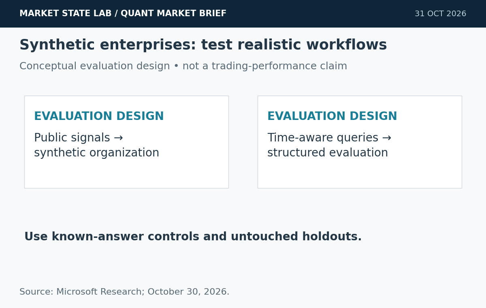
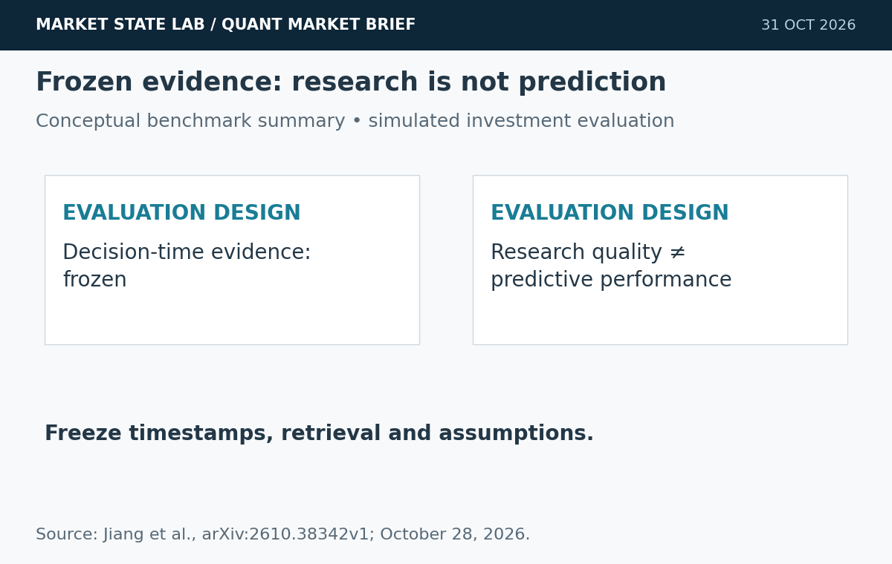
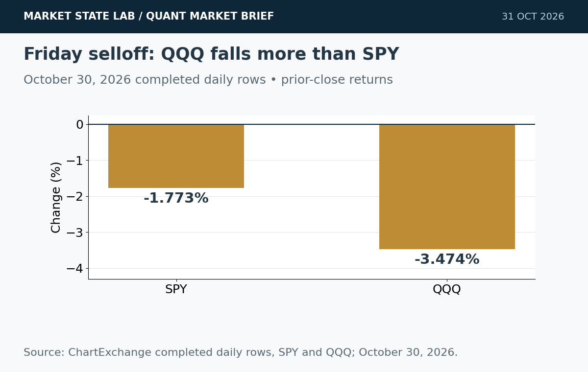
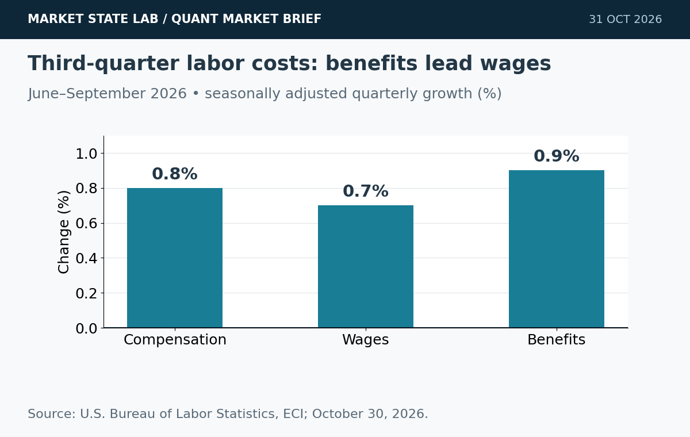
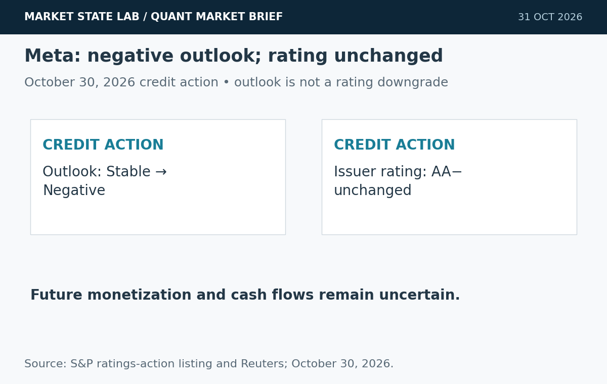

# Quant Market Brief — October 31, 2026: Frozen Evidence & October Selloff

Research cutoff: **October 31, 2026, 6:36 a.m. CT (11:36 UTC)**. Weekend edition: market prices are **October 30 prior-close**; VIX is delayed at Friday’s close; funding fixings are lagged. No live depth or options-positioning feed verified.

[Subscribe by email](https://market-state-lab.ghost.io/?utm_source=github&utm_medium=technical_archive&utm_campaign=qmb_2026-10-31#/portal/signup).

## 1. Microsoft builds synthetic enterprises to test Copilot

*Graphic: Market State Lab; Microsoft Research; October 30, 2026. Conceptual or quantitative as labeled.*

**Date:** Microsoft Research, October 30, 2026.

**Fact:** Microsoft describes synthetic enterprise environments grounded in public occupational data, job postings and SEC filings. The environments include capital-markets workflows and time-evolving communication histories. [Direct source](https://www.microsoft.com/en-us/research/blog/from-synthetic-enterprise-data-evaluations-to-real-microsoft-copilot-ai-confidence/)

**Inference:** Structured synthetic environments can expose workflow failures missed by generic benchmarks.

**Uncertainty:** Vendor-reported evaluation design does not establish trading performance or perfect realism.

**Why it matters:** Build known-answer, timestamped scenarios alongside untouched real-data holdouts.

## 2. Investor benchmark freezes the evidence available at decision time

*Graphic: Market State Lab; Jiang et al., arXiv:2610.38342v1; October 28, 2026. Conceptual or quantitative as labeled.*

**Date:** Preprint submitted October 28, 2026.

**Fact:** Investor’s Last Exam evaluates 86 assignments using a versioned database of 3.43 million document versions and timestamp-governed retrieval. The authors find that overall research capability does not consistently translate into forecasting performance. [Direct source](https://arxiv.org/abs/2610.38342)

**Inference:** Research quality and investment prediction require separate acceptance gates.

**Uncertainty:** Preprint benchmark scores and simulated investment outcomes are not live trading evidence.

**Why it matters:** Freeze retrieval, calculations and assumptions at each forecast origin; grade forecasts separately from narrative quality.

## 3. Friday’s selloff hits technology harder than broad equities

*Graphic: Market State Lab; ChartExchange completed daily rows, SPY and QQQ; October 30, 2026. Conceptual or quantitative as labeled.*

**Date:** Completed October 30 session.

**Fact:** Completed historical rows show SPY down 1.773% to 755.72 and QQQ down 3.474% to 690.49 on October 30. Associated session volumes were 77.70 million and 85.24 million shares. [Direct source](https://chartexchange.com/symbol/nasdaq-qqq/historical/)

**Inference:** Technology concentration increased the gap between broad-index and growth-heavy exposures.

**Uncertainty:** Site quote banners differ from completed daily rows; this edition uses daily rows consistently. These are prior-close prices, not executable weekend quotes.

**Why it matters:** Re-estimate opening-gap and concentration risk before the next session; volume does not establish depth.

## 4. Compensation costs rise 0.8% in the third quarter

*Graphic: Market State Lab; U.S. Bureau of Labor Statistics, ECI; October 30, 2026. Conceptual or quantitative as labeled.*

**Date:** BLS release October 30; quarter ending September 2026.

**Fact:** Civilian compensation costs rose 0.8% seasonally adjusted over the quarter. Wages rose 0.7% and benefits 0.9%. Over twelve months, total compensation rose 3.4%, not seasonally adjusted. [Direct source](https://www.bls.gov/news.release/eci.nr0.htm)

**Inference:** Wages and benefits can transmit different cost pressures into corporate margins.

**Uncertainty:** Quarterly and annual changes use different seasonal conventions; this release alone does not determine Fed policy.

**Why it matters:** Keep seasonal bases and release vintages explicit; model wages and benefits separately.

## 5. S&P revises Meta’s outlook to negative; rating remains AA−

*Graphic: Market State Lab; S&P ratings-action listing and Reuters; October 30, 2026. Conceptual or quantitative as labeled.*

**Date:** Rating action October 30, 2026.

**Fact:** S&P revised Meta’s outlook from stable to negative, citing capital-spending and free-operating-cash-flow uncertainty. Its AA− rating remained unchanged. Meta disputed the assessment of its AI monetization capabilities. [Direct source](https://www.reuters.com/business/sp-global-revises-outlook-meta-negative-cashflow-concerns-2026-10-30/)

**Inference:** Infrastructure investment now needs explicit financing and cash-flow stress scenarios.

**Uncertainty:** An outlook revision is not a rating downgrade. Conflicting secondary cash-flow projections are omitted.

**Why it matters:** Separate confirmed credit actions from forecasts about investment returns and future funding needs.

## Quant & Market Dashboard

### Liquidity, funding and volatility

- **Weekend state:** U.S. cash equities are closed. No reliable current overnight futures/ETF spreads, depth, volume or funding transactions verified. Friday data are historical context; do not carry their liquidity assumptions into the next open.
- **October 30 completed rows:** SPY close **755.72**, volume **77.70m**, high–low range **11.10 points**; QQQ close **690.49**, volume **85.24m**, range **15.18 points**. Quote banners differ from daily rows; all calculations use completed rows. Volume is an activity proxy, not depth or slippage. [SPY](https://chartexchange.com/symbol/nyse-spy/historical/) · [QQQ](https://chartexchange.com/symbol/nasdaq-qqq/historical/).
- **Funding:** Latest verified October 29 SOFR **3.94%**, EFFR **3.88%**, both unchanged. The six-basis-point gap is lagged aggregate context; current executable Treasury spreads/depth unavailable. [SOFR](https://fred.stlouisfed.org/series/SOFR) · [EFFR](https://fred.stlouisfed.org/series/EFFR).
- **Volatility: Moderate, near the high boundary; medium confidence.** Delayed VIX at **4:00 p.m. ET / 3:00 p.m. CT October 30: 19.42**, up **12.907%** from 17.20. The sub-20 level supports moderate classification, but the sharp equity decline and weekend gap risk require stricter execution controls. No live weekend reading, term structure, skew or dealer-gamma estimate verified. [VIX](https://chartexchange.com/symbol/index-vix/historical/).

### Factor performance proxies

| Factor | ETF | October 30 daily | September 23→October 30 |
|---|---|---:|---:|
| Momentum | [MTUM](https://stockanalysis.com/etf/mtum/history/) | -4.77% | -10.36% |
| Value | [VLUE](https://stockanalysis.com/etf/vlue/history/) | -1.70% | -3.34% |
| Quality | [QUAL](https://stockanalysis.com/etf/qual/history/) | -0.99% | +0.16% |
| Size | [IWM](https://stockanalysis.com/etf/iwm/history/) | -1.65% | -0.92% |
| Growth | [IWF](https://stockanalysis.com/etf/iwf/history/) | -2.89% | -6.20% |
| Low volatility | [SPLV](https://stockanalysis.com/etf/splv/history/) | +0.33% | +7.32% |

Unadjusted close-to-close price returns exclude distributions; these ETF exposures are not isolated factor premia. Fresh October 30 endpoints; September 23 anchors preserved from the dated archive. No future corporate actions applied. Low volatility was the only positive daily proxy; momentum had the largest daily decline.

### Execution and microstructure

- Before the next **8:30 a.m. CT cash open**, refresh SPY/QQQ NBBO, quote age, displayed depth, ES/NQ basis and opening-auction imbalances. Recompute timestamps after the weekend daylight-saving transition; use named time zones rather than fixed offsets.
- Use bounded limits and capped participation. Stress weekend gaps, spread widening, slippage, queue uncertainty, cancellations and missed fills; stale indicative prices are liquidity traps.
- Review Friday-expired options and exercise/assignment outcomes; check each remaining contract’s expiry, settlement and deliverable. Reject stale, crossed or one-sided quotes. Short-dated gamma and volatility repricing matter; dealer-gamma sign and pinning are unknown.
- Refresh the next-session event calendar before enabling execution; no future release outcome is assumed here.

**Research watchlist:** SPY, QQQ, IWM, RSP, TLT; ES, NQ, ZN, VX; MTUM, VLUE, QUAL, IWF, SPLV; SOXX, META, INTC.

### DRL Improvements for the MATLAB System

1. Enforce drawdown, exposure, participation and liquidity limits outside the learned policy, with a safe fallback for stale inputs.
2. Charge spread, impact, turnover, latency and missed fills in rewards; report tail loss and coverage separately.
3. Freeze decision-time evidence and evaluate predictions separately from explanation quality; keep synthetic scenario tests distinct from untouched real-data holdouts.
4. Use purged, embargoed walk-forward folds, paired seeds and unseen regimes; stress weekend gaps and variable execution costs.

### Model hygiene

Preserve availability timestamps and point-in-time universes. Check leakage, survivorship and look-ahead bias, causal corporate actions, stale options, multiple testing, calibration and drift. Archive economic vintages and retrieval versions; synthetic data must not contaminate the final holdout.

### MATLAB optimization patterns

- Use named-zone timetables and causal synchronize/retime alignment; test daylight-saving boundaries.
- Vectorize features, preallocate logs and profile before parallelizing.
- Parallelize independent folds or Bayesian trials with reproducible random streams and immutable holdouts.
- Use GPUs only for suitable large batches; keep environment, risk and execution modules modular.

### High-value quant research question

**Does freezing the full decision-time evidence set change model rankings on realized forecast error and net execution utility?**

Compare identical forecast origins, costs and risk limits. This tests whether apparent research quality survives strict information availability and economic scoring.

[Subscribe by email](https://market-state-lab.ghost.io/?utm_source=github&utm_medium=technical_archive&utm_campaign=qmb_2026-10-31#/portal/signup).

*Research and education only—not individualized financial advice. No trading performance is promised.*
