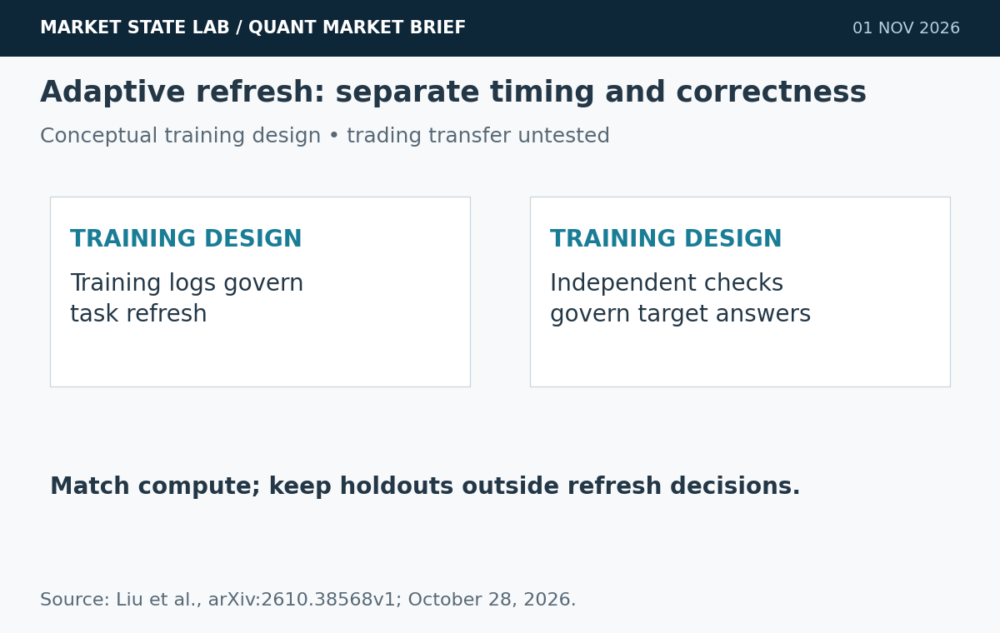
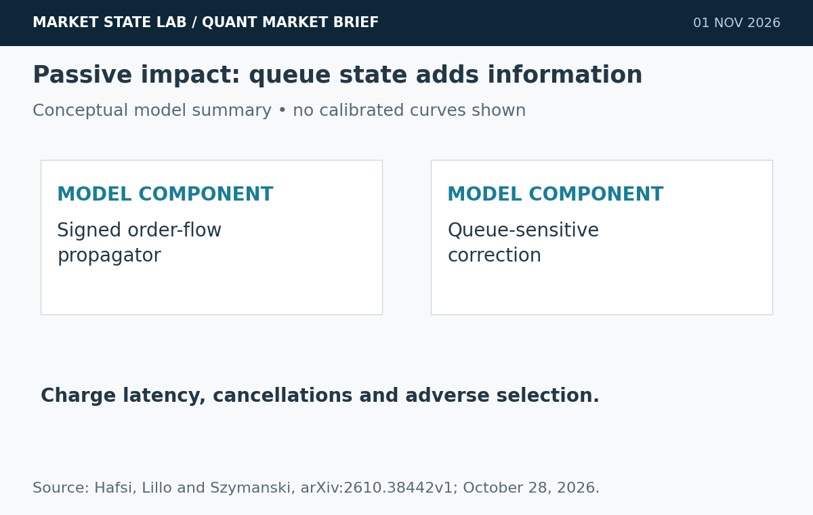
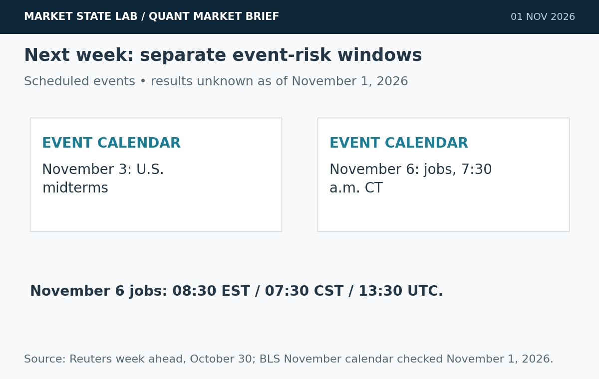
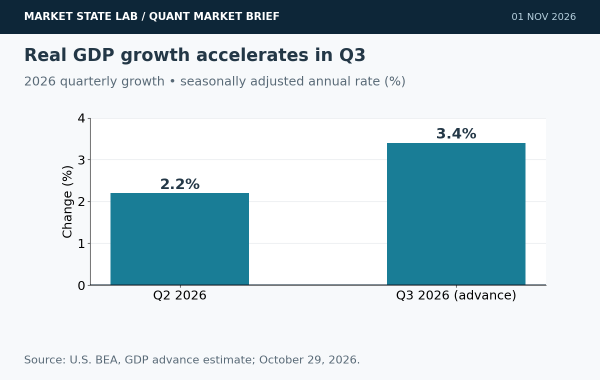
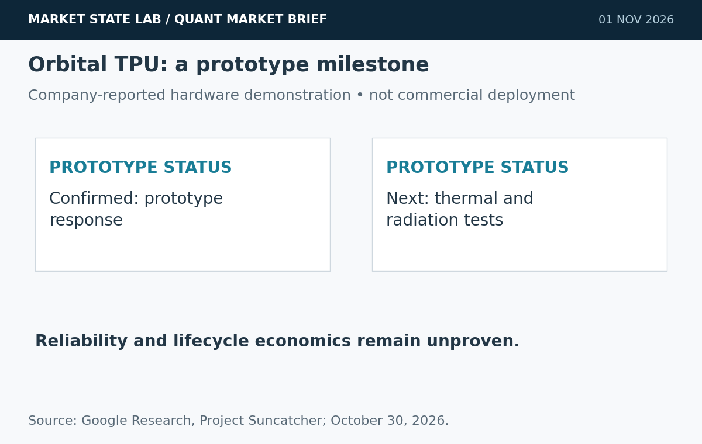

# Quant Market Brief — November 1, 2026: Queue-Aware Execution & Event Risk

Research cutoff: **November 1, 2026, 6:31 a.m. CST (12:31 UTC)**. Weekend edition: market prices are **October 30 prior-close**; VIX is delayed at Friday’s close; funding fixings are lagged. No live depth or options-positioning feed verified.

[Subscribe by email](https://market-state-lab.ghost.io/?utm_source=github&utm_medium=technical_archive&utm_campaign=qmb_2026-11-01#/portal/signup).

## 1. A-RSI refreshes training tasks without consulting test scores

*Graphic: Market State Lab; Liu et al., arXiv:2610.38568v1; October 28, 2026. Conceptual or quantitative as labeled.*

**Date:** Preprint submitted October 28, 2026.

**Fact:** A-RSI uses reward variation and training accuracy to refresh a task pool when its learning signal declines. Reference answers come from a static library of model-authored programs and are separately audited; refresh decisions do not consult validation or test scores. [Direct source](https://arxiv.org/abs/2610.38568)

**Inference:** Refresh timing and target correctness should be evaluated as separate mechanisms.

**Uncertainty:** Multimodal benchmark improvements do not establish trading-policy benefits or guarantee correct synthetic labels.

**Why it matters:** Compare adaptive and fixed refresh schedules at matched compute, with independently checked rewards and untouched holdouts.

## 2. Passive-order impact depends on queue state

*Graphic: Market State Lab; Hafsi, Lillo and Szymanski, arXiv:2610.38442v1; October 28, 2026. Conceptual or quantitative as labeled.*

**Date:** Preprint submitted October 28, 2026.

**Fact:** A queue-sensitive propagator model separates signed order-flow impact from a state-dependent correction linked to volume at the best quotes. Calibration on high-frequency order-book data improves model fit and predicted passive-impact curves. [Direct source](https://arxiv.org/abs/2610.38442)

**Inference:** Limit-order execution models need queue-state information as well as signed flow.

**Uncertainty:** In-sample fit and calibrated impact accuracy are not evidence of profitable live execution or transfer to every venue.

**Why it matters:** Test queue-aware fill and impact models against flow-only baselines after latency, cancellations and adverse selection.

## 3. Election and jobs week adds distinct repricing windows

*Graphic: Market State Lab; Reuters week ahead, October 30; BLS November calendar checked November 1, 2026. Conceptual or quantitative as labeled.*

**Date:** Reuters week-ahead report October 30; events November 3 and 6.

**Fact:** Reuters highlights the coming U.S. midterms, major earnings and October employment report as tests for an AI-wary market. Election Day is November 3; BLS schedules the jobs report for November 6 at 8:30 a.m. ET / 7:30 a.m. CT. [Direct source](https://www.reuters.com/legal/legalindustry/wall-st-week-ahead-midterm-elections-earnings-jobs-data-loom-ai-wary-market-2026-10-30/)

**Inference:** Election-result uncertainty and scheduled economic releases require separate gap-risk scenarios.

**Uncertainty:** Election outcomes, earnings reactions and payroll results are unknown; a busy calendar supplies no directional trading signal.

**Why it matters:** Map event exposure by session and contract expiry; refresh quotes and liquidity after each repricing window.

## 4. Third-quarter GDP accelerates to a 3.4% annualized pace

*Graphic: Market State Lab; U.S. BEA, GDP advance estimate; October 29, 2026. Conceptual or quantitative as labeled.*

**Date:** BEA advance estimate October 29; third quarter 2026.

**Fact:** Real GDP grew at a 3.4% seasonally adjusted annual rate in the third quarter, versus 2.2% in the second. Real final sales to private domestic purchasers increased 4.9% at an annual rate. [Direct source](https://www.bea.gov/news/2026/gdp-advance-estimate-3rd-quarter-2026)

**Inference:** Headline growth and private domestic demand provide different measures of economic momentum.

**Uncertainty:** This is an advance estimate subject to revision. Annualized quarterly growth is not year-over-year growth and does not precommit Fed policy.

**Why it matters:** Preserve the release vintage and separate inventories, underlying demand and inflation in macro features.

## 5. Google reports its first orbital TPU-generated response

*Graphic: Market State Lab; Google Research, Project Suncatcher; October 30, 2026. Conceptual or quantitative as labeled.*

**Date:** Google announcement October 30, 2026.

**Fact:** Google says its Project Suncatcher prototype produced a response from an onboard Gemma 4 model running on a data-center-class TPU. Thermal-stress and radiation tests are next; twin interconnected satellites are a planned 2027 milestone. [Direct source](https://blog.google/innovation-and-ai/models-and-research/google-research/project-suncatcher-satellite-response/)

**Inference:** The demonstration advances hardware feasibility, while deployment economics remain a separate question.

**Uncertainty:** A company-reported prototype milestone does not establish commercial reliability, cost advantage or a production orbital data center.

**Why it matters:** Evaluate power, cooling, communications, radiation resilience and total lifecycle cost before extrapolating infrastructure value.

## Quant & Market Dashboard

### Liquidity, funding and volatility

- **Weekend state:** U.S. cash equities are closed. No reliable current overnight futures/ETF spreads, depth, volume or funding transactions verified. Friday data are historical context; do not carry their liquidity assumptions into the next open.
- **October 30 completed rows:** SPY close **755.72**, volume **77.70m**, high–low range **11.10 points**; QQQ close **690.49**, volume **85.24m**, range **15.18 points**. Quote banners differ from daily rows; all calculations use completed rows. Volume is an activity proxy, not depth or slippage. [SPY](https://chartexchange.com/symbol/nyse-spy/historical/) · [QQQ](https://chartexchange.com/symbol/nasdaq-qqq/historical/).
- **Funding:** Latest verified October 29 SOFR **3.94%**, EFFR **3.88%**, both unchanged. The six-basis-point gap is lagged aggregate context; current executable Treasury spreads/depth unavailable. [SOFR](https://fred.stlouisfed.org/series/SOFR) · [EFFR](https://fred.stlouisfed.org/series/EFFR).
- **Volatility: Moderate, near the high boundary; medium confidence.** Delayed VIX at **4:00 p.m. ET / 3:00 p.m. CT October 30: 19.42**, up **12.907%** from 17.20. The sub-20 level supports moderate classification, but the sharp equity decline and weekend gap risk require stricter execution controls. No live weekend reading, term structure, skew or dealer-gamma estimate verified. [VIX](https://chartexchange.com/symbol/index-vix/historical/).

### Factor performance proxies

| Factor | ETF | October 30 daily | September 23→October 30 |
|---|---|---:|---:|
| Momentum | [MTUM](https://stockanalysis.com/etf/mtum/history/) | -4.77% | -10.36% |
| Value | [VLUE](https://stockanalysis.com/etf/vlue/history/) | -1.70% | -3.34% |
| Quality | [QUAL](https://stockanalysis.com/etf/qual/history/) | -0.99% | +0.16% |
| Size | [IWM](https://stockanalysis.com/etf/iwm/history/) | -1.65% | -0.92% |
| Growth | [IWF](https://stockanalysis.com/etf/iwf/history/) | -2.89% | -6.20% |
| Low volatility | [SPLV](https://stockanalysis.com/etf/splv/history/) | +0.33% | +7.32% |

Unadjusted close-to-close price returns exclude distributions; these ETF exposures are not isolated factor premia. Fresh October 30 endpoints; September 23 anchors preserved from the dated archive. No future corporate actions applied. Low volatility was the only positive daily proxy; momentum had the largest daily decline.

### Execution and microstructure

- Before the next **8:30 a.m. CT cash open**, refresh SPY/QQQ NBBO, quote age, displayed depth, ES/NQ basis and opening-auction imbalances. U.S. daylight saving time ended today: Central is now CST (UTC−6), Eastern EST (UTC−5). Use named time zones; the Monday cash open is 14:30 UTC.
- Use bounded limits and capped participation. Stress weekend gaps, spread widening, slippage, queue uncertainty, cancellations and missed fills; stale indicative prices are liquidity traps.
- Review Friday-expired options and exercise/assignment outcomes; check each remaining contract’s expiry, settlement and deliverable. Reject stale, crossed or one-sided quotes. Short-dated gamma and volatility repricing matter; dealer-gamma sign and pinning are unknown.
- Watch November 3 election-result risk and the November 6 jobs release at 7:30 a.m. CST (13:30 UTC). Treat each as a separate liquidity reset. [BLS calendar](https://www.bls.gov/schedule/2026/11_sched.htm). Outcomes remain unknown.

**Research watchlist:** SPY, QQQ, IWM, RSP, TLT; ES, NQ, ZN, VX; MTUM, VLUE, QUAL, IWF, SPLV; SOXX, GOOGL, AMD, AAPL.

### DRL Improvements for the MATLAB System

1. Enforce drawdown, exposure, participation and liquidity limits outside the learned policy, with a safe fallback for stale inputs.
2. Charge spread, impact, turnover, latency and missed fills in rewards; report tail loss and coverage separately.
3. Separate task-refresh timing from target validation; keep untouched holdouts outside the refresh loop and condition execution costs on queue state.
4. Use purged, embargoed walk-forward folds, paired seeds and unseen regimes; stress weekend gaps and variable execution costs.

### Model hygiene

Preserve availability timestamps and point-in-time universes. Check leakage, survivorship and look-ahead bias, causal corporate actions, stale options, multiple testing, calibration and drift. Archive economic vintages and retrieval versions; synthetic data must not contaminate the final holdout.

### MATLAB optimization patterns

- Use named-zone timetables and causal synchronize/retime alignment; test daylight-saving boundaries.
- Vectorize features, preallocate logs and profile before parallelizing.
- Parallelize independent folds or Bayesian trials with reproducible random streams and immutable holdouts.
- Use GPUs only for suitable large batches; keep environment, risk and execution modules modular.

### High-value quant research question

**Does adding queue state improve out-of-sample passive-execution shortfall after latency and adverse selection?**

Compare queue-aware and flow-only baselines with identical order intent, participation caps and cancellation rules. This separates useful state information from optimistic fill assumptions.

[Subscribe by email](https://market-state-lab.ghost.io/?utm_source=github&utm_medium=technical_archive&utm_campaign=qmb_2026-11-01#/portal/signup).

*Research and education only—not individualized financial advice. No trading performance is promised.*
