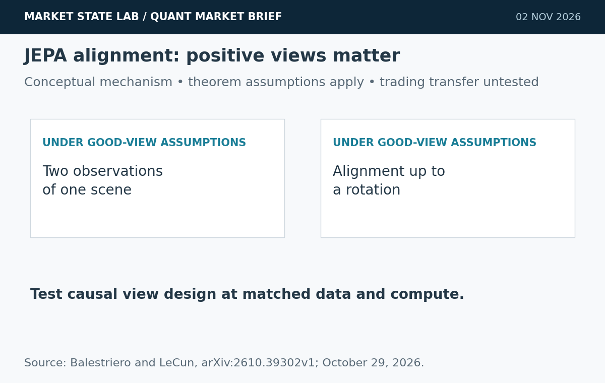
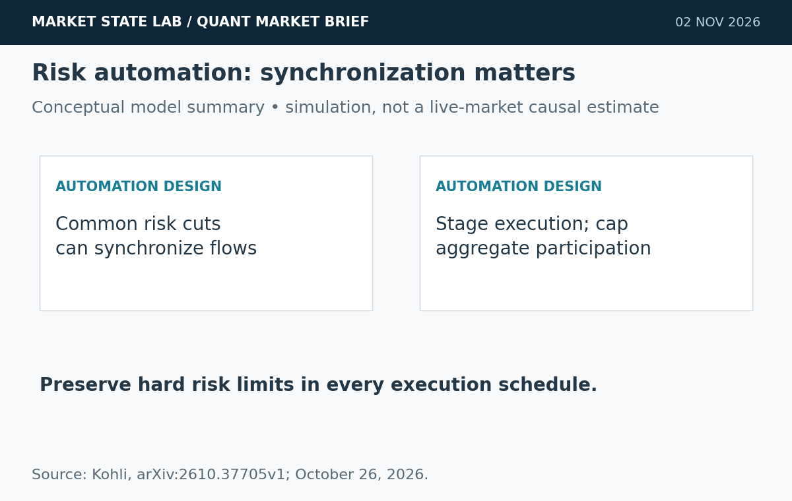
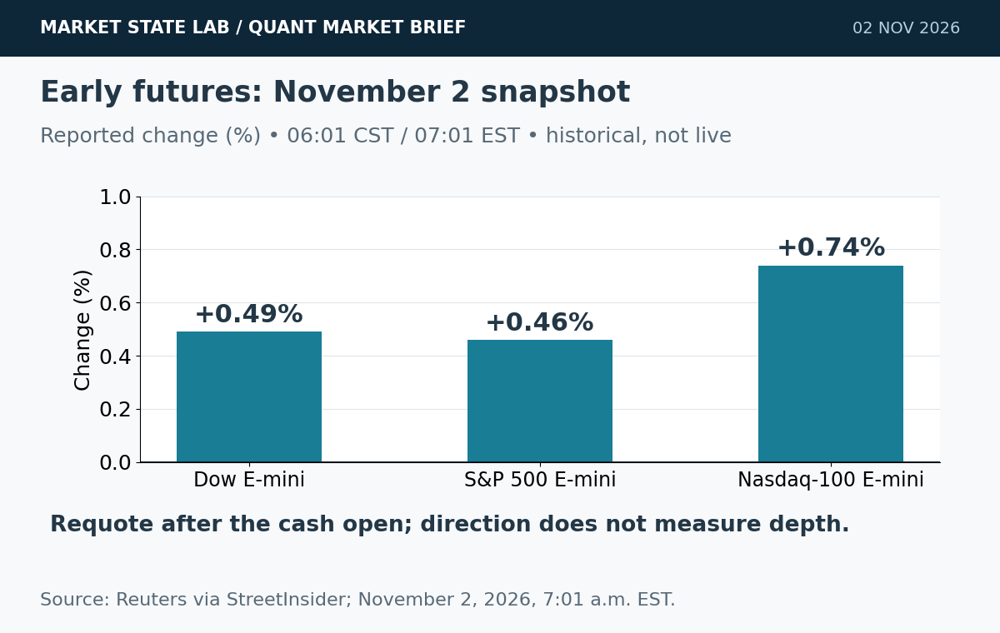
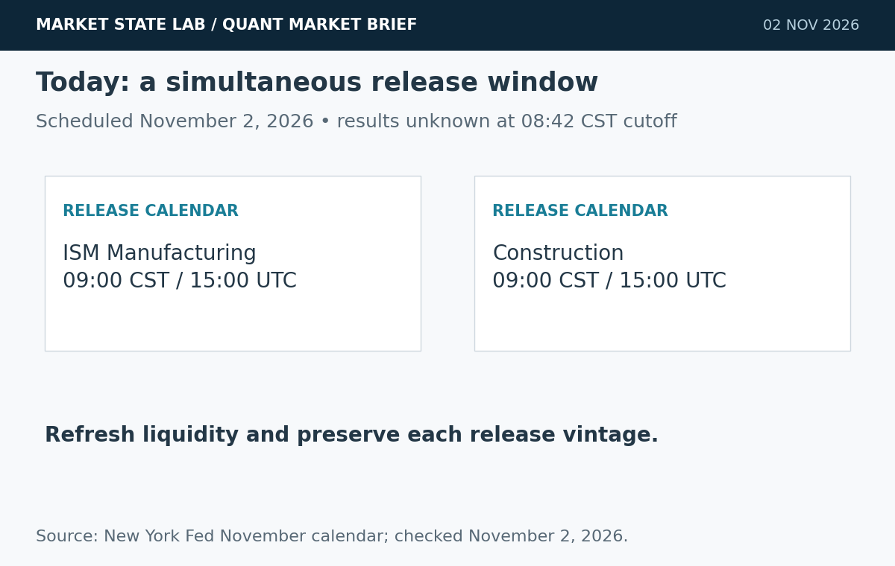
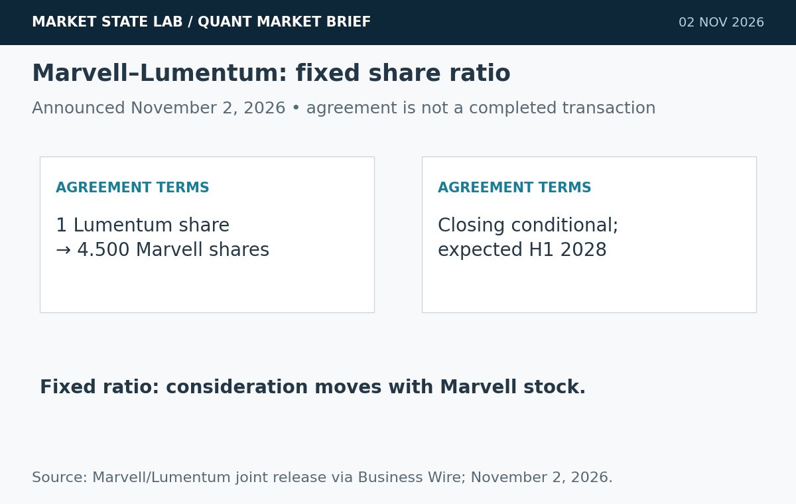

# Quant Market Brief — November 2, 2026: Risk Synchrony & AI Connectivity

Research cutoff: **November 2, 2026, 8:42 a.m. CST (14:42 UTC)**. Cash trading has opened; market observations below are explicitly timestamped and are not live execution quotes. Factor comparisons use October 30 completed closes. No current depth or options-positioning feed verified.

[Subscribe by email](https://market-state-lab.ghost.io/?utm_source=github&utm_medium=technical_archive&utm_campaign=qmb_2026-11-02#/portal/signup).

## 1. JEPA research makes positive-view design central to alignment

*Graphic: Market State Lab; Balestriero and LeCun, arXiv:2610.39302v1; October 29, 2026. Conceptual or quantitative as labeled.*

**Date:** Preprint submitted October 29, 2026.

**Fact:** Balestriero and LeCun prove representation alignment up to a rotation for separately trained JEPAs under their good-view assumptions. Their experiments find that positive-pair design can improve alignment efficiency beyond simply increasing model scale. [Direct source](https://arxiv.org/abs/2610.39302)

**Inference:** How training observations are paired may matter as much as encoder capacity.

**Uncertainty:** The theorem has assumptions; vision/language results do not establish financial prediction or trading performance.

**Why it matters:** Compare causal market-view constructions at matched data and compute, with untouched temporal holdouts.

## 2. Quant model identifies synchronized risk automation as a liquidation amplifier

*Graphic: Market State Lab; Kohli, arXiv:2610.37705v1; October 26, 2026. Conceptual or quantitative as labeled.*

**Date:** Preprint submitted October 26, 2026.

**Fact:** Kohli’s calibrated agent-based model attributes market-wide liquidation amplification to synchronized risk overlays and execution. Dispersed overlay parameters, staged execution and a participation breaker reduce modeled tail liquidation when combined. [Direct source](https://arxiv.org/abs/2610.37705)

**Inference:** Diversifying model providers alone may leave common execution triggers intact.

**Uncertainty:** These are model-dependent simulations and historical replays, not an observed live-market causal estimate or guaranteed mitigation.

**Why it matters:** Stress common-shock risk cuts; compare staged execution with identical hard risk limits and measure tail loss, shortfall and coverage.

## 3. Early futures rebound precedes a busy election week

*Graphic: Market State Lab; Reuters via StreetInsider; November 2, 2026, 7:01 a.m. EST. Conceptual or quantitative as labeled.*

**Date:** Reuters November 2, 2026; snapshot 7:01 a.m. EST / 6:01 a.m. CST.

**Fact:** Reuters reported Dow E-mini futures up 0.49%, S&P 500 E-minis up 0.46% and Nasdaq-100 E-minis up 0.74% at 7:01 a.m. Eastern, as technology shares steadied ahead of the midterms and earnings. [Direct source](https://new.streetinsider.com/Reuters/Wall%2BSt%2Bfutures%2Brise%2Bas%2BAI%2Bstocks%2Bcatch%2Btheir%2Bbreath%3B%2Bmidterms%2Bin%2Bfocus/27268508.html)

**Inference:** The early rebound does not establish durable post-open liquidity or a reversal of October’s weakness.

**Uncertainty:** This is a historical premarket snapshot, not a current executable quote. Cash trading began after this observation.

**Why it matters:** Requote SPY/QQQ after the open and around data releases; validate depth and futures basis before sizing execution.

## 4. Manufacturing and construction releases create a 9 a.m. execution checkpoint

*Graphic: Market State Lab; New York Fed November calendar; checked November 2, 2026. Conceptual or quantitative as labeled.*

**Date:** November 2, 2026 releases scheduled for 10:00 a.m. EST / 9:00 a.m. CST.

**Fact:** The New York Fed calendar schedules ISM Manufacturing and construction data for November 2 at 10:00 a.m. Eastern, or 9:00 a.m. Central. Both results remain unavailable at this edition’s cutoff. [Direct source](https://www.newyorkfed.org/research/calendars/i-nov26.html)

**Inference:** Simultaneous activity releases can change rate-sensitive features and execution conditions together.

**Uncertainty:** Calendar times are tentative; no release result, surprise or policy response is assumed.

**Why it matters:** Record availability timestamps, separate release vintages and refresh spreads/depth after the data window.

## 5. Marvell agrees to acquire Lumentum in a fixed-ratio stock deal

*Graphic: Market State Lab; Marvell/Lumentum joint release via Business Wire; November 2, 2026. Conceptual or quantitative as labeled.*

**Date:** Company announcement November 2, 2026; agreement signed November 1.

**Fact:** Marvell and Lumentum announced an all-stock acquisition agreement: each Lumentum share would receive 4.500 Marvell shares. The companies expect closing in the first half of 2028, subject to shareholder and regulatory approvals and other conditions. [Direct source](https://www.businesswire.com/news/home/20261102374788/en/Marvell-and-Lumentum-to-Combine-Creating-a-Category-Leader-in-AI-Connectivity)

**Inference:** The agreement combines electrical and optical AI connectivity; fixed-ratio consideration fluctuates with Marvell’s share price.

**Uncertainty:** The deal is not completed. Closing, integration and projected commercial benefits remain uncertain.

**Why it matters:** Model the share ratio, dilution and closing conditions separately from AI demand forecasts; do not treat a headline deal value as fixed cash consideration.

## Quant & Market Dashboard

### Liquidity, funding and volatility

- **Data state:** The 8:30 a.m. CST cash open has passed. Current futures/ETF depth, consolidated spreads, overnight volume and executable Treasury liquidity are not verified. Early futures direction is not evidence of market depth. Use fresh broker/exchange quotes before acting.
- **ETF activity proxy:** October 30 completed daily rows: SPY **755.72**, volume **77.70m**, high–low **11.10 points**; QQQ **690.49**, volume **85.24m**, high–low **15.18 points**. A November 2 SPY observation at **8:32:14 a.m. CST** was **759.42**, cumulative volume **2.22m**; delay status unspecified. QQQ’s banner conflicts with its completed row, so it is excluded. These are historical/delayed context, not executable quotes. Volume does not measure depth or slippage. [SPY](https://chartexchange.com/symbol/nyse-spy/historical/) · [QQQ](https://chartexchange.com/symbol/nasdaq-qqq/historical/).
- **Funding:** October 30 SOFR **3.95%**, up one basis point; EFFR **3.88%**, unchanged. FRED updated November 2 at **7:02** and **8:02 a.m. CST**, respectively. The **seven-basis-point** gap is a lagged aggregate proxy, not proof of current Treasury-market stress. [SOFR](https://fred.stlouisfed.org/series/SOFR) · [EFFR](https://fred.stlouisfed.org/series/EFFR).
- **Volatility: Moderate with elevated event risk; medium confidence.** Delayed VIX **18.99** at **8:10 a.m. CST November 2**, versus Friday’s **19.42**. A sub-20 reading supports the moderate classification; Friday’s wide ranges and today’s releases argue for conservative execution. This observation predates the cash open. Term structure, skew and dealer gamma are unverified. [VIX](https://chartexchange.com/symbol/index-vix/historical/).

### Factor performance proxies

| Factor | ETF | October 30 daily | September 23→October 30 |
|---|---|---:|---:|
| Momentum | [MTUM](https://stockanalysis.com/etf/mtum/history/) | -4.77% | -10.36% |
| Value | [VLUE](https://stockanalysis.com/etf/vlue/history/) | -1.70% | -3.34% |
| Quality | [QUAL](https://stockanalysis.com/etf/qual/history/) | -0.99% | +0.16% |
| Size | [IWM](https://stockanalysis.com/etf/iwm/history/) | -1.65% | -0.92% |
| Growth | [IWF](https://stockanalysis.com/etf/iwf/history/) | -2.89% | -6.20% |
| Low volatility | [SPLV](https://stockanalysis.com/etf/splv/history/) | +0.33% | +7.32% |

Unadjusted close-to-close price returns exclude distributions; ETF exposures are not isolated factor premia. October 30 endpoints rechecked November 2; September 23 anchors preserved from the dated archive. These are completed-session comparisons, not today’s factor performance. Low volatility was the only positive daily proxy; momentum had the largest daily decline.

### Execution and microstructure

- Refresh SPY/QQQ NBBO, quote age, displayed depth, ES/NQ basis and opening-auction outcomes now that the **8:30 a.m. CST / 14:30 UTC** open has passed. Reduce participation while spreads, basis or cancellation rates remain unstable.
- Today’s **9:00 a.m. CST / 15:00 UTC** manufacturing/construction window is a separate liquidity reset. Use bounded limit orders; stress spread widening, impact, slippage, partial fills and adverse selection. Small displayed size and stale indicative quotes can create liquidity traps.
- For options, verify each contract’s expiry, settlement and deliverable. Reject stale, crossed or one-sided quotes; compare package execution costs. Short-dated gamma can amplify sensitivity, but dealer-gamma sign, pinning and current positioning are unknown.
- Stage discretionary risk reductions without relaxing hard drawdown/exposure limits. Test aggregate participation breakers under common shocks rather than assuming diversification of AI providers removes synchronization risk.

**Research watchlist:** SPY, QQQ, IWM, RSP, TLT; ES, NQ, ZN, VX; MTUM, VLUE, QUAL, IWF, SPLV; MRVL, LITE, SOXX.

### DRL Improvements for the MATLAB System

1. Enforce drawdown, exposure, participation and stale-data limits outside the policy; retain a safe fallback.
2. Charge spread, impact, turnover, latency and missed fills in rewards; report tail loss, shortfall and trade coverage separately.
3. Test staged risk-cut timing and a shared participation breaker under common shocks, while preserving identical hard risk constraints.
4. Use purged, embargoed walk-forward folds, paired seeds and unseen regimes; stress transaction costs and avoid future information in positive-view construction.

### Model hygiene

Preserve availability timestamps, economic release vintages and point-in-time universes. Check leakage, survivorship and look-ahead bias, causal corporate actions, stale options quotes, multiple testing, calibration and drift. Freeze final holdouts; archive source and retrieval versions.

### MATLAB optimization patterns

- Use named-zone timetables with causal synchronize/retime alignment and explicit release timestamps.
- Vectorize features, preallocate logs and profile before parallelizing.
- Parallelize independent folds or Bayesian trials with reproducible random streams and immutable holdouts.
- Use GPUs for suitable large batches only; keep policy, risk and execution modules separate.

### High-value quant research question

**Does staging otherwise identical risk reductions lower tail liquidation without increasing drawdown breaches or execution shortfall?**

Compare synchronized and staged schedules under matched shocks, participation limits and transaction costs. This tests whether execution coordination adds resilience beyond provider diversification.

[Subscribe by email](https://market-state-lab.ghost.io/?utm_source=github&utm_medium=technical_archive&utm_campaign=qmb_2026-11-02#/portal/signup).

*Research and education only—not individualized financial advice. No trading performance is promised.*
