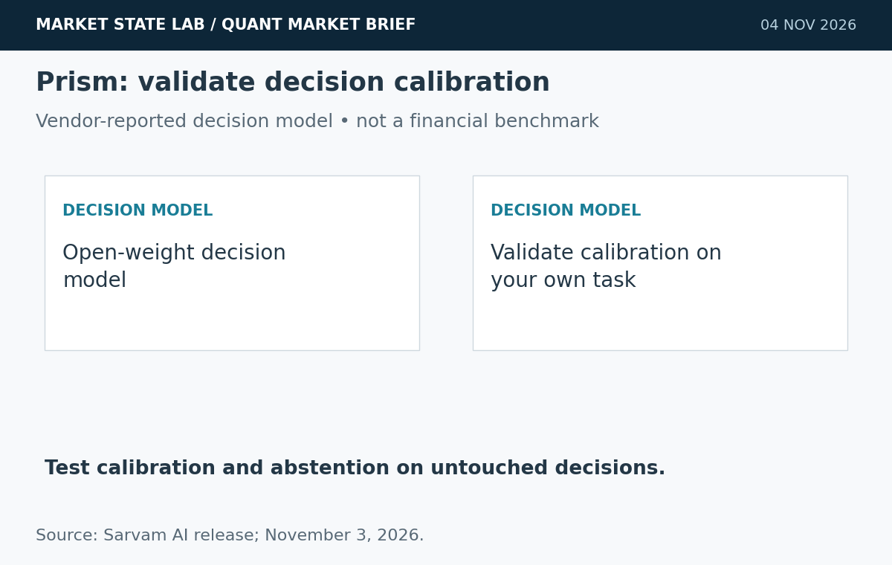
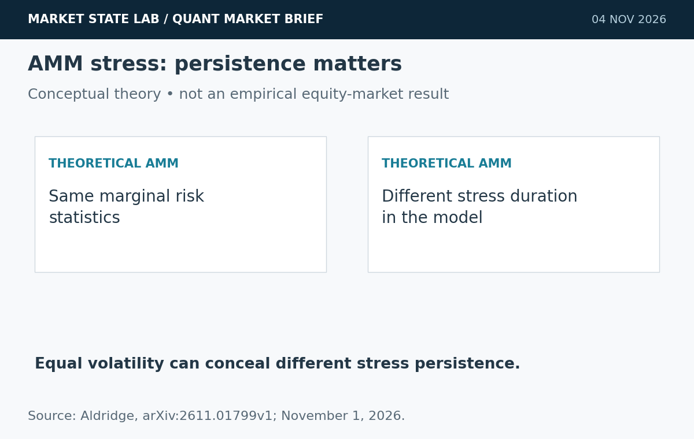
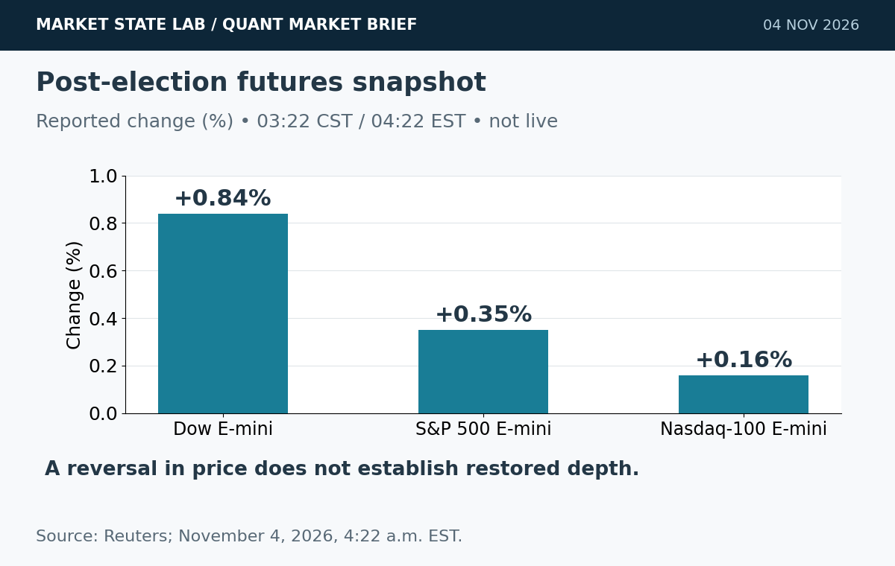
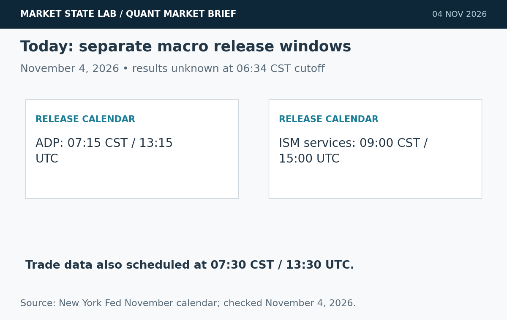
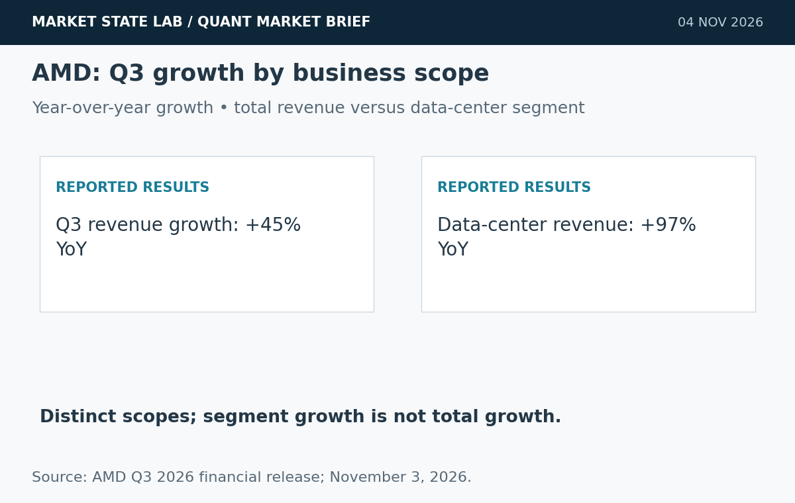

# Quant Market Brief — November 4, 2026: Post-Election Repricing & AMD Growth

Research cutoff: **November 4, 2026, 6:34 a.m. CST (12:34 UTC)**. Premarket edition: futures are an earlier reported snapshot, ETF/factor observations November 3 prior-close, VIX delayed and funding lagged. No live execution feed verified.

[Subscribe by email](https://market-state-lab.ghost.io/?utm_source=github&utm_medium=technical_archive&utm_campaign=qmb_2026-11-04#/portal/signup).

## 1. Sarvam releases Prism for fast, calibrated decisions

*Graphic: Market State Lab; Sarvam AI release; November 3, 2026. Conceptual or quantitative as labeled.*

**Date:** November 3, 2026.

**Fact:** Sarvam released Prism with open weights, built on Sarvam 105B. Its own comparison reports a 71.8 average score across three indices and 44 ms median response time on B200 hardware. [Direct source](https://www.sarvam.ai/blogs/sarvam-prism)

**Inference:** Calibration and abstention deserve evaluation alongside accuracy and latency.

**Uncertainty:** These are vendor-run benchmarks; hardware timing and calibration claims do not establish performance on financial decisions.

**Why it matters:** Benchmark calibration, option-order sensitivity and abstention on untouched time-separated decisions before workflow automation.

## 2. AMM research shows volatility can miss feedback-driven stress

*Graphic: Market State Lab; Aldridge, arXiv:2611.01799v1; November 1, 2026. Conceptual or quantitative as labeled.*

**Date:** Preprint submitted November 1, 2026.

**Fact:** Aldridge models learning agents interacting with a constant-product automated market maker. Herd and arbitrage regimes can have identical return distributions and turnover yet different stress duration; serial statistics identify feedback sign in the model. [Direct source](https://arxiv.org/abs/2611.01799)

**Inference:** State persistence can add information beyond volatility and volume.

**Uncertainty:** Theoretical AMM results are not an empirical finding about SPY/QQQ order books or demonstrated trading alpha.

**Why it matters:** Compare volatility-only and serial-dependence state features under realistic costs and untouched regime holdouts.

## 3. Futures recover early election-night losses

*Graphic: Market State Lab; Reuters; November 4, 2026, 4:22 a.m. EST. Conceptual or quantitative as labeled.*

**Date:** Reuters November 4; snapshot 4:22 a.m. EST / 3:22 a.m. CST.

**Fact:** Reuters reports Democrats won both congressional chambers and U.S. futures recovered early losses. At 3:22 a.m. CST, Dow E-minis were up 0.84%, S&P 500 E-minis 0.35% and Nasdaq-100 E-minis 0.16%. [Direct source](https://www.reuters.com/business/us-stock-index-futures-steady-democrats-seize-congress-2026-11-04/)

**Inference:** A reversal in direction does not guarantee restored market depth.

**Uncertainty:** This is an earlier reported snapshot, not an executable current quote. Policy consequences remain uncertain.

**Why it matters:** Refresh SPY/QQQ quotes, futures basis and auction imbalances; stress two-way gaps rather than extrapolating overnight direction.

## 4. ADP and services data add two distinct release windows

*Graphic: Market State Lab; New York Fed November calendar; checked November 4, 2026. Conceptual or quantitative as labeled.*

**Date:** November 4, 2026 scheduled releases; checked before publication.

**Fact:** The New York Fed calendar schedules ADP at 7:15 a.m. CST and ISM Non-Manufacturing at 9:00 a.m. CST today. It also lists trade data at 7:30 a.m. CST. Results are unknown at cutoff. [Direct source](https://www.newyorkfed.org/research/calendars/i-nov26.html)

**Inference:** Labor and services information can reset rate-sensitive signals separately from the election reaction.

**Uncertainty:** Calendar times are tentative; no release values, surprises or Fed response are assumed.

**Why it matters:** Attach availability timestamps to each release vintage and reassess liquidity after each event.

## 5. AMD reports record quarterly revenue and data-center growth

*Graphic: Market State Lab; AMD Q3 2026 financial release; November 3, 2026. Conceptual or quantitative as labeled.*

**Date:** Results released November 3, 2026, 4:15 p.m. EST.

**Fact:** AMD reported third-quarter revenue of $13.377 billion, up 45% year over year, and data-center segment revenue growth of 97%. GAAP diluted earnings per share were $1.46, versus non-GAAP $2.09. [Direct source](https://ir.amd.com/news-events/press-releases/detail/1303/amd-reports-third-quarter-2026-financial-results)

**Inference:** Data-center demand is supporting both accelerators and server CPUs.

**Uncertainty:** Company outlook is forward-looking; growth does not by itself establish valuation attractiveness or sustainable margins.

**Why it matters:** Separate realized revenue, GAAP profitability and forecasts; stress concentration and capital-spending sensitivity.

## Quant & Market Dashboard

### Liquidity, funding and volatility

- **Overnight:** Current ES/NQ or ETF spreads, depth, overnight volume, options positioning and executable Treasury liquidity are unverified. The reported futures reversal is a direction proxy, not evidence of depth. Do not carry an old quote into an order.
- **Prior-close activity, November 3:** SPY completed row **754.35**, volume **32.89m**, range **4.68 points**; QQQ **685.28**, volume **37.52m**, range **5.51 points**. Small discrepancies exist between quote banners and daily rows; this edition uses completed rows. Activity is not executable liquidity. [SPY](https://chartexchange.com/symbol/nyse-spy/historical/) · [QQQ](https://chartexchange.com/symbol/nasdaq-qqq/historical/).
- **Funding:** Latest verified November 2 SOFR **3.95%** and EFFR **3.88%**, unchanged from October 30; seven-basis-point gap. FRED updated November 3 at 7:02 and 8:03 a.m. CST respectively. Lagged aggregate context does not establish current Treasury stress. [SOFR](https://fred.stlouisfed.org/series/SOFR) · [EFFR](https://fred.stlouisfed.org/series/EFFR).
- **Volatility: Moderate, transitioning from high; medium confidence.** Delayed VIX **18.04 at 5:54 a.m. CST November 4**, versus November 3 close **20.83**. Sub-20 supports the house moderate classification; overnight reversals and release windows warrant stricter controls. Term structure, skew and dealer-gamma sign are unknown. [VIX](https://chartexchange.com/symbol/index-vix/historical/).

### Factor performance proxies

| Factor | ETF | November 3 daily | October 5→November 3 |
|---|---|---:|---:|
| Momentum | [MTUM](https://stockanalysis.com/etf/mtum/history/) | +1.16% | -13.87% |
| Value | [VLUE](https://stockanalysis.com/etf/vlue/history/) | +0.12% | -3.55% |
| Quality | [QUAL](https://stockanalysis.com/etf/qual/history/) | -0.05% | -1.76% |
| Size | [IWM](https://stockanalysis.com/etf/iwm/history/) | +0.23% | -1.27% |
| Growth | [IWF](https://stockanalysis.com/etf/iwf/history/) | +1.05% | -8.50% |
| Low volatility | [SPLV](https://stockanalysis.com/etf/splv/history/) | -0.74% | +8.14% |

Source-linked completed daily rows; unadjusted close-to-close price returns exclude distributions and are not isolated factor premia. All endpoints were retrieved for this edition. Momentum/growth rebounded on the day but remain negative over the approximately four-week comparison; low volatility shows the opposite pattern. No future corporate action is applied.

### Execution and microstructure

- Before the **8:30 a.m. CST / 14:30 UTC** cash open, refresh NBBO, quote age, displayed depth, opening-auction imbalances and ES/NQ basis. Post-election gaps can make indicative prices and thin displayed size liquidity traps.
- ADP **7:15**, trade data **7:30**, and services **9:00 a.m. CST** are separate liquidity resets. Use bounded limits and participation caps; stress spread widening, slippage, latency, cancellations and missed fills.
- For SPY/QQQ options, verify expiry, settlement and deliverables; reject stale, crossed or one-sided quotes. Compare package execution costs. Short-dated gamma can amplify moves; dealer positioning and pinning are unverified.
- Compare serial-dependence features with volatility-only states; do not transfer AMM theory to equity order books without empirical validation.

**Research watchlist:** SPY, QQQ, IWM, RSP, TLT; ES, NQ, ZN, VX; MTUM, VLUE, QUAL, IWF, SPLV; AMD, NVDA, SOXX.

### DRL Improvements for the MATLAB System

1. Enforce drawdown, exposure, participation and stale-data limits outside the policy, with a safe fallback.
2. Penalize spread, impact, turnover, latency and missed fills; report tail loss, coverage and constraint breaches separately.
3. Compare volatility-only states with causal serial-dependence and stress-duration features under matched risk and cost constraints.
4. Use purged, embargoed walk-forward folds, paired seeds and unseen regimes; calibrate uncertainty and test abstention under drift.

### Model hygiene

Check leakage, survivorship and look-ahead bias, corporate actions, stale options, multiple testing, calibration and drift. Preserve point-in-time universes, economic vintages, source snapshots and availability timestamps; keep final holdouts untouched.

### MATLAB optimization patterns

- Align named-zone timetables causally with synchronize/retime; never forward-fill an unreleased macro value.
- Vectorize rolling features, preallocate logs and profile bottlenecks.
- Parallelize independent folds or Bayesian trials with reproducible random streams.
- Use GPUs only for suitable large batches; separate policy, risk and execution modules.

### High-value quant research question

**Do causal serial-dependence features improve prediction of liquidity-stress duration beyond volatility and volume, after transaction costs?**

Use matched event windows, purged walk-forward folds and a volatility/volume baseline. It tests whether state persistence adds practical information rather than merely fitting return magnitudes.

[Subscribe by email](https://market-state-lab.ghost.io/?utm_source=github&utm_medium=technical_archive&utm_campaign=qmb_2026-11-04#/portal/signup).

*Research and education only—not individualized financial advice. No trading performance is promised.*
