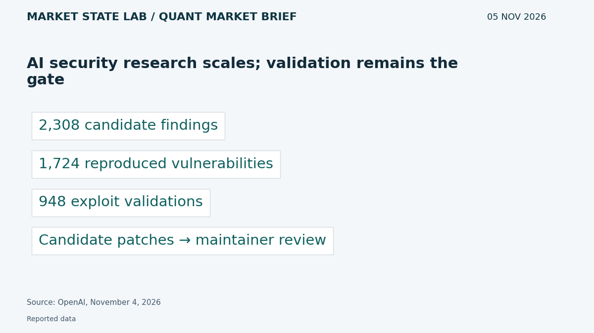
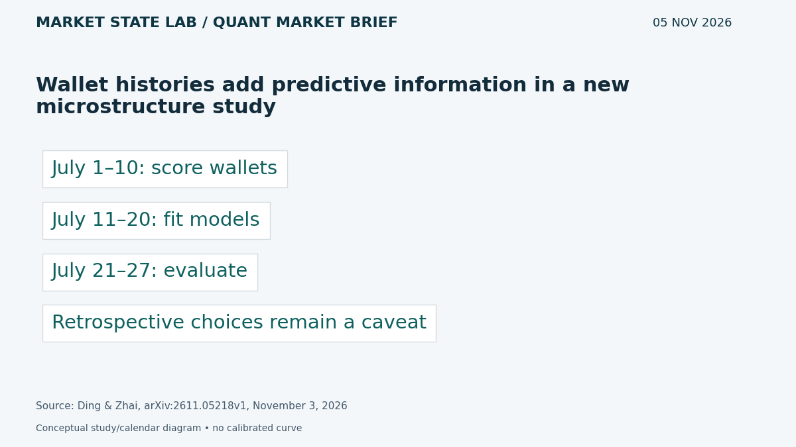
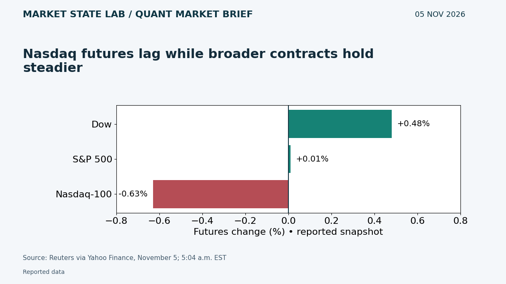
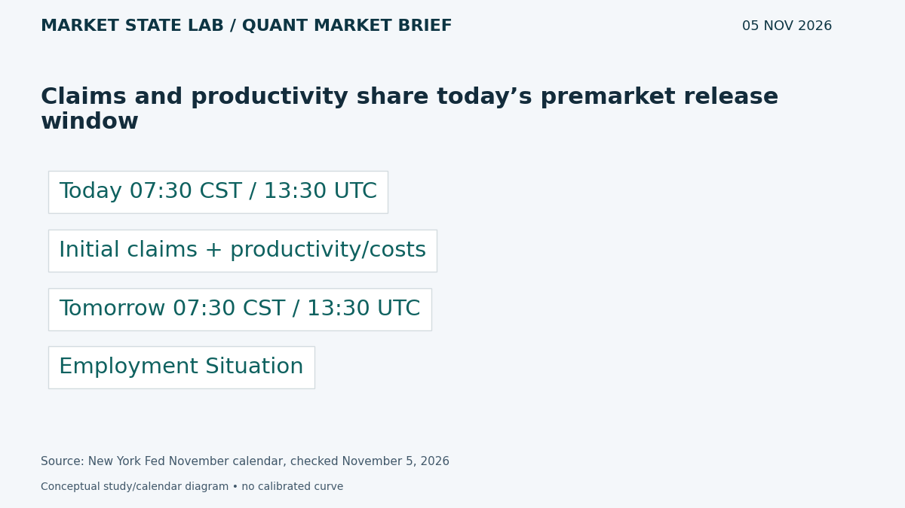
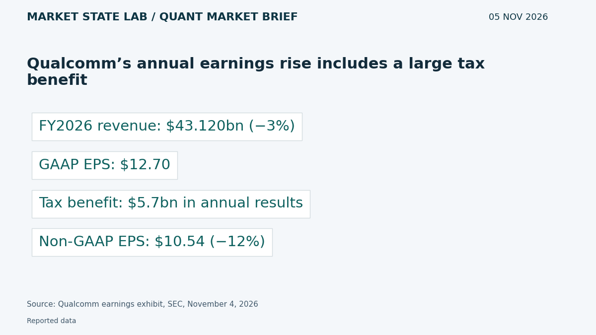

# Quant Market Brief — November 5, 2026: Wallet Signals & Nasdaq Divergence

Research cutoff: **November 5, 2026, 6:32 a.m. CST (12:32 UTC)**. Futures are an earlier reported snapshot; ETF factors are November 4 prior-close, VIX delayed and funding lagged. No live execution feed verified.

[Subscribe by email](https://market-state-lab.ghost.io/?utm_source=github&utm_medium=technical_archive&utm_campaign=qmb_2026-11-05#/portal/signup).

## 1. AI security research scales; validation remains the gate

*Graphic: Market State Lab; OpenAI, November 4, 2026.*

**Fact — November 4, 2026:** OpenAI reports a Linux research pipeline progressing from 2,308 candidate findings to 1,724 reproduced vulnerabilities and 948 privilege-escalation exploits, with candidate patches for review. [Direct source](https://openai.com/index/a-thousand-fewer-paths-to-root/)

**Inference / Why it matters:** Use staged evidence gates and human review in automated technical workflows.

**Uncertainty:** Vendor-reported controlled research; generated patches are not all deployed fixes.

## 2. Wallet histories add predictive information in a new microstructure study

*Graphic: Market State Lab; Ding & Zhai, arXiv:2611.05218v1, November 3, 2026.*

**Fact — Preprint submitted November 3, 2026:** Ding and Zhai report that wallet-attributed features improve short-horizon Hyperliquid forecasts beyond an anonymous benchmark. Their chronological evaluation uses earlier wallet scores. [Direct source](https://arxiv.org/abs/2611.05218)

**Inference / Why it matters:** Test feature availability, delayed inputs and matched placebos before trusting predictive gains.

**Uncertainty:** Retrospectively selected specifications, consensus timestamps and data gaps limit deployment claims; executable profit is not demonstrated.

## 3. Nasdaq futures lag while broader contracts hold steadier

*Graphic: Market State Lab; Reuters via Yahoo Finance, November 5; 5:04 a.m. EST.*

**Fact — November 5, 2026; 4:04 a.m. CST snapshot:** Reuters reports Dow futures +0.48%, S&P 500 futures +0.01% and Nasdaq-100 futures −0.63% at 5:04 a.m. EST, following Wednesday’s broad rally. [Direct source](https://ca.finance.yahoo.com/news/p-500-futures-steady-midterm-105838388.html)

**Inference / Why it matters:** Reassess SPY–QQQ relative risk and refresh executable quotes before placing orders.

**Uncertainty:** Earlier press snapshot, not live prices, spreads or depth; no directional trade is implied.

## 4. Claims and productivity share today’s premarket release window

*Graphic: Market State Lab; New York Fed November calendar, checked November 5, 2026.*

**Fact — November 5, 2026 scheduled events:** The New York Fed calendar lists initial claims and preliminary productivity/costs for 8:30 a.m. EST today, and the Employment Situation at that time tomorrow. [Direct source](https://www.newyorkfed.org/research/calendars/i-nov26.html)

**Inference / Why it matters:** Treat today’s labor/cost releases and Friday’s jobs report as separate information events.

**Uncertainty:** Schedules are tentative; release values and surprises are unknown at cutoff.

## 5. Qualcomm’s annual earnings rise includes a large tax benefit

*Graphic: Market State Lab; Qualcomm earnings exhibit, SEC, November 4, 2026.*

**Fact — Results released November 4, 2026:** Qualcomm reports fiscal-2026 GAAP revenue of $43.120 billion, down 3%, and GAAP EPS of $12.70. Annual GAAP results include a $5.7 billion tax benefit; non-GAAP EPS was $10.54, down 12%. [Direct source](https://www.sec.gov/Archives/edgar/data/804328/000080432826000127/qcom092726erex991.htm)

**Inference / Why it matters:** Separate operating results, accounting effects and forecasts when comparing earnings quality.

**Uncertainty:** Non-GAAP measures require reconciliation; management’s diversification targets remain forward-looking.

## Quant & Market Dashboard

### Liquidity and volatility

- **Overnight:** ES/NQ and ETF spreads, depth and overnight volume are unverified. Futures divergence is a direction proxy, not evidence of executable liquidity. Current Treasury depth and options positioning are unavailable.
- **Prior-close activity, November 4:** SPY completed daily row 766.81, volume 62.13m; QQQ 691.95, volume 62.37m. Provider quote banners differ slightly from daily rows; use completed rows consistently. Volume is an activity proxy, not fill quality. [SPY](https://chartexchange.com/symbol/nyse-spy/historical/) · [QQQ](https://chartexchange.com/symbol/nasdaq-qqq/historical/).
- **Funding:** November 3 SOFR 3.97% versus EFFR 3.88%, a nine-basis-point gap; SOFR is two basis points above November 2. FRED updated these on November 4 at 7:02 and 8:02 a.m. CST. Lagged aggregate context does not establish present funding stress. [SOFR](https://fred.stlouisfed.org/series/SOFR) · [EFFR](https://fred.stlouisfed.org/series/EFFR).
- **Regime: Moderate, easing; medium confidence.** Delayed VIX 16.76 at November 5 5:54 a.m. CST, versus November 4 close 16.61 and November 3 close 20.83. House rule: 15–25 moderate; below 15 low; 25–35 high; above 35 stressed. Cross-asset dispersion and macro windows can still elevate execution risk. Term structure and skew unverified. [VIX](https://chartexchange.com/symbol/index-vix/historical/).

### Factor proxies

| Factor | ETF | Nov 3→4 | Oct 7→Nov 4 (4 weeks) |
|---|---|---:|---:|
| Momentum | [MTUM](https://stockanalysis.com/etf/mtum/history/) | -1.95% | -15.37% |
| Value | [VLUE](https://stockanalysis.com/etf/vlue/history/) | +0.18% | -4.02% |
| Quality | [QUAL](https://stockanalysis.com/etf/qual/history/) | +2.31% | +0.50% |
| Size | [IWM](https://stockanalysis.com/etf/iwm/history/) | +1.51% | +2.28% |
| Growth | [IWF](https://stockanalysis.com/etf/iwf/history/) | +0.39% | -8.43% |
| Low volatility | [SPLV](https://stockanalysis.com/etf/splv/history/) | +2.12% | +10.24% |

Calculated from source-linked Close columns, not adjusted total returns. These are indicative ETF price-return proxies, not isolated factor premia; distributions are excluded. Both endpoints use the same provider scale; corporate-action histories were not independently refreshed. Do not splice these levels into a differently adjusted series. Quality and low volatility led momentum on the day; momentum and growth remained negative over four weeks.

### Execution and microstructure

- Initial claims and productivity/costs: **7:30 a.m. CST / 13:30 UTC**. Cash opening auction: **8:30 a.m. CST / 14:30 UTC**. Recheck quotes after each event and before Friday’s jobs release.
- For SPY/QQQ, inspect NBBO age, spread, depth, auction imbalances and ES/NQ basis. Use bounded limits, participation caps and explicit slippage budgets. Displayed size and high prior volume can hide liquidity traps.
- For options, verify expiry, deliverables, settlement, quote synchronization and package costs. Reject stale, crossed or one-sided markets. Short-dated gamma can magnify moves; dealer gamma sign, pinning and expiry-flow magnitude are unknown.
- Keep venue-specific identity signals separate from anonymous U.S. equity feeds. Test anonymous adverse-selection proxies rather than assuming wallet features transfer.

**Research watchlist:** SPY, QQQ, IWM, RSP, TLT; ES, NQ, ZN, VX; MTUM, VLUE, QUAL, IWF, SPLV; QCOM, SOXX.

### DRL Improvements for the MATLAB System

1. Enforce drawdown, exposure, participation and stale-data constraints outside the policy, with a safe fallback.
2. Penalize spread, market impact, latency, turnover and missed fills; report tail loss and constraint breaches separately from reward.
3. Run purged, embargoed walk-forward tests with matched seeds, locked feature selection and unseen market regimes; stress execution costs and delayed inputs.
4. Add abstention under poor calibration or drift; compare richer state features with a simple volatility/volume baseline.

### Model hygiene

Check leakage, survivorship and look-ahead bias, corporate actions, stale options quotes, multiple testing, calibration and drift. Preserve point-in-time universes, release vintages and availability timestamps. Fit scalers only on training folds. Retrospective feature selection requires a new untouched test.

### MATLAB optimization patterns

- Use named-zone timetables and causal synchronize/retime alignment; never backfill an unreleased observation.
- Vectorize rolling features, preallocate replay logs and profile before optimizing.
- Parallelize independent folds or Bayesian trials with reproducible random streams.
- Use GPUs only for suitable batch workloads; keep data, policy, risk and execution modules separate.

### High-value quant research question

**Do delayed, anonymous adverse-selection proxies improve one-step risk forecasts beyond volatility and volume after realistic costs?**

This tests the transferable mechanism in the wallet study without assuming U.S. equity feeds expose trader identities. Lock features prospectively, compare delayed inputs and assess risk improvement as well as net returns.

[Subscribe by email](https://market-state-lab.ghost.io/?utm_source=github&utm_medium=technical_archive&utm_campaign=qmb_2026-11-05#/portal/signup).

*Research and education only—not individualized financial advice. No trading performance is promised.*
