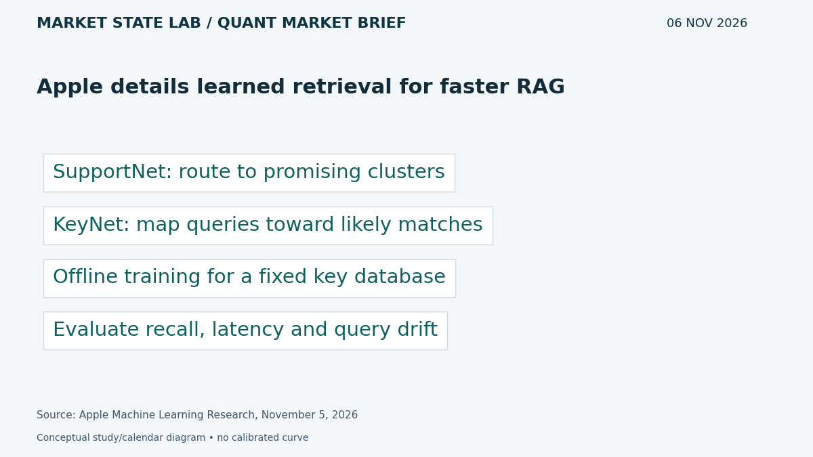
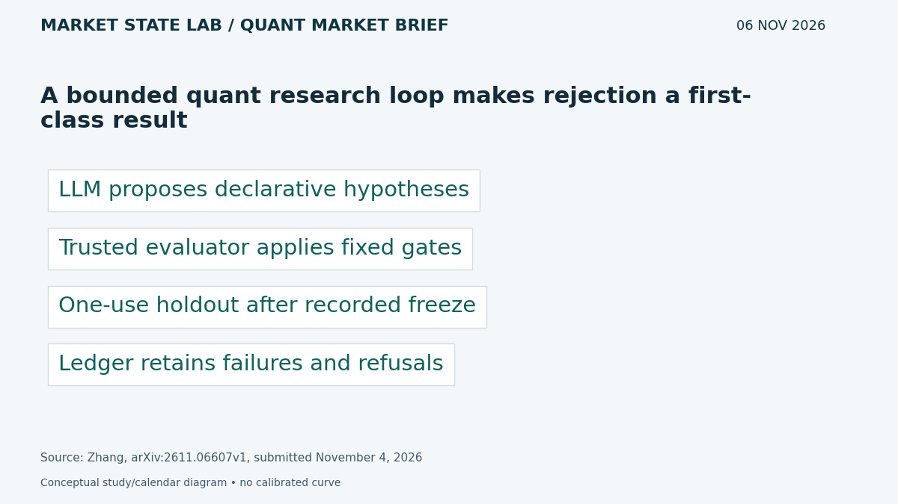
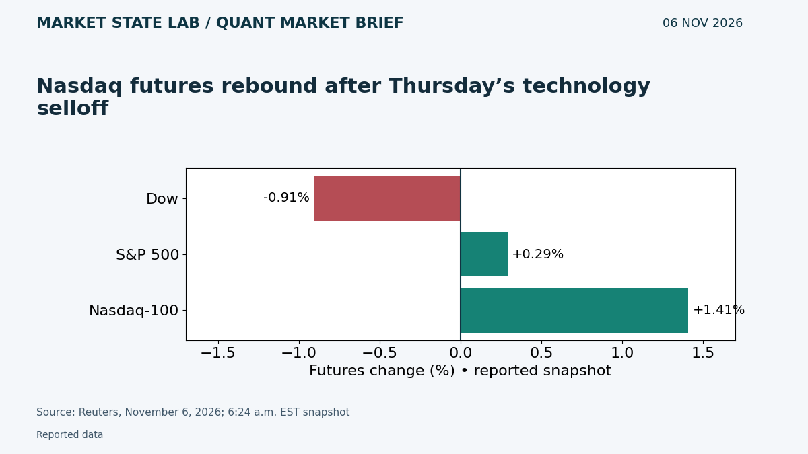
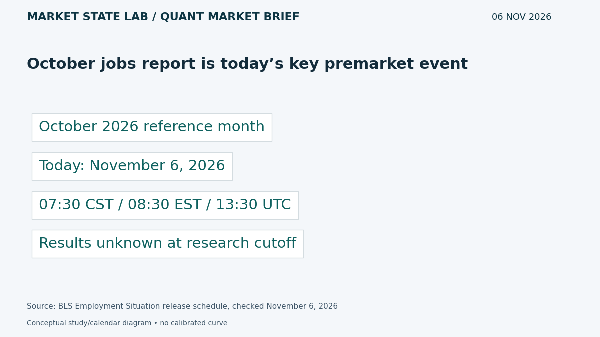
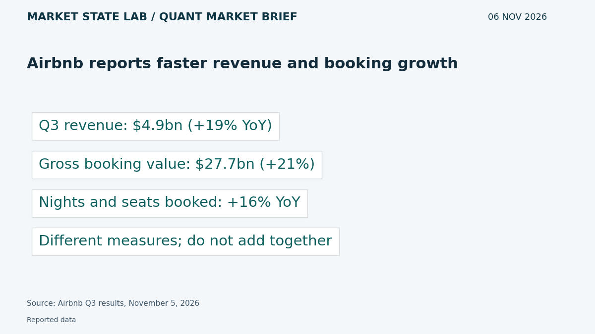

# Quant Market Brief — November 6, 2026: Jobs Risk & Research Gates

Research cutoff: **November 6, 2026, 6:30 a.m. CST (12:30 UTC)**. Futures are an earlier reported snapshot; ETF factors are November 5 prior-close, VIX delayed and funding lagged. No live execution feed verified.

[Subscribe by email](https://market-state-lab.ghost.io/?utm_source=github&utm_medium=technical_archive&utm_campaign=qmb_2026-11-06#/portal/signup).

## 1. Apple details learned retrieval for faster RAG

*Graphic: Market State Lab; Apple Machine Learning Research, November 5, 2026.*

**Fact — Research highlight published November 5, 2026; underlying paper July 2026:** Apple describes SupportNet cluster routing and KeyNet query mapping, trained offline for a fixed key database and a known query distribution. [Direct source](https://machinelearning.apple.com/research/faster-retrieval)

**Inference / Why it matters:** Benchmark recall, end-to-end latency and query drift on your own research archive before replacing retrieval infrastructure.

**Uncertainty:** Reported gains are dataset- and setup-dependent; the highlight explains existing research rather than a newly released trading tool.

## 2. A bounded quant research loop makes rejection a first-class result

*Graphic: Market State Lab; Zhang, arXiv:2611.06607v1, submitted November 4, 2026.*

**Fact — Preprint submitted November 4, 2026; listed November 5:** Henry Zhang describes a loop in which an LLM proposes declarative hypotheses while trusted code applies acceptance gates and a one-use chronological holdout. Most reported hypotheses fail. [Direct source](https://arxiv.org/abs/2611.06607)

**Inference / Why it matters:** Separate proposal generation from evaluation authority; retain refusals and failed trials, and lock final tests before opening results.

**Uncertainty:** Independent preprint and author-reported campaigns; this is a reference design, not proof that an automated strategy will earn returns.

## 3. Nasdaq futures rebound after Thursday’s technology selloff

*Graphic: Market State Lab; Reuters, November 6, 2026; 6:24 a.m. EST snapshot.*

**Fact — November 6, 2026; 5:24 a.m. CST snapshot:** Reuters reports Dow futures −0.91%, S&P 500 futures +0.29% and Nasdaq-100 futures +1.41% at 6:24 a.m. EST, after Thursday’s sharp technology-led decline. [Direct source](https://www.reuters.com/business/nasdaq-futures-rise-after-steep-ai-selloff-chip-stocks-stabilize-2026-11-06/)

**Inference / Why it matters:** Stress two-way gaps and refresh SPY/QQQ relative risk; a rebound does not establish restored market depth.

**Uncertainty:** Earlier press snapshot, not executable quotes; regulation-related explanations are reported market interpretations, not established causality.

## 4. October jobs report is today’s key premarket event

*Graphic: Market State Lab; BLS Employment Situation release schedule, checked November 6, 2026.*

**Fact — November 6, 2026 scheduled release:** BLS schedules the October 2026 Employment Situation for November 6 at 8:30 a.m. Eastern, or 7:30 a.m. CST. [Direct source](https://www.bls.gov/schedule/news_release/empSit.htm)

**Inference / Why it matters:** Reset labor-sensitive signals only when the release arrives; evaluate payrolls, unemployment, earnings and revisions jointly.

**Uncertainty:** Results and surprises were unknown at cutoff. The release does not mechanically determine the Federal Reserve’s next decision.

## 5. Airbnb reports faster revenue and booking growth

*Graphic: Market State Lab; Airbnb Q3 results, November 5, 2026.*

**Fact — Results released November 5, 2026:** Airbnb reports Q3 revenue of $4.9 billion, up 19% year over year; gross booking value of $27.7 billion, up 21%; and nights and seats booked growth of 16%. [Direct source](https://news.airbnb.com/airbnb-q3-2026-financial-results)

**Inference / Why it matters:** Separate booking volume, pricing and recognized revenue when evaluating demand and operating performance.

**Uncertainty:** Company-reported figures; booking value is not revenue, and non-GAAP measures and forward guidance require separate evaluation.

## Quant & Market Dashboard

### Liquidity and volatility

- **Overnight:** Current ES/NQ and ETF spreads, depth, overnight volume, Treasury liquidity and options positioning are unverified. The futures rebound is a direction proxy, not evidence of easy execution.
- **Prior-close activity, November 5:** completed daily rows show SPY 733.00, volume 125.89m, and QQQ 647.05, volume 130.68m. Quote banners differ from daily rows; use the latter consistently and reconcile against the execution feed before trading. Heavy volume is not narrow spreads or available depth. [SPY](https://chartexchange.com/symbol/nyse-spy/historical/) · [QQQ](https://chartexchange.com/symbol/nasdaq-qqq/historical/).
- **Funding:** latest verified November 4 SOFR 3.94% versus EFFR 3.88%, a six-basis-point gap. FRED updated November 5 at 7:02 and 8:02 a.m. CST respectively. SOFR fell three basis points from November 3; these lagged fixings do not establish current Treasury or funding stress. [SOFR](https://fred.stlouisfed.org/series/SOFR) · [EFFR](https://fred.stlouisfed.org/series/EFFR).
- **Regime: High; medium confidence.** Delayed VIX 26.44 at November 6 5:36 a.m. CST, versus November 5 close 28.18 and November 4 close 16.61. House thresholds: below 15 low, 15–25 moderate, 25–35 high, above 35 stressed. This is an explicit operating convention, not a calibrated forecast. Skew, term structure and dealer gamma remain unknown. [VIX](https://chartexchange.com/symbol/index-vix/historical/).

### Factor proxies

| Factor | ETF | Nov 4→5 | Oct 8→Nov 5 (4 weeks) |
|---|---|---:|---:|
| Momentum | [MTUM](https://stockanalysis.com/etf/mtum/history/) | -8.24% | -21.09% |
| Value | [VLUE](https://stockanalysis.com/etf/vlue/history/) | -5.71% | -9.06% |
| Quality | [QUAL](https://stockanalysis.com/etf/qual/history/) | -3.47% | -3.08% |
| Size | [IWM](https://stockanalysis.com/etf/iwm/history/) | -4.59% | -2.37% |
| Growth | [IWF](https://stockanalysis.com/etf/iwf/history/) | -6.40% | -13.18% |
| Low volatility | [SPLV](https://stockanalysis.com/etf/splv/history/) | -1.17% | +7.81% |

Source-linked Close columns on a common provider scale; price returns exclude distributions and are not isolated factor premia. Corporate-action histories were not independently refreshed. Do not splice these levels into differently adjusted series. All six proxies fell on the day; low volatility lost less and remained positive over four weeks. Rounded-close calculations can differ from provider percentage columns.

### Execution and microstructure

- Jobs release **7:30 a.m. CST / 13:30 UTC**; cash opening auction **8:30 a.m. CST / 14:30 UTC**. Refresh state after each rather than carrying pre-release quotes into orders.
- For SPY/QQQ, inspect quote age, NBBO spreads, displayed depth, auction imbalances and ES/NQ basis. Reduce participation when depth thins; use bounded limits, cancellation controls and realistic slippage budgets. A rising price on thin depth is a liquidity trap.
- For options, verify expiry, deliverables and settlement; reject stale, crossed and one-sided quotes, and price packages coherently. Friday expiry and short-dated gamma can accelerate hedging flows, but dealer-gamma sign, pinning and flow magnitude are unverified.
- Recalibrate impact estimates after the volatility jump. Treat missed fills, gaps, latency and spread expansion as separate stress dimensions.

**Research watchlist:** SPY, QQQ, IWM, RSP, TLT; ES, NQ, ZN, VX; MTUM, VLUE, QUAL, IWF, SPLV; ABNB, SOXX.

### DRL Improvements for the MATLAB System

1. Enforce drawdown, exposure, participation and stale-data limits outside the policy, with a safe fallback.
2. Penalize spread, impact, turnover, latency and missed fills; report tail losses and risk breaches separately from reward.
3. Lock feature and reward choices before a purged walk-forward test; use a one-use final holdout and retain the full trial ledger.
4. Stress unseen high-volatility regimes with widened spreads and delayed observations; require calibrated uncertainty or abstention before restoring normal risk.

### Model hygiene

Audit leakage, survivorship bias, look-ahead, corporate actions, stale options, multiple testing, calibration and drift. Preserve point-in-time universes, economic vintages and availability timestamps. Fit preprocessing only on training folds; never recycle an inspected final holdout.

### MATLAB optimization patterns

- Align named-zone timetables causally with synchronize/retime; do not backfill unreleased data.
- Vectorize rolling features, preallocate logs and profile the actual bottleneck.
- Parallelize independent folds or Bayesian trials with reproducible random streams and an explicit search budget.
- Use GPUs only for suitable batches; keep hypothesis proposals separate from trusted risk and evaluation modules.

### High-value quant research question

**Does requiring a frozen trial ledger and one-use holdout reduce false strategy acceptance compared with repeatedly selecting the best validation score?**

Compare acceptance and subsequent performance under matched data, search budgets, costs and seeds. It tests research-process reliability rather than another unconstrained alpha search.

[Subscribe by email](https://market-state-lab.ghost.io/?utm_source=github&utm_medium=technical_archive&utm_campaign=qmb_2026-11-06#/portal/signup).

*Research and education only—not individualized financial advice. No trading performance is promised.*
