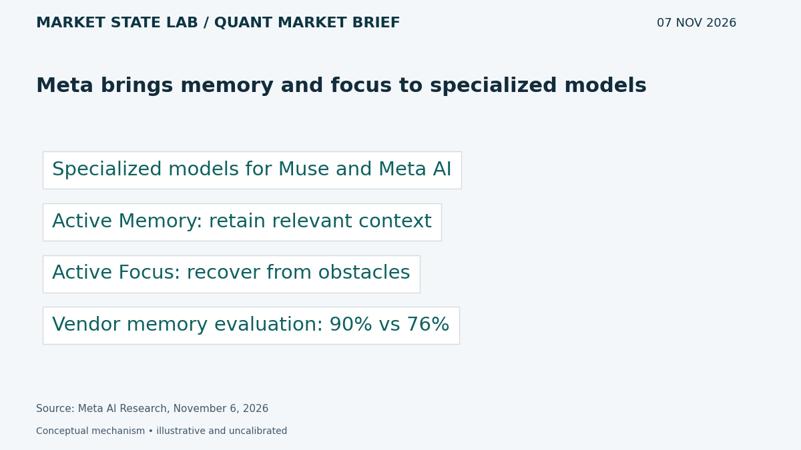
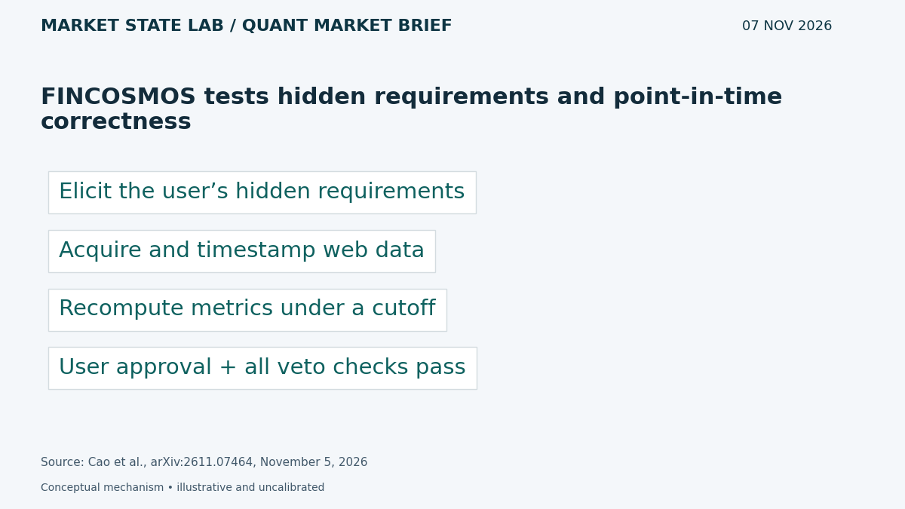
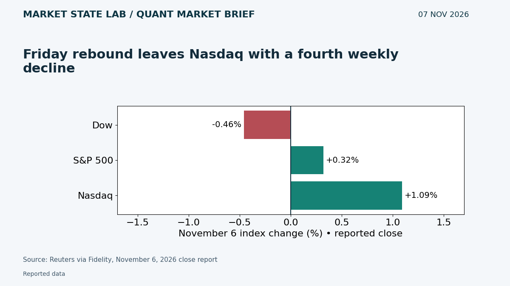
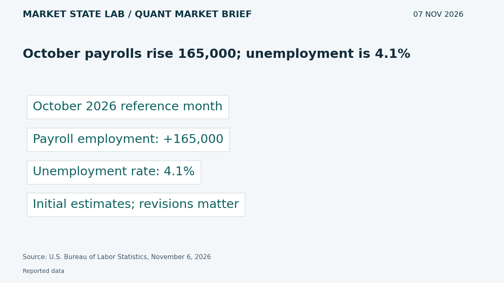
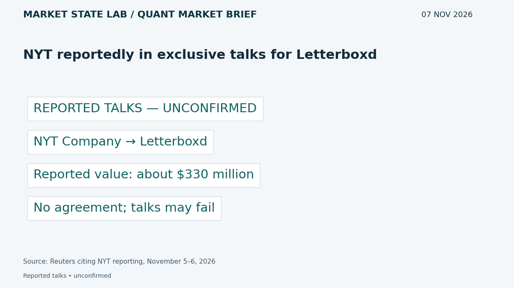

# Quant Market Brief — November 7, 2026: Jobs Results & Agent Verification

Research cutoff: **November 7, 2026, 6:30 a.m. CST (12:30 UTC)**. Saturday edition; market data are Friday prior-close or lagged, not live quotes.

[Subscribe by email](https://market-state-lab.ghost.io/?utm_source=github&utm_medium=technical_archive&utm_campaign=qmb_2026-11-07#/portal/signup).

## 1. Meta brings memory and focus to specialized models

*Graphic: Market State Lab; Meta AI Research, November 6, 2026.*

**Fact — November 6, 2026:** Meta announces specialized models for Muse and Meta AI with Active Memory and Active Focus; its own Active Memory evaluation reports 90% versus 76% for the previous model. [Direct source](https://research.meta.ai/blog/specialized-models-for-muse-and-metaai)

**Inference / Why it matters:** Test stale-context rejection and requirement retention, not just recall, before trusting a persistent research assistant.

**Uncertainty:** Vendor evaluation, not an independently validated finance benchmark; availability and performance can vary.

## 2. FINCOSMOS tests hidden requirements and point-in-time correctness

*Graphic: Market State Lab; Cao et al., arXiv:2611.07464, November 5, 2026.*

**Fact — Submitted November 5; finance listing November 6, 2026:** FINCOSMOS evaluates financial agents that must acquire web data, elicit a hidden strategy and backtest under a cutoff. Authors report no accepted session among 150 sessions: user sign-off did not survive programmatic checks. [Direct source](https://arxiv.org/abs/2611.07464)

**Inference / Why it matters:** Turn ambiguous strategy requests into explicit specifications and verify data timing and recomputed metrics independently.

**Uncertainty:** Preprint and benchmark-specific findings; simulated users and tasks do not establish universal failure rates.

## 3. Friday rebound leaves Nasdaq with a fourth weekly decline

*Graphic: Market State Lab; Reuters via Fidelity, November 6, 2026 close report.*

**Fact — November 6, 2026 close report, 4:02 p.m. EST:** Reuters reports Friday gains of 1.09% for the Nasdaq and 0.32% for the S&P 500, while the Dow fell 0.46%. The Nasdaq still posted its fourth consecutive weekly decline. [Direct source](https://www.fidelity.com/news/article/us-markets/202611061602RTRSNEWSCOMBINED_L6N46N1AI_1)

**Inference / Why it matters:** Distinguish a one-session rebound from trend repair; stress Monday gaps and execution costs.

**Uncertainty:** Reported closing figures were described as unofficial; index changes are not ETF returns or executable quotes.

## 4. October payrolls rise 165,000; unemployment is 4.1%

*Graphic: Market State Lab; U.S. Bureau of Labor Statistics, November 6, 2026.*

**Fact — BLS release November 6, 2026, 8:30 a.m. EST:** BLS reports October nonfarm payroll growth of 165,000 and unemployment of 4.1%, which it characterizes as little changed. [Direct source](https://www.bls.gov/news.release/empsit.nr0.htm)

**Inference / Why it matters:** Model labor growth and revisions alongside inflation; do not infer the next Fed decision from one headline.

**Uncertainty:** Initial estimates are revised; establishment payrolls and household unemployment are different surveys.

## 5. NYT reportedly in exclusive talks for Letterboxd

*Graphic: Market State Lab; Reuters citing NYT reporting, November 5–6, 2026.*

**Fact — Reuters report November 6 UTC; underlying report November 5, 2026:** Reuters, citing a New York Times report, says the Times Company is in exclusive talks to acquire Letterboxd at about $330 million. No agreement has been reached. [Direct source](https://www.reuters.com/business/media-telecom/new-york-times-company-advanced-talks-acquire-letterboxd-roughly-330-million-nyt-2026-11-06/)

**Inference / Why it matters:** Evaluate subscriber adjacency and integration economics separately from a speculative acquisition premium.

**Uncertainty:** Unconfirmed talks; price and completion may change or the deal may fail.

## Quant & Market Dashboard

### Liquidity and volatility

- **Weekend state:** U.S. cash equities are closed Saturday. Current ES/NQ depth, spreads, overnight volume, ETF executable quotes, Treasury liquidity and options positioning are unverified. Friday activity is a proxy only; refresh after futures reopen and before Monday’s cash auction.
- **November 6 completed daily rows:** SPY 735.29, volume 58.98m; QQQ 656.10, volume 70.69m. Provider banners show different closing levels; reconcile against the execution feed rather than mixing snapshots. Volume does not measure depth. [SPY](https://chartexchange.com/symbol/nyse-spy/historical/) · [QQQ](https://chartexchange.com/symbol/nasdaq-qqq/historical/).
- **Funding:** November 5 SOFR 3.92% versus EFFR 3.88%, a four-basis-point gap. Published November 6; lagged fixings do not establish current funding stress. [SOFR](https://fred.stlouisfed.org/series/SOFR) · [EFFR](https://fred.stlouisfed.org/series/EFFR).
- **Regime: High; medium confidence.** November 6 delayed close VIX 25.64 at 4:00 p.m. EST / 3:00 p.m. CST, versus 28.18 November 5. House thresholds: below 15 low, 15–25 moderate, 25–35 high, above 35 stressed. This operating convention is not a calibrated forecast. Skew, term structure and dealer gamma remain unverified. [VIX](https://chartexchange.com/symbol/index-vix/historical/).

### Factor proxies

| Factor | ETF | Nov 5→6 | Oct 9→Nov 6 (4 weeks) |
|---|---|---:|---:|
| Momentum | [MTUM](https://stockanalysis.com/etf/mtum/history/) | +1.85% | -20.30% |
| Value | [VLUE](https://stockanalysis.com/etf/vlue/history/) | +0.11% | -8.69% |
| Quality | [QUAL](https://stockanalysis.com/etf/qual/history/) | +0.07% | -3.43% |
| Size | [IWM](https://stockanalysis.com/etf/iwm/history/) | +0.99% | -1.89% |
| Growth | [IWF](https://stockanalysis.com/etf/iwf/history/) | +1.26% | -12.63% |
| Low volatility | [SPLV](https://stockanalysis.com/etf/splv/history/) | -0.93% | +6.56% |

Price returns from the source-linked Close columns, excluding distributions; these are ETF proxies, not isolated factor premia. Corporate-action histories were not independently refreshed; keep a common adjustment basis. Momentum and growth rebounded on Friday but remain sharply negative over four weeks; low volatility fell Friday but remains positive over that horizon.

### Execution and microstructure

- No regular SPY/QQQ trading session Saturday. For Monday November 9, cash opening auction is 8:30 a.m. CST / 14:30 UTC. Recheck the economic calendar before staging orders; Friday’s labor-release window has passed.
- Inspect quote age, NBBO spreads, displayed depth, auction imbalances and ES/NQ basis. Use bounded limits and participation caps; stress gaps, cancellations, missed fills, latency and widened spreads. Rising prices on thin depth can trap liquidity takers.
- Options: refresh post-expiry positions and hedge requirements; verify expiry, deliverables and settlement. Reject stale, crossed or one-sided quotes. Dealer-gamma sign, expiry concentrations and pinning remain unknown.

**Research watchlist:** SPY, QQQ, IWM, RSP, TLT; ES, NQ, ZN, VX; MTUM, VLUE, QUAL, IWF, SPLV; META, NYT.

### DRL Improvements for the MATLAB System

1. Keep drawdown, exposure, participation and stale-data limits outside the policy, with a safe fallback.
2. Penalize spread, impact, turnover, latency and missed fills; evaluate tail losses separately from reward.
3. Purge walk-forward folds, lock reward choices and reserve a one-use final holdout; retain all failed trials.
4. Randomize liquidity and observation delays across regimes; test whether abstention preserves risk compliance under distribution shift.

### Model hygiene

Audit leakage, survivorship bias, look-ahead, corporate actions, stale options quotes, multiple testing, calibration and drift. Use point-in-time universes, release vintages and availability timestamps. Fit preprocessing on training folds only; keep user approval separate from numerical acceptance.

### MATLAB optimization patterns

- Use named-zone timetables and causal synchronize/retime; never backfill unreleased observations.
- Vectorize rolling features, preallocate logs and profile before optimizing.
- Parallelize independent folds or Bayesian trials with reproducible random streams and fixed budgets.
- Use GPUs for suitable batches; keep data, risk controls and evaluation in modular environments.

### High-value quant research question

**Does explicit requirement elicitation plus independent metric recomputation reduce false acceptance of financial-agent backtests?**

Compare with a user-sign-off-only workflow under matched tasks, seeds and data cutoffs. This tests whether persuasive reports conceal specification or timing errors.

[Subscribe by email](https://market-state-lab.ghost.io/?utm_source=github&utm_medium=technical_archive&utm_campaign=qmb_2026-11-07#/portal/signup).

*Research and education only—not individualized financial advice. No trading performance is promised.*
