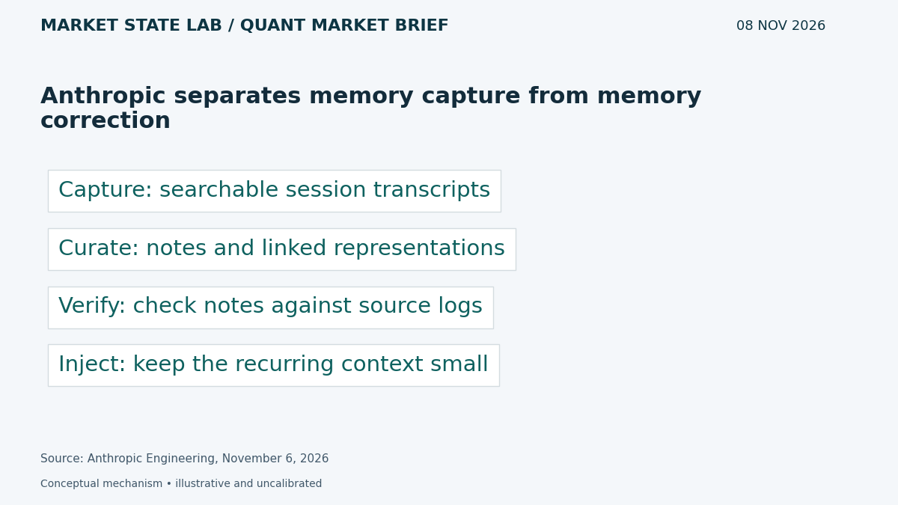
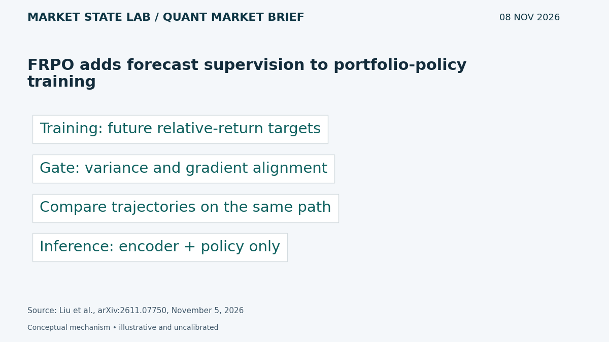
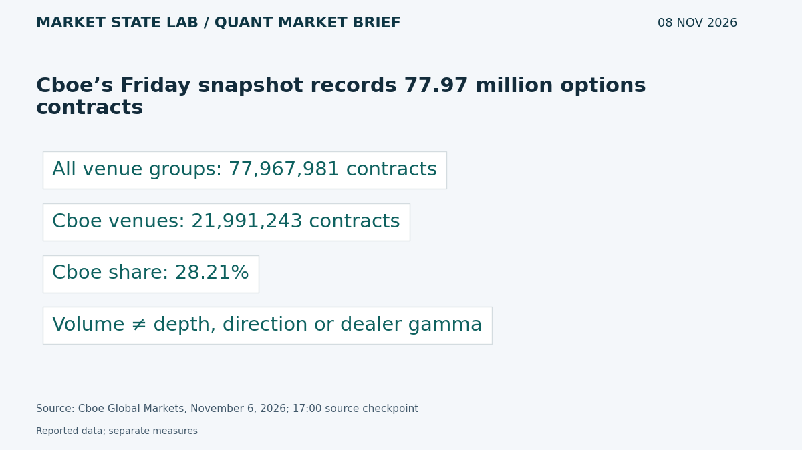
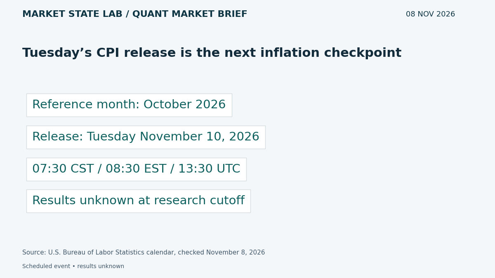
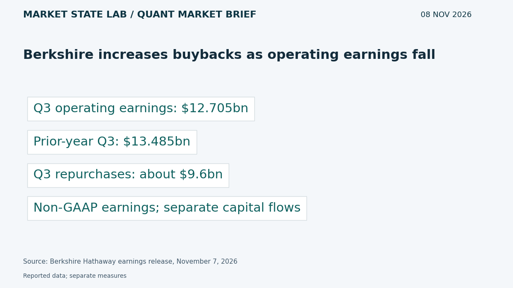

# Quant Market Brief — November 8, 2026: CPI Watch & Training-Only Forecasts

Research cutoff: **November 8, 2026, 6:36 a.m. CST (12:36 UTC)**. Sunday morning edition; market data are Friday prior-close or lagged, not live quotes.

[Subscribe by email](https://market-state-lab.ghost.io/?utm_source=github&utm_medium=technical_archive&utm_campaign=qmb_2026-11-08#/portal/signup).

## 1. Anthropic separates memory capture from memory correction

*Graphic: Market State Lab; Anthropic Engineering, November 6, 2026.*

**Fact — Published November 6, 2026:** Anthropic describes a hierarchy of transcripts, notes, structured representations and injected context. Offline reflection, called dreaming, checks notes against original transcripts and can repair errors. [Direct source](https://www.anthropic.com/research/components-of-agent-memory)

**Inference / Why it matters:** Keep source transcripts and provenance when curating research memory; test correction of deliberately planted wrong notes.

**Uncertainty:** Vendor experiments; reflection consumes compute and can introduce errors. Larger memory is not automatically better.

## 2. FRPO adds forecast supervision to portfolio-policy training

*Graphic: Market State Lab; Liu et al., arXiv:2611.07750, November 5, 2026.*

**Fact — Preprint submitted November 5, 2026:** Foresee to Trade proposes Forecast-Augmented Relative Policy Optimization. A training-only Financial State Head learns future relative-return targets; a gate uses predictive variance and gradient alignment. Inference uses the encoder and trading policy. [Direct source](https://arxiv.org/abs/2611.07750)

**Inference / Why it matters:** Test auxiliary forecasts against an otherwise identical policy, preserving holdings, cash constraints and transaction costs.

**Uncertainty:** Preprint with author-reported backtests; future targets must remain inside training folds and never become inference inputs.

## 3. Cboe’s Friday snapshot records 77.97 million options contracts

*Graphic: Market State Lab; Cboe Global Markets, November 6, 2026; 17:00 source checkpoint.*

**Fact — November 6, 2026; source checkpoint 17:00:** Cboe’s market-volume summary reports 77,967,981 matched contracts across listed venue groups; Cboe venues account for 21,991,243, or 28.21%. [Direct source](https://ww2.cboe.com/us/options/market_statistics/?iframe=1)

**Inference / Why it matters:** Use aggregate activity to plan capacity checks, then inspect actual SPY/QQQ chain spreads and depth before execution.

**Uncertainty:** Prior-session volume, not current liquidity or directional positioning. Snapshot time zone is not specified in the extracted table.

## 4. Tuesday’s CPI release is the next inflation checkpoint

*Graphic: Market State Lab; U.S. Bureau of Labor Statistics calendar, checked November 8, 2026.*

**Fact — Schedule checked November 8, 2026:** BLS schedules October CPI for Tuesday November 10 at 8:30 a.m. Eastern, or 7:30 a.m. CST. Results are not yet available. [Direct source](https://www.bls.gov/schedule/2026/11_sched_list.htm)

**Inference / Why it matters:** Apply event-conditioned risk limits; compare headline, core and component surprises without importing unreleased values into signals.

**Uncertainty:** Calendar event, not a forecast or released inflation reading; recheck timing before placing orders.

## 5. Berkshire increases buybacks as operating earnings fall

*Graphic: Market State Lab; Berkshire Hathaway earnings release, November 7, 2026.*

**Fact — Company release November 7, 2026:** Berkshire reports Q3 operating earnings of $12.705 billion versus $13.485 billion a year earlier, and approximately $9.6 billion of share repurchases during the quarter. [Direct source](https://berkshirehathaway.com/news/nov0726.pdf)

**Inference / Why it matters:** Separate operating performance from investment mark-to-market gains and evaluate buybacks against valuation and liquidity needs.

**Uncertainty:** Operating earnings are non-GAAP; repurchases do not establish undervaluation. The company says the release alone is insufficient for an investment judgment.

## Quant & Market Dashboard

### Liquidity and volatility

- **Weekend state:** U.S. cash equities are closed Sunday morning. Current ES/NQ depth, spreads, overnight volume, ETF executable quotes, Treasury liquidity and options positioning are unverified. Friday activity is a proxy only; refresh after futures reopen and before Monday’s cash auction.
- **November 6 completed daily rows:** SPY 735.29, volume 58.98m; QQQ 656.10, volume 70.69m. Provider banners show different closing levels; reconcile against the execution feed rather than mixing snapshots. Volume does not measure depth. [SPY](https://chartexchange.com/symbol/nyse-spy/historical/) · [QQQ](https://chartexchange.com/symbol/nasdaq-qqq/historical/).
- **Funding:** November 5 SOFR 3.92% versus EFFR 3.88%, a four-basis-point gap. Published November 6; lagged fixings do not establish current funding stress. [SOFR](https://fred.stlouisfed.org/series/SOFR) · [EFFR](https://fred.stlouisfed.org/series/EFFR).
- **Regime: High; medium confidence.** November 6 delayed close VIX 25.64 at 4:00 p.m. EST / 3:00 p.m. CST, versus 28.18 November 5. House thresholds: below 15 low, 15–25 moderate, 25–35 high, above 35 stressed. This operating convention is not a calibrated forecast. Skew, term structure and dealer gamma remain unverified. [VIX](https://chartexchange.com/symbol/index-vix/historical/).

### Factor proxies

| Factor | ETF | Nov 5→6 | Oct 9→Nov 6 (4 weeks) |
|---|---|---:|---:|
| Momentum | [MTUM](https://stockanalysis.com/etf/mtum/history/) | +1.85% | -20.30% |
| Value | [VLUE](https://stockanalysis.com/etf/vlue/history/) | +0.11% | -8.69% |
| Quality | [QUAL](https://stockanalysis.com/etf/qual/history/) | +0.07% | -3.43% |
| Size | [IWM](https://stockanalysis.com/etf/iwm/history/) | +0.99% | -1.89% |
| Growth | [IWF](https://stockanalysis.com/etf/iwf/history/) | +1.26% | -12.63% |
| Low volatility | [SPLV](https://stockanalysis.com/etf/splv/history/) | -0.93% | +6.56% |

Price returns from the source-linked Close columns, excluding distributions; these are ETF proxies, not isolated factor premia. October 9 comparison inputs are archived from November 7; November 6 closes were rechecked today. Corporate-action histories were not independently refreshed; keep a common adjustment basis. Momentum and growth rebounded on Friday but remain sharply negative over four weeks; low volatility fell Friday but remains positive over that horizon.

### Execution and microstructure

- No regular SPY/QQQ trading session Sunday. For Monday November 9, cash opening auction is 8:30 a.m. CST / 14:30 UTC. Recheck the economic calendar before staging orders; CPI is Tuesday at 7:30 a.m. CST; check the full calendar before orders.
- Inspect quote age, NBBO spreads, displayed depth, auction imbalances and ES/NQ basis. Use bounded limits and participation caps; stress gaps, cancellations, missed fills, latency and widened spreads. Rising prices on thin depth can trap liquidity takers.
- Options: refresh post-expiry positions and hedge requirements; verify expiry, deliverables and settlement. Reject stale, crossed or one-sided quotes. Dealer-gamma sign, expiry concentrations and pinning remain unknown.

**Research watchlist:** SPY, QQQ, IWM, RSP, TLT; ES, NQ, ZN, VX; MTUM, VLUE, QUAL, IWF, SPLV; BRK.B.

### DRL Improvements for the MATLAB System

1. Keep drawdown, exposure, participation and stale-data limits outside the policy, with a safe fallback.
2. Penalize spread, impact, turnover, latency and missed fills; evaluate tail losses separately from reward.
3. Keep future-return targets in training folds only; purge overlapping horizons and reserve a one-use final holdout.
4. Randomize liquidity and observation delays across regimes; test whether abstention preserves risk compliance under distribution shift.

### Model hygiene

Audit leakage, survivorship bias, look-ahead, corporate actions, stale options quotes, multiple testing, calibration and drift. Use point-in-time universes, release vintages and availability timestamps. Fit preprocessing on training folds only; keep memory curation separate from point-in-time numerical evaluation.

### MATLAB optimization patterns

- Use named-zone timetables and causal synchronize/retime; never backfill unreleased observations.
- Vectorize rolling features, preallocate logs and profile before optimizing.
- Parallelize independent folds or Bayesian trials with reproducible random streams and fixed budgets.
- Use GPUs for suitable batches; keep data, risk controls and evaluation in modular environments.

### High-value quant research question

**Does training-only forecast supervision improve net risk-adjusted results versus an identical policy without the auxiliary head?**

Match seeds, initial states, search budgets and costs; purge target horizons at fold boundaries. It tests whether forecast learning adds decision value without leakage.

[Subscribe by email](https://market-state-lab.ghost.io/?utm_source=github&utm_medium=technical_archive&utm_campaign=qmb_2026-11-08#/portal/signup).

*Research and education only—not individualized financial advice. No trading performance is promised.*
