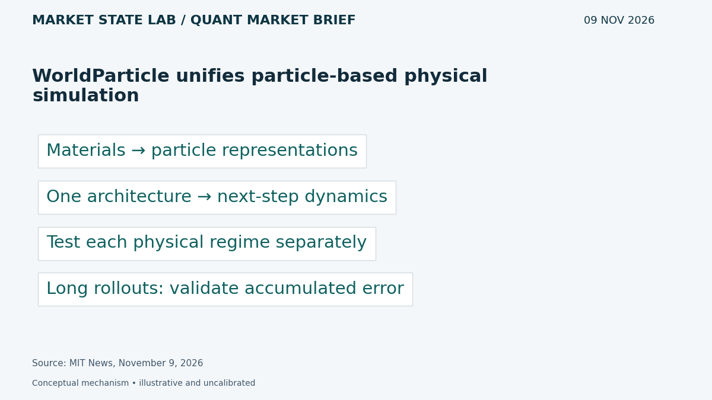
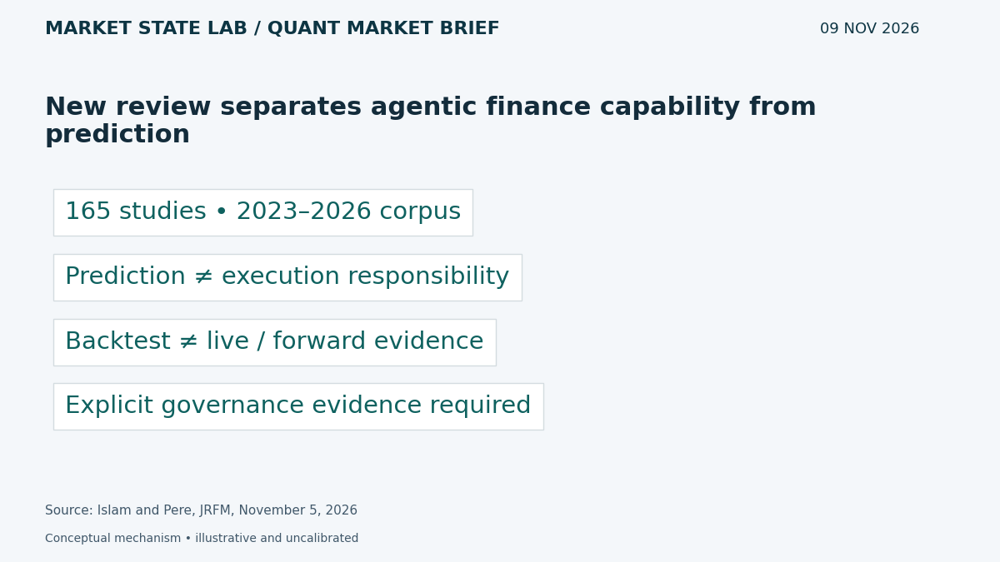
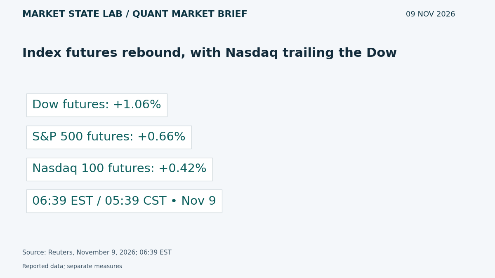
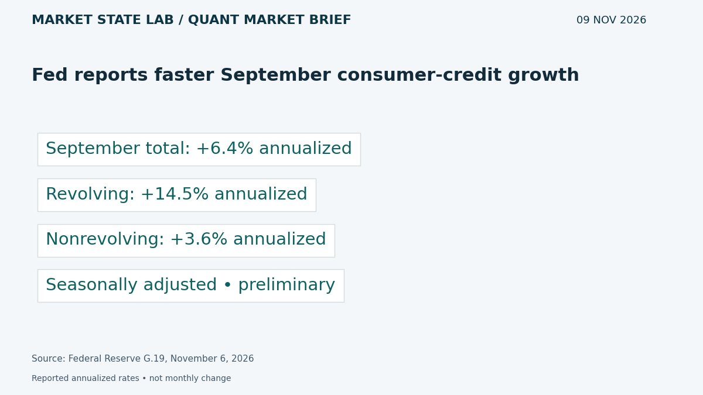
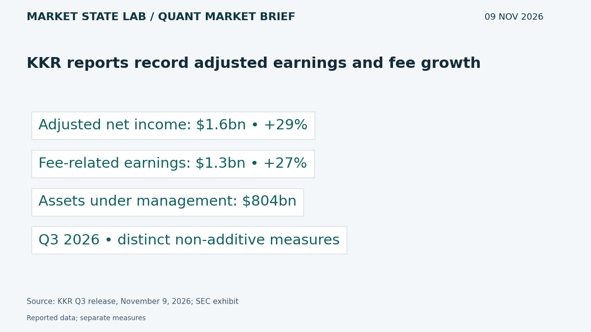

# Quant Market Brief — November 9, 2026: Selective Rebound & Consumer Credit

Research cutoff: **November 9, 2026, 6:38 a.m. CST (12:38 UTC)**. Monday premarket edition; market data are explicitly timestamped reported/delayed snapshots or prior-close observations, not live executable quotes.

[Subscribe by email](https://market-state-lab.ghost.io/?utm_source=github&utm_medium=technical_archive&utm_campaign=qmb_2026-11-09#/portal/signup).

## 1. WorldParticle unifies particle-based physical simulation

*Graphic: Market State Lab; MIT News, November 9, 2026.*

**Fact — MIT report November 9, 2026:** MIT and collaborators describe WorldParticle, a deep-learning architecture that represents materials as particles and predicts their next movements across physical phenomena, including granular materials and proteins. [Direct source](https://news.mit.edu/2026/single-ai-model-simulates-many-substances-behavior-1109)

**Inference / Why it matters:** For MATLAB surrogate models, test shared representations against specialist baselines and measure long-rollout stability.

**Uncertainty:** Research demonstrations do not establish universal physical fidelity or applicability to financial prices.

## 2. New review separates agentic finance capability from prediction

*Graphic: Market State Lab; Islam and Pere, JRFM, November 5, 2026.*

**Fact — Published November 5, 2026:** A scoping review synthesizes 165 studies from 2023–2026. Its framework distinguishes prediction, interpretation, recommendation, execution and coordination, and explicitly separates historical or simulated evaluation from live or forward testing. [Direct source](https://www.mdpi.com/1911-8074/19/11/892)

**Inference / Why it matters:** Require evidence for the decision responsibility an agent actually assumes; preserve external risk controls and forward evaluation.

**Uncertainty:** A literature synthesis is not a validated profitable strategy. Tool use alone does not establish agentic capability.

## 3. Index futures rebound, with Nasdaq trailing the Dow

*Graphic: Market State Lab; Reuters, November 9, 2026; 06:39 EST.*

**Fact — Reuters November 9, 2026; 06:39 EST snapshot:** At 6:39 a.m. EST, Reuters reported Dow futures up 1.06%, S&P 500 futures up 0.66%, and Nasdaq 100 futures up 0.42% following last week’s selloff. [Direct source](https://www.reuters.com/business/wall-st-futures-rise-after-rough-week-nvidia-unsettles-investors-2026-11-09/)

**Inference / Why it matters:** Check breadth and ES/NQ relative strength before treating the rebound as broad risk recovery.

**Uncertainty:** Reported snapshot, not executable quotes. Positive futures do not establish healthy order-book depth.

## 4. Fed reports faster September consumer-credit growth

*Graphic: Market State Lab; Federal Reserve G.19, November 6, 2026.*

**Fact — Federal Reserve release November 6, 2026:** Consumer credit grew at a seasonally adjusted annual rate of 6.4% in September and 4.2% in Q3. September revolving credit grew 14.5% annualized, versus 3.6% for nonrevolving credit. [Direct source](https://www.federalreserve.gov/releases/g19/current/)

**Inference / Why it matters:** Separate revolving from nonrevolving borrowing when testing consumer-demand and credit-risk signals.

**Uncertainty:** Preliminary and revisable; annualized growth is not a monthly percentage change, and borrowing growth alone does not prove household distress.

## 5. KKR reports record adjusted earnings and fee growth

*Graphic: Market State Lab; KKR Q3 release, November 9, 2026; SEC exhibit.*

**Fact — Company release November 9, 2026:** KKR reports Q3 adjusted net income of $1.6 billion, up 29% year over year, and fee-related earnings of $1.3 billion, up 27%. Assets under management reached $804 billion. [Direct source](https://www.sec.gov/Archives/edgar/data/1404912/000140491226000030/q326earningsrelease_vf.htm)

**Inference / Why it matters:** Separate recurring fee earnings from realization-sensitive income when assessing alternative asset managers.

**Uncertainty:** Adjusted measures are non-GAAP; AUM is not revenue or immediately deployable liquidity.

## Quant & Market Dashboard

### Liquidity and volatility

- **Overnight:** Index futures are higher at the story’s 05:39 CST checkpoint. ES/NQ spreads, depth, overnight volume, ETF executable quotes and Treasury-market depth are unverified; price direction is not a liquidity measure. Refresh the execution feed before the cash auction.
- **Funding:** Latest verified SOFR is 3.92% for November 5, published November 6 at 07:02 CST. Today’s fixing was not yet available at cutoff. Lagged funding is not a current stress diagnosis. [FRED SOFR](https://fred.stlouisfed.org/series/SOFR).
- **Regime: Moderate, with elevated transition risk; medium confidence.** Delayed VIX was 23.31 at November 9 06:39 EST / 05:39 CST, versus Friday’s daily-row close of 25.64. House thresholds: below 15 low, 15–25 moderate, 25–35 high, above 35 stressed; not calibrated forecasts. Current skew, term structure and dealer gamma remain unverified. [VIX](https://chartexchange.com/symbol/index-vix/historical/).

### Factor proxies

| Factor | ETF | Nov 5→6 | Oct 9→Nov 6 (4 weeks) |
|---|---|---:|---:|
| Momentum | [MTUM](https://stockanalysis.com/etf/mtum/history/) | +1.85% | -20.30% |
| Value | [VLUE](https://stockanalysis.com/etf/vlue/history/) | +0.11% | -8.69% |
| Quality | [QUAL](https://stockanalysis.com/etf/qual/history/) | +0.07% | -3.43% |
| Size | [IWM](https://stockanalysis.com/etf/iwm/history/) | +0.99% | -1.89% |
| Growth | [IWF](https://stockanalysis.com/etf/iwf/history/) | +1.26% | -12.63% |
| Low volatility | [SPLV](https://stockanalysis.com/etf/splv/history/) | -0.93% | +6.56% |

Price returns from the source-linked Close columns, excluding distributions; these are ETF proxies, not isolated factor premia. October 9 comparison inputs are archived from November 7; November 6 closes were rechecked November 9; no new completed cash session exists. Corporate-action histories were not independently refreshed; keep a common adjustment basis. Momentum and growth rebounded on Friday but remain sharply negative over four weeks; low volatility fell Friday but remains positive over that horizon.

### Execution and microstructure

- For today, Monday November 9, cash opening auction is 8:30 a.m. CST / 14:30 UTC. Recheck the economic calendar before staging orders; CPI is Tuesday at 7:30 a.m. CST; results unknown at cutoff. [BLS calendar](https://www.bls.gov/schedule/2026/11_sched_list.htm).
- Inspect quote age, NBBO spreads, displayed depth, auction imbalances and ES/NQ basis. Use bounded limits and participation caps; stress gaps, cancellations, missed fills, latency and widened spreads. Rising prices on thin depth can trap liquidity takers.
- Options: refresh post-expiry positions and hedge requirements; verify expiry, deliverables and settlement. Reject stale, crossed or one-sided quotes. Dealer-gamma sign, expiry concentrations and pinning remain unknown.

**Research watchlist:** SPY, QQQ, IWM, RSP, TLT; ES, NQ, ZN, VX; MTUM, VLUE, QUAL, IWF, SPLV; NVDA, KKR.

### DRL Improvements for the MATLAB System

1. Keep drawdown, exposure, participation and stale-data limits outside the policy, with a safe fallback.
2. Penalize spread, impact, turnover, latency and missed fills; evaluate tail losses separately from reward.
3. Keep future-return targets in training folds only; purge overlapping horizons and reserve a one-use final holdout.
4. Randomize liquidity and observation delays across regimes; test whether abstention preserves risk compliance under distribution shift.

### Model hygiene

Audit leakage, survivorship bias, look-ahead, corporate actions, stale options quotes, multiple testing, calibration and drift. Use point-in-time universes, release vintages and availability timestamps. Fit preprocessing on training folds only; keep memory curation separate from point-in-time numerical evaluation.

### MATLAB optimization patterns

- Use named-zone timetables and causal synchronize/retime; never backfill unreleased observations.
- Vectorize rolling features, preallocate logs and profile before optimizing.
- Parallelize independent folds or Bayesian trials with reproducible random streams and fixed budgets.
- Use GPUs for suitable batches; keep data, risk controls and evaluation in modular environments.

### High-value quant research question

**Does an explicit abstention gate based on spread, depth and quote age improve net out-of-sample results during volatility-regime transitions?**

Compare identical policies with and without the gate, matching seeds, action budgets and costs. Test missed opportunity alongside drawdown and slippage; it distinguishes useful restraint from accidental underexposure.

[Subscribe by email](https://market-state-lab.ghost.io/?utm_source=github&utm_medium=technical_archive&utm_campaign=qmb_2026-11-09#/portal/signup).

*Research and education only—not individualized financial advice. No trading performance is promised.*
