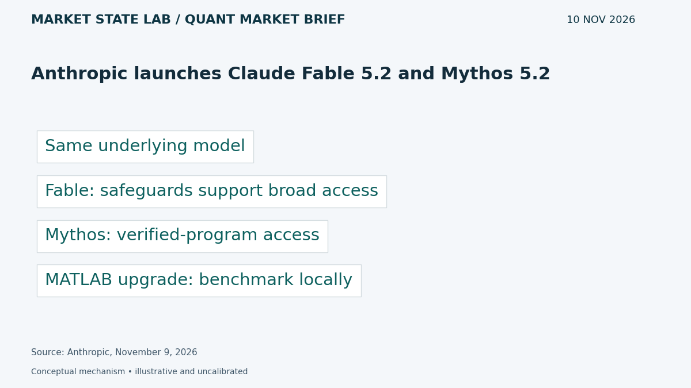
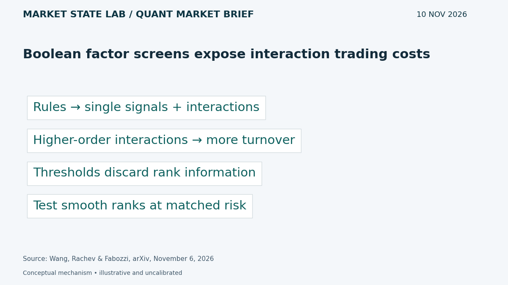
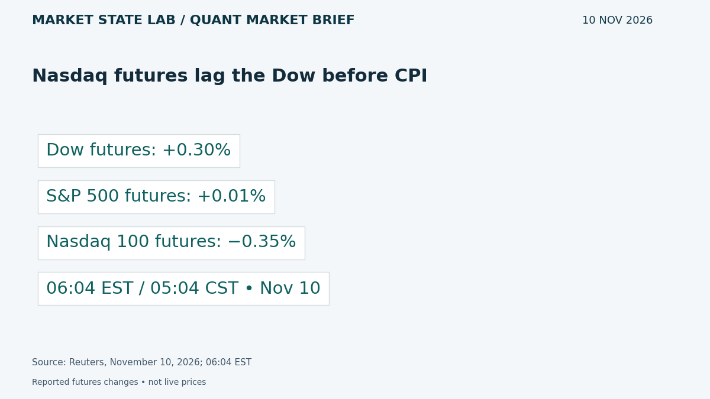
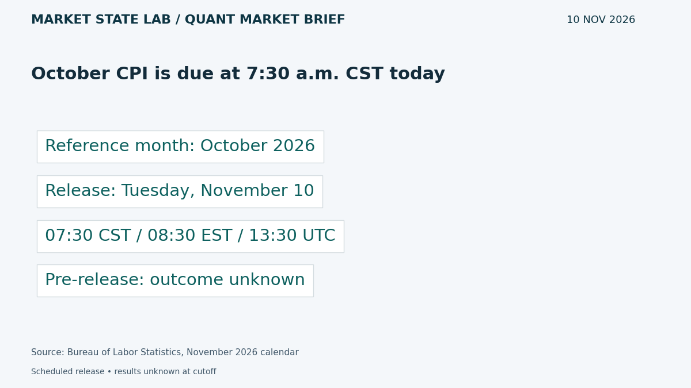
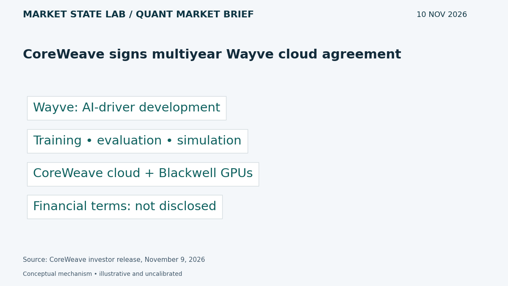

# Quant Market Brief — November 10, 2026: CPI Setup & Factor Trading Costs

Research cutoff: **November 10, 2026, 6:33 a.m. CST (12:33 UTC)**. Tuesday pre-CPI edition; market data are explicitly timestamped reported/delayed snapshots or prior-close observations, not live executable quotes.

[Subscribe by email](https://market-state-lab.ghost.io/?utm_source=github&utm_medium=technical_archive&utm_campaign=qmb_2026-11-10#/portal/signup).

## 1. Anthropic launches Claude Fable 5.2 and Mythos 5.2

*Graphic: Market State Lab; Anthropic, November 9, 2026.*

**Fact — Company announcement November 9, 2026:** Anthropic released Fable 5.2 and Mythos 5.2, describing coding, reasoning and vision improvements. They share an underlying model; Fable has safeguards supporting broad access, while Mythos access uses verification programs. [Direct source](https://www.anthropic.com/claude-fable-and-mythos-5-2)

**Inference / Why it matters:** Benchmark MATLAB code generation against fixed correctness tests, latency and cost before changing the production model.

**Uncertainty:** Performance claims are vendor evaluations, not independent evidence of reliable financial decisions.

## 2. Boolean factor screens expose interaction trading costs

*Graphic: Market State Lab; Wang, Rachev & Fabozzi, arXiv, November 6, 2026.*

**Fact — Preprint submitted November 6, 2026:** Wang, Rachev and Fabozzi decompose Boolean portfolio rules into individual signals and interactions. Their U.S. stock study links higher-order interactions to lower persistence and higher turnover, and compares threshold rules with smoother products of ranks. [Direct source](https://arxiv.org/abs/2611.09834)

**Inference / Why it matters:** Compare hard screening intersections with smooth rank weights at matched risk, including spread and market-impact costs.

**Uncertainty:** This is a preprint with author backtests. Quoted-spread estimates do not capture every execution cost or establish future alpha.

## 3. Nasdaq futures lag the Dow before CPI

*Graphic: Market State Lab; Reuters, November 10, 2026; 06:04 EST.*

**Fact — Reuters November 10, 2026; 06:04 EST snapshot:** At 6:04 a.m. EST, Reuters reported Dow futures up 0.30%, S&P 500 futures up 0.01%, and Nasdaq 100 futures down 0.35%. [Direct source](https://www.reuters.com/business/sp-500-dow-futures-climb-oil-slide-lifts-sentiment-2026-11-10/)

**Inference / Why it matters:** Monitor ES/NQ relative strength and SPY/QQQ execution conditions separately; a positive broad-market headline can hide growth weakness.

**Uncertainty:** Earlier reported snapshot, not live executable prices. These changes reveal neither spreads nor order-book depth.

## 4. October CPI is due at 7:30 a.m. CST today

*Graphic: Market State Lab; Bureau of Labor Statistics, November 2026 calendar.*

**Fact — BLS calendar: November 10, 2026 release:** The BLS calendar schedules October 2026 Consumer Price Index data for Tuesday November 10 at 8:30 a.m. EST, equivalent to 7:30 a.m. CST / 13:30 UTC. Results were unavailable at the research cutoff. [Direct source](https://www.bls.gov/schedule/2026/11_sched_list.htm)

**Inference / Why it matters:** Stress event gaps and spread expansion; compare actual headline and core readings with a timestamped consensus only after release.

**Uncertainty:** This is release scheduling, not an inflation forecast. No CPI outcome or immediate market reaction is asserted.

## 5. CoreWeave signs multiyear Wayve cloud agreement

*Graphic: Market State Lab; CoreWeave investor release, November 9, 2026.*

**Fact — Company announcement November 9, 2026:** CoreWeave announced a multiyear agreement to support Wayve’s AI-driver development with its cloud and NVIDIA Blackwell GPUs, covering training, evaluation and simulation. [Direct source](https://investors.coreweave.com/news/news-details/2026/CoreWeave-to-Power-Wayves-AI-Driver-Training-in-Multi-Year-Agreement/default.aspx)

**Inference / Why it matters:** Track capacity utilization, customer diversification and cash requirements; distinguish contracted demand from recognized revenue.

**Uncertainty:** Financial terms and the agreement’s revenue contribution were not disclosed. A capacity agreement alone does not establish profitability.

## Quant & Market Dashboard

### Liquidity and volatility

- **Overnight:** Futures show divergence at the story’s 05:04 CST checkpoint. Current ES/NQ spreads, depth, overnight volume, ETF executable quotes and Treasury-market depth are unverified; price direction is only a cautious sentiment proxy. No reliable current liquidity rating can be assigned.
- **Funding:** Latest verified SOFR is 3.89% for November 6, updated November 9 at 07:02 CST. Today’s update was not available at cutoff. This lagged funding reading is not a current stress diagnosis. [FRED SOFR](https://fred.stlouisfed.org/series/SOFR).
- **Regime: Moderate; medium confidence, with concentrated CPI event risk.** Delayed VIX was 20.04 at November 10 06:32 EST / 05:32 CST, versus November 9 close 19.92 and November 6 close 25.64. House thresholds: below 15 low, 15–25 moderate, 25–35 high, above 35 stressed; not calibrated forecasts. Current skew, term structure and dealer gamma remain unverified. [VIX](https://chartexchange.com/symbol/index-vix/historical/).

### Factor proxies

| Factor | ETF | Nov 6→9 | Oct 9→Nov 9 (~1 month) |
|---|---|---:|---:|
| Momentum | [MTUM](https://stockanalysis.com/etf/mtum/history/) | +4.88% | -16.41% |
| Value | [VLUE](https://stockanalysis.com/etf/vlue/history/) | +2.72% | -6.20% |
| Quality | [QUAL](https://stockanalysis.com/etf/qual/history/) | +2.21% | -1.30% |
| Size | [IWM](https://stockanalysis.com/etf/iwm/history/) | +3.23% | +1.28% |
| Growth | [IWF](https://stockanalysis.com/etf/iwf/history/) | +2.92% | -10.09% |
| Low volatility | [SPLV](https://stockanalysis.com/etf/splv/history/) | +1.25% | +7.89% |

Price returns calculated from source-linked split-adjusted Close columns, excluding distributions, through the November 9 cash close (16:00 EST / 15:00 CST). ETF proxies are not isolated factor premia. Common endpoints were rechecked today; independent corporate-action validation remains incomplete. All six rose Monday; momentum and growth remain negative over the longer window while low volatility and size are positive.

### Execution and microstructure

- Today, Tuesday November 10: CPI at 07:30 CST / 13:30 UTC; cash opening auction at 08:30 CST / 14:30 UTC. Keep pre-release and post-release observations separate. [BLS calendar](https://www.bls.gov/schedule/2026/11_sched_list.htm).
- For SPY/QQQ, inspect quote age, NBBO spreads, displayed depth, auction imbalances and ES/NQ basis. Use bounded limits and participation caps; stress slippage, gaps, cancellations, missed fills and observation latency. Thin-depth rebounds can trap marketable orders.
- Options: verify expiry, deliverables and settlement, including same-day expiries; reject stale, crossed or one-sided quotes. Gamma can amplify near-expiry hedging and implied volatility can reprice after CPI, but dealer-gamma sign, expiry concentrations, pinning and their magnitude are unverified.

**Research watchlist:** SPY, QQQ, IWM, RSP, TLT; ES, NQ, ZN, VX; MTUM, VLUE, QUAL, IWF, SPLV; CRWV, NVDA.

### DRL Improvements for the MATLAB System

1. Enforce drawdown, exposure, participation and stale-data limits outside the policy, with an explicit safe fallback.
2. Penalize spread, impact, turnover, latency and missed fills; evaluate tail losses separately from average reward.
3. Use purged walk-forward evaluation across inflation-event and quiet regimes, with a one-use final holdout and all preprocessing fitted on training folds.
4. Randomize spread, depth and observation delay; test risk compliance and abstention under regime shifts and liquidity withdrawal.

### Model hygiene

Audit leakage, survivorship bias, look-ahead, corporate actions, stale options quotes, multiple testing, calibration and drift. Use point-in-time universes, release vintages and actual availability timestamps. Isolate model selection from final evaluation and compare rank and threshold implementations on a common adjustment basis.

### MATLAB optimization patterns

- Use named-zone timetables and causal synchronize/retime; never backfill unreleased CPI observations.
- Vectorize rolling ranks, preallocate logs and profile before optimizing.
- Parallelize independent folds or Bayesian trials with reproducible random streams and fixed budgets.
- Use GPUs for sufficiently large training batches; keep data, risk controls and evaluation in modular environments.

### High-value quant research question

**Do smooth rank-product factor weights reduce net trading costs versus Boolean screening intersections at matched risk, especially around CPI releases?**

Compare identical point-in-time universes and risk budgets with purged walk-forward testing, realistic impact and missed fills. This tests whether threshold-driven turnover consumes apparent interaction alpha rather than assuming a smoother rule is better.

[Subscribe by email](https://market-state-lab.ghost.io/?utm_source=github&utm_medium=technical_archive&utm_campaign=qmb_2026-11-10#/portal/signup).

*Research and education only—not individualized financial advice. No trading performance is promised.*
