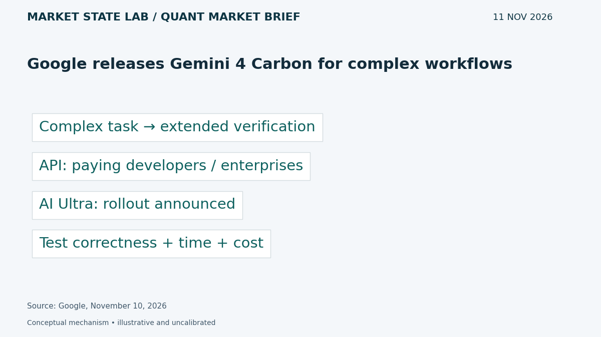
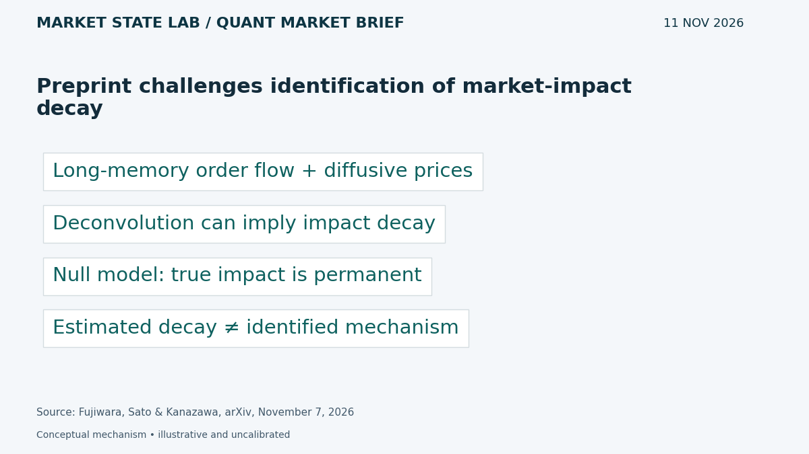
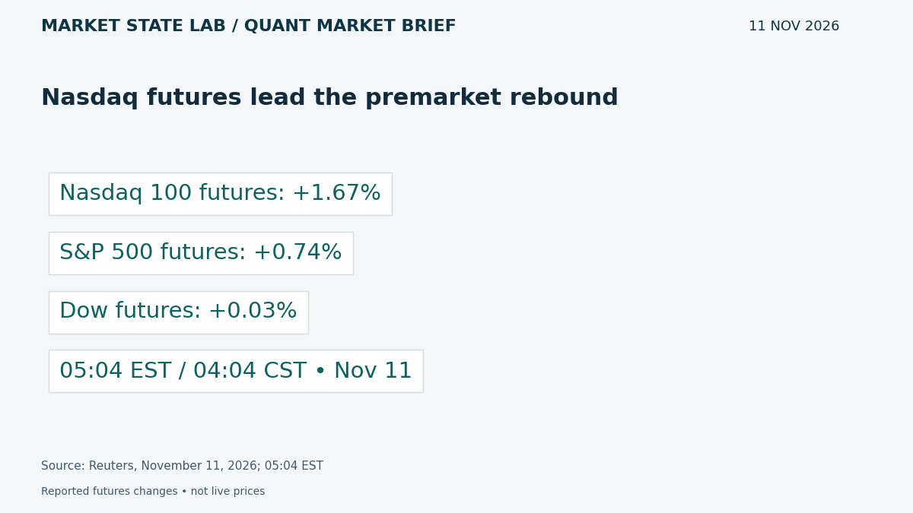
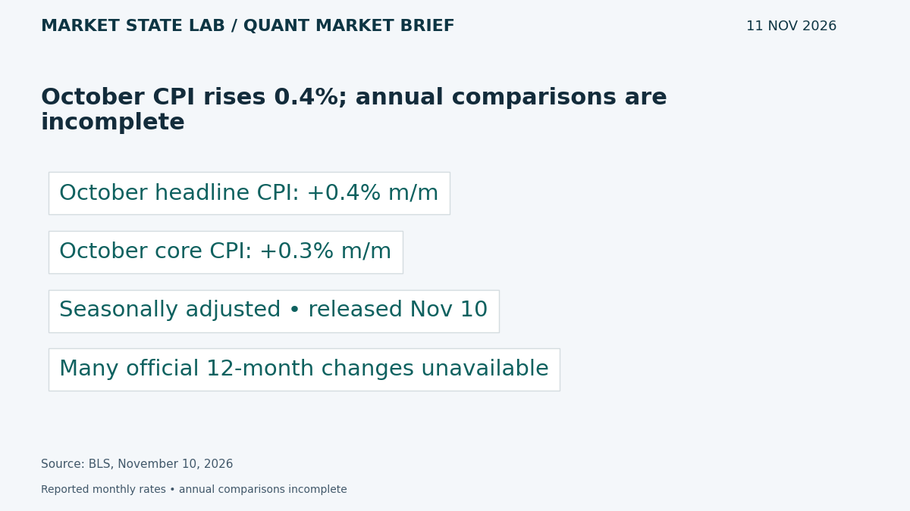
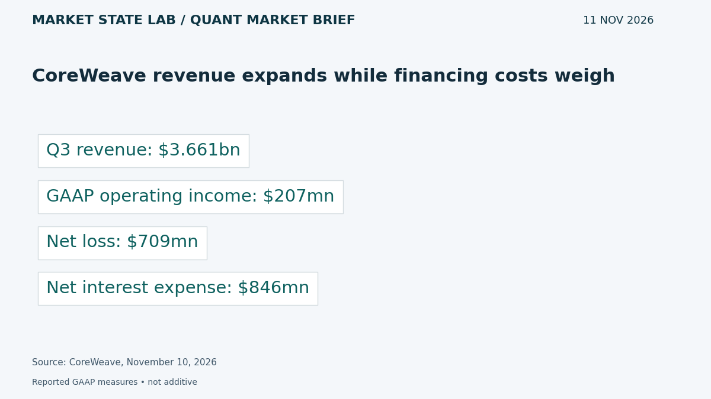

# Quant Market Brief — November 11, 2026: CPI Results & Impact-Model Risk

Research cutoff: **November 11, 2026, 6:38 a.m. CST (12:38 UTC)**. Wednesday post-CPI edition; market data are explicitly timestamped reported/delayed snapshots or prior-close observations, not live executable quotes.

[Subscribe by email](https://market-state-lab.ghost.io/?utm_source=github&utm_medium=technical_archive&utm_campaign=qmb_2026-11-11#/portal/signup).

## 1. Google releases Gemini 4 Carbon for complex workflows

*Graphic: Market State Lab; Google, November 10, 2026.*

**Fact — Google announcement November 10, 2026:** Google made Gemini 4 Carbon available through its API for paying developers and enterprises, with rollout to AI Ultra subscribers. It targets complex coding, knowledge work and scientific reasoning with extended verification loops. [Direct source](https://blog.google/innovation-and-ai/models-and-research/gemini-models/gemini-4-carbon-now-available/)

**Inference / Why it matters:** Test multi-step MATLAB debugging on a frozen task set, recording correctness, verification coverage, latency and cost.

**Uncertainty:** Capability and economic claims are vendor-reported; longer reasoning does not guarantee correct code or research.

## 2. Preprint challenges identification of market-impact decay

*Graphic: Market State Lab; Fujiwara, Sato & Kanazawa, arXiv, November 7, 2026.*

**Fact — Preprint submitted November 7, 2026:** Fujiwara, Sato and Kanazawa show that, under their diffusive-price and long-memory order-flow assumptions, propagator estimation can infer transient impact even when true impact is permanent. Their null model demonstrates this identification failure. [Direct source](https://arxiv.org/abs/2611.10574)

**Inference / Why it matters:** Stress execution simulators against permanent-impact nulls before teaching a policy that waiting automatically restores liquidity.

**Uncertainty:** The result concerns a specified estimation framework, not proof that real-world impact never decays; this is a preprint.

## 3. Nasdaq futures lead the premarket rebound

*Graphic: Market State Lab; Reuters, November 11, 2026; 05:04 EST.*

**Fact — Reuters November 11, 2026; 05:04 EST snapshot:** At 5:04 a.m. EST, Reuters reported Nasdaq 100 futures up 1.67%, S&P 500 futures up 0.74%, and Dow futures up 0.03%. [Direct source](https://www.reuters.com/business/sp-500-nasdaq-futures-rise-after-coreweave-soothes-ai-spending-fears-2026-11-11/)

**Inference / Why it matters:** Monitor QQQ versus SPY and distinguish a concentrated technology bounce from broad participation.

**Uncertainty:** Earlier reported snapshot, not live executable quotes; price gains do not establish healthy depth.

## 4. October CPI rises 0.4%; annual comparisons are incomplete

*Graphic: Market State Lab; BLS, November 10, 2026.*

**Fact — BLS release November 10, 2026:** BLS reported October CPI up 0.4% month over month, seasonally adjusted, and core CPI up 0.3%. Missing October 2025 survey data prevent publication of many official October 2026 twelve-month changes. [Direct source](https://www.bls.gov/news.release/archives/cpi_11102026.htm)

**Inference / Why it matters:** Use official monthly readings and data-availability flags; do not silently replace missing annual inflation with an estimate.

**Uncertainty:** Missing year-ago observations limit comparisons. CPI is not the Fed’s preferred PCE inflation measure.

## 5. CoreWeave revenue expands while financing costs weigh

*Graphic: Market State Lab; CoreWeave, November 10, 2026.*

**Fact — Company results November 10, 2026:** CoreWeave reported Q3 revenue of $3.661 billion, GAAP operating income of $207 million and net loss of $709 million. Net interest expense was $846 million. [Direct source](https://investors.coreweave.com/news/news-details/2026/CoreWeave-Reports-Strong-Third-Quarter-2026-Results/default.aspx)

**Inference / Why it matters:** Evaluate demand growth alongside financing burden and cash requirements; operating income alone does not establish bottom-line profitability.

**Uncertainty:** Adjusted metrics differ from GAAP; backlog and forward guidance depend on future delivery and are not cash in hand.

## Quant & Market Dashboard

### Liquidity and volatility

- **Overnight:** The futures snapshot indicates technology-led gains, not order-book health. Current ES/NQ spreads, depth, overnight volume, ETF NBBO and Treasury depth are unverified. Refresh the execution feed; no reliable current liquidity rating is assigned.
- **Holiday conditions:** SIFMA recommends a full fixed-income market close today for Veterans Day; firm decisions can differ. NYSE’s calendar does not list today as an equity holiday. Infer greater cross-asset execution caution, not a measured deterioration in depth. [SIFMA](https://www.sifma.org/news/press-releases/sifma-fixed-income-market-close-recommendation-in-the-u-s-the-u-k-and-japan-for-the-u-s-veterans-day-holiday-2026) · [NYSE](https://www.nyse.com/trade/hours-calendars).
- **Funding:** Latest verified SOFR is 3.88% for November 9, updated November 10 at 07:02 CST; next FRED update is November 12. This lagged fixing does not diagnose current stress. [FRED](https://fred.stlouisfed.org/series/SOFR).
- **Regime: Moderate; medium confidence.** Delayed VIX was 18.60 at November 11 06:36 EST / 05:36 CST, versus November 10 close 19.46. House bands: below 15 low, 15–25 moderate, 25–35 high, above 35 stressed; descriptive, not calibrated forecasts. Skew, term structure and dealer gamma are unverified. [VIX](https://chartexchange.com/symbol/index-vix/historical/).

### Factor proxies

| Factor | ETF | Nov 9→10 | Oct 9→Nov 10 (~1 month) |
|---|---|---:|---:|
| Momentum | [MTUM](https://stockanalysis.com/etf/mtum/history/) | -0.21% | -16.59% |
| Value | [VLUE](https://stockanalysis.com/etf/vlue/history/) | -0.14% | -6.33% |
| Quality | [QUAL](https://stockanalysis.com/etf/qual/history/) | -0.34% | -1.64% |
| Size | [IWM](https://stockanalysis.com/etf/iwm/history/) | -0.68% | +0.59% |
| Growth | [IWF](https://stockanalysis.com/etf/iwf/history/) | -0.86% | -10.86% |
| Low volatility | [SPLV](https://stockanalysis.com/etf/splv/history/) | +0.33% | +8.25% |

Source-linked split-adjusted Close-column price returns, excluding distributions, through November 10 at 16:00 EST / 15:00 CST. October 9 baselines are archived from the prior edition; latest closes were rechecked today. These are imperfect ETF proxies, not isolated factor premia. Corporate actions were not independently validated. Low volatility rose Tuesday while the other five fell; momentum and growth remain negative over the longer window.

### Execution and microstructure

- Cash opening auction: 08:30 CST / 14:30 UTC today. Yesterday’s CPI has been released; do not retain a pre-release event flag. Recheck exchange and product-specific holiday trading and settlement calendars.
- SPY/QQQ: inspect quote age, NBBO spreads, depth, auction imbalances and ES/NQ basis. Use bounded limits and participation caps; stress slippage, gaps, cancellations, missed fills and latency. A technology-led rebound on thin depth can trap marketable orders.
- Options: verify same-day expiry availability, deliverables and settlement. Reject stale, crossed or one-sided quotes. Near-expiry gamma can amplify hedging; dealer-gamma sign, expiry concentrations, pinning and flow magnitude remain unknown. Holiday-thinned underlying hedges are a scenario to test, not an observed fact.

**Research watchlist:** SPY, QQQ, IWM, RSP, TLT; ES, NQ, ZN, VX; MTUM, VLUE, QUAL, IWF, SPLV; CRWV, NVDA, GOOGL.

### DRL Improvements for the MATLAB System

1. Enforce drawdown, exposure, participation and stale-data limits outside the policy, with an explicit safe fallback.
2. Penalize spread, impact, turnover, latency and missed fills; stress permanent as well as transient impact and evaluate tail losses separately.
3. Use purged walk-forward evaluation with training-only preprocessing and a one-use final holdout; separate holiday, event and ordinary sessions.
4. Randomize depth and observation delays across regimes; test abstention when liquidity estimates or impact models are unreliable.

### Model hygiene

Audit leakage, survivorship bias, look-ahead, corporate actions, stale options quotes, multiple testing, calibration and drift. Preserve point-in-time universes, release vintages, missing-data flags and availability timestamps. Fit preprocessing inside training folds. An estimated impact-decay kernel is not itself causal identification.

### MATLAB optimization patterns

- Use named-zone timetables with exchange-specific calendars and causal synchronization.
- Vectorize rolling features, preallocate logs and profile bottlenecks.
- Parallelize independent folds or Bayesian trials with reproducible random streams and fixed budgets.
- Use GPUs for sufficiently large batches; keep impact models, risk limits and evaluation modular.

### High-value quant research question

**Does an execution policy retain its net advantage when a fitted transient-impact model is replaced by a permanent-impact null at matched volatility and order-flow persistence?**

Use matched seeds, risk budgets and fill assumptions in walk-forward tests. This tests whether apparent policy skill depends on an unidentified liquidity-recovery mechanism.

[Subscribe by email](https://market-state-lab.ghost.io/?utm_source=github&utm_medium=technical_archive&utm_campaign=qmb_2026-11-11#/portal/signup).

*Research and education only—not individualized financial advice. No trading performance is promised.*
