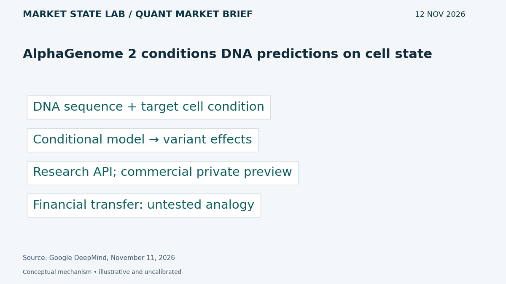
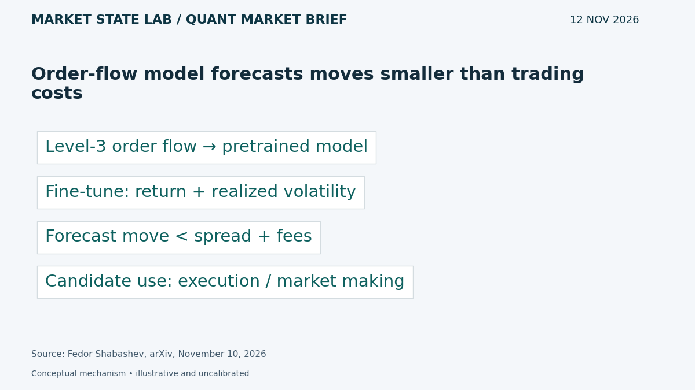
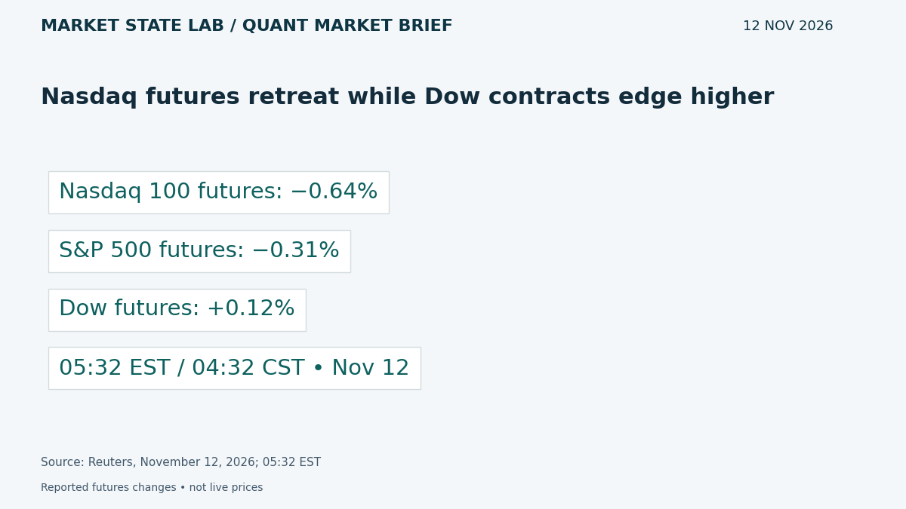
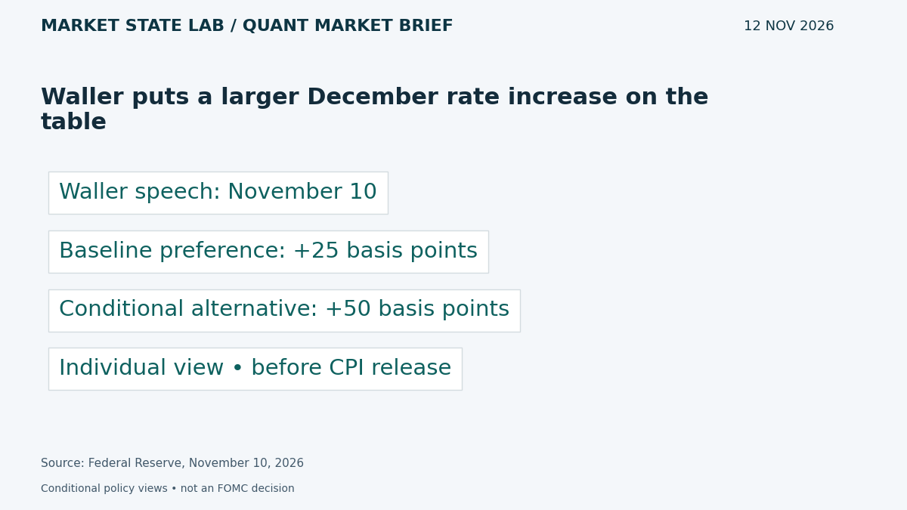
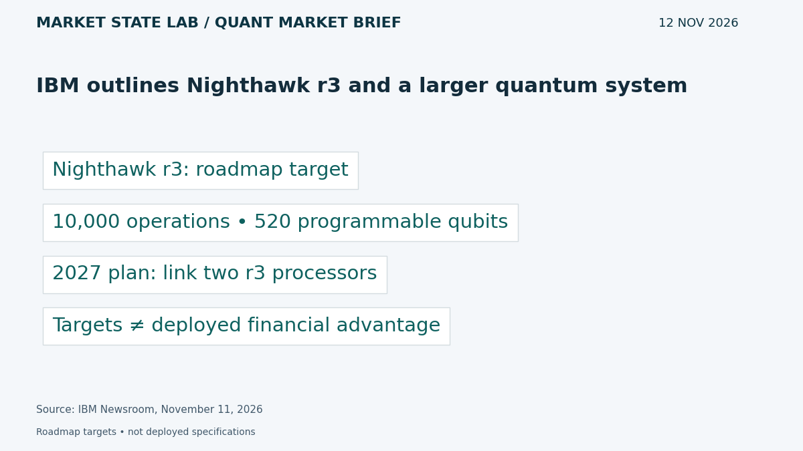

# Quant Market Brief — November 12, 2026: Forecasts vs Costs & Rate Risk

Research cutoff: **November 12, 2026, 6:33 a.m. CST (12:33 UTC)**. Thursday premarket edition; market data are explicitly timestamped reported/delayed snapshots or prior-close observations, not live executable quotes.

[Subscribe by email](https://market-state-lab.ghost.io/?utm_source=github&utm_medium=technical_archive&utm_campaign=qmb_2026-11-12#/portal/signup).

## 1. AlphaGenome 2 conditions DNA predictions on cell state

*Graphic: Market State Lab; Google DeepMind, November 11, 2026.*

**Fact — Google DeepMind announcement November 11, 2026:** AlphaGenome 2 takes a DNA sequence and a target tissue, cell type or state to predict variant effects. DeepMind announced non-commercial research API access and a private preview for commercial research. [Direct source](https://deepmind.google/blog/alphagenome-2-deciphering-how-cells-read-dna-to-better-understand-disease/)

**Inference / Why it matters:** For MATLAB research, compare explicitly conditioned models with pooled models under held-out regimes; treat this as an architectural analogy.

**Uncertainty:** Biological results do not establish financial forecasting value; reported performance comes from the developer.

## 2. Order-flow model forecasts moves smaller than trading costs

*Graphic: Market State Lab; Fedor Shabashev, arXiv, November 10, 2026.*

**Fact — Preprint submitted November 10, 2026:** Shabashev pretrains a 300-million-parameter model on Level-3 data from Bitstamp and Bitfinex, then fine-tunes microprice-return and realized-volatility forecasts. The paper reports sub-second predictive gains, but forecast moves are smaller than spread plus fees. [Direct source](https://arxiv.org/abs/2611.14117)

**Inference / Why it matters:** Evaluate execution or market-making decisions against latency and fill-aware baselines; forecast accuracy alone is not tradable alpha.

**Uncertainty:** Crypto-exchange evidence does not establish equity transfer, live profitability or feasibility with daily OHLCV data.

## 3. Nasdaq futures retreat while Dow contracts edge higher

*Graphic: Market State Lab; Reuters, November 12, 2026; 05:32 EST.*

**Fact — Reuters November 12, 2026; 05:32 EST snapshot:** At 5:32 a.m. EST, Reuters reported Nasdaq 100 futures down 0.64%, S&P 500 futures down 0.31%, and Dow futures up 0.12%. [Direct source](https://www.reuters.com/business/nasdaq-futures-fall-nvidia-turmoil-rattles-ai-stocks-2026-11-12/)

**Inference / Why it matters:** Monitor QQQ/SPY divergence and technology concentration; refresh spreads and depth before assuming yesterday’s rally continues.

**Uncertainty:** Earlier reported snapshot, not executable quotes. Price direction does not measure liquidity.

## 4. Waller puts a larger December rate increase on the table

*Graphic: Market State Lab; Federal Reserve, November 10, 2026.*

**Fact — Federal Reserve speech November 10, 2026:** Before the October CPI release, Governor Waller said he leaned toward a 25-basis-point December increase, but a 50-basis-point increase should be considered if core CPI remained around 0.3% monthly or higher. [Direct source](https://www.federalreserve.gov/newsevents/speech/waller20261110a.htm)

**Inference / Why it matters:** Stress both rate paths and distinguish an individual official’s conditional guidance from an FOMC decision.

**Uncertainty:** The speech preceded CPI; it is not a post-release commitment, consensus forecast or announced policy change.

## 5. IBM outlines Nighthawk r3 and a larger quantum system

*Graphic: Market State Lab; IBM Newsroom, November 11, 2026.*

**Fact — IBM announcement November 11, 2026:** IBM announced Nighthawk r3, designed for 10,000 quantum operations on 520 programmable qubits, and plans to link two r3 processors in 2027 into a system exceeding 1,000 qubits. [Direct source](https://newsroom.ibm.com/2026-11-11-ibm-quantum-nighthawk-demonstrates-new-levels-of-speed-and-quality,-with-plans-to-scale-beyond-1,000-qubits-in-2027)

**Inference / Why it matters:** Evaluate accuracy, end-to-end runtime and classical comparison costs before assigning business value to larger quantum hardware.

**Uncertainty:** These r3 specifications and the linked system are roadmap targets, not a verified deployed capability or proof of financial advantage.

## Quant & Market Dashboard

### Liquidity and volatility

- **Overnight:** Futures show technology weakness at 04:32 CST. Current ES/NQ spreads, depth, overnight volume, ETF NBBO and Treasury depth are unverified. Treat direction as a cautious sentiment proxy, not a liquidity rating. Refresh the execution feed as fixed-income trading resumes after Veterans Day; do not infer measured depth recovery.
- **Funding:** Latest verified SOFR is 3.88% for November 9, updated November 10 at 07:02 CST. FRED lists November 12 as the next release; the new update was unavailable at cutoff. This lagged fixing does not diagnose current stress. [FRED](https://fred.stlouisfed.org/series/SOFR).
- **Regime: Moderate; medium confidence.** Delayed VIX was 18.29 at November 12 06:38 EST / 05:38 CST, versus November 11 close 17.49. House bands: below 15 low, 15–25 moderate, 25–35 high, above 35 stressed; descriptive, not calibrated forecasts. Skew, term structure and dealer gamma are unverified. [VIX](https://chartexchange.com/symbol/index-vix/historical/).

### Factor proxies

| Factor | ETF | Nov 10→11 | Oct 9→Nov 11 (~1 month) |
|---|---|---:|---:|
| Momentum | [MTUM](https://stockanalysis.com/etf/mtum/history/) | +3.79% | -13.42% |
| Value | [VLUE](https://stockanalysis.com/etf/vlue/history/) | +2.95% | -3.57% |
| Quality | [QUAL](https://stockanalysis.com/etf/qual/history/) | +0.97% | -0.69% |
| Size | [IWM](https://stockanalysis.com/etf/iwm/history/) | +0.89% | +1.49% |
| Growth | [IWF](https://stockanalysis.com/etf/iwf/history/) | +2.28% | -8.83% |
| Low volatility | [SPLV](https://stockanalysis.com/etf/splv/history/) | +0.14% | +8.40% |

Source-linked split-adjusted Close-column price returns, excluding distributions, through November 11 at 16:00 EST / 15:00 CST. October 9 baselines are archived from the prior edition; latest closes were rechecked today. These are imperfect ETF proxies, not isolated factor premia. Corporate actions were not independently validated. All six rose Wednesday; momentum and growth remain negative over the longer window while size and low volatility remain positive.

### Execution and microstructure

- Cash opening auction: 08:30 CST / 14:30 UTC today. October PPI is scheduled Friday November 13 at 07:30 CST / 13:30 UTC; results unknown. Recheck other release and speaker calendars before staging orders. [BLS calendar](https://www.bls.gov/schedule/2026/11_sched_list.htm).
- SPY/QQQ: inspect quote age, NBBO spreads, depth, auction imbalances and ES/NQ basis. Use bounded limits and participation caps; stress slippage, gaps, cancellations, missed fills and latency. Yesterday’s rally can become a liquidity trap if displayed depth vanishes.
- Options: verify same-day expiry availability, deliverables and settlement, and Friday expiry exposure. Reject stale, crossed or one-sided quotes. Near-expiry gamma and event-related volatility repricing matter, but dealer-gamma sign, expiry concentrations, pinning and flow magnitude remain unknown.

**Research watchlist:** SPY, QQQ, IWM, RSP, TLT; ES, NQ, ZN, VX; MTUM, VLUE, QUAL, IWF, SPLV; NVDA, IBM, GOOGL.

### DRL Improvements for the MATLAB System

1. Enforce drawdown, exposure, participation and stale-data limits outside the policy, with an explicit safe fallback.
2. Penalize spread, impact, turnover, latency and missed fills; compare forecast magnitude with the full cost hurdle before acting.
3. Use purged walk-forward evaluation, training-only preprocessing and a one-use final holdout; hold out assets and regimes separately.
4. Randomize depth, observation delays and fill probabilities; test abstention when predicted advantage is smaller than cost uncertainty.

### Model hygiene

Audit leakage, survivorship bias, look-ahead, corporate actions, stale options quotes, multiple testing, calibration and drift. Preserve point-in-time universes, release vintages and availability timestamps. Fit preprocessing inside folds. Daily OHLCV cannot recreate Level-3 queues or validate sub-second fills.

### MATLAB optimization patterns

- Use named-zone timetables and causal synchronization; retain quote and event timestamps separately.
- Vectorize rolling features, preallocate logs and profile bottlenecks.
- Parallelize independent folds or Bayesian trials with reproducible random streams and fixed budgets.
- Use GPUs for sufficiently large batches; keep forecasts, execution simulation and risk controls modular.

### High-value quant research question

**Does a calibrated forecast-versus-cost abstention gate improve net execution quality over the same predictor without the gate under realistic latency and missed fills?**

Use matched seeds, risk budgets and action opportunities across held-out regimes. This tests whether predictive accuracy can improve decisions once spread, fees, impact and fill uncertainty are included.

[Subscribe by email](https://market-state-lab.ghost.io/?utm_source=github&utm_medium=technical_archive&utm_campaign=qmb_2026-11-12#/portal/signup).

*Research and education only—not individualized financial advice. No trading performance is promised.*
