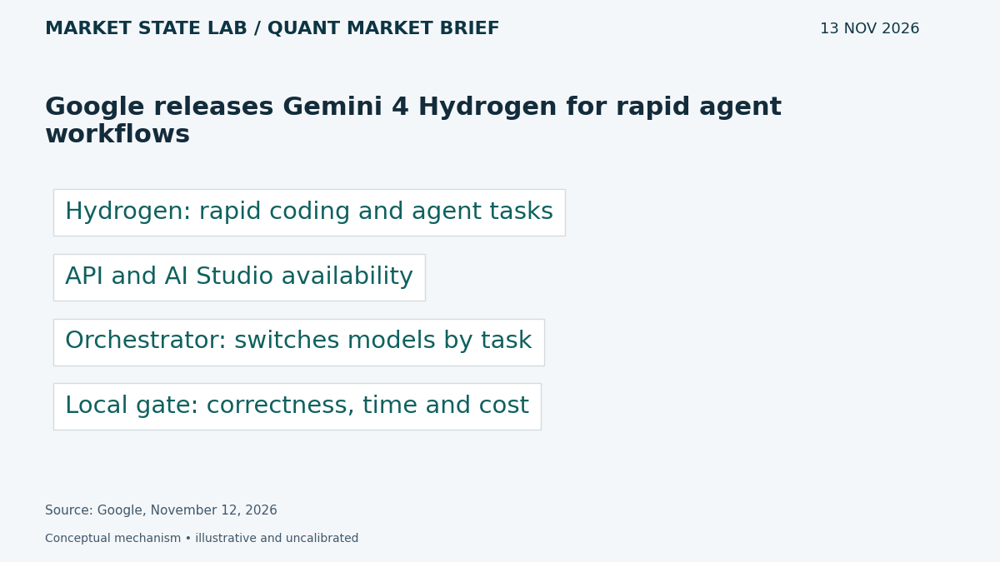
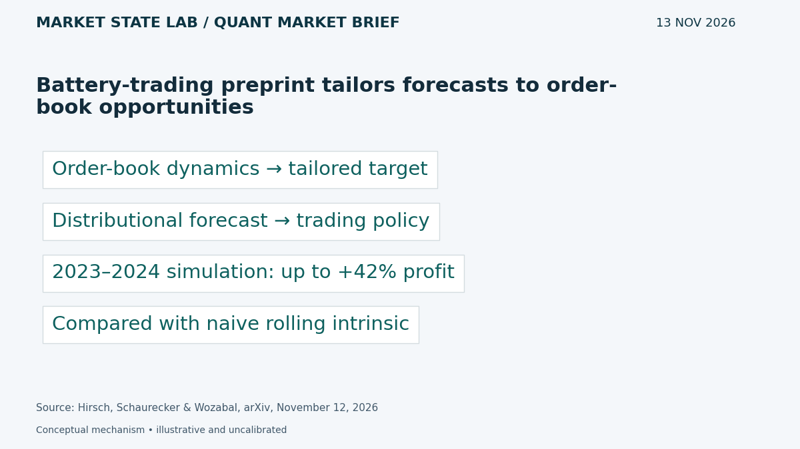
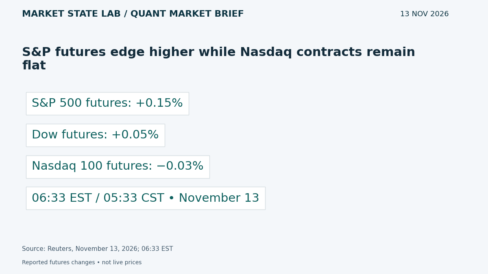
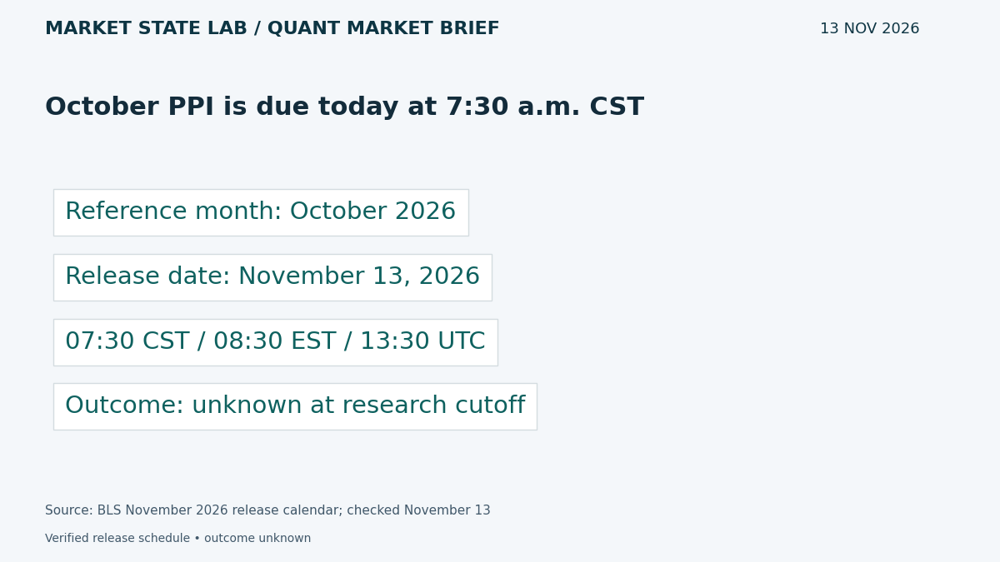
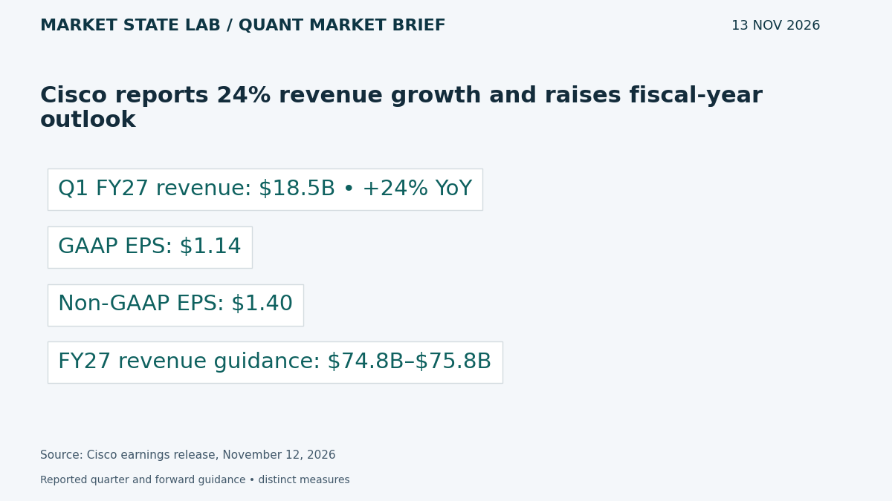

# Quant Market Brief — November 13, 2026: PPI Risk & Forecast Stability

Research cutoff: **November 13, 2026, 6:40 a.m. CST (12:40 UTC)**. Friday premarket edition; market data are explicitly timestamped reported/delayed snapshots or prior-close observations, not live executable quotes.

[Subscribe by email](https://market-state-lab.ghost.io/?utm_source=github&utm_medium=technical_archive&utm_campaign=qmb_2026-11-13#/portal/signup).

## 1. Google releases Gemini 4 Hydrogen for rapid agent workflows

*Graphic: Market State Lab; Google, November 12, 2026.*

**Fact — Google announcement November 12, 2026:** Google released Hydrogen across the Gemini API, AI Studio and other products. It targets rapid coding and agent workflows; Antigravity’s Orchestrator switches between models within a session. [Direct source](https://blog.google/innovation-and-ai/models-and-research/gemini-models/introducing-gemini-4-hydrogen/)

**Inference / Why it matters:** Benchmark task routing for MATLAB research: measure verified correctness, elapsed time and total cost against a single-model baseline.

**Uncertainty:** Vendor benchmarks and orchestration claims do not establish reliable financial research or gains on your own workload.

## 2. Battery-trading preprint tailors forecasts to order-book opportunities

*Graphic: Market State Lab; Hirsch, Schaurecker & Wozabal, arXiv, November 12, 2026.*

**Fact — Hirsch, Schaurecker and Wozabal preprint submitted November 12, 2026, 17:43:52 UTC:** The authors extend a rolling intrinsic battery-trading policy using distributional forecasts of an order-book-derived target. Their 2023–2024 high-frequency simulation reports profit improvements up to 42% over the naive policy. [Direct source](https://arxiv.org/abs/2611.17170)

**Inference / Why it matters:** Test targets aligned with feasible actions and compare forecast accuracy with decision value and stability under matched risk and costs.

**Uncertainty:** The reported maximum is simulation evidence, not live profit or an expected equity-market return; battery constraints and market design limit transfer.

## 3. S&P futures edge higher while Nasdaq contracts remain flat

*Graphic: Market State Lab; Reuters, November 13, 2026; 06:33 EST.*

**Fact — Reuters November 13; observation 06:33 EST / 05:33 CST:** At 5:33 a.m. CST, Reuters reported S&P 500 futures +0.15%, Dow futures +0.05% and Nasdaq 100 futures −0.03%. [Direct source](https://www.reuters.com/business/nasdaq-futures-dip-nvidia-tumult-keeps-investors-edge-2026-11-13/)

**Inference / Why it matters:** Monitor ES/NQ relative strength and SPY/QQQ breadth separately; refresh quotes after the inflation release before sizing execution.

**Uncertainty:** This is an earlier reported snapshot, not a live executable quote or evidence of deep liquidity.

## 4. October PPI is due today at 7:30 a.m. CST

*Graphic: Market State Lab; BLS November 2026 release calendar; checked November 13.*

**Fact — BLS November 2026 calendar, rechecked November 13 before release:** BLS schedules the October Producer Price Index release for November 13 at 8:30 a.m. EST / 7:30 a.m. CST / 13:30 UTC. Results were unavailable at the research cutoff. [Direct source](https://www.bls.gov/schedule/2026/11_sched_list.htm)

**Inference / Why it matters:** Separate pre-release and post-release states, stress gaps and spread expansion, and compare component readings with timestamped expectations.

**Uncertainty:** This confirms timing only. It is neither an inflation forecast nor a Federal Reserve decision; PPI does not map one-for-one into CPI or PCE.

## 5. Cisco reports 24% revenue growth and raises fiscal-year outlook

*Graphic: Market State Lab; Cisco earnings release, November 12, 2026.*

**Fact — Cisco fiscal Q1 2027 results published November 12, 2026; quarter ended October 24:** Cisco reported quarterly revenue of $18.5 billion, up 24%, GAAP EPS of $1.14 and non-GAAP EPS of $1.40. It raised fiscal 2027 revenue guidance to $74.8–$75.8 billion. [Direct source](https://investor.cisco.com/news/news-details/2026/CISCO-REPORTS-FIRST-QUARTER-EARNINGS/default.aspx)

**Inference / Why it matters:** Track networking demand alongside margins and cash conversion; separate reported results from forward guidance when evaluating infrastructure exposure.

**Uncertainty:** Non-GAAP earnings require reconciliation; guidance is forward-looking and does not establish future growth or share-price performance.

## Quant & Market Dashboard

### Liquidity and volatility

- **Overnight:** The reported 05:33 CST futures snapshot shows small, mixed moves. Current ES/NQ spreads, displayed depth, overnight volume, executable ETF NBBO and Treasury-market depth remain unverified. Direction is a cautious sentiment proxy, not a liquidity rating; refresh execution feeds before trading.
- **Funding:** Latest verified SOFR is **3.89% for November 10**, updated November 12 at **07:02 CST**. Today's update was unavailable at cutoff. This lagged fixing cannot diagnose current funding stress. [FRED](https://fred.stlouisfed.org/series/SOFR).
- **Regime: Moderate; medium confidence, with concentrated event risk.** Delayed VIX was **18.22 at November 13 07:04 EST / 06:04 CST**, versus November 12 close **18.70**. House bands: below 15 low, 15–25 moderate, 25–35 high, above 35 stressed; descriptive conventions, not calibrated forecasts. Skew, term structure and dealer gamma remain unverified. [VIX](https://chartexchange.com/symbol/index-vix/historical/).

### Factor proxies

| Factor | ETF | Nov 11→12 | Oct 9→Nov 12 (~1 month) |
|---|---|---:|---:|
| Momentum | [MTUM](https://stockanalysis.com/etf/mtum/history/) | +0.14% | -13.30% |
| Value | [VLUE](https://stockanalysis.com/etf/vlue/history/) | -1.06% | -4.59% |
| Quality | [QUAL](https://stockanalysis.com/etf/qual/history/) | -0.60% | -1.29% |
| Size | [IWM](https://stockanalysis.com/etf/iwm/history/) | -1.64% | -0.18% |
| Growth | [IWF](https://stockanalysis.com/etf/iwf/history/) | -0.37% | -9.16% |
| Low volatility | [SPLV](https://stockanalysis.com/etf/splv/history/) | -0.23% | +8.15% |

Source-linked split-adjusted Close-column price returns, excluding distributions, through November 12 at **16:00 EST / 15:00 CST**. October 9 baselines are archived from earlier editions; latest closes were rechecked today. Corporate actions were not independently validated. These imperfect ETF proxies do not isolate factor premia. Momentum rose slightly Thursday while the other five proxies declined; low volatility remains positive over the longer window.

### Execution and microstructure

- PPI: **07:30 CST / 13:30 UTC today**; cash opening auction: **08:30 CST / 14:30 UTC**. Results remain unknown at cutoff. Separate observations and risk settings across the release; recheck other calendars before staging orders. [BLS calendar](https://www.bls.gov/schedule/2026/11_sched_list.htm).
- SPY/QQQ: inspect quote age, NBBO spreads, displayed depth, auction imbalances and ES/NQ basis. Use bounded limits and participation caps; stress slippage, gaps, cancellations, latency and missed fills. Small index moves can conceal thin depth or concentrated constituent risks.
- Options: verify Friday expiries, deliverables, settlement and exercise obligations. Reject stale, crossed or one-sided quotes. Near-expiry gamma and event-volatility repricing can amplify execution risk; dealer positioning, expiry concentrations, pinning and flow magnitude remain unknown. Do not infer gamma direction from open interest alone.

**Research watchlist:** SPY, QQQ, IWM, RSP, TLT; ES, NQ, ZN, VX; MTUM, VLUE, QUAL, IWF, SPLV; CSCO, NVDA, GOOGL.

### DRL Improvements for the MATLAB System

1. Enforce drawdown, exposure, participation and stale-data limits outside the policy, with an explicit safe fallback.
2. Penalize spread, impact, turnover, latency and missed fills; include forecast instability and tail losses in evaluation.
3. Use purged walk-forward evaluation, training-only preprocessing and an untouched final holdout; separate event and quiet regimes.
4. Randomize depth, observation delays and fill probabilities; test abstention and hard risk compliance under distribution shift.

### Model hygiene

Audit leakage, survivorship bias, look-ahead bias, corporate actions, stale options quotes, multiple testing, calibration and drift. Preserve point-in-time universes, release vintages and actual availability timestamps. Fit preprocessing inside folds. Forecast targets must match feasible actions; daily OHLCV cannot validate order-book fills.

### MATLAB optimization patterns

- Use named-zone timetables and causal synchronization; retain quote and release timestamps separately.
- Vectorize rolling features, preallocate logs and profile bottlenecks.
- Parallelize independent folds or Bayesian trials with reproducible random streams and fixed search budgets.
- Use GPUs for sufficiently large batches; keep forecasts, environments, execution simulation and risk controls modular.

### High-value quant research question

**At matched risk and trading costs, do action-aligned distributional forecasts improve net decisions more than a more accurate but less stable point forecast?**

Compare identical policies with and without forecast inputs, matching seeds, search budgets and action opportunities across held-out regimes. This tests decision value and stability rather than predictive accuracy alone; electricity-market simulation evidence does not establish transfer to equities.

[Subscribe by email](https://market-state-lab.ghost.io/?utm_source=github&utm_medium=technical_archive&utm_campaign=qmb_2026-11-13#/portal/signup).

*Research and education only—not individualized financial advice. No trading performance is promised.*
