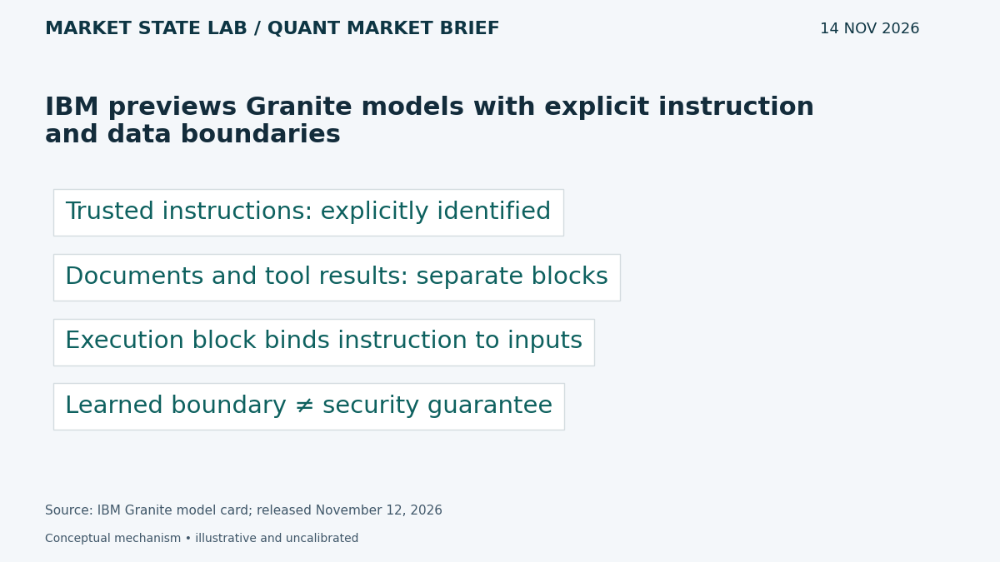
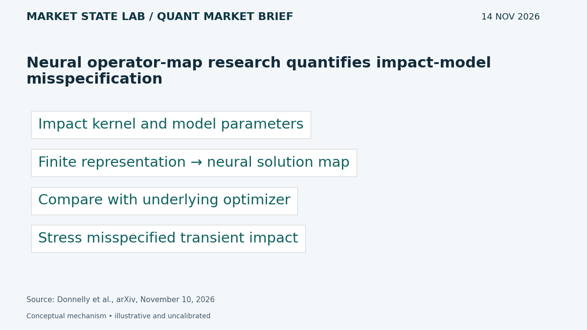
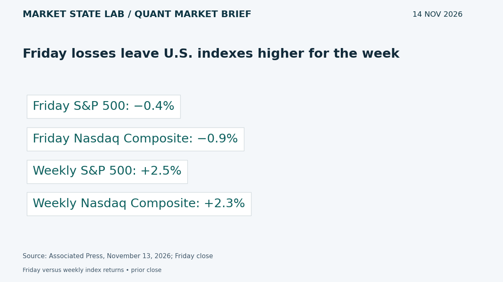
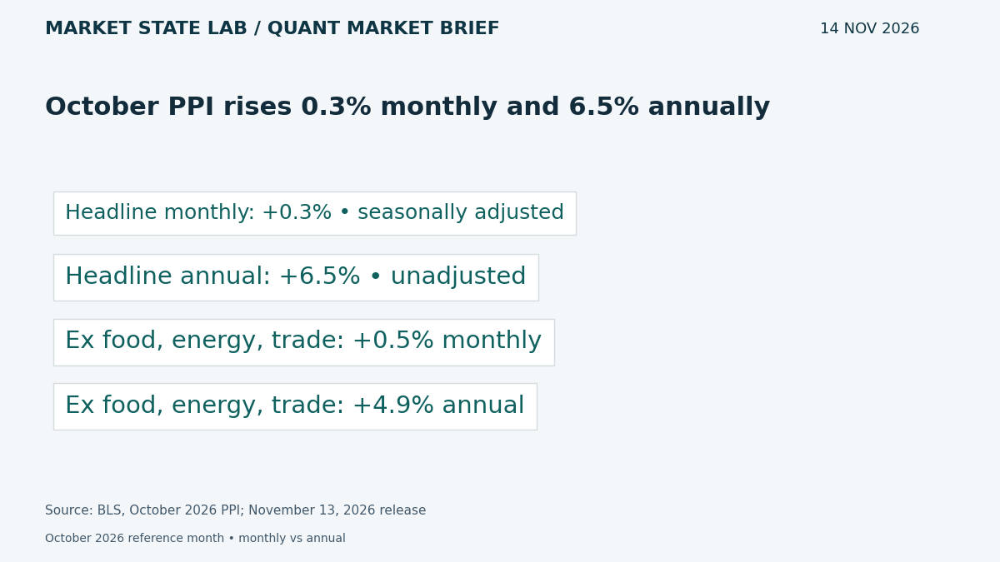
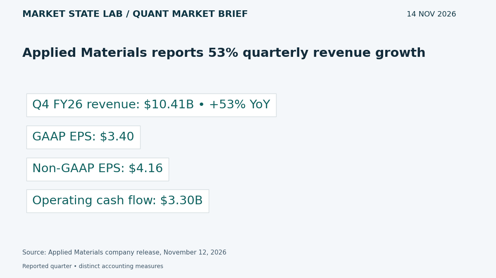

# Quant Market Brief — November 14, 2026: Inflation Results & Execution Models

Research cutoff: **November 14, 2026, 6:34 a.m. CST (12:34 UTC)**. Saturday weekend edition; market data are explicitly timestamped reported/delayed snapshots or prior-close observations, not live executable quotes.

[Subscribe by email](https://market-state-lab.ghost.io/?utm_source=github&utm_medium=technical_archive&utm_campaign=qmb_2026-11-14#/portal/signup).

## 1. IBM previews Granite models with explicit instruction and data boundaries

*Graphic: Market State Lab; IBM Granite model card; released November 12, 2026.*

**Fact — IBM release November 12, 2026:** IBM released experimental Granite 4.1 LLMON previews in 3B and 8B variants. Structured blocks identify instructions, documents and tool results, while an execution block specifies which instruction operates on which inputs. [Direct source](https://huggingface.co/ibm-granite/granite-4.1-3b-llmon-preview)

**Inference / Why it matters:** Test document and tool-output injection resistance in MATLAB research assistants; keep execution permissions and risk gates outside the language model.

**Uncertainty:** IBM says boundary-following is learned behavior, not an enforced guarantee. Conventional chat input degrades quality; the bundled template is required.

## 2. Neural operator-map research quantifies impact-model misspecification

*Graphic: Market State Lab; Donnelly et al., arXiv, November 10, 2026.*

**Fact — Donnelly, Galimberti, Healy and Zhang preprint November 10, 2026:** The paper establishes local Lipschitz continuity of an optimal liquidation strategy with respect to model parameters, then builds neural approximations of the solution map and studies costs from misspecifying transient impact. [Direct source](https://arxiv.org/abs/2611.14245)

**Inference / Why it matters:** Benchmark a MATLAB execution surrogate against the underlying optimizer and stress unseen impact kernels before using its actions.

**Uncertainty:** The result depends on the modeled execution problem. Approximation accuracy does not establish live fills, universal robustness or profitable trading.

## 3. Friday losses leave U.S. indexes higher for the week

*Graphic: Market State Lab; Associated Press, November 13, 2026; Friday close.*

**Fact — AP November 13, 2026 completed-session report:** The S&P 500 fell 0.4% Friday to 7,561.67, while the Nasdaq Composite fell 0.9%. The S&P nevertheless gained 2.5% for the week and the Nasdaq gained 2.3%. [Direct source](https://apnews.com/article/wall-street-stocks-dow-nasdaq-12c1e8155fb85c3c7b09e058ed6d3c74)

**Inference / Why it matters:** Separate daily drawdown from weekly recovery; test breadth and factor leadership before extrapolating an index rebound.

**Uncertainty:** These are rounded completed-session index returns, not SPY/QQQ returns or current executable quotes.

## 4. October PPI rises 0.3% monthly and 6.5% annually

*Graphic: Market State Lab; BLS, October 2026 PPI; November 13, 2026 release.*

**Fact — BLS release November 13, 2026, 08:30 EST:** Final-demand PPI rose 0.3% in October, seasonally adjusted, and 6.5% over twelve months, unadjusted. The index excluding foods, energy and trade services rose 0.5% monthly and 4.9% annually. [Direct source](https://www.bls.gov/news.release/archives/ppi_11132026.htm)

**Inference / Why it matters:** Preserve each measure and adjustment convention when updating inflation inputs; stress persistent inflation without treating PPI as a Fed decision.

**Uncertainty:** PPI differs from CPI and PCE, and the exclusion measure here also removes trade services. Data are subject to revision.

## 5. Applied Materials reports 53% quarterly revenue growth

*Graphic: Market State Lab; Applied Materials company release, November 12, 2026.*

**Fact — Applied Materials November 12, 2026; quarter ended October 25:** Applied Materials reported fiscal Q4 revenue of $10.41 billion, up 53% year over year, GAAP EPS of $3.40 and non-GAAP EPS of $4.16. Quarterly operating cash flow reached $3.30 billion. [Direct source](https://rss.globenewswire.com/news-release/2026/11/12/3402149/0/en/applied-materials-announces-fourth-quarter-and-fiscal-year-2026-results.html)

**Inference / Why it matters:** Compare semiconductor-equipment demand with margins, cash conversion and customer concentration when evaluating infrastructure exposure.

**Uncertainty:** Non-GAAP figures require reconciliation; one strong quarter does not establish future demand or stock performance.

## Quant & Market Dashboard

### Liquidity and volatility

- **Overnight/weekend:** U.S. cash markets are closed. Current ES/NQ spreads, depth, overnight volume, executable ETF NBBO and Treasury-market depth remain unverified. Friday close is a cautious state proxy, not current executable liquidity. Refresh feeds when each venue reopens; do not carry Friday spreads into the next session.
- **Funding:** Latest verified SOFR is **3.90% for November 12**, updated November 13 at **07:02 CST**. This lagged fixing cannot diagnose current stress. [FRED](https://fred.stlouisfed.org/series/SOFR).
- **Regime: Moderate; medium confidence.** VIX closed at **19.30 on November 13**, up from **18.70**; the provider labels its 16:00 EST / 15:00 CST observation delayed. House bands: below 15 low, 15–25 moderate, 25–35 high, above 35 stressed; descriptive conventions, not calibrated forecasts. Skew, term structure and dealer gamma remain unverified. Weekend gap risk remains. [VIX](https://chartexchange.com/symbol/index-vix/historical/).

### Factor proxies

| Factor | ETF | Nov 12→13 | Oct 9→Nov 13 (~1 month) |
|---|---|---:|---:|
| Momentum | [MTUM](https://stockanalysis.com/etf/mtum/history/) | -1.99% | -15.02% |
| Value | [VLUE](https://stockanalysis.com/etf/vlue/history/) | -0.63% | -5.18% |
| Quality | [QUAL](https://stockanalysis.com/etf/qual/history/) | -0.05% | -1.34% |
| Size | [IWM](https://stockanalysis.com/etf/iwm/history/) | -0.32% | -0.50% |
| Growth | [IWF](https://stockanalysis.com/etf/iwf/history/) | -1.12% | -10.18% |
| Low volatility | [SPLV](https://stockanalysis.com/etf/splv/history/) | +0.54% | +8.73% |

Source-linked split-adjusted Close-column price returns, excluding distributions, through November 13 at **16:00 EST / 15:00 CST**. October 9 baselines are archived from earlier editions; latest closes were rechecked today. Corporate actions were not independently validated. These imperfect ETF proxies do not isolate factor premia. Low volatility rose Friday while the other five proxies declined; momentum and growth remain negative over the longer window.

### Execution and microstructure

- Next regular cash opening auction: **Monday November 16, 08:30 CST / 14:30 UTC**. Refresh release calendars and overnight positions before staging orders. Replace pre-PPI flags with the confirmed release vintage; do not reuse stale event-state inputs.
- SPY/QQQ: inspect quote age, NBBO spreads, displayed depth, auction imbalances and ES/NQ basis. Use bounded limits and participation caps; stress slippage, gaps, cancellations, latency and missed fills. Small index moves can conceal thin depth or concentrated constituent risks.
- Options: reconcile Friday expiries and verify next-session contracts, deliverables, settlement and exercise obligations. Reject stale, crossed or one-sided quotes. Near-expiry gamma and event-volatility repricing can amplify execution risk; dealer positioning, expiry concentrations, pinning and flow magnitude remain unknown. Do not infer gamma direction from open interest alone.

**Research watchlist:** SPY, QQQ, IWM, RSP, TLT; ES, NQ, ZN, VX; MTUM, VLUE, QUAL, IWF, SPLV; AMAT, NVDA, IBM.

### DRL Improvements for the MATLAB System

1. Enforce drawdown, exposure, participation and stale-data limits outside the policy, with an explicit safe fallback.
2. Penalize spread, impact, turnover, latency and missed fills; stress permanent and transient impact alongside tail losses.
3. Use purged walk-forward evaluation, training-only preprocessing and an untouched final holdout; separate event and quiet regimes.
4. Randomize depth, observation delays and fill probabilities; test abstention and hard risk compliance under distribution shift.

### Model hygiene

Audit leakage, survivorship bias, look-ahead bias, corporate actions, stale options quotes, multiple testing, calibration and drift. Preserve point-in-time universes, release vintages and actual availability timestamps. Fit preprocessing inside folds. Forecast targets must match feasible actions; daily OHLCV cannot validate order-book fills.

### MATLAB optimization patterns

- Use named-zone timetables and causal synchronization; retain quote and release timestamps separately.
- Vectorize rolling features, preallocate logs and profile bottlenecks.
- Parallelize independent folds or Bayesian trials with reproducible random streams and fixed search budgets.
- Use GPUs for sufficiently large batches; keep forecasts, environments, execution simulation and risk controls modular.

### High-value quant research question

**Does a neural execution surrogate retain its net advantage under held-out impact kernels and realistic fill uncertainty?**

Compare it with the underlying optimizer using matched risk, seeds and action opportunities, measuring cost, constraint breaches and missed fills. This tests whether approximation speed survives model misspecification rather than only interpolation within the training distribution.

[Subscribe by email](https://market-state-lab.ghost.io/?utm_source=github&utm_medium=technical_archive&utm_campaign=qmb_2026-11-14#/portal/signup).

*Research and education only—not individualized financial advice. No trading performance is promised.*
