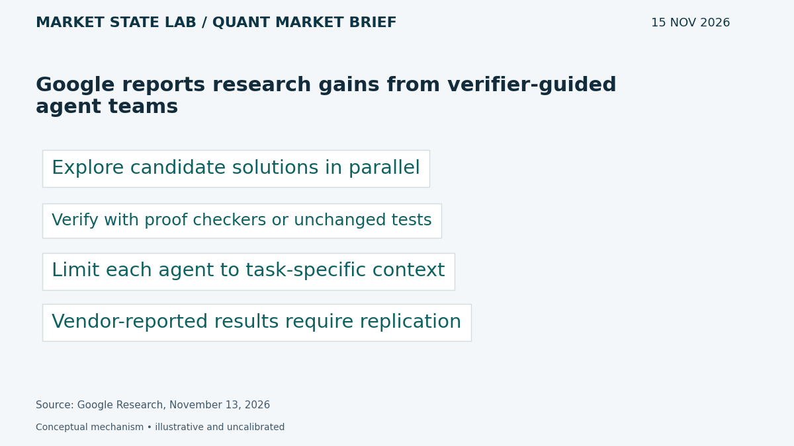
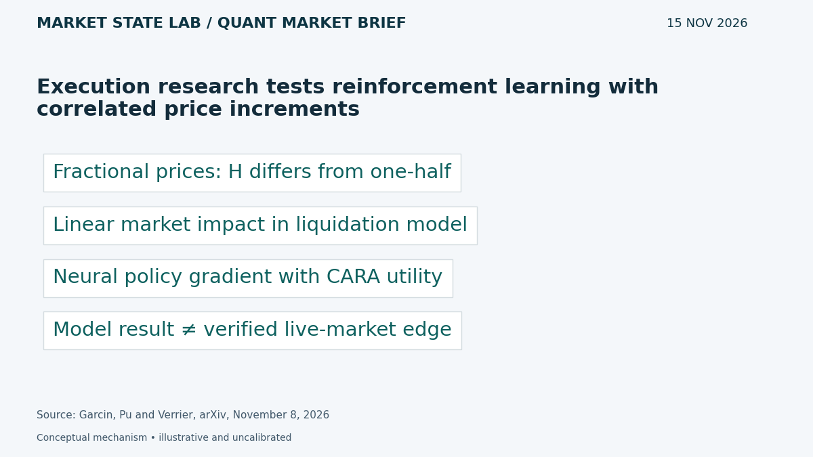
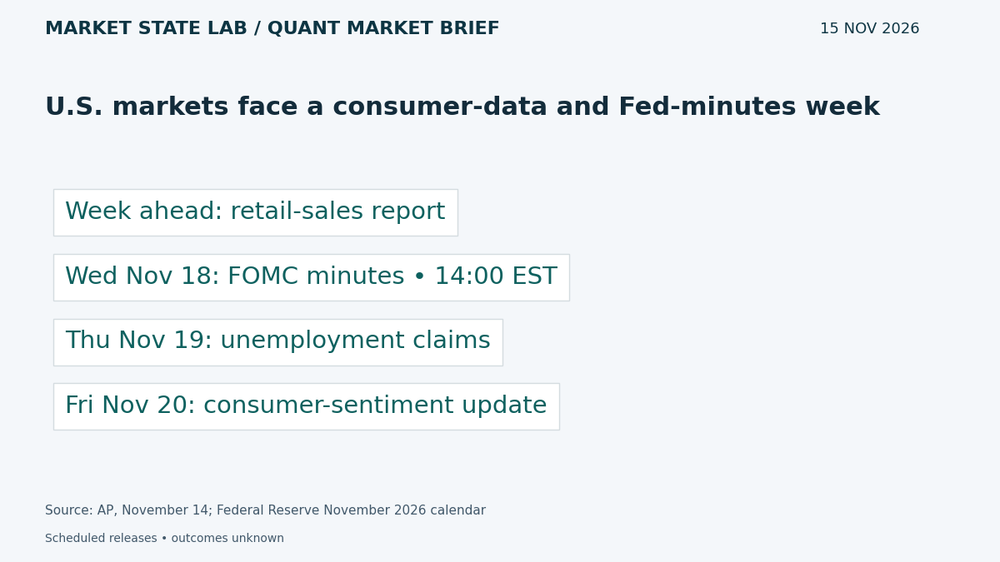
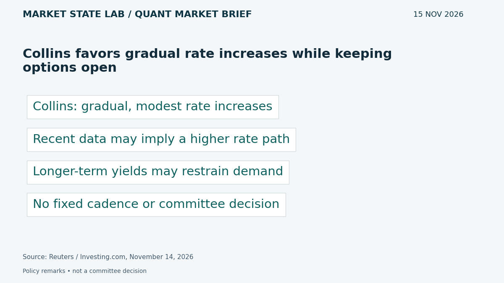
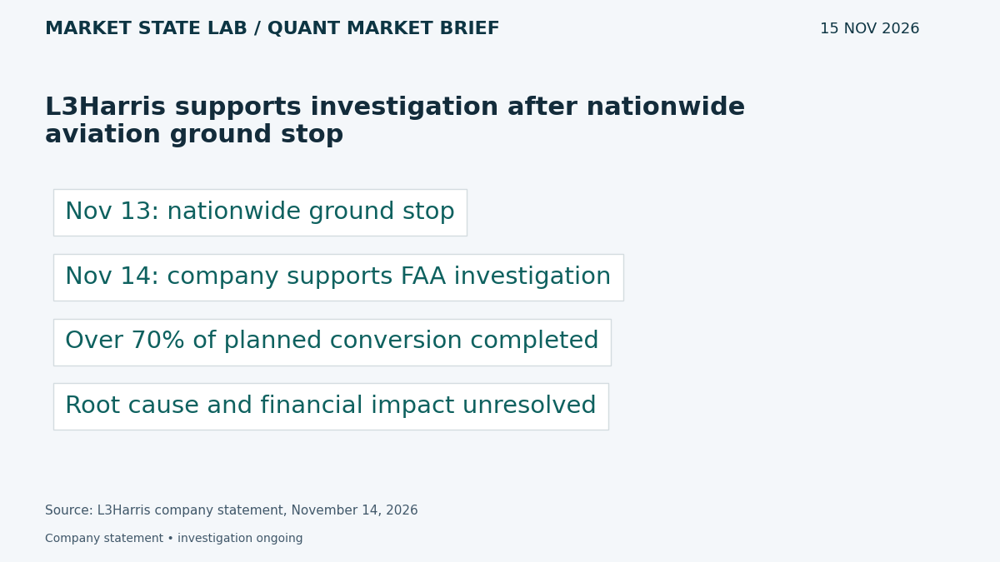

# Quant Market Brief — November 15, 2026: Verified Agents & Rate-Path Risk

Research cutoff: **November 15, 2026, 6:37 a.m. CST (12:37 UTC)**. Sunday weekend edition; market data are explicitly timestamped reported/delayed snapshots or prior-close observations, not live executable quotes.

[Subscribe by email](https://market-state-lab.ghost.io/?utm_source=github&utm_medium=technical_archive&utm_campaign=qmb_2026-11-15#/portal/signup).

## 1. Google reports research gains from verifier-guided agent teams

*Graphic: Market State Lab; Google Research, November 13, 2026.*

**Fact — Google Research, November 13, 2026:** Google reports new mathematics, science and systems-engineering results from Antigravity /teamwork. Its workflow combines parallel exploration with independent checks, including proof checkers and unchanged software tests, and limits each agent to task-specific context. [Direct source](https://research.google/blog/advancing-science-engineering-with-antigravitys-teamwork-feature/)

**Inference / Why it matters:** Evaluate research assistants by reproducible verification and total search cost; use independent tests for MATLAB code and freeze financial evaluation data.

**Uncertainty:** These are vendor-reported examples, not evidence of universal reliability or trading profitability. External replication remains necessary.

## 2. Execution research tests reinforcement learning with correlated price increments

*Graphic: Market State Lab; Garcin, Pu and Verrier, arXiv, November 8, 2026.*

**Fact — Garcin, Pu and Verrier preprint submitted November 8, 2026:** A new preprint studies liquidation with linear market impact and fractional Brownian prices. When the Hurst parameter differs from one-half, its authors find the deterministic Almgren–Chriss solution is no longer optimal and train a neural policy-gradient strategy using CARA utility. [Direct source](https://arxiv.org/abs/2611.11373)

**Inference / Why it matters:** Test whether dependence-aware execution improves costs after estimating memory only within training folds and adding realistic fill uncertainty.

**Uncertainty:** The improvement is conditional on the simulated price and impact model; this preprint does not establish executable market alpha.

## 3. U.S. markets face a consumer-data and Fed-minutes week

*Graphic: Market State Lab; AP, November 14; Federal Reserve November 2026 calendar.*

**Fact — AP week-ahead report, November 14, 2026:** AP's week-ahead preview highlights retail sales, Wednesday's Fed minutes, Thursday's unemployment claims and Friday's consumer-sentiment update. The Federal Reserve calendar confirms minutes on November 18 at 2 p.m. Eastern. [Direct source](https://www.sfgate.com/business/article/retail-sales-and-fed-minutes-in-focus-next-week-22530766.php)

**Inference / Why it matters:** Map SPY/QQQ holding periods and option expiries to scheduled release risk; separate event premiums from ordinary realized-volatility signals.

**Uncertainty:** This is a calendar setup, not a forecast of surprises, market direction or option returns. Recheck release times before execution.

## 4. Collins favors gradual rate increases while keeping options open

*Graphic: Market State Lab; Reuters / Investing.com, November 14, 2026.*

**Fact — Reuters, November 14, 2026, 15:46 UTC:** Boston Fed President Susan Collins supported a steady pace of modest rate increases on Saturday, citing economic uncertainty. She said recent inflation and labor-market data could imply a higher policy-rate path than she expected a few months ago. [Direct source](https://www.investing.com/news/economy-news/feds-collins-says-gradual-rate-hikes-best-to-manage-economic-risks-5027385)

**Inference / Why it matters:** Stress duration and growth-factor exposure across both gradual tightening and stronger restraint from longer-term yields; avoid coding one official's view as a committee decision.

**Uncertainty:** Collins did not commit to a fixed cadence. Her remarks do not determine the next FOMC outcome.

## 5. L3Harris supports investigation after nationwide aviation ground stop

*Graphic: Market State Lab; L3Harris company statement, November 14, 2026.*

**Fact — L3Harris statement, November 14; ground stop November 13, 2026:** L3Harris said it is supporting the FAA's investigation into the November 13 nationwide ground stop. The company says more than 70% of the planned conversion from legacy copper communications to fiber has been completed with its partners and the FAA. [Direct source](https://www.l3harris.com/newsroom/press-release/2026/11/l3harris-statement-nov-13-ground-stop)

**Inference / Why it matters:** Monitor contractor operational exposure and airline disruption costs; require staged rollouts, rollback controls and failure isolation in critical trading infrastructure.

**Uncertainty:** The statement does not establish root cause, liability or financial impact. Completion percentage is company-reported, not an outage-recovery measure.

## Quant & Market Dashboard

### Liquidity and volatility

- **Overnight/weekend:** U.S. cash markets are closed. Current ES/NQ spreads, depth, overnight volume, executable ETF NBBO and Treasury-market depth remain unverified. Friday close is a cautious state proxy, not current executable liquidity. Refresh feeds when each venue reopens; do not carry Friday spreads into the next session.
- **Funding:** Latest verified SOFR is **3.90% for November 12**, updated November 13 at **07:02 CST**. This lagged fixing cannot diagnose current stress. [FRED](https://fred.stlouisfed.org/series/SOFR).
- **Regime: Moderate; medium confidence.** VIX closed at **19.30 on November 13**, up from **18.70**; the provider labels its 16:00 EST / 15:00 CST observation delayed. House bands: below 15 low, 15–25 moderate, 25–35 high, above 35 stressed; descriptive conventions, not calibrated forecasts. Skew, term structure and dealer gamma remain unverified. Weekend gap risk remains. [VIX](https://chartexchange.com/symbol/index-vix/historical/).

### Factor proxies

| Factor | ETF | Nov 12→13 | Oct 9→Nov 13 (~1 month) |
|---|---|---:|---:|
| Momentum | [MTUM](https://stockanalysis.com/etf/mtum/history/) | -1.99% | -15.02% |
| Value | [VLUE](https://stockanalysis.com/etf/vlue/history/) | -0.63% | -5.18% |
| Quality | [QUAL](https://stockanalysis.com/etf/qual/history/) | -0.05% | -1.34% |
| Size | [IWM](https://stockanalysis.com/etf/iwm/history/) | -0.32% | -0.50% |
| Growth | [IWF](https://stockanalysis.com/etf/iwf/history/) | -1.12% | -10.18% |
| Low volatility | [SPLV](https://stockanalysis.com/etf/splv/history/) | +0.54% | +8.73% |

Source-linked split-adjusted Close-column price returns, excluding distributions, through November 13 at **16:00 EST / 15:00 CST**. All three reference closes were rechecked today. Corporate actions were not independently validated. These imperfect ETF proxies do not isolate factor premia. Low volatility rose Friday while the other five proxies declined; momentum and growth remain negative over the longer window.

### Execution and microstructure

- Next regular cash opening auction: **Monday November 16, 08:30 CST / 14:30 UTC**. Refresh release calendars and overnight positions before staging orders. FOMC minutes are scheduled Wednesday November 18 at 13:00 CST / 19:00 UTC; refresh the other release times before execution. [Fed calendar](https://www.federalreserve.gov/newsevents/2026-november.htm).
- SPY/QQQ: inspect quote age, NBBO spreads, displayed depth, auction imbalances and ES/NQ basis. Use bounded limits and participation caps; stress slippage, gaps, cancellations, latency and missed fills. Small index moves can conceal thin depth or concentrated constituent risks.
- Options: reconcile Friday expiries and verify next-session contracts, deliverables, settlement and exercise obligations. Reject stale, crossed or one-sided quotes. Near-expiry gamma and event-volatility repricing can amplify execution risk; dealer positioning, expiry concentrations, pinning and flow magnitude remain unknown. Do not infer gamma direction from open interest alone.

**Research watchlist:** SPY, QQQ, IWM, RSP, TLT; ES, NQ, ZN, VX; MTUM, VLUE, QUAL, IWF, SPLV; GOOGL, LHX; JETS as an airline-sector proxy.

### DRL Improvements for the MATLAB System

1. Enforce drawdown, exposure, participation and stale-data limits outside the policy, with an explicit safe fallback.
2. Penalize spread, impact, turnover, latency and missed fills; stress permanent and transient impact alongside tail losses.
3. Use purged walk-forward evaluation, training-only preprocessing and an untouched final holdout; separate event and quiet regimes.
4. Randomize depth, observation delays and fill probabilities; test abstention and hard risk compliance under distribution shift.

### Model hygiene

Audit leakage, survivorship bias, look-ahead bias, corporate actions, stale options quotes, multiple testing, calibration and drift. Preserve point-in-time universes, release vintages and actual availability timestamps. Fit preprocessing inside folds. Forecast targets must match feasible actions; daily OHLCV cannot validate order-book fills.

### MATLAB optimization patterns

- Use named-zone timetables and causal synchronization; retain quote and release timestamps separately.
- Vectorize rolling features, preallocate logs and profile bottlenecks.
- Parallelize independent folds or Bayesian trials with reproducible random streams and fixed search budgets.
- Use GPUs for sufficiently large batches; keep forecasts, environments, execution simulation and risk controls modular.

### High-value quant research question

**Does dependence-aware execution outperform a memory-free baseline after realistic costs and estimation error?**

Estimate price memory only within training folds; compare with an Almgren–Chriss baseline at matched risk and participation limits across quiet, event and regime-shift periods. Measure implementation shortfall, tail loss and risk breaches. This tests whether simulated dependence survives estimation error and trading costs.

[Subscribe by email](https://market-state-lab.ghost.io/?utm_source=github&utm_medium=technical_archive&utm_campaign=qmb_2026-11-15#/portal/signup).

*Research and education only—not individualized financial advice. No trading performance is promised.*
