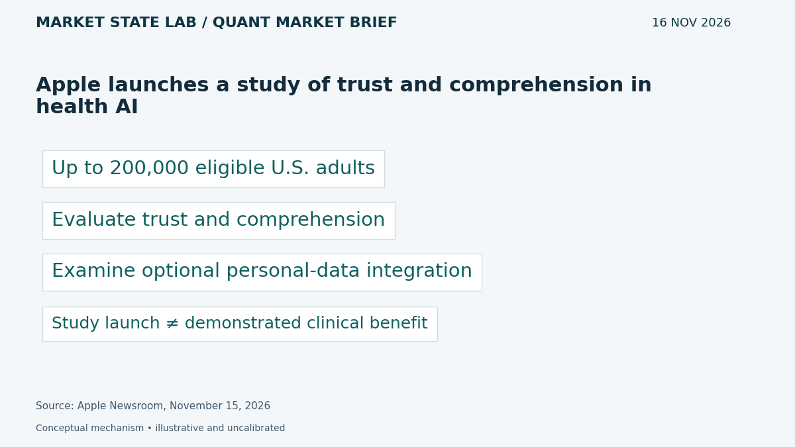
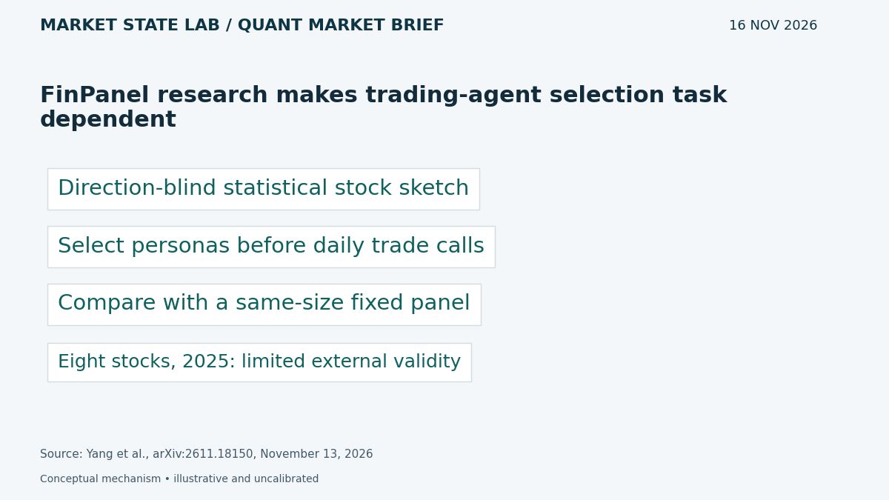
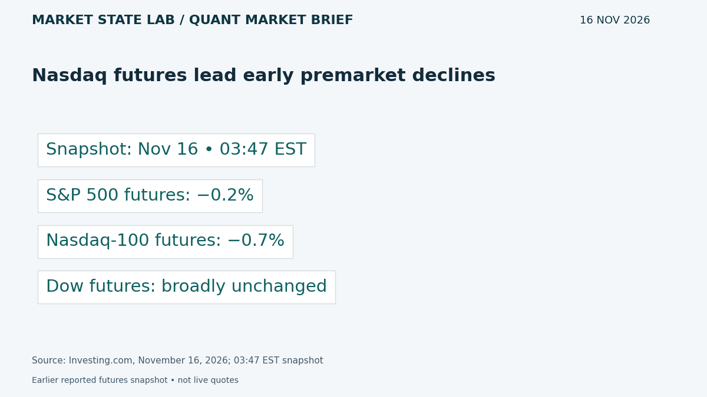
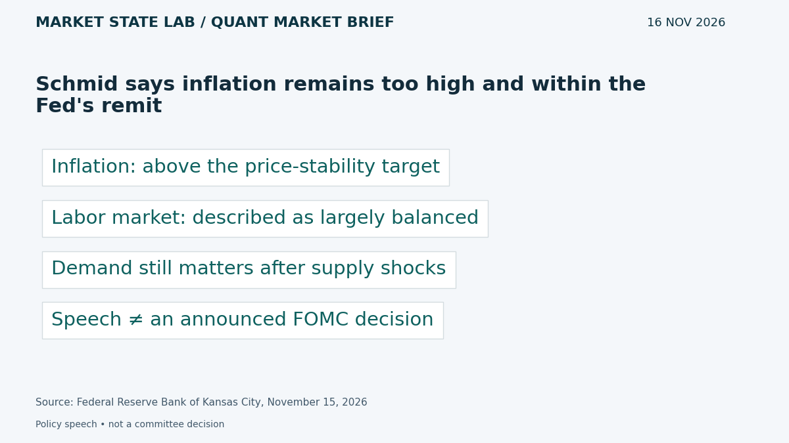
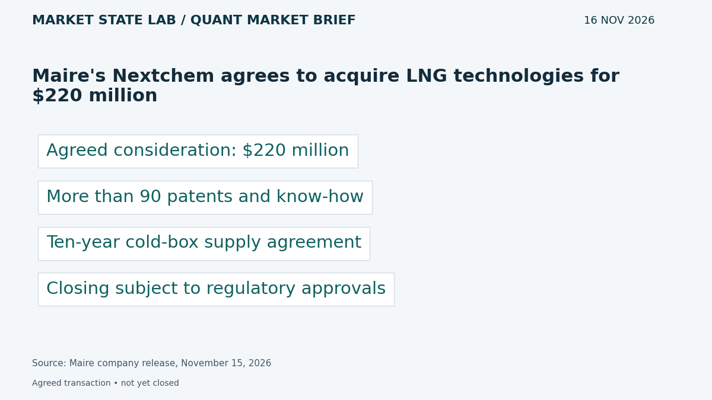

# Quant Market Brief — November 16, 2026: AI Trust & Trading-Agent Selection

Research cutoff: **November 16, 2026, 7:40 a.m. CST (13:40 UTC)**. Monday premarket recovery edition; market data are explicitly timestamped reported/delayed snapshots or prior-close observations, not live executable quotes.

[Subscribe by email](https://market-state-lab.ghost.io/?utm_source=github&utm_medium=technical_archive&utm_campaign=qmb_2026-11-16#/portal/signup).

## 1. Apple launches a study of trust and comprehension in health AI

*Graphic: Market State Lab; Apple Newsroom, November 15, 2026.*

**Fact — Apple announcement November 15, 2026:** Apple and OpenEvidence launched a U.S. study of conversational health AI, open to up to 200,000 eligible adults. It will examine trust, response quality, comprehension and everyday actions; optional HealthKit sharing will test personal-data integration. [Direct source](https://www.apple.com/newsroom/2026/11/apple-launches-research-study-to-explore-the-use-of-ai-for-health/)

**Inference / Why it matters:** Evaluate research assistants on comprehension, calibrated trust and downstream decisions as well as answer accuracy; make optional data access explicit.

**Uncertainty:** This is a study launch, not a demonstrated clinical benefit. Apple says the app does not diagnose or treat conditions or replace professional advice.

## 2. FinPanel research makes trading-agent selection task dependent

*Graphic: Market State Lab; Yang et al., arXiv:2611.18150, November 13, 2026.*

**Fact — Yang et al. preprint submitted November 13; listed November 16, 2026:** FinPanel selects trader personas for each stock from a direction-blind statistical sketch, collects independent daily calls and lets a manager commit the trade. Its authors report an advantage over a same-size fixed panel in tests on eight U.S. stocks during 2025. [Direct source](https://arxiv.org/abs/2611.18150)

**Inference / Why it matters:** Compare task-conditioned model selection with a fixed ensemble under identical data, risk and cost budgets; count selection and inference costs.

**Uncertainty:** The small stock sample and one-year evaluation limit generalization. Direction-blind selection does not by itself eliminate leakage, selection bias or implementation costs.

## 3. Nasdaq futures lead early premarket declines

*Graphic: Market State Lab; Investing.com, November 16, 2026; 03:47 EST snapshot.*

**Fact — Investing.com November 16, 2026; quote snapshot 03:47 EST / 02:47 CST:** At 03:47 Eastern, Investing.com reported S&P 500 futures down 0.2%, Nasdaq-100 futures down 0.7% and Dow futures broadly unchanged. The report describes an AI-sensitive week ahead of Nvidia earnings. [Direct source](https://ca.investing.com/news/economy-news/nvidia-results-ahead-this-week-feds-warsh-to-speak--whats-moving-markets-4959912)

**Inference / Why it matters:** Separate technology concentration from broad-market weakness; refresh SPY/QQQ executable quotes and opening imbalances before sizing orders.

**Uncertainty:** These are an earlier reported futures snapshot, not current quotes or ETF returns. Subsequent prices can differ materially; no executable depth was verified.

## 4. Schmid says inflation remains too high and within the Fed's remit

*Graphic: Market State Lab; Federal Reserve Bank of Kansas City, November 15, 2026.*

**Fact — Kansas City Fed speech November 15, 2026:** Jeff Schmid argued that demand contributes to inflation even when supply shocks raise costs, and that the Fed retains the tools and responsibility to address it. He described the labor market as largely balanced and challenged the idea that AI-driven demand is beyond monetary policy's influence. [Direct source](https://www.kansascityfed.org/speeches/the-economic-outlook-monetary-policy-and-payments/)

**Inference / Why it matters:** Stress rate-sensitive exposures against persistent inflation and tighter financial conditions; do not assume AI investment insulates the broader market from policy restraint.

**Uncertainty:** These are one official's views, not an announced committee action or a commitment to a specific next rate move.

## 5. Maire's Nextchem agrees to acquire LNG technologies for $220 million

*Graphic: Market State Lab; Maire company release, November 15, 2026.*

**Fact — Maire announcement November 15; Reuters report November 16, 2026:** Nextchem agreed to acquire LNG process technologies from Chart Industries for $220 million, including more than 90 patents and proprietary know-how. The package includes a ten-year cold-box supply agreement; closing is subject to regulatory approvals and expected by year-end or early January 2027. [Direct source](https://www.groupmaire.com/en/newsroom/press-releases/detail/nextchem-maire-to-acquire-natural-gas-liquefaction-lng-process-technologies-from-us-based-chart-industries-including-over-90-patents-and-proprietary-know-how/)

**Inference / Why it matters:** Distinguish the acquired licensing platform from equipment supply and uncommitted project pipeline when evaluating LNG infrastructure exposure.

**Uncertainty:** The transaction is not yet closed. Forecast earnings and pipeline conversion remain management expectations, not realized outcomes.

## Quant & Market Dashboard

### Liquidity and volatility

- **Overnight/premarket:** Regular U.S. cash trading has not opened. Current ES/NQ spreads, depth, overnight volume, executable ETF NBBO and Treasury-market depth remain unverified. Use the timestamped futures report in story 3 and Friday closes as cautious state proxies, not executable liquidity. Refresh feeds and do not carry Friday spreads into the opening auction.
- **Funding:** Latest verified SOFR is **3.90% for November 13**, updated November 16 at **07:02 CST**. This lagged fixing cannot diagnose current stress. [FRED](https://fred.stlouisfed.org/series/SOFR).
- **Regime: Moderate; medium confidence.** VIX was **20.69 on November 16 at 07:54 EST / 06:54 CST**, versus Friday close **19.30**; the provider labels this observation delayed. House bands: below 15 low, 15–25 moderate, 25–35 high, above 35 stressed; descriptive conventions, not calibrated forecasts. Skew, term structure and dealer gamma remain unverified. Opening-gap risk remains. [VIX](https://chartexchange.com/symbol/index-vix/historical/).

### Factor proxies

| Factor | ETF | Nov 12→13 | Oct 9→Nov 13 (~1 month) |
|---|---|---:|---:|
| Momentum | [MTUM](https://stockanalysis.com/etf/mtum/history/) | -1.99% | -15.02% |
| Value | [VLUE](https://stockanalysis.com/etf/vlue/history/) | -0.63% | -5.18% |
| Quality | [QUAL](https://stockanalysis.com/etf/qual/history/) | -0.05% | -1.34% |
| Size | [IWM](https://stockanalysis.com/etf/iwm/history/) | -0.32% | -0.50% |
| Growth | [IWF](https://stockanalysis.com/etf/iwf/history/) | -1.12% | -10.18% |
| Low volatility | [SPLV](https://stockanalysis.com/etf/splv/history/) | +0.54% | +8.73% |

Source-linked split-adjusted Close-column price returns, excluding distributions, through November 13 at **16:00 EST / 15:00 CST**. All three reference closes were rechecked today. Corporate actions were not independently validated. These imperfect ETF proxies do not isolate factor premia. Low volatility rose Friday while the other five proxies declined; momentum and growth remain negative over the longer window.

### Execution and microstructure

- Next regular cash opening auction: **today, Monday November 16, 08:30 CST / 14:30 UTC**. Refresh release calendars and overnight positions before staging orders. FOMC minutes are scheduled Wednesday November 18 at 13:00 CST / 19:00 UTC; refresh the other release times before execution. [Fed calendar](https://www.federalreserve.gov/newsevents/2026-november.htm).
- SPY/QQQ: inspect quote age, NBBO spreads, displayed depth, auction imbalances and ES/NQ basis. Use bounded limits and participation caps; stress slippage, gaps, cancellations, latency and missed fills. Small index moves can conceal thin depth or concentrated constituent risks.
- Options: reconcile Friday expiries and verify next-session contracts, deliverables, settlement and exercise obligations. Reject stale, crossed or one-sided quotes. Near-expiry gamma and event-volatility repricing can amplify execution risk; dealer positioning, expiry concentrations, pinning and flow magnitude remain unknown. Do not infer gamma direction from open interest alone.

**Research watchlist:** SPY, QQQ, IWM, RSP, TLT; ES, NQ, ZN, VX; MTUM, VLUE, QUAL, IWF, SPLV; AAPL, NVDA, BKR; LNG as a sector watch symbol.

### DRL Improvements for the MATLAB System

1. Enforce drawdown, exposure, participation and stale-data limits outside the policy, with an explicit safe fallback.
2. Penalize spread, impact, turnover, latency and missed fills; stress permanent and transient impact alongside tail losses.
3. Use purged walk-forward evaluation, training-only preprocessing and an untouched final holdout; separate event and quiet regimes.
4. Randomize depth, observation delays and fill probabilities; test abstention and hard risk compliance under distribution shift.

### Model hygiene

Audit leakage, survivorship bias, look-ahead bias, corporate actions, stale options quotes, multiple testing, calibration and drift. Preserve point-in-time universes, release vintages and actual availability timestamps. Fit preprocessing inside folds. Forecast targets must match feasible actions; daily OHLCV cannot validate order-book fills.

### MATLAB optimization patterns

- Use named-zone timetables and causal synchronization; retain quote and release timestamps separately.
- Vectorize rolling features, preallocate logs and profile bottlenecks.
- Parallelize independent folds or Bayesian trials with reproducible random streams and fixed search budgets.
- Use GPUs for sufficiently large batches; keep forecasts, environments, execution simulation and risk controls modular.

### High-value quant research question

**Does task-conditioned model selection beat a fixed ensemble after selection and execution costs?**

Select model membership only inside training folds, then compare with a same-size fixed ensemble under matched risk, feature, inference and execution budgets. Report net return, calibration, drawdown and selection turnover across held-out regimes. This tests whether routing adds value beyond extra search and computation.

[Subscribe by email](https://market-state-lab.ghost.io/?utm_source=github&utm_medium=technical_archive&utm_campaign=qmb_2026-11-16#/portal/signup).

*Research and education only—not individualized financial advice. No trading performance is promised.*
