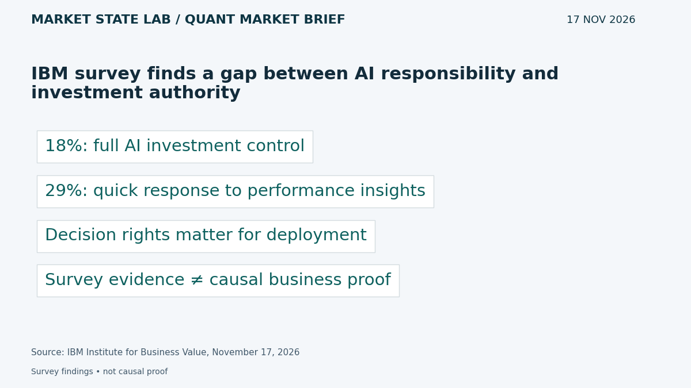
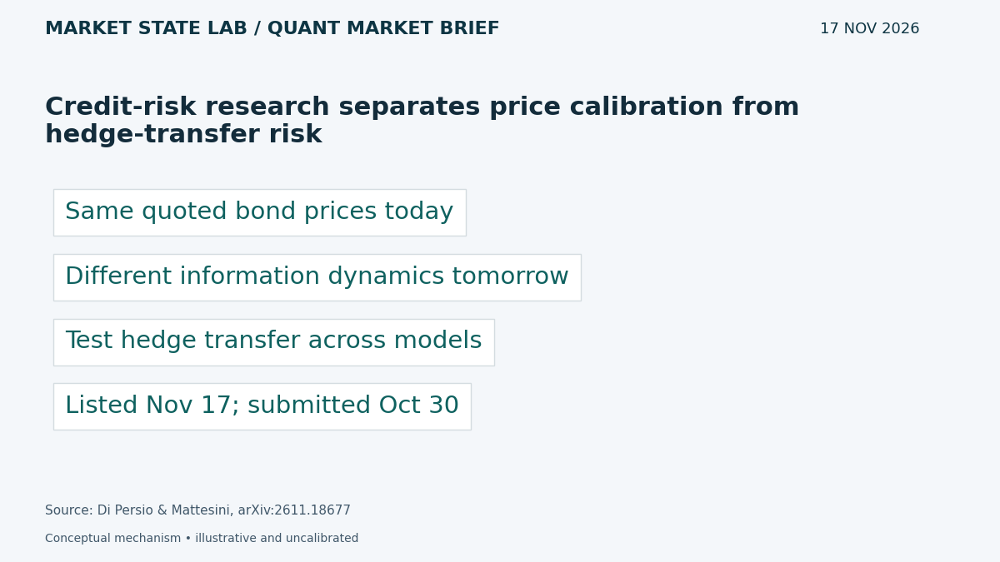
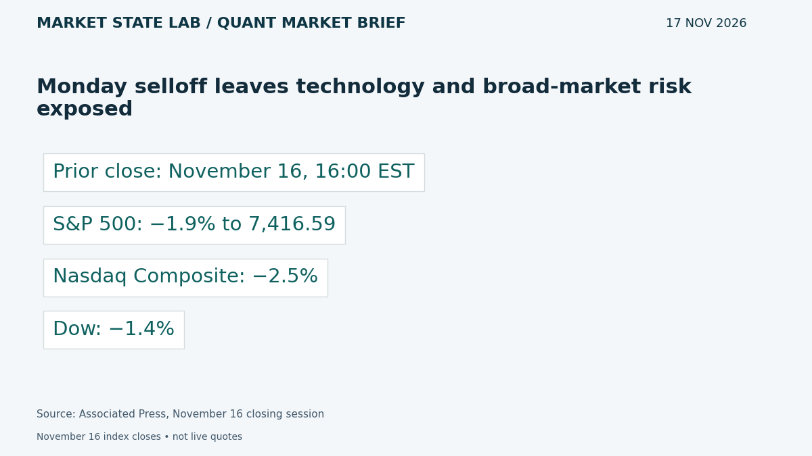
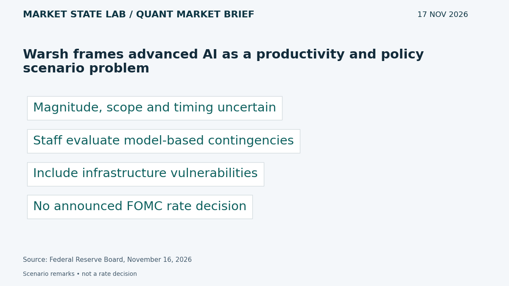
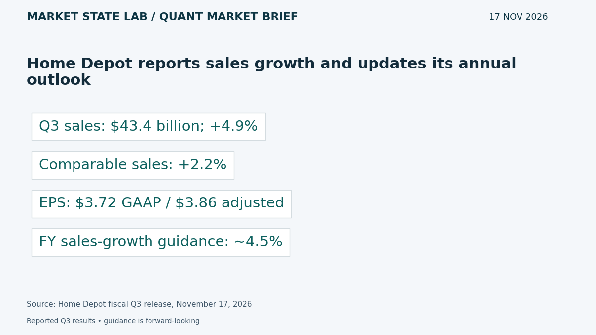

# Quant Market Brief — November 17, 2026: Model Risk & Retail Results

Research cutoff: **November 17, 2026, 6:33 a.m. CST (12:33 UTC)**. Tuesday premarket edition; market data are explicitly timestamped reported/delayed snapshots or prior-close observations, not live executable quotes.

[Subscribe by email](https://market-state-lab.ghost.io/?utm_source=github&utm_medium=technical_archive&utm_campaign=qmb_2026-11-17#/portal/signup).

## 1. IBM survey finds a gap between AI responsibility and investment authority

*Graphic: Market State Lab; IBM Institute for Business Value, November 17, 2026.*

**Fact — IBM announcement November 17, 2026:** IBM reports that only 18% of surveyed chief AI officers fully control AI investment decisions, while 29% say their organizations quickly redirect decisions and resources when performance insights identify improvements. [Direct source](https://newsroom.ibm.com/2026-11-17-ibm-study-chief-ai-officers-see-where-ai-creates-value%2C-but-few-control-investment-decisions)

**Inference / Why it matters:** Assign explicit authority to pause, resize or retire AI workflows; measure business outcomes rather than model adoption alone.

**Uncertainty:** Survey responses are self-reported associations, not causal proof that a particular governance structure improves returns.

## 2. Credit-risk research separates price calibration from hedge-transfer risk

*Graphic: Market State Lab; Di Persio & Mattesini, arXiv:2611.18677.*

**Fact — arXiv new listing November 17; submission record October 30, 2026:** Di Persio and Mattesini use adapted Wasserstein distance to compare how credit models reveal information over time. Models matching current bond prices can still imply different rating dynamics and hedging errors. [Direct source](https://arxiv.org/abs/2611.18677)

**Inference / Why it matters:** Add model-transfer stress tests to calibration checks; compare hedges under alternative information dynamics rather than accepting a single fitted model.

**Uncertainty:** Theoretical and numerical research is not a demonstrated trading edge. The November 17 listing and October 30 submission dates differ; this is not represented as a paper first written today.

## 3. Monday selloff leaves technology and broad-market risk exposed

*Graphic: Market State Lab; Associated Press, November 16 closing session.*

**Fact — November 16 regular-session close; AP report retrieved November 17, 2026:** The S&P 500 closed Monday at 7,416.59, down 1.9%, its third consecutive loss. The Nasdaq Composite fell 2.5% and the Dow fell 1.4%, according to AP. [Direct source](https://apnews.com/article/wall-street-stocks-dow-nasdaq-2e6a9c41b6336e9240c1b01585d20cd4)

**Inference / Why it matters:** Reassess correlated downside exposure and opening-auction participation; a prior-close loss does not establish current executable liquidity.

**Uncertainty:** These are November 16 index closes, not November 17 futures, SPY or QQQ quotes. No current order-book depth was verified.

## 4. Warsh frames advanced AI as a productivity and policy scenario problem

*Graphic: Market State Lab; Federal Reserve Board, November 16, 2026.*

**Fact — Federal Reserve opening remarks November 16, 2026:** At the Fed's Productivity and Jobs Task Force Conference, Kevin Warsh emphasized uncertainty about the magnitude and timing of advanced AI's economic effects. Board staff have begun evaluating contingencies with stylized model-based scenarios. [Direct source](https://www.federalreserve.gov/newsevents/speech/warsh20261116a.htm)

**Inference / Why it matters:** Stress alternative productivity and adoption paths in macro-sensitive models; avoid hard-coding a single AI-driven growth or rate outcome.

**Uncertainty:** The remarks supply no precise productivity forecast and announce no new FOMC rate decision.

## 5. Home Depot reports sales growth and updates its annual outlook

*Graphic: Market State Lab; Home Depot fiscal Q3 release, November 17, 2026.*

**Fact — Company earnings release November 17, 2026:** Home Depot reported third-quarter sales of $43.4 billion, up 4.9%, with comparable sales up 2.2%. Diluted EPS was $3.72 and adjusted diluted EPS $3.86. Its updated full-year sales-growth guidance is approximately 4.5%. [Direct source](https://ir.homedepot.com/news-releases/2026/11-17-2026-110221331)

**Inference / Why it matters:** Separate comparable demand, acquisition effects and adjusted earnings when evaluating consumer and housing exposure.

**Uncertainty:** Guidance is forward-looking. Adjusted EPS differs from GAAP EPS; reported sales growth alone does not establish broad household demand strength.

## Quant & Market Dashboard

### Liquidity and volatility

- **Overnight/premarket:** Regular U.S. cash trading has not opened. Current ES/NQ spreads, depth, overnight volume, executable ETF NBBO and Treasury-market depth remain unverified. Use the prior-close index report in story 3 and Monday ETF closes as cautious state proxies, not executable liquidity. Refresh feeds and do not carry prior-session spreads into the opening auction.
- **Funding:** Latest verified SOFR is **3.90% for November 13**, updated November 16 at **07:02 CST**. This lagged fixing cannot diagnose current stress. [FRED](https://fred.stlouisfed.org/series/SOFR).
- **Regime: Moderate; medium confidence.** VIX was **23.29 on November 17 at 06:18 EST / 05:18 CST**, versus Monday close **22.91**; the provider labels this observation delayed. House bands: below 15 low, 15–25 moderate, 25–35 high, above 35 stressed; descriptive conventions, not calibrated forecasts. Skew, term structure and dealer gamma remain unverified. Opening-gap risk remains. [VIX](https://chartexchange.com/symbol/index-vix/historical/).

### Factor proxies

| Factor | ETF | Nov 13→16 | Oct 9→Nov 16 (~1 month) |
|---|---|---:|---:|
| Momentum | [MTUM](https://stockanalysis.com/etf/mtum/history/) | -3.34% | -17.86% |
| Value | [VLUE](https://stockanalysis.com/etf/vlue/history/) | -2.27% | -7.33% |
| Quality | [QUAL](https://stockanalysis.com/etf/qual/history/) | -1.54% | -2.85% |
| Size | [IWM](https://stockanalysis.com/etf/iwm/history/) | -1.66% | -2.15% |
| Growth | [IWF](https://stockanalysis.com/etf/iwf/history/) | -2.87% | -12.76% |
| Low volatility | [SPLV](https://stockanalysis.com/etf/splv/history/) | -0.09% | +8.64% |

Source-linked split-adjusted Close-column price returns, excluding distributions, through November 16 at **16:00 EST / 15:00 CST**. All three reference closes were rechecked today. Corporate actions were not independently validated. These imperfect ETF proxies do not isolate factor premia. All six proxies declined Monday; low volatility fell least and remains positive over the longer window.

### Execution and microstructure

- Next regular cash opening auction: **today, Tuesday November 17, 08:30 CST / 14:30 UTC**. Refresh release calendars and overnight positions before staging orders. FOMC minutes are scheduled Wednesday November 18 at 13:00 CST / 19:00 UTC; refresh the other release times before execution. [Fed calendar](https://www.federalreserve.gov/newsevents/2026-november.htm).
- SPY/QQQ: inspect quote age, NBBO spreads, displayed depth, auction imbalances and ES/NQ basis. Use bounded limits and participation caps; stress slippage, gaps, cancellations, latency and missed fills. Small index moves can conceal thin depth or concentrated constituent risks.
- Options: reconcile Friday expiries and verify next-session contracts, deliverables, settlement and exercise obligations. Reject stale, crossed or one-sided quotes. Near-expiry gamma and event-volatility repricing can amplify execution risk; dealer positioning, expiry concentrations, pinning and flow magnitude remain unknown. Do not infer gamma direction from open interest alone.

**Research watchlist:** SPY, QQQ, IWM, RSP, TLT; ES, NQ, ZN, VX; MTUM, VLUE, QUAL, IWF, SPLV; IBM, HD, NVDA; LQD and HYG for credit-risk research.

### DRL Improvements for the MATLAB System

1. Enforce drawdown, exposure, participation and stale-data limits outside the policy, with an explicit safe fallback.
2. Penalize spread, impact, turnover, latency and missed fills; stress permanent and transient impact alongside tail losses.
3. Use purged walk-forward evaluation, training-only preprocessing and an untouched final holdout; separate event and quiet regimes.
4. Randomize depth, observation delays and fill probabilities; test abstention and hard risk compliance under distribution shift.

### Model hygiene

Audit leakage, survivorship bias, look-ahead bias, corporate actions, stale options quotes, multiple testing, calibration and drift. Preserve point-in-time universes, release vintages and actual availability timestamps. Fit preprocessing inside folds. Forecast targets must match feasible actions; daily OHLCV cannot validate order-book fills.

### MATLAB optimization patterns

- Use named-zone timetables and causal synchronization; retain quote and release timestamps separately.
- Vectorize rolling features, preallocate logs and profile bottlenecks.
- Parallelize independent folds or Bayesian trials with reproducible random streams and fixed search budgets.
- Use GPUs for sufficiently large batches; keep forecasts, environments, execution simulation and risk controls modular.

### High-value quant research question

**Do model-transfer stress tests reject strategies that pass ordinary calibration and walk-forward checks?**

Compare policies with matched calibration and walk-forward scores under alternative information-arrival and execution models. Select scenarios within training folds, freeze policies and report net return, tail loss and constraint breaches out of sample. This tests whether familiar validation misses model dependence.

[Subscribe by email](https://market-state-lab.ghost.io/?utm_source=github&utm_medium=technical_archive&utm_campaign=qmb_2026-11-17#/portal/signup).

*Research and education only—not individualized financial advice. No trading performance is promised.*
