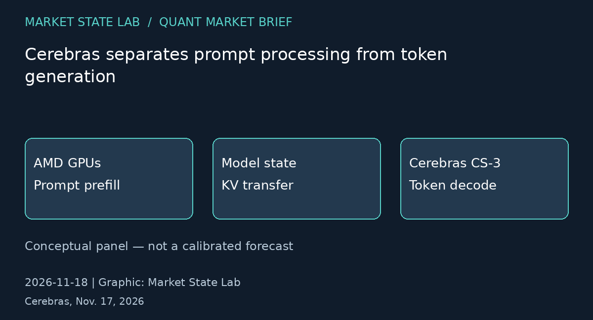
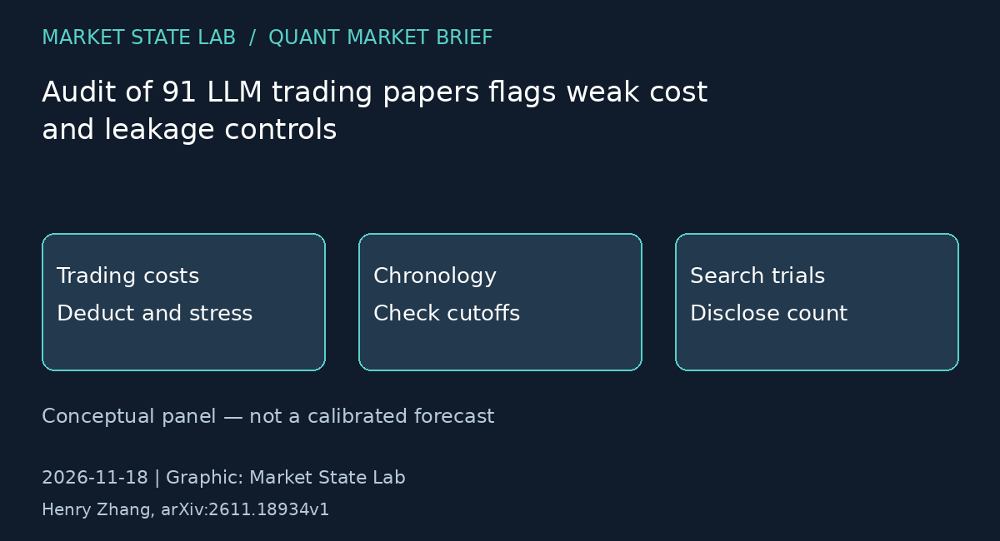
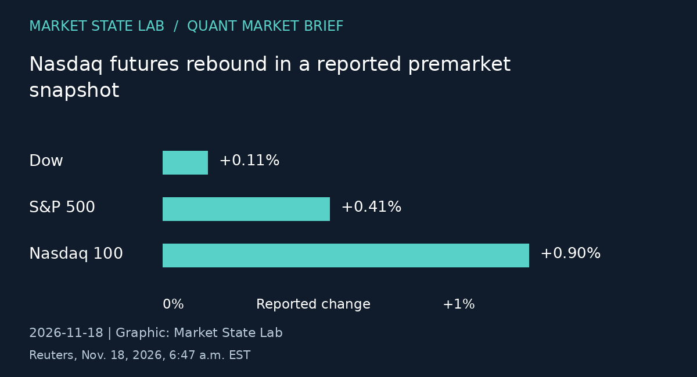
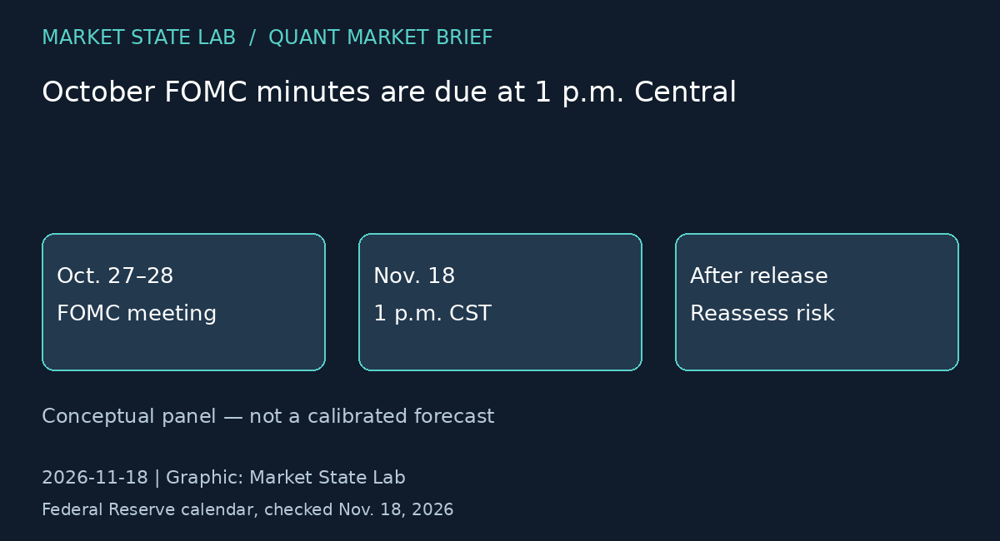
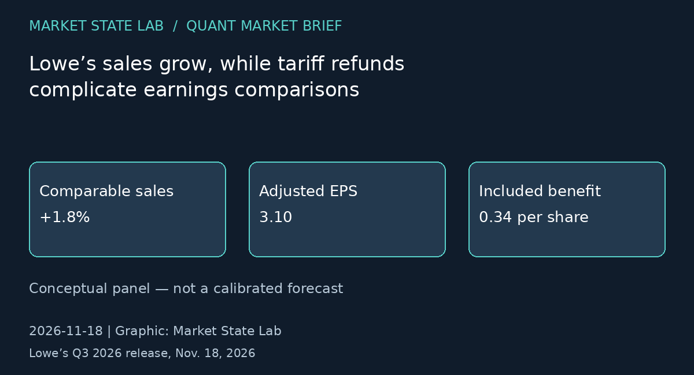

# Quant Market Brief — November 18, 2026: Inference Efficiency & Fed Minutes

Research cutoff: November 18, 2026, 6:33 a.m. CST (12:33 UTC). Premarket edition.

[Subscribe by email](https://market-state-lab.ghost.io/?utm_source=github&utm_medium=repository&utm_campaign=qmb_2026-11-18#/portal/signup).

## 1. Cerebras separates prompt processing from token generation

*AI / machine learning | November 17, 2026*

Graphic: Market State Lab. Source: Cerebras, Nov. 17, 2026.

**Facts:** Cerebras describes a production deployment using AMD Instinct GPUs for prompt processing and CS-3 systems for output generation. It reports five times the throughput per megawatt versus its CS-3-only configuration on a shared GPT-OSS-120B endpoint measured November 14.

**Inference / Why it matters:** benchmark end-to-end latency and throughput separately. For research assistants, faster inference can reduce iteration time; it does not establish better forecasting skill.

**Uncertainty:** Vendor-reported, workload-specific performance; no independent replication established here.

[Direct source](https://www.cerebras.ai/blog/cerebras-launches-disaggregated-inference).

## 2. Audit of 91 LLM trading papers flags weak cost and leakage controls

*Quantitative finance | Submitted November 13; listed November 17, 2026*

Graphic: Market State Lab. Source: Henry Zhang, arXiv:2611.18934v1.

**Facts:** A preregistered audit reports that 51% of 75 papers with trading tests deduct no trading costs; only 9% model costs from data. The median test window is 12 months. Only five papers combine deducted costs, a leakage control and a reported trial count.

**Inference / Why it matters:** require those three disclosures before treating an LLM strategy result as candidate evidence. Reproduce net performance with point-in-time inputs before comparing models.

**Uncertainty:** Preprint findings depend on the selected corpus and coding rubric; this is not a replication of every trading strategy.

[Direct source](https://arxiv.org/abs/2611.18934).

## 3. Nasdaq futures rebound in a reported premarket snapshot

*U.S. markets / SPY / QQQ | November 18, 2026; snapshot 6:47 a.m. EST*

Graphic: Market State Lab. Source: Reuters, Nov. 18, 2026, 6:47 a.m. EST.

**Facts:** Reuters reported Dow E-mini futures up 0.11%, S&P 500 E-minis up 0.41% and Nasdaq 100 E-minis up 0.90% at 6:47 a.m. EST (5:47 a.m. CST), following Nvidia’s forecast.

**Inference / Why it matters:** a technology-led rebound can widen QQQ versus SPY exposure differences. Verify auction imbalances and executable quotes before treating the gap as a tradable continuation signal.

**Uncertainty:** Reported snapshot, not live quotes. Futures direction does not measure spreads, order-book depth or opening fills.

[Direct source](https://www.reuters.com/business/nasdaq-futures-jump-nvidia-forecast-lifts-ai-trade-ahead-anthropic-pricing-2026-11-18/).

## 4. October FOMC minutes are due at 1 p.m. Central

*U.S. economy / Federal Reserve | Scheduled November 18, 2026*

Graphic: Market State Lab. Source: Federal Reserve calendar, checked Nov. 18, 2026.

**Facts:** The Federal Reserve’s calendar schedules minutes of the October 27–28 meeting for November 18 at 2 p.m. EST, equivalent to 1 p.m. CST.

**Inference / Why it matters:** treat the release as a scheduled liquidity and repricing event. Reassess spreads and short-dated options exposure around the release rather than predicting the contents.

**Uncertainty:** Minutes were not released at this research cutoff. They describe the earlier meeting and do not constitute a new rate decision.

[Direct source](https://www.federalreserve.gov/newsevents/2026-November.htm).

## 5. Lowe’s sales grow, while tariff refunds complicate earnings comparisons

*Major business | November 18, 2026; quarter ended October 30*

Graphic: Market State Lab. Source: Lowe’s Q3 2026 release, Nov. 18, 2026.

**Facts:** Lowe’s reported sales of $22.8 billion, up 9.3%, and comparable-sales growth of 1.8%. Adjusted diluted EPS was $3.10; both GAAP and adjusted EPS include a $0.34 benefit from IEEPA tariff refunds. Its earnings call is scheduled for 9 a.m. EST today.

**Inference / Why it matters:** separate recurring demand, acquisitions and refund effects when updating earnings features. Headline adjusted EPS is not a clean measure of recurring operating improvement.

**Uncertainty:** Company-reported unaudited results; guidance remains forward-looking. This briefing does not infer a share-price reaction.

[Direct source](https://corporate.lowes.com/newsroom/press-releases/lowes-reports-third-quarter-2026-sales-and-earnings-results).

## Quant & Market Dashboard

**Data status:** research cutoff as above. No live executable feed or verified overnight book-depth/spread/volume, repo-funding or Treasury bid/ask snapshot was available. Use the story-three futures snapshot as a direction proxy only; do not interpret rising futures as abundant liquidity.

**Volatility regime — high; medium confidence.** Yahoo’s historical VIX panel reports 25.46 at the November 17 close (3:15:01 p.m. CST), versus 22.91 on November 16. These are prior-close readings, not today’s options surface. Editorial classification uses below 15 low, 15–20 moderate, 20–30 high, above 30 stressed; VIX alone cannot establish liquidity stress. Source: https://finance.yahoo.com/quote/%5EVIX/history/

**Factors:** momentum MTUM, value VLUE, quality QUAL, size IWM, growth IWF, low volatility SPLV. One-session and four-week returns are **unavailable for all six proxies**: comparable closes and split treatment could not be verified after the data provider rejected requests. No ranking or directional inference is published. Intended endpoints: one-session November 16–17; four-week end November 17, target start October 20 (28 calendar days earlier). Actual common start and prices: unverified, no substitution made. Required basis: split-adjusted closing-price returns excluding distributions; in-window splits applied once, out-of-window events excluded. ETF proxies are not pure factors.

**SPY/QQQ and options execution:** opening auction is 8:30 a.m. CST; FOMC minutes are 1 p.m. CST. Use limits and staged participation; compare current spread, displayed depth and realized slippage with the same time-of-day baseline before increasing participation. Avoid extrapolating thin premarket prints to regular-hours capacity. Short-dated gamma can amplify hedge sensitivity; dealer gamma sign, positioning and pin levels are unverified. Recheck expiry, settlement terms, quote age and option-leg liquidity; a tight midpoint without executable size is a liquidity trap.

**Microstructure implications:** gate signals on fresh quotes, spread and available size; reset execution assumptions after the auction and minutes. Watchlist for research: SPY, QQQ, IWM, MTUM, VLUE, QUAL, IWF, SPLV, NVDA, LOW, TLT. This is a monitoring list, not trade instructions.

### DRL Improvements for the MATLAB System

- Enforce exposure, turnover, drawdown and capital-preservation limits outside the policy; log every veto and breach.
- Reward net returns after commissions, spread and impact, with penalties for tail losses and unstable turnover. Stress delayed execution and partial fills.
- Use purged walk-forward evaluation with embargoes and frozen seeds; compare against cash and simple allocation baselines across volatility regimes. Preserve failed runs and avoid tuning on the final holdout.

### Model Hygiene

Fit scaling and features inside each training fold; use point-in-time constituents to limit survivorship and look-ahead bias. Audit model-training cutoffs and publication lags. Version corporate actions and adjustments, reject stale/crossed options quotes, count all search trials, adjust for multiple testing, and monitor calibration and drift before retraining.

### MATLAB Optimization Patterns

- Align timezone-aware timetables before vectorizing feature and return calculations; preserve release timestamps separately from observation dates.
- Profile the environment and data pipeline before parallel Bayesian optimization; use reproducible independent random streams and frozen configurations.
- Use GPUs only for sufficiently large supported tensor workloads; benchmark transfer overhead. Keep data, reward, risk gates and execution modules separate.

**High-value research question:** does a spread-and-volatility gate improve net out-of-sample SPY/QQQ opening-session performance versus a fixed waiting period? Test matched signals, identical costs and purged walk-forward windows. It is worth testing because a directional gap may survive while its executable edge disappears.

[Subscribe by email](https://market-state-lab.ghost.io/?utm_source=github&utm_medium=repository&utm_campaign=qmb_2026-11-18#/portal/signup). Forward this edition to a colleague who tests systematic strategies.

Disclosure: Research and education, not individualized financial advice. Markets involve risk; model and vendor claims may fail independent validation. © Market State Lab.
