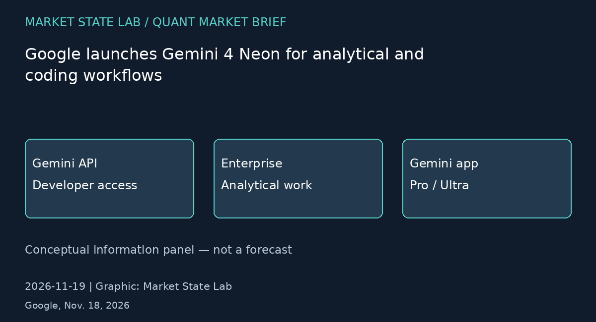
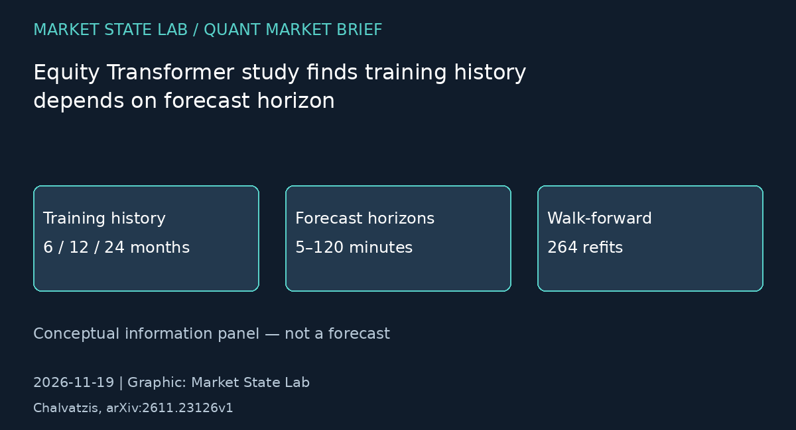
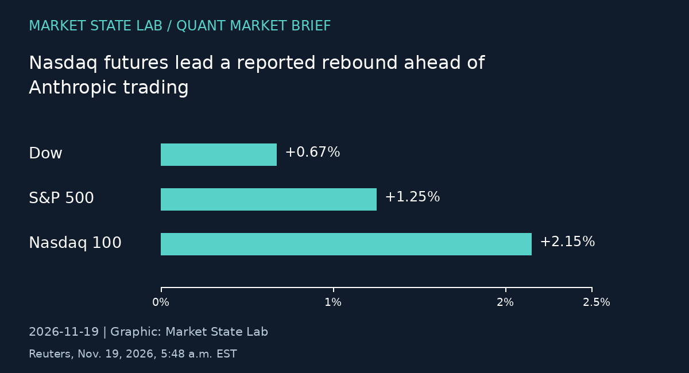
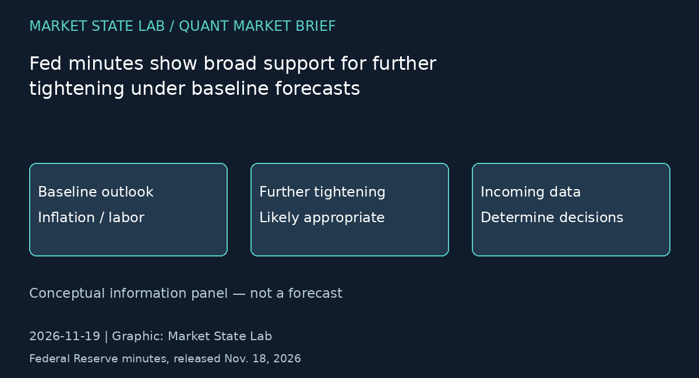
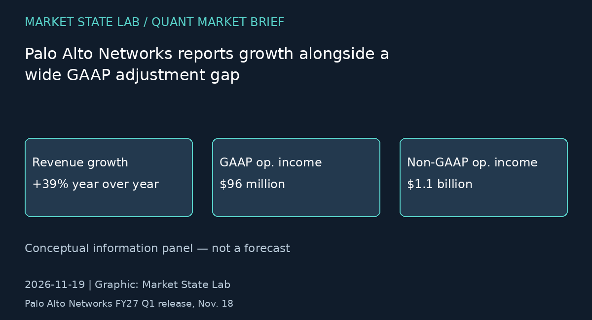

# Quant Market Brief — November 19, 2026: Training Windows & Rate Risk

Research cutoff: November 19, 2026, 6:33 a.m. CST (12:33 UTC). Premarket edition; no live executable feed.

[Subscribe by email](https://market-state-lab.ghost.io/?utm_source=github&utm_medium=repository&utm_campaign=qmb_2026-11-19#/portal/signup).

## 1. Google launches Gemini 4 Neon for analytical and coding workflows

*AI / machine learning | November 18, 2026*

Graphic: Market State Lab. Source: Google, Nov. 18, 2026.

**Facts:** Google introduced Gemini 4 Neon and announced rollout through its API, enterprise offerings, Antigravity and eligible paid Gemini app plans. Google positions it for complex coding, analytical and scientific workflows.

**Inference / Why it matters:** evaluate a frozen MATLAB debugging and data-audit task set before switching research assistants; measure correctness, latency and reproducibility separately.

**Uncertainty:** Availability depends on rollout and plan. Vendor benchmark claims do not establish trading profitability or MATLAB-specific reliability.

[Direct source](https://blog.google/innovation-and-ai/models-and-research/gemini-models/introducing-gemini-4-neon/).

## 2. Equity Transformer study finds training history depends on forecast horizon

*Quantitative finance | Submitted November 17; listed November 18, 2026*

Graphic: Market State Lab. Source: Chalvatzis, arXiv:2611.23126v1.

**Facts:** The preprint compares twelve configurations under a fixed Transformer and feature set, using monthly walk-forward evaluation and 264 refits. More training data did not uniformly improve accuracy; the preferred historical sampling varied with forecast horizon.

**Inference / Why it matters:** test history selection jointly with forecast horizon in the MATLAB research protocol, with a frozen model architecture and cost model.

**Uncertainty:** Intraday information-coefficient evidence is not net trading P&L. Results do not prove a causal recency benefit or transfer to daily SPY forecasts.

[Direct source](https://arxiv.org/abs/2611.23126).

## 3. Nasdaq futures lead a reported rebound ahead of Anthropic trading

*U.S. markets / SPY / QQQ | November 19, 2026; 5:48 a.m. EST snapshot*

Graphic: Market State Lab. Source: Reuters, Nov. 19, 2026, 5:48 a.m. EST.

**Facts:** Reuters reported Dow E-minis up 0.67%, S&P 500 E-minis up 1.25% and Nasdaq 100 E-minis up 2.15% at 5:48 a.m. EST (4:48 a.m. CST), ahead of Anthropic’s expected Nasdaq debut.

**Inference / Why it matters:** verify QQQ versus SPY concentration and opening liquidity before extrapolating a technology-led gap into an executable continuation signal.

**Uncertainty:** Reported snapshot, not live executable quotes. A positive futures gap does not establish order-book depth or the IPO’s eventual opening price.

[Direct source](https://www.reuters.com/business/nasdaq-futures-jump-anthropics-record-ipo-pricing-fuels-hopes-strong-debut-2026-11-19/).

## 4. Fed minutes show broad support for further tightening under baseline forecasts

*U.S. economy / Federal Reserve | October 27–28 meeting; released November 18, 2026*

Graphic: Market State Lab. Source: Federal Reserve minutes, released Nov. 18, 2026.

**Facts:** The October minutes say almost all participants judged further rate increases would likely be appropriate under their baseline outlooks. A couple said a move larger than 25 basis points could warrant consideration at the next meeting if inflation data were unfavorable.

**Inference / Why it matters:** stress equity-duration exposure and rate-sensitive hedges across alternative policy outcomes rather than hard-coding a single expected move.

**Uncertainty:** These are conditional views from October, released November 18, not a new rate decision or a commitment about December.

[Direct source](https://www.federalreserve.gov/monetarypolicy/fomcminutes20261028.htm).

## 5. Palo Alto Networks reports growth alongside a wide GAAP adjustment gap

*Major technology / business | November 18, 2026; quarter ended October 31*

Graphic: Market State Lab. Source: Palo Alto Networks FY27 Q1 release, Nov. 18.

**Facts:** Palo Alto Networks reported fiscal first-quarter revenue of $3.44 billion, up 39%. GAAP operating income was $96 million versus $1.1 billion on a non-GAAP basis. Its fiscal 2027 revenue outlook is $14.52–$14.57 billion.

**Inference / Why it matters:** distinguish demand growth from the adjustments supporting profitability measures before adding an earnings-quality or growth signal.

**Uncertainty:** Company-reported results and forward-looking guidance; GAAP and non-GAAP measures are not interchangeable. No share-price reaction is inferred here.

[Direct source](https://www.paloaltonetworks.com/company/press/2026/palo-alto-networks-reports-fiscal-first-quarter-2027-financial-results).

## Quant & Market Dashboard

**Data status:** research cutoff as above. No live executable feed or verified overnight book-depth/spread/volume, repo-funding or Treasury bid/ask snapshot was available. Use the story-three futures snapshot as a direction proxy only; do not interpret rising futures as abundant liquidity.

**Volatility regime — high; medium confidence.** The November 18 prior-close VIX was 24.56, versus 25.46 on November 17, corroborated by Cboe’s previous-close field and Yahoo history. These are prior-close readings, not today’s options surface. Editorial classification uses below 15 low, 15–20 moderate, 20–30 high, above 30 stressed; VIX alone cannot establish liquidity stress. Sources: https://www.cboe.com/tradable-products/vix/ and https://finance.yahoo.com/quote/%5EVIX/history/

**Factors:** momentum MTUM, value VLUE, quality QUAL, size IWM, growth IWF, low volatility SPLV. One-session and four-week returns are **unavailable for all six proxies**: comparable closes and split treatment could not be verified after the provider rejected a premium-endpoint request. No ranking or directional inference is published. Intended endpoints: one-session November 17–18; four-week end November 18, target start October 21 (28 calendar days earlier). Actual common start and prices: unverified, no substitution made. Required basis: split-adjusted closing-price returns excluding distributions; in-window splits applied once, out-of-window events excluded. ETF proxies are not pure factors.

**SPY/QQQ and options execution:** opening auction is 8:30 a.m. CST; weekly claims and the Philadelphia Fed manufacturing survey are scheduled for 7:30 a.m. CST. Recheck the calendar before execution. Calendar sources: https://fred.stlouisfed.org/releases/calendar?rid=180&y=2026 and https://www.cmegroup.com/education/events/econoday/671289 . Use limits and staged participation; compare current spread, displayed depth and realized slippage with the same time-of-day baseline before increasing participation. Avoid extrapolating thin premarket prints to regular-hours capacity. Short-dated gamma can amplify hedge sensitivity; dealer gamma sign, positioning and pin levels are unverified. Recheck expiry, settlement terms, quote age and option-leg liquidity; a tight midpoint without executable size is a liquidity trap.

**Microstructure implications:** gate signals on fresh quotes, spread and available size; reset execution assumptions after scheduled releases and the opening auction. Watchlist for research: SPY, QQQ, IWM, MTUM, VLUE, QUAL, IWF, SPLV, NVDA, PANW, TLT. This is a monitoring list, not trade instructions.

### DRL Improvements for the MATLAB System

- Enforce exposure, turnover, drawdown and capital-preservation limits outside the policy; log every veto and breach.
- Reward net returns after commissions, spread and impact, with penalties for tail losses and unstable turnover. Stress delayed execution and partial fills.
- Use purged walk-forward evaluation with embargoes and frozen seeds; compare against cash and simple allocation baselines across volatility regimes. Preserve failed runs and avoid tuning on the final holdout.

### Model Hygiene

Fit scaling and features inside each training fold; use point-in-time constituents to limit survivorship and look-ahead bias. Audit model-training cutoffs and publication lags. Version corporate actions and adjustments, reject stale/crossed options quotes, count all search trials, adjust for multiple testing, and monitor calibration and drift before retraining.

### MATLAB Optimization Patterns

- Align timezone-aware timetables before vectorizing feature and return calculations; preserve release timestamps separately from observation dates.
- Profile the environment and data pipeline before parallel Bayesian optimization; use reproducible independent random streams and frozen configurations.
- Use GPUs only for sufficiently large supported tensor workloads; benchmark transfer overhead. Keep data, reward, risk gates and execution modules separate.

**High-value research question:** does jointly selecting training history and forecast horizon improve net out-of-sample SPY/QQQ performance versus a fixed expanding window? Use identical features, architecture, transaction costs and purged walk-forward folds; count every configuration trial. It is worth testing because more history may reduce estimation noise while importing obsolete relationships.

[Subscribe by email](https://market-state-lab.ghost.io/?utm_source=github&utm_medium=repository&utm_campaign=qmb_2026-11-19#/portal/signup). Please forward this edition to a colleague who tests systematic strategies.

Disclosure: Research and education, not individualized financial advice. Markets involve risk; vendor and research claims require independent validation. © Market State Lab.
