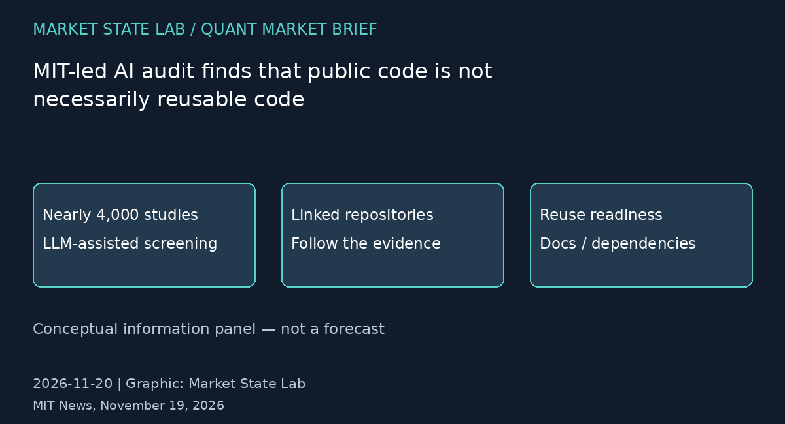
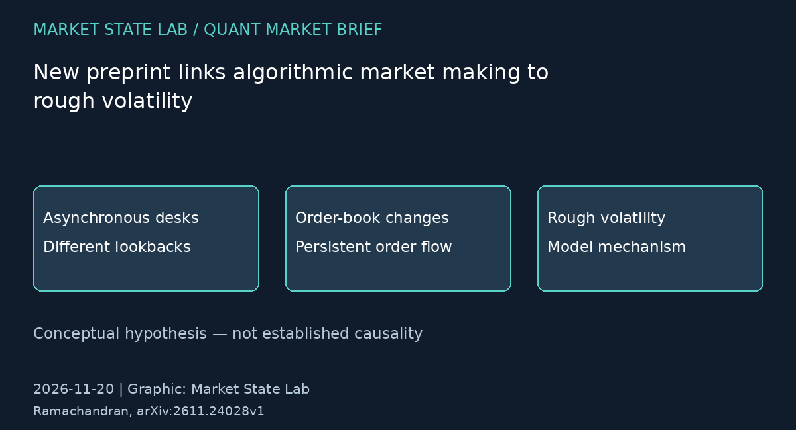
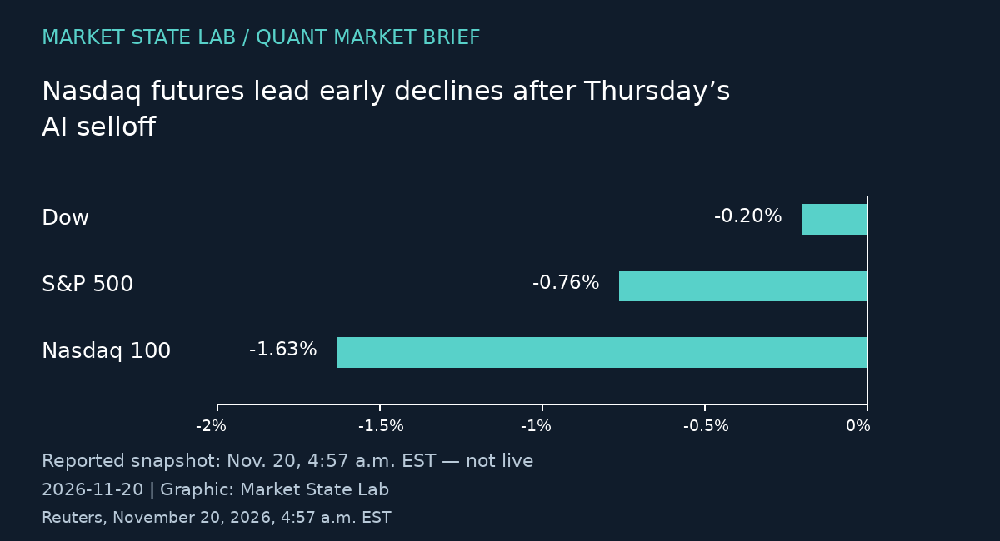
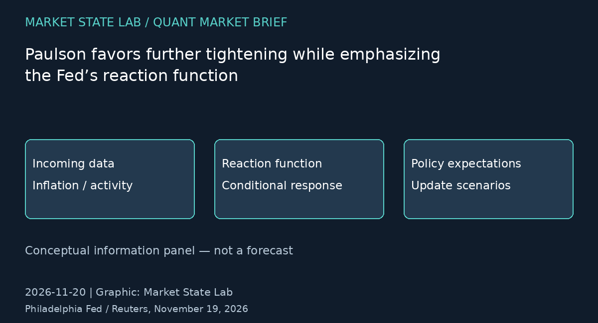
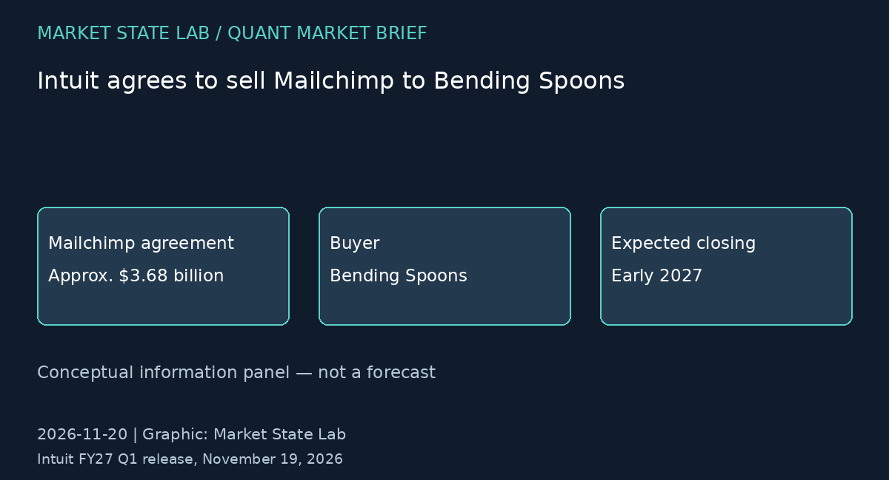

# Quant Market Brief — November 20, 2026: Rough Volatility & Expiry Risk

Research cutoff: November 20, 2026, 6:34 a.m. CST (12:34 UTC). Premarket edition; no live executable feed.

[Subscribe by email](https://market-state-lab.ghost.io/?utm_source=github&utm_medium=repository&utm_campaign=qmb_2026-11-20#/portal/signup).

## 1. MIT-led AI audit finds that public code is not necessarily reusable code

*AI / machine learning | MIT report published November 19, 2026*

Graphic: Market State Lab. Source: MIT News, November 19, 2026.

**Facts:** An MIT and Dana-Farber-led team used LLMs to examine nearly 4,000 clinical prediction studies and assess linked code repositories. Its review found that code sharing was uncommon and public repositories often lacked information needed for scrutiny and reuse.

**Inference / Why it matters:** Require an executable environment, dependency versions, data lineage and test instructions before admitting a shared model into a MATLAB research pipeline.

**Uncertainty:** This is evidence from clinical prediction research, not a measured failure rate for trading repositories. LLM-assisted audits still require validation.

[Direct source](https://news.mit.edu/2026/ai-helps-researchers-investigate-how-medical-studies-share-code-1119).

## 2. New preprint links algorithmic market making to rough volatility

*Algorithmic trading / quantitative finance | Submitted November 18; q-fin listing November 19, 2026*

Graphic: Market State Lab. Source: Ramachandran, arXiv:2611.24028v1.

**Facts:** Sai Niranjan Ramachandran proposes a mechanism in which market makers with different information horizons generate persistent order flow and rough volatility. The author tests model predictions with simulated agents and six months of Binance data containing about 790 million orders.

**Inference / Why it matters:** Test whether volatility persistence and order-flow memory improve execution-cost forecasts before embedding such states in a trading agent.

**Uncertainty:** A new preprint, not established causality or a profitable strategy. Binance perpetual-futures evidence does not establish transfer to SPY/QQQ or U.S. options.

[Direct source](https://arxiv.org/abs/2611.24028).

## 3. Nasdaq futures lead early declines after Thursday’s AI selloff

*U.S. markets / SPY / QQQ | November 20, 2026; 4:57 a.m. EST reported snapshot*

Graphic: Market State Lab. Source: Reuters, November 20, 2026, 4:57 a.m. EST.

**Facts:** Reuters reported Dow E-minis down 0.20%, S&P 500 E-minis down 0.76% and Nasdaq 100 E-minis down 1.63% at 4:57 a.m. EST (3:57 a.m. CST), following Thursday’s selloff.

**Inference / Why it matters:** Recheck QQQ concentration and opening capacity; a futures move supplies direction, not evidence of executable ETF liquidity.

**Uncertainty:** An early reported snapshot, not live quotes or a prediction of the cash open. Depth, spreads and current positioning were not verified.

[Direct source](https://www.reuters.com/legal/transactional/wall-st-futures-slip-anthropic-debut-fails-reassure-ai-investors-2026-11-20/).

## 4. Paulson favors further tightening while emphasizing the Fed’s reaction function

*U.S. economy / Federal Reserve | Speech and subsequent remarks November 19, 2026*

Graphic: Market State Lab. Source: Philadelphia Fed / Reuters, November 19, 2026.

**Facts:** In her November 19 speech, Philadelphia Fed President Anna Paulson emphasized shared understanding of how the Fed responds to economic developments. Reuters reported that, after the speech, she supported additional rate increases because inflation remained too high.

**Inference / Why it matters:** Use conditional rate and inflation scenarios in equity-duration and hedge stress tests; avoid treating speeches as fixed policy promises.

**Uncertainty:** An individual official’s views, not a new FOMC decision or an agreed path. The rate comments were reported from remarks after the prepared speech.

[Direct source](https://www.philadelphiafed.org/the-economy/monetary-policy/261119-money-marketeers-speech).

[Reporting on post-speech remarks](https://www.reuters.com/business/feds-paulson-says-understanding-not-guidance-drives-effective-communication-2026-11-19/).

## 5. Intuit agrees to sell Mailchimp to Bending Spoons

*Major technology / business | Announced November 19, 2026; FY27 Q1 ended October 31*

Graphic: Market State Lab. Source: Intuit FY27 Q1 release, November 19, 2026.

**Facts:** Intuit announced a definitive agreement to sell Mailchimp to Bending Spoons for approximately $3.68 billion. Mailchimp’s quarterly revenue declined 1% to $313 million. Closing is expected in early calendar 2027, subject to regulatory approvals and customary conditions.

**Inference / Why it matters:** Separate continuing-business growth from divestiture effects when updating INTU valuation and earnings-event models.

**Uncertainty:** The sale has not closed. Intuit’s published guidance excludes its impact and is to be updated at closing; no deal completion or share-price reaction is assumed.

[Direct source](https://investors.intuit.com/_assets/_d2e22f68d63e51dea352101f414a0724/intuit/news/2026-11-19_Intuit_Reports_First_Quarter_Results_and_Enters_1331.pdf).

## Quant & Market Dashboard

**Data status / overnight liquidity:** No live executable futures/ETF feed or verified overnight spreads, book depth, volume or funding/repo snapshot was available. Use story three’s timestamped futures direction only as a cautious proxy. A Reuters global-markets report describes safe-haven Treasury buying and a benchmark ten-year yield below 5%; this is reported market context, not a verified Treasury liquidity or bid/ask measure. Source: https://www.reuters.com/world/china/global-markets-global-markets-2026-11-20/

**Volatility regime — high, near the stressed threshold; medium confidence.** Cboe’s quotes page and Yahoo history show VIX at 28.44 for the November 19 close, up from 24.56 on November 18. These are prior-close observations, not live implied volatility or the SPY/QQQ options surface. Editorial thresholds: below 15 low, 15–20 moderate, 20–30 high, 30 or above stressed. VIX cannot establish book liquidity or dealer positioning. Sources: https://www.cboe.com/data/quotes/vix/multiple and https://finance.yahoo.com/quote/%5EVIX/history/

**Factors — performance unavailable, no rankings:**

| Exposure | ETF proxy | One session | Four weeks |
|---|---|---|---|
| Momentum | MTUM | Unavailable | Unavailable |
| Value | VLUE | Unavailable | Unavailable |
| Quality | QUAL | Unavailable | Unavailable |
| Size | IWM | Unavailable | Unavailable |
| Growth | IWF | Unavailable | Unavailable |
| Low volatility | SPLV | Unavailable | Unavailable |

Intended latest completed common-session end: **November 19**; preceding session **November 18**. Four-week target start freshly calculated as **October 22**, exactly 28 calendar days before November 19. Actual common start, comparable prices and adjustments: **unverified; no substitute date used**. Required basis is split-adjusted closing-price return excluding distributions, applying in-window splits once and excluding out-of-window actions. Alpha Vantage’s standard terms provide personal non-commercial use unless otherwise agreed in writing; publication permission for this repository and newsletter use was not verified. No Alpha Vantage prices, corporate actions or derived returns are exported. A publication-cleared comparable alternative was not verified. ETF proxies are not pure factors. Terms: https://www.alphavantage.co/terms_of_service/

**SPY/QQQ and options execution:** U.S. cash opening auction is 8:30 a.m. CST. Michigan’s final November consumer survey is scheduled for **9:00 a.m. CST**, still unreleased at cutoff. November 20 is monthly options expiry. Distinguish AM-settled index contracts from ETF options and PM expiries; confirm contract-specific last trading and settlement terms. Gamma sensitivity can rise near expiry, but dealer gamma sign, concentrations and pin levels are unverified. Use limits, staged participation and quote-age checks. Compare current spreads, executable depth and slippage with time-of-day baselines; thin premarket prints and attractive option midpoints without size are liquidity traps. Reset assumptions after the auction and the release. Calendar sources: https://www.sca.isr.umich.edu/ and https://www.optionseducation.org/referencelibrary/expiration-calendar

**Microstructure implications / research watchlist:** Gate participation on fresh quotes, displayed size and spread relative to baseline; stress partial fills and abrupt liquidity withdrawal. Monitor SPY, QQQ, IWM, MTUM, VLUE, QUAL, IWF, SPLV, TLT, NVDA and INTU. This is a research watchlist, not a recommendation to trade.

### DRL Improvements for the MATLAB System

- Enforce exposure, turnover, drawdown and capital-preservation limits outside the learned policy; log every veto and breach.
- Reward net performance after commissions, spread and impact, penalizing tail losses and unstable turnover. Simulate latency, partial fills and liquidity withdrawal.
- Use purged walk-forward evaluation with embargoes, frozen final holdouts and regime-stratified stress tests. Compare against cash and simple baselines; retain failed trials and execution-cost sensitivity results.

### Model Hygiene

Fit transforms only within training folds. Use point-in-time constituents and release timestamps to prevent survivorship, leakage and look-ahead bias. Version corporate actions and apply adjustments once. Reject stale, crossed or zero-size options quotes. Count all configurations, control multiple testing, and monitor calibration and drift; do not select retraining rules on the final holdout.

### MATLAB Optimization Patterns

- Align timezone-aware timetables before vectorizing features and returns; keep observation dates separate from publication timestamps.
- Profile before parallel Bayesian optimization. Freeze objective inputs and random streams, and archive trial order; parallel timing can still prevent exact reproducibility.
- Keep data, reward, independent risk gates and execution modules separate. Use GPUs for suitable large tensor workloads; benchmark transfer overhead and minimize host/device transfers.

Technical references: https://www.mathworks.com/help/stats/parallel_bayesian_optimization.html ; https://www.mathworks.com/help/reinforcement-learning/ug/train-reinforcement-learning-agents.html ; https://www.mathworks.com/help/parallel-computing/measure-and-improve-gpu-performance.html

**High-value quant research question:** Does adding order-flow persistence to a spread-and-volatility participation gate reduce net SPY/QQQ execution shortfall versus the same gate without memory? Test matched signals in purged walk-forward folds with identical costs and separate expiry-day results. It is worth testing because persistent liquidity changes may matter beyond a single spread snapshot; the preprint does not establish that benefit for U.S. ETFs.

[Subscribe by email](https://market-state-lab.ghost.io/?utm_source=github&utm_medium=repository&utm_campaign=qmb_2026-11-20#/portal/signup). Please forward this edition to a colleague who tests systematic strategies.

Disclosure: Research and education, not individualized financial advice. Markets involve risk; research claims require independent validation. © Market State Lab.
