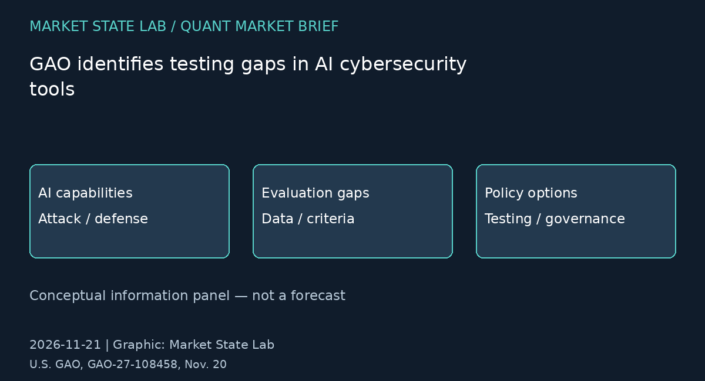
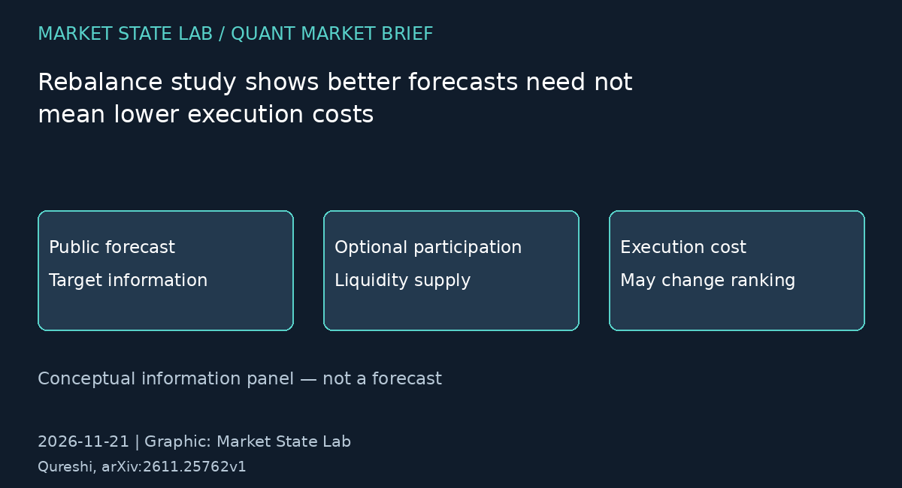
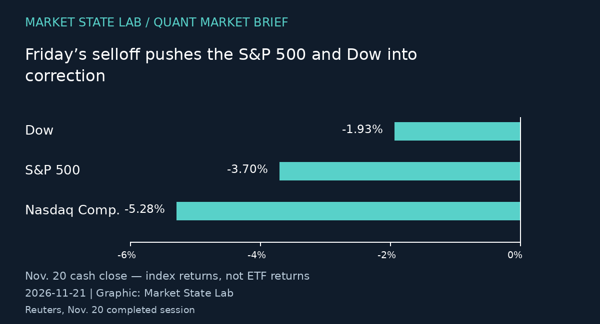
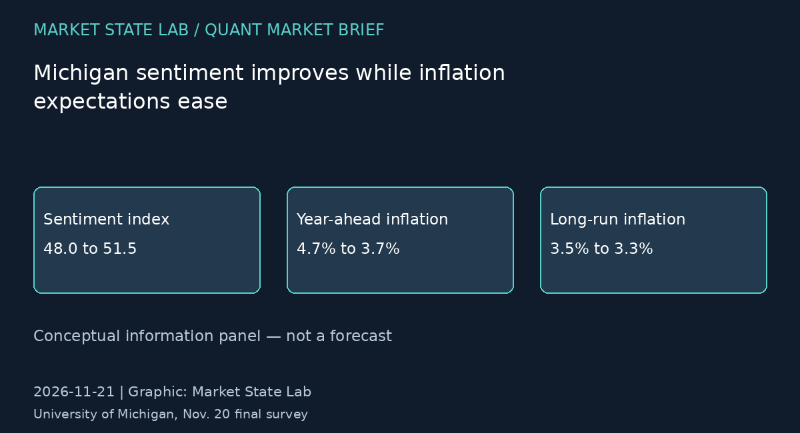
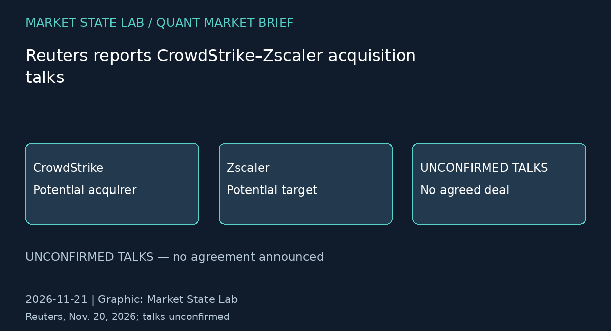

# Quant Market Brief — November 21, 2026: Volatility Stress & Rebalance Signals

Research cutoff: November 21, 2026, 6:36 a.m. CST (12:36 UTC). Weekend edition; market data are prior-close or reported completed-session observations.

[Subscribe by email](https://market-state-lab.ghost.io/?utm_source=github&utm_medium=repository&utm_campaign=qmb_2026-11-21#/portal/signup).

## 1. GAO identifies testing gaps in AI cybersecurity tools

*AI / machine learning | Published and publicly released November 20, 2026*

Graphic: Market State Lab. Source: U.S. GAO, GAO-27-108458, Nov. 20.

**Facts:** GAO’s November 20 report says generative AI expands cyber defense capabilities while accelerating attacks. It identifies challenges with evaluation criteria, data and governance, and presents policy options including expanded testing environments.

**Inference / Why it matters:** For MATLAB assistants and data pipelines, test tool permissions and failure modes in an isolated environment before granting production access.

**Uncertainty:** The report is a technology assessment, not a measured guarantee that a specific AI security product works.

[Direct source](https://www.gao.gov/products/gao-27-108458).

## 2. Rebalance study shows better forecasts need not mean lower execution costs

*Algorithmic trading / quantitative finance | Submitted November 19; listed November 20, 2026*

Graphic: Market State Lab. Source: Qureshi, arXiv:2611.25762v1.

**Facts:** Khizar Qureshi’s preprint models an institution committed to rebalancing while liquidity suppliers may choose whether to participate. Allowing optional participation can reverse the execution-cost ranking of information structures.

**Inference / Why it matters:** Evaluate forecast accuracy jointly with participation and cross-impact assumptions in rebalance simulations.

**Uncertainty:** A theoretical preprint. Its ETF data describe uncertainty and trading conditions without identifying supplier activation or actual institutional costs.

[Direct source](https://arxiv.org/abs/2611.25762).

## 3. Friday’s selloff pushes the S&P 500 and Dow into correction

*U.S. markets / SPY / QQQ | November 20, 2026 completed cash session; 3:00 p.m. CST*

Graphic: Market State Lab. Source: Reuters, Nov. 20 completed session.

**Facts:** Friday’s Dow, S&P 500 and Nasdaq Composite fell 1.93%, 3.70% and 5.28%, respectively. Reuters reported that the Dow and S&P 500 closed more than 10% below their records.

**Inference / Why it matters:** Stress gap, spread and impact assumptions before using Monday’s SPY/QQQ opening signals.

**Uncertainty:** Completed-session index moves, not ETF returns or current executable quotes. A correction does not predict the next session.

[Direct source](https://www.reuters.com/legal/transactional/wall-st-futures-slip-anthropic-debut-fails-reassure-ai-investors-2026-11-20/).

## 4. Michigan sentiment improves while inflation expectations ease

*U.S. economy / Federal Reserve | Final November survey released November 20, 2026*

Graphic: Market State Lab. Source: University of Michigan, Nov. 20 final survey.

**Facts:** The final November sentiment index rose to 51.5 from October’s 48.0. Median year-ahead inflation expectations fell to 3.7% from 4.7%; long-run expectations eased to 3.3% from 3.5%. Interviews ended November 16.

**Inference / Why it matters:** Keep household expectations separate from realized inflation when constructing macro regimes and rate-sensitivity tests.

**Uncertainty:** Survey responses precede the latest market decline and do not establish a Fed policy decision or subsequent consumer spending.

[Direct source](https://www.sca.isr.umich.edu/).

## 5. Reuters reports CrowdStrike–Zscaler acquisition talks

*Major technology / business | Reported November 20, 2026 at 3:32 p.m. CST*

Graphic: Market State Lab. Source: Reuters, Nov. 20, 2026; talks unconfirmed.

**Facts:** Reuters, citing two people familiar with the matter, reported ongoing talks for CrowdStrike to acquire Zscaler. The report said no agreement was guaranteed and the companies had not immediately responded to requests for comment.

**Inference / Why it matters:** Separate rumor-driven event exposure from ordinary cybersecurity factor exposure; model a no-deal scenario.

**Uncertainty:** Unconfirmed reported talks, not an announced transaction. Terms, timing and completion remain unknown.

[Direct source](https://www.reuters.com/legal/litigation/crowdstrike-talks-acquire-zscaler-source-says-2026-11-20/).

## Quant & Market Dashboard

**Data status / weekend liquidity:** U.S. cash equities and listed ETF options are closed Saturday. No live weekend order book or verified overnight futures/ETF spreads, depth, funding/repo or Treasury bid/ask snapshot was available. Friday exchange volume was reported as 25.19 billion shares versus a 19.50 billion twenty-session average. That is completed-session turnover, not evidence of tight spreads or available depth. Source: https://www.reuters.com/legal/transactional/wall-st-futures-slip-anthropic-debut-fails-reassure-ai-investors-2026-11-20/

**Volatility regime — stressed; medium confidence.** Yahoo historical data and YCharts report November 20 prior-close VIX of 35.89, versus 28.44 on November 19. Yahoo timestamps the close at 3:15:01 p.m. CST. Editorial thresholds: below 15 low, 15–20 moderate, 20–30 high, 30 or above stressed. This measures implied-volatility conditions, not verified liquidity stress or the current SPY/QQQ options surface. Sources: https://finance.yahoo.com/quote/%5EVIX/history/ and https://ycharts.com/indices/%5EVIX/level

**Factors — performance unavailable, no rankings:**

| Exposure | ETF proxy | One session | Four weeks |
|---|---|---|---|
| Momentum | MTUM | Unavailable | Unavailable |
| Value | VLUE | Unavailable | Unavailable |
| Quality | QUAL | Unavailable | Unavailable |
| Size | IWM | Unavailable | Unavailable |
| Growth | IWF | Unavailable | Unavailable |
| Low volatility | SPLV | Unavailable | Unavailable |

Intended latest completed common-session end: **November 20**; preceding session **November 19**. Four-week target start freshly calculated as **October 23**, exactly 28 calendar days before November 20. Actual common start, comparable prices and adjustments: **unverified; no substitute date used**. Required basis is split-adjusted closing-price return excluding distributions, applying in-window splits once and excluding out-of-window actions. Alpha Vantage’s standard terms provide personal non-commercial use unless otherwise agreed in writing; publication permission for this repository and newsletter use was not verified. No Alpha Vantage prices, corporate actions or derived returns are exported. A publication-cleared comparable alternative was not verified. ETF proxies are not pure factors. Terms: https://www.alphavantage.co/terms_of_service/

**SPY/QQQ and options execution:** No opening auction today. For the next regular session, verify the calendar and the 8:30 a.m. CST cash opening auction. Friday monthly expiry has passed; reconcile assignment, exercise and residual exposure before Monday. Dealer gamma sign and remaining concentrations are unverified; do not carry Friday pin assumptions forward. Use limits, staged participation and quote-age checks. Compare spreads, executable depth and slippage with time-of-day baselines. Friday's final options quotes are stale for Monday execution; thin reopening prints and midpoints without size are liquidity traps. Recheck event timing before trading. Calendar source: https://www.optionseducation.org/referencelibrary/expiration-calendar

**Microstructure implications / research watchlist:** Gate participation on fresh quotes, displayed size and spread relative to baseline; stress partial fills and abrupt liquidity withdrawal. Monitor SPY, QQQ, IWM, MTUM, VLUE, QUAL, IWF, SPLV, TLT, NVDA, CRWD and ZS. This is a research watchlist, not a recommendation to trade.

### DRL Improvements for the MATLAB System

- Enforce exposure, turnover, drawdown and capital-preservation limits outside the learned policy; log every veto and breach.
- Reward net performance after commissions, spread and impact, penalizing tail losses and unstable turnover. Simulate latency, partial fills and liquidity withdrawal.
- Use purged walk-forward evaluation with embargoes, frozen final holdouts and regime-stratified stress tests. Compare against cash and simple baselines; retain failed trials and execution-cost sensitivity results.

### Model Hygiene

Fit transforms only within training folds. Use point-in-time constituents and release timestamps to prevent survivorship, leakage and look-ahead bias. Version corporate actions and apply adjustments once. Reject stale, crossed or zero-size options quotes. Count all configurations, control multiple testing, and monitor calibration and drift; do not select retraining rules on the final holdout.

### MATLAB Optimization Patterns

- Align timezone-aware timetables before vectorizing features and returns; keep observation dates separate from publication timestamps.
- Profile before parallel Bayesian optimization. Freeze objective inputs and random streams, and archive trial order; parallel timing can still prevent exact reproducibility.
- Keep data, reward, independent risk gates and execution modules separate. Use GPUs for suitable large tensor workloads; benchmark transfer overhead and minimize host/device transfers.

Technical references: https://www.mathworks.com/help/stats/parallel_bayesian_optimization.html ; https://www.mathworks.com/help/reinforcement-learning/ug/train-reinforcement-learning-agents.html ; https://www.mathworks.com/help/parallel-computing/measure-and-improve-gpu-performance.html

**High-value quant research question:** Does a more accurate rebalance forecast reduce net execution shortfall once liquidity-provider participation can change? Compare fixed-participation and endogenous-participation simulations under identical targets, transient impact and costs, then test calibration out of sample. It is worth testing because predictive accuracy can improve while execution economics deteriorate; the preprint supplies a hypothesis, not a demonstrated SPY/QQQ edge.

[Subscribe by email](https://market-state-lab.ghost.io/?utm_source=github&utm_medium=repository&utm_campaign=qmb_2026-11-21#/portal/signup). Please forward this edition to a colleague who tests systematic strategies.

Disclosure: Research and education, not individualized financial advice. Markets involve risk; research claims require independent validation. © Market State Lab.
