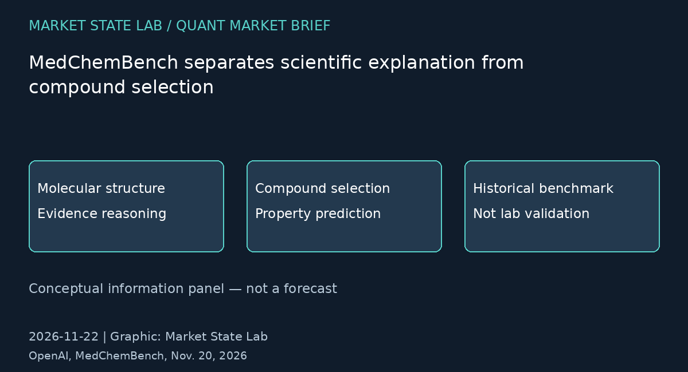
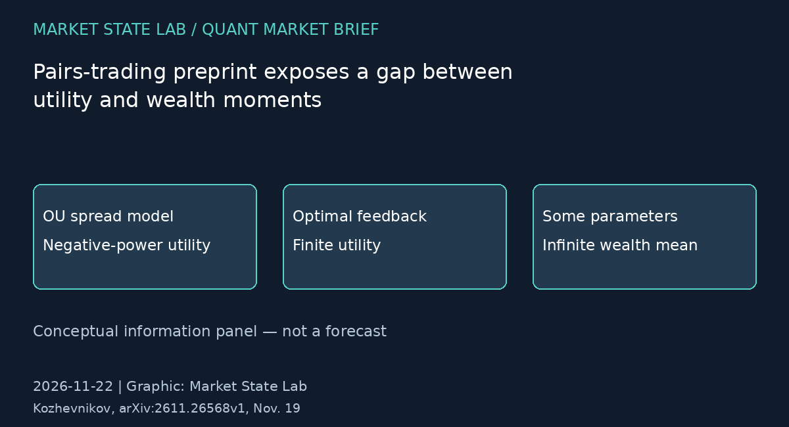
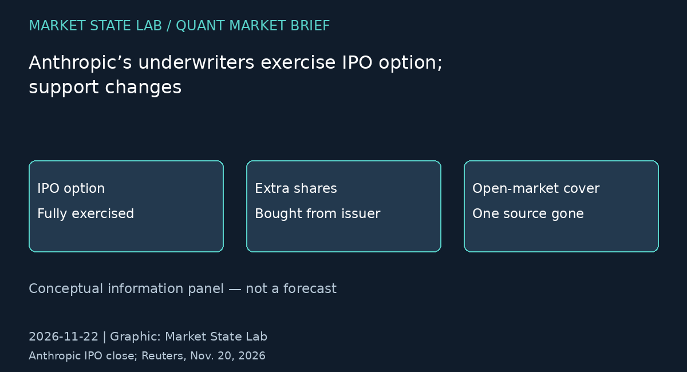
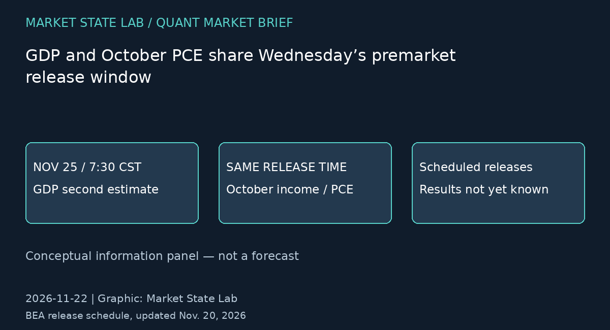
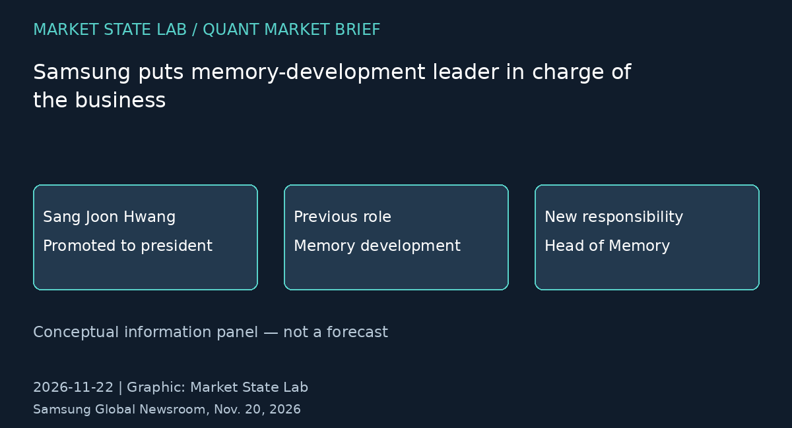

# Quant Market Brief — November 22, 2026: IPO Liquidity & PCE Week

Research cutoff: November 22, 2026, 6:38 a.m. CST (12:38 UTC). Weekend edition; market data are prior-close or reported completed-session observations.

[Subscribe by email](https://market-state-lab.ghost.io/?utm_source=github&utm_medium=repository&utm_campaign=qmb_2026-11-22#/portal/signup).

## 1. MedChemBench separates scientific explanation from compound selection

*AI / machine learning | Published November 20, 2026*

Graphic: Market State Lab. Source: OpenAI, MedChemBench, Nov. 20, 2026.

**Facts:** OpenAI introduced MedChemBench, with 99 problems drawn from published medicinal-chemistry research. It evaluates molecular reconstruction, explanations, compound selection and property prediction; selection and numerical prediction remain difficult.

**Inference / Why it matters:** Evaluate assistants by downstream decision quality as well as explanation quality. For research automation, test the full evidence-to-action pipeline rather than relying on one aggregate score.

**Uncertainty:** Prior exposure to published sources cannot be ruled out. Benchmark results do not establish new-drug discovery or improved laboratory decisions.

[Direct source](https://openai.com/index/introducing-medchembench/).

## 2. Pairs-trading preprint exposes a gap between utility and wealth moments

*Algorithmic trading / quantitative finance | Submitted November 19, 2026 at 12:35:56 p.m. CST*

Graphic: Market State Lab. Source: Kozhevnikov, arXiv:2611.26568v1, Nov. 19.

**Facts:** Aleksei Kozhevnikov derives optimal feedback for a finite-horizon pairs model with an Ornstein-Uhlenbeck spread and negative-power utility. Under specified parameter and horizon conditions, expected terminal wealth is infinite while optimal expected utility remains finite.

**Inference / Why it matters:** Inspect tail moments and sensitivity to mean-reversion estimates alongside reward or utility. Reject an apparent optimum that depends on unrealistic tails or unstable exposure.

**Uncertainty:** A theoretical preprint, not peer-reviewed live-trading evidence. Its admissible nonnegative-wealth model is not a real-world capital guarantee; borrow, slippage and model error require separate tests.

[Direct source](https://arxiv.org/abs/2611.26568).

## 3. Anthropic’s underwriters exercise IPO option; support changes

*U.S. markets / options microstructure | Company announcement and Reuters report November 20, 2026*

Graphic: Market State Lab. Source: Anthropic IPO close; Reuters, Nov. 20, 2026.

**Facts:** Anthropic confirmed full exercise of the underwriters’ option for 147 million additional shares at the IPO price. Reuters reported that closing this stabilization position removed one potential source of open-market buying support.

**Inference / Why it matters:** Treat IPO stabilization as a temporary mechanism, never a price floor. Separate single-name event exposure from SPY/QQQ signals; verify actual ETF holdings before assuming direct index exposure.

**Uncertainty:** No continuing support level, dealer gamma, index inclusion or next-session price direction was verified.

[Direct source](https://www.anthropic.com/news/ipo-close).

[Additional reporting](https://www.reuters.com/markets/us/anthropics-ipo-bank-closed-position-meant-stabilize-stock-removing-source-2026-11-20/).

## 4. GDP and October PCE share Wednesday’s premarket release window

*U.S. economy / Federal Reserve | BEA calendar updated November 20; releases scheduled November 25, 2026*

Graphic: Market State Lab. Source: BEA release schedule, updated Nov. 20, 2026.

**Facts:** BEA schedules the third-quarter GDP second estimate and corporate profits alongside October Personal Income and Outlays for November 25 at 8:30 a.m. Eastern, or 7:30 a.m. Central. The latter release contains PCE inflation measures.

**Inference / Why it matters:** Model a joint growth-and-inflation event window: avoid treating simultaneous surprises as independent signals, and refresh execution assumptions after the releases.

**Uncertainty:** This is a verified upcoming calendar event, not released data, a consensus estimate or a forecast of Fed action. Schedules can change.

[Direct source](https://www.bea.gov/news/schedule).

## 5. Samsung puts memory-development leader in charge of the business

*Major technology / business | Announced November 20, 2026 in Korea*

Graphic: Market State Lab. Source: Samsung Global Newsroom, Nov. 20, 2026.

**Facts:** Samsung promoted Sang Joon Hwang to president and named him head of its Memory Business. He previously led memory development, including DRAM and high-bandwidth memory.

**Inference / Why it matters:** Track product qualification, delivery and margins when assessing memory suppliers; a leadership appointment alone is insufficient evidence of better operating performance.

**Uncertainty:** The announcement provides no new shipment, yield, customer-qualification or earnings result.

[Direct source](https://news.samsung.com/global/samsung-electronics-announces-new-leadership-5).

## Quant & Market Dashboard

**Data status / weekend liquidity:** U.S. cash equities and listed ETF options are closed Sunday morning. No live weekend order book or verified overnight futures/ETF spreads, depth, funding/repo or Treasury bid/ask snapshot was available. No current funding or Treasury-market signal was independently verified; no liquidity direction is inferred from missing data.

**Volatility regime — stressed; medium confidence.** YCharts’ historical series reports November 20 prior-close VIX of 35.89, versus 28.44 on November 19. These are completed-session observations, not live Sunday readings. Editorial thresholds: below 15 low, 15–20 moderate, 20–30 high, 30 or above stressed. This classification does not establish liquidity stress or today’s SPY/QQQ options surface. Source: https://ycharts.com/indicators/vix_volatility_index

**Factors — performance unavailable, no rankings:**

| Exposure | ETF proxy | One session | Four weeks |
|---|---|---|---|
| Momentum | MTUM | Unavailable | Unavailable |
| Value | VLUE | Unavailable | Unavailable |
| Quality | QUAL | Unavailable | Unavailable |
| Size | IWM | Unavailable | Unavailable |
| Growth | IWF | Unavailable | Unavailable |
| Low volatility | SPLV | Unavailable | Unavailable |

Intended latest completed common-session end: **November 20**; preceding session **November 19**. Four-week target start freshly calculated as **October 23**, exactly 28 calendar days before November 20. Actual common start, comparable prices and adjustments: **unverified; no substitute date used**. Required basis is split-adjusted closing-price return excluding distributions, applying in-window splits once and excluding out-of-window actions. Alpha Vantage’s standard terms provide personal non-commercial use unless otherwise agreed in writing; publication permission for this repository and newsletter use was not verified. No Alpha Vantage prices, corporate actions or derived returns are exported. A publication-cleared comparable alternative was not verified. ETF proxies are not pure factors. Terms: https://www.alphavantage.co/terms_of_service/

**SPY/QQQ and options execution:** No cash opening auction today. The next regular session opens Monday, November 23 at 8:30 a.m. CST. The GDP/PCE releases are scheduled Wednesday, November 25 at 7:30 a.m. CST, before the cash open. NYSE markets close Thursday, November 26 for Thanksgiving; Friday, November 27 cash trading ends at noon CST (eligible options at 12:15 p.m.; check each contract and venue). Compress participation schedules for the shorter session; holiday-thin liquidity is a risk, not a measured current condition. Friday monthly expiry has passed: reconcile exercise, assignment and residual exposure. Dealer gamma sign and strike concentrations are unverified; do not carry expired pin assumptions forward. Use limits, staged participation and quote-age checks; compare spread, executable depth and slippage with time-of-day baselines. Stale Friday options marks, thin reopening prints and midpoints without size are liquidity traps. Calendar sources: https://www.nyse.com/trade/hours-calendars ; https://www.bea.gov/news/schedule

**Microstructure implications / research watchlist:** Gate participation on fresh quotes, size and spread relative to baseline; stress partial fills and liquidity withdrawal. An exercised IPO option is not continuing price support. Monitor SPY, QQQ, IWM, MTUM, VLUE, QUAL, IWF, SPLV, TLT, ANT, NVDA and MU. This is a research watchlist, not a recommendation to trade.

### DRL Improvements for the MATLAB System

- Enforce exposure, turnover, drawdown and capital-preservation limits outside the learned policy; log every veto and breach.
- Reward net performance after commissions, spread and impact, penalizing tail losses and unstable turnover. Simulate latency, partial fills and liquidity withdrawal.
- Use purged walk-forward evaluation with embargoes, frozen final holdouts and regime-stratified stress tests. Compare against cash and simple baselines; retain failed trials and execution-cost sensitivity results.

### Model Hygiene

Fit transforms only within training folds. Use point-in-time constituents and release timestamps to prevent survivorship, leakage and look-ahead bias. Version corporate actions and apply adjustments once. Reject stale, crossed or zero-size options quotes. Count all configurations, control multiple testing, and monitor calibration and drift; do not select retraining rules on the final holdout.

### MATLAB Optimization Patterns

- Align timezone-aware timetables before vectorizing features and returns; keep observation dates separate from publication timestamps.
- Profile before parallel Bayesian optimization. Freeze objective inputs and random streams, and archive trial order; parallel timing can still prevent exact reproducibility.
- Keep data, reward, independent risk gates and execution modules separate. Use GPUs for suitable large tensor workloads; benchmark transfer overhead and minimize host/device transfers.

Technical references: https://www.mathworks.com/help/stats/parallel_bayesian_optimization.html ; https://www.mathworks.com/help/reinforcement-learning/ug/train-reinforcement-learning-agents.html ; https://www.mathworks.com/help/parallel-computing/measure-and-improve-gpu-performance.html

**High-value quant research question:** Does an OU-based pairs strategy retain net risk-adjusted performance when mean-reversion estimates are perturbed and borrow costs, impact and independent drawdown caps are imposed? Compare frozen-parameter and uncertainty-aware policies in purged walk-forward tests. It is worth testing because a mathematically optimal utility policy can remain fragile to parameter and execution assumptions; the new preprint supplies theory, not a demonstrated trading edge.

[Subscribe by email](https://market-state-lab.ghost.io/?utm_source=github&utm_medium=repository&utm_campaign=qmb_2026-11-22#/portal/signup). Please forward this edition to a colleague who tests systematic strategies.

Disclosure: Research and education, not individualized financial advice. Markets involve risk; research claims require independent validation. © Market State Lab.
