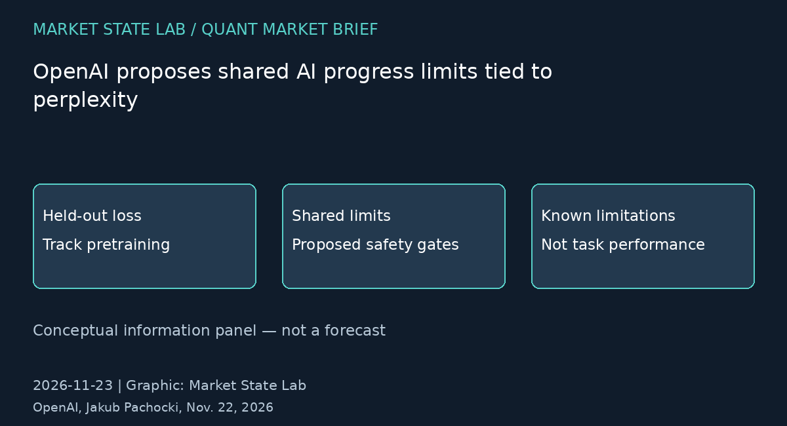
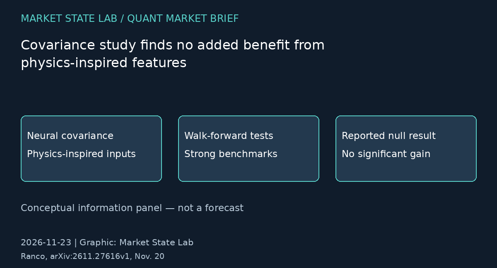
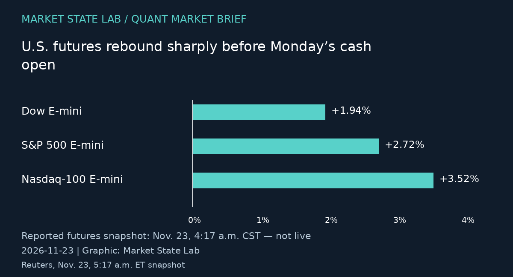
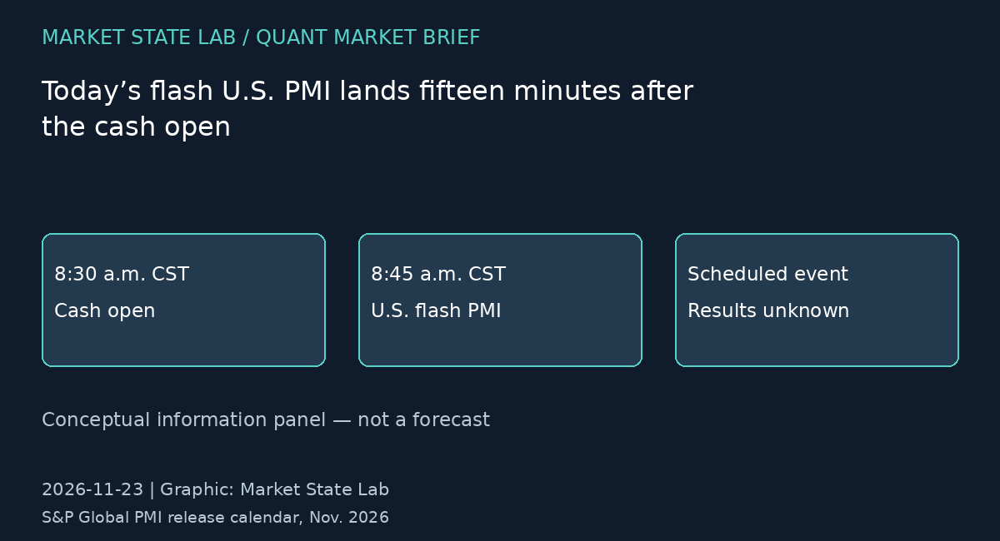
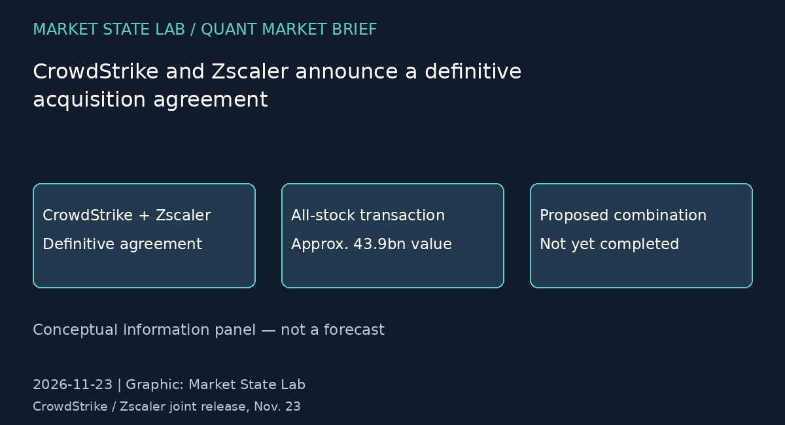

# Quant Market Brief — November 23, 2026: Futures Rebound & Covariance Tests

Research cutoff: November 23, 2026, 6:34 a.m. CST (12:34 UTC). Premarket edition; quotes are reported snapshots or prior-close, not live executable data.

[Subscribe by email](https://market-state-lab.ghost.io/?utm_source=github&utm_medium=repository&utm_campaign=qmb_2026-11-23#/portal/signup).

## 1. OpenAI proposes shared AI progress limits tied to perplexity

*AI / machine learning | Published November 22, 2026*

Graphic: Market State Lab. Source: OpenAI, Jakub Pachocki, Nov. 22, 2026.

**Facts:** OpenAI’s chief scientist proposes using perplexity alongside other measurements to compare AI progress and establish shared development limits tied to monitoring capabilities.

**Inference / Why it matters:** Keep model-score improvements separate from task-specific validation and permission controls in research assistants.

**Uncertainty:** A proposal, not an adopted industry rule. Cross-lab datasets differ, and perplexity does not measure every downstream capability.

[Direct source](https://openai.com/index/perplexity-and-intelligence/).

## 2. Covariance study finds no added benefit from physics-inspired features

*Algorithmic trading / quantitative finance | Submitted November 20; newly listed November 23, 2026*

Graphic: Market State Lab. Source: Ranco, arXiv:2611.27616v1, Nov. 20.

**Facts:** Gabriele Ranco’s preprint reports no significant improvement over HAR-RV or LSTM benchmarks from its physics-inspired covariance framework, and no significant portfolio Sharpe improvement after costs.

**Inference / Why it matters:** Require feature ablations and equally tuned simple benchmarks before adding complexity to a MATLAB risk model.

**Uncertainty:** Author-reported preprint results on 29 DJIA stocks using 2012–2015 data; not proof that the features never help or that the analysis is independently replicated.

[Direct source](https://arxiv.org/abs/2611.27616).

## 3. U.S. futures rebound sharply before Monday’s cash open

*U.S. markets / SPY / QQQ | November 23, 2026, 4:17 a.m. CST reported snapshot*

Graphic: Market State Lab. Source: Reuters, Nov. 23, 5:17 a.m. ET snapshot.

**Facts:** Reuters reported Dow, S&P 500 and Nasdaq-100 E-mini futures up 1.94%, 2.72% and 3.52%, respectively, at 5:17 a.m. Eastern after last week’s selloff.

**Inference / Why it matters:** Treat the rebound as opening-gap risk; wait for fresh spread and depth evidence before increasing participation.

**Uncertainty:** A reported premarket snapshot, not live executable prices, SPY/QQQ returns or evidence of a durable recovery.

[Direct source](https://www.reuters.com/business/wall-street-futures-rebound-after-rough-week-ai-linked-shares-2026-11-23/).

## 4. Today’s flash U.S. PMI lands fifteen minutes after the cash open

*U.S. economy / Federal Reserve | Scheduled November 23, 2026 at 8:45 a.m. CST*

Graphic: Market State Lab. Source: S&P Global PMI release calendar, Nov. 2026.

**Facts:** S&P Global’s release calendar schedules November’s flash U.S. PMI for November 23 at 9:45 a.m. Eastern, equivalent to 8:45 a.m. Central.

**Inference / Why it matters:** Separate the opening-auction window from the PMI event window when evaluating intraday signals and fill assumptions.

**Uncertainty:** Scheduled survey release, not published results or a forecast of Fed action. Recheck the calendar before execution.

[Direct source](https://www.pmi.spglobal.com/Public/Home/PDF/UK_Rel_Dates).

## 5. CrowdStrike and Zscaler announce a definitive acquisition agreement

*Major technology / business | Announced November 23, 2026; material update to November 20 talks*

Graphic: Market State Lab. Source: CrowdStrike / Zscaler joint release, Nov. 23.

**Facts:** CrowdStrike and Zscaler announced a definitive all-stock acquisition agreement valuing Zscaler at approximately $43.9 billion. This advances the previously reported talks to an announced transaction.

**Inference / Why it matters:** For event studies, distinguish announcement risk from completion risk and model stock-consideration exposure rather than a fixed cash payoff.

**Uncertainty:** The deal is proposed, not completed. Regulatory and shareholder approvals and integration outcomes remain uncertain.

[Direct source](https://ir.crowdstrike.com/news-releases/news-release-details/crowdstrike-acquire-zscaler-bringing-network-security-and-zero).

## Quant & Market Dashboard

**Data status / overnight liquidity:** Futures direction is a reported snapshot in story 3, not a current executable order book. Overnight futures/ETF spreads, depth and volume, funding/repo and Treasury bid/ask signals were not independently verified. No current funding or Treasury-market signal was independently verified; no liquidity direction is inferred from missing data.

**Volatility regime — stressed; medium confidence.** YCharts’ historical series reports November 20 prior-close VIX of 35.89, versus 28.44 on November 19. These are completed-session observations, not live Monday readings. Editorial thresholds: below 15 low, 15–20 moderate, 20–30 high, 30 or above stressed. This classification does not establish liquidity stress or today’s SPY/QQQ options surface. Source: https://ycharts.com/indicators/vix_volatility_index

**Factors — performance unavailable, no rankings:**

| Exposure | ETF proxy | One session | Four weeks |
|---|---|---|---|
| Momentum | MTUM | Unavailable | Unavailable |
| Value | VLUE | Unavailable | Unavailable |
| Quality | QUAL | Unavailable | Unavailable |
| Size | IWM | Unavailable | Unavailable |
| Growth | IWF | Unavailable | Unavailable |
| Low volatility | SPLV | Unavailable | Unavailable |

Intended latest completed common-session end: **November 20**; preceding session **November 19**. Four-week target start freshly calculated as **October 23**, exactly 28 calendar days before November 20. Actual common start, comparable prices and adjustments: **unverified; no substitute date used**. Required basis is split-adjusted closing-price return excluding distributions, applying in-window splits once and excluding out-of-window actions. Alpha Vantage’s standard terms provide personal non-commercial use unless otherwise agreed in writing; publication permission for this repository and newsletter use was not verified. No Alpha Vantage prices, corporate actions or derived returns are exported. A publication-cleared comparable alternative was not verified. ETF proxies are not pure factors. Terms: https://www.alphavantage.co/terms_of_service/

**SPY/QQQ and options execution:** Monday cash opening auction: **8:30 a.m. CST**; U.S. flash PMI: **8:45 a.m. CST**, fifteen minutes later. Treat opening-gap fills and the PMI reaction as separate event windows. Wednesday November 25 GDP/PCE: **7:30 a.m. CST**. Thanksgiving November 26 closed; November 27 cash closes **noon CST**, eligible options **12:15 p.m. CST**; check contract and venue. Reconcile Friday monthly-expiry exercise and assignment. Dealer gamma sign and remaining strike concentrations are unverified; avoid unsupported pin assumptions. Use limits and staged participation; compare spread, depth and slippage with time-of-day baselines. Stale Friday options marks, midpoint fills without size and thin premarket prints are liquidity traps. Holiday-thin trading is a risk, not a measured condition today. Calendar sources: https://www.pmi.spglobal.com/Public/Home/PDF/UK_Rel_Dates ; https://www.bea.gov/news/schedule ; https://www.nyse.com/trade/hours-calendars

**Microstructure implications / research watchlist:** Gate participation on fresh quotes, size and spread relative to baseline; stress partial fills and liquidity withdrawal. A futures rebound does not establish improved execution liquidity. Monitor SPY, QQQ, IWM, MTUM, VLUE, QUAL, IWF, SPLV, TLT, NVDA, MU, CRWD and ZS. This is a research watchlist, not a recommendation to trade.

### DRL Improvements for the MATLAB System

- Enforce exposure, turnover, drawdown and capital-preservation limits outside the learned policy; log every veto and breach.
- Reward net performance after commissions, spread and impact, penalizing tail losses and unstable turnover. Simulate latency, partial fills and liquidity withdrawal.
- Use purged walk-forward evaluation with embargoes, frozen final holdouts and regime-stratified stress tests. Compare against cash and simple baselines; retain failed trials and execution-cost sensitivity results.

### Model Hygiene

Fit transforms only within training folds. Use point-in-time constituents and release timestamps to prevent survivorship, leakage and look-ahead bias. Version corporate actions and apply adjustments once. Reject stale, crossed or zero-size options quotes. Count all configurations, control multiple testing, and monitor calibration and drift; do not select retraining rules on the final holdout.

### MATLAB Optimization Patterns

- Align timezone-aware timetables before vectorizing features and returns; keep observation dates separate from publication timestamps.
- Profile before parallel Bayesian optimization. Freeze objective inputs and random streams, and archive trial order; parallel timing can still prevent exact reproducibility.
- Keep data, reward, independent risk gates and execution modules separate. Use GPUs for suitable large tensor workloads; benchmark transfer overhead and minimize host/device transfers.

Technical references: https://www.mathworks.com/help/stats/parallel_bayesian_optimization.html ; https://www.mathworks.com/help/reinforcement-learning/ug/train-reinforcement-learning-agents.html ; https://www.mathworks.com/help/parallel-computing/measure-and-improve-gpu-performance.html

**High-value quant research question:** Do physics-inspired covariance features improve net portfolio outcomes beyond equally tuned HAR-RV and LSTM baselines in a fresh ETF universe? Use nested walk-forward ablations, identical decision timestamps, turnover costs and multiple-testing controls. Worth testing because a new null result suggests complexity may add maintenance and overfitting risk without measurable economic benefit; replication could establish whether that finding transfers.

[Subscribe by email](https://market-state-lab.ghost.io/?utm_source=github&utm_medium=repository&utm_campaign=qmb_2026-11-23#/portal/signup). Please forward this edition to a colleague who tests systematic strategies.

Disclosure: Research and education, not individualized financial advice. Markets involve risk; research claims require independent validation. © Market State Lab.
