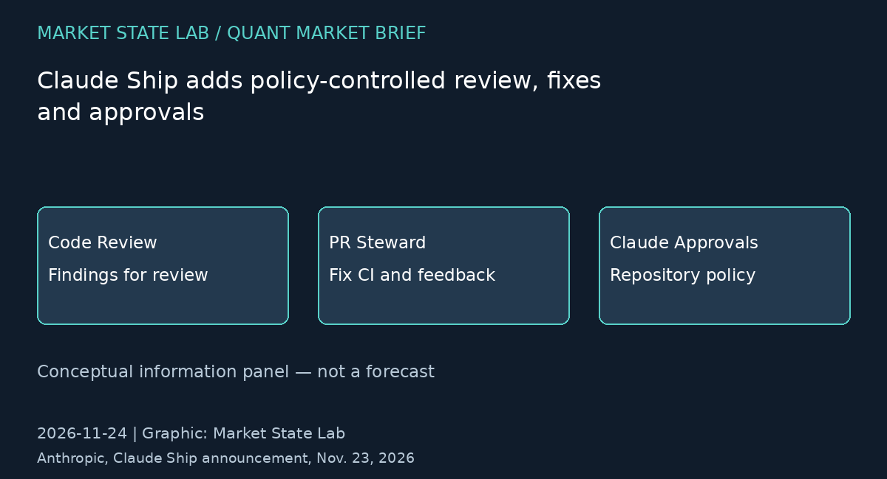
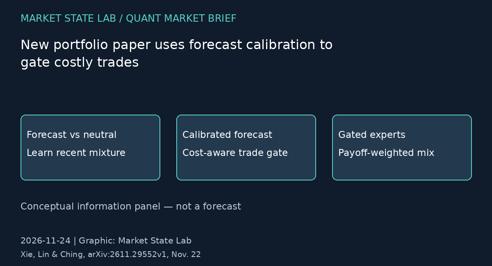
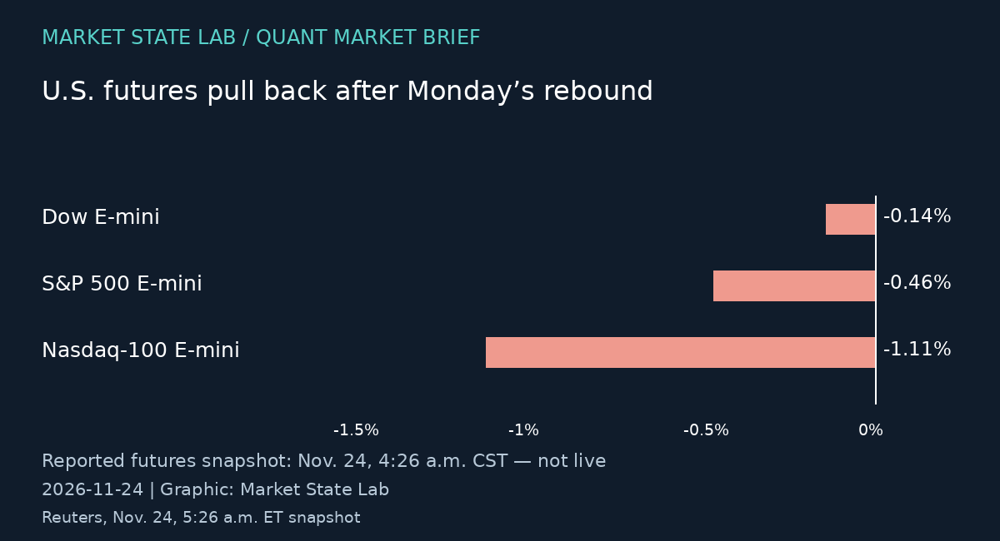
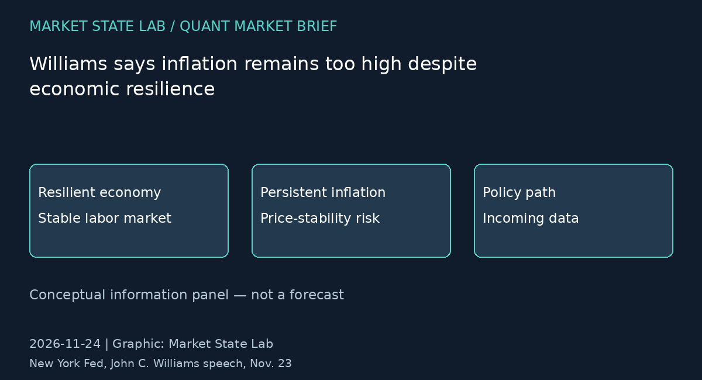
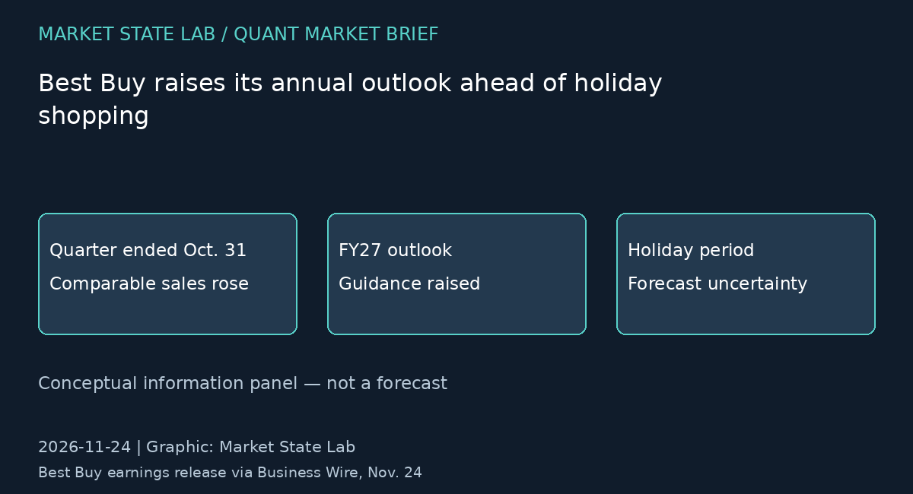

# Quant Market Brief — November 24, 2026: Review Gates & Rate Risk

Research cutoff: November 24, 2026, 6:36 a.m. CST (12:36 UTC). Premarket edition; quotes are reported snapshots or prior-close, not live executable data.

[Subscribe by email](https://market-state-lab.ghost.io/?utm_source=github&utm_medium=repository&utm_campaign=qmb_2026-11-24#/portal/signup).

## 1. Claude Ship adds policy-controlled review, fixes and approvals

*AI / machine learning | Announced November 23, 2026*

Graphic: Market State Lab. Source: Anthropic, Claude Ship announcement, Nov. 23, 2026.

**Facts:** Anthropic introduced Claude Ship in beta: Code Review is generally available, while PR Steward and Claude Approvals are beta tools for GitHub pull requests. Steward can work on fixes and feedback; Approvals evaluates requests against repository policy.

**Inference / Why it matters:** Begin with observe-only approval policies and independent tests before granting an AI reviewer authority in a MATLAB research repository.

**Uncertainty:** Vendor-announced capabilities, not independently verified reliability. PR Steward does not approve or merge requests; AI review can miss defects.

[Direct source](https://claude.com/resources/articles/introducing-claude-ship).

## 2. New portfolio paper uses forecast calibration to gate costly trades

*Algorithmic trading / quantitative finance | Submitted November 22; listed November 24, 2026*

Graphic: Market State Lab. Source: Xie, Lin & Ching, arXiv:2611.29552v1, Nov. 22.

**Facts:** A new preprint adjusts an adaptive moving-average forecast using predictive likelihoods against a neutral forecast, then feeds that calibrated mixture into a transaction-cost-aware portfolio rule. It also combines gated experts by payoff.

**Inference / Why it matters:** Test an explicit no-trade gate against a fixed cost threshold before making a trading agent more complex.

**Uncertainty:** Author-reported backtests, not independently replicated or live results. Historical proportional costs do not establish realistic spread, impact, latency or capacity performance.

[Direct source](https://arxiv.org/abs/2611.29552).

## 3. U.S. futures pull back after Monday’s rebound

*U.S. markets / SPY / QQQ | November 24, 2026, 4:26 a.m. CST reported snapshot*

Graphic: Market State Lab. Source: Reuters, Nov. 24, 5:26 a.m. ET snapshot.

**Facts:** Reuters reported Dow, S&P 500 and Nasdaq-100 E-mini futures down 0.14%, 0.46% and 1.11%, respectively, at 5:26 a.m. Eastern after Monday’s rally.

**Inference / Why it matters:** Treat QQQ-sensitive opening gaps as execution risk; require fresh spread, size and depth evidence before increasing participation.

**Uncertainty:** A reported premarket snapshot, not live executable prices, SPY/QQQ returns or evidence of the cash-session outcome.

[Direct source](https://www.reuters.com/business/wall-st-futures-dip-chip-stocks-cool-after-nvidia-fueled-rally-2026-11-24/).

## 4. Williams says inflation remains too high despite economic resilience

*U.S. economy / Federal Reserve | Speech delivered November 23, 2026*

Graphic: Market State Lab. Source: New York Fed, John C. Williams speech, Nov. 23.

**Facts:** New York Fed President John Williams described resilient growth and a stable labor market, but said inflation remained too high and that restoring price stability required further work. He said his policy assessment would follow the totality of incoming data.

**Inference / Why it matters:** Stress rate-sensitive exposures against an inflation surprise rather than reading an equity rebound as confirmation of easier policy.

**Uncertainty:** One policymaker’s stated assessment, not a new FOMC decision, rate-path commitment or guarantee that inflation will follow his forecast.

[Direct source](https://www.newyorkfed.org/newsevents/speeches/2026/wil261123).

## 5. Best Buy raises its annual outlook ahead of holiday shopping

*Major technology / business | Results released November 24, 2026; quarter ended October 31*

Graphic: Market State Lab. Source: Best Buy earnings release via Business Wire, Nov. 24.

**Facts:** Best Buy reported third-quarter comparable sales growth of 6.1% and raised its fiscal 2027 comparable-sales growth guidance to 3.4%–4.0%. The release covers the quarter ended October 31.

**Inference / Why it matters:** Separate realized sales from forward guidance when testing consumer-electronics demand signals; monitor margin and holiday conversion alongside revenue.

**Uncertainty:** Company-reported results and management guidance. The holiday outcome is not yet realized, and this edition makes no claim about the stock’s reaction.

[Direct source](https://www.businesswire.com/news/home/20261123253985/en/Best-Buy-Reports-Third-Quarter-Results).

## Quant & Market Dashboard

**Data status / overnight liquidity:** Futures direction is a reported snapshot in story 3, not a current executable order book. Overnight futures/ETF spreads, depth and volume, funding/repo and Treasury bid/ask signals were not independently verified. No current funding or Treasury-market signal was independently verified; no liquidity direction is inferred from missing data.

**Volatility regime — high; medium confidence.** YCharts reports November 23 prior-close VIX of 26.62, down from 35.89 on November 20. These are completed-session observations, not live Tuesday readings. Editorial thresholds: below 15 low, 15–20 moderate, 20–30 high, 30 or above stressed. The decline does not establish normal liquidity or today’s SPY/QQQ options surface. Source: https://ycharts.com/indicators/vix_volatility_index

**Factors — performance unavailable, no rankings:**

| Exposure | ETF proxy | One session | Four weeks |
|---|---|---|---|
| Momentum | MTUM | Unavailable | Unavailable |
| Value | VLUE | Unavailable | Unavailable |
| Quality | QUAL | Unavailable | Unavailable |
| Size | IWM | Unavailable | Unavailable |
| Growth | IWF | Unavailable | Unavailable |
| Low volatility | SPLV | Unavailable | Unavailable |

Intended latest completed common-session end: **November 23**; preceding session **November 20**. Four-week target start freshly calculated as **October 26**, exactly 28 calendar days before November 23. Actual common start, comparable prices and adjustments: **unverified; no substitute date used**. Required basis is split-adjusted closing-price return excluding distributions, applying in-window splits once and excluding out-of-window actions. Alpha Vantage’s standard terms provide personal non-commercial use unless otherwise agreed in writing; publication permission for this repository and newsletter use was not verified. No Alpha Vantage prices, corporate actions or derived returns are exported. A publication-cleared comparable alternative was not verified. ETF proxies are not pure factors. Terms: https://www.alphavantage.co/terms_of_service/

**SPY/QQQ and options execution:** Tuesday cash opening auction: **8:30 a.m. CST**. Separate auction fills from continuous trading; a premarket futures decline does not establish executable ETF prices. Wednesday November 25 GDP/PCE: **7:30 a.m. CST**. Thanksgiving November 26 closed; November 27 cash closes **noon CST**, eligible options **12:15 p.m. CST**; check contract and venue. Reconcile Friday monthly-expiry exercise and assignment. Dealer gamma sign and remaining strike concentrations are unverified; avoid unsupported pin assumptions. Use limits and staged participation; compare spread, depth and slippage with time-of-day baselines. Stale prior-session options marks, midpoint fills without size and thin premarket prints are liquidity traps. Holiday-thin trading is a risk, not a measured condition today. Calendar sources: https://www.bea.gov/news/schedule ; https://www.nyse.com/trade/hours-calendars

**Microstructure implications / research watchlist:** Gate participation on fresh quotes, size and spread relative to baseline; stress partial fills and liquidity withdrawal. Futures direction alone does not establish execution liquidity. Monitor SPY, QQQ, IWM, MTUM, VLUE, QUAL, IWF, SPLV, TLT, NVDA, MU and BBY. This is a research watchlist, not a recommendation to trade.

### DRL Improvements for the MATLAB System

- Enforce exposure, turnover, drawdown and capital-preservation limits outside the learned policy; log every veto and breach.
- Reward net performance after commissions, spread and impact, penalizing tail losses and unstable turnover. Simulate latency, partial fills and liquidity withdrawal.
- Use purged walk-forward evaluation with embargoes, frozen final holdouts and regime-stratified stress tests. Compare against cash and simple baselines; retain failed trials and execution-cost sensitivity results.

### Model Hygiene

Fit transforms only within training folds. Use point-in-time constituents and release timestamps to prevent survivorship, leakage and look-ahead bias. Version corporate actions and apply adjustments once. Reject stale, crossed or zero-size options quotes. Count all configurations, control multiple testing, and monitor calibration and drift; do not select retraining rules on the final holdout.

### MATLAB Optimization Patterns

- Align timezone-aware timetables before vectorizing features and returns; keep observation dates separate from publication timestamps.
- Profile before parallel Bayesian optimization. Freeze objective inputs and random streams, and archive trial order; parallel timing can still prevent exact reproducibility.
- Keep data, reward, independent risk gates and execution modules separate. Use GPUs for suitable large tensor workloads; benchmark transfer overhead and minimize host/device transfers.

Technical references: https://www.mathworks.com/help/stats/parallel_bayesian_optimization.html ; https://www.mathworks.com/help/reinforcement-learning/ug/train-reinforcement-learning-agents.html ; https://www.mathworks.com/help/parallel-computing/measure-and-improve-gpu-performance.html

**High-value quant research question:** Does a forecast-calibration trade gate improve net ETF allocation outcomes over a fixed cost threshold when spreads, impact and volatility regimes change? Use nested walk-forward tests, frozen baselines and identical timestamps. Worth testing because avoiding weak trades may improve implementation more reliably than pursuing larger gross forecasts; the result could also disappear under realistic execution costs.

[Subscribe by email](https://market-state-lab.ghost.io/?utm_source=github&utm_medium=repository&utm_campaign=qmb_2026-11-24#/portal/signup). Please forward this edition to a colleague who tests systematic strategies.

Disclosure: Research and education, not individualized financial advice. Markets involve risk; research claims require independent validation. © Market State Lab.
