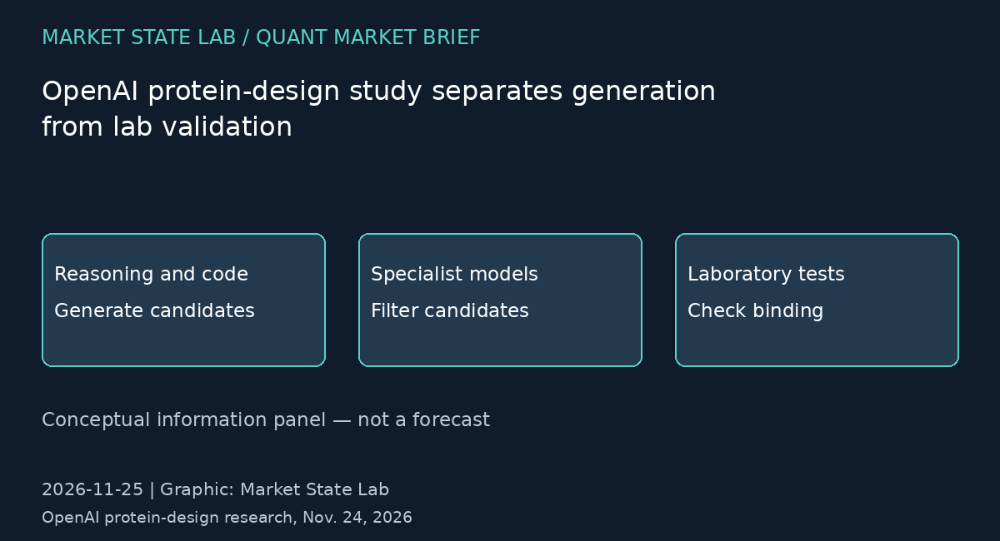
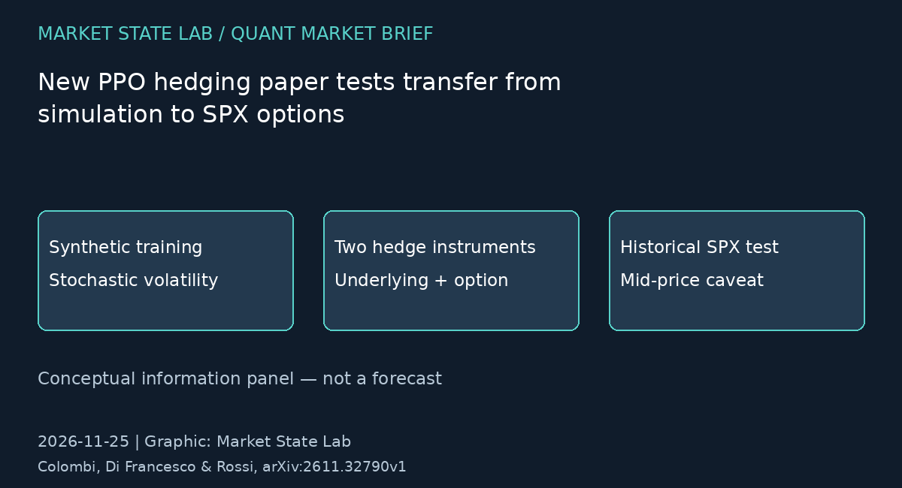
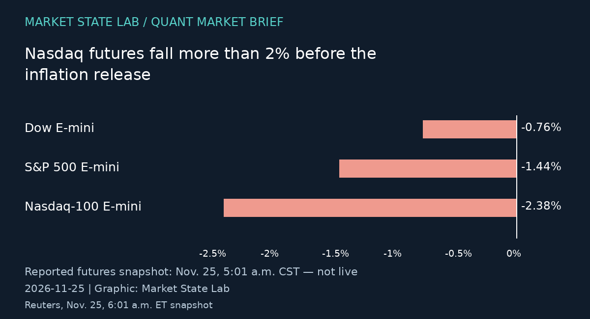
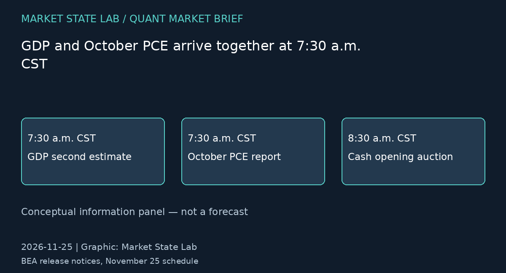
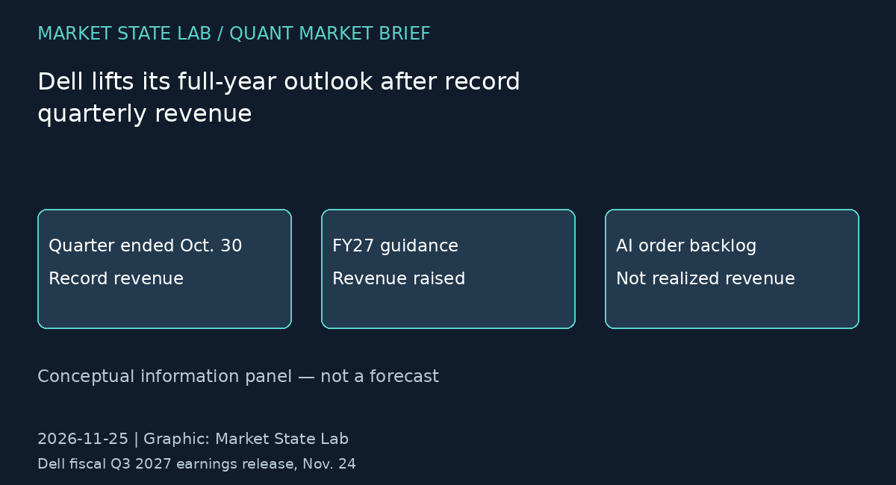

# Quant Market Brief — November 25, 2026: PPO Hedging & PCE Risk

Research cutoff: November 25, 2026, 6:34 a.m. CST (12:34 UTC). Premarket edition; quotes are reported snapshots or prior-close, not live executable data.

[Subscribe by email](https://market-state-lab.ghost.io/?utm_source=github&utm_medium=repository&utm_campaign=qmb_2026-11-25#/portal/signup).

## 1. OpenAI protein-design study separates generation from lab validation

*AI / machine learning | Published November 24, 2026*

Graphic: Market State Lab. Source: OpenAI protein-design research, Nov. 24, 2026.

**Facts:** OpenAI reports protein structure and sequence design with GPT-6 models using reasoning and code. Laboratory work with Onava found evidence of binding across five targets; specialist models helped filter candidates and supply sequences in the testing workflow.

**Inference / Why it matters:** Evaluate a general model’s proposed solution separately from specialist screening and independent validation; apply the same separation to financial research agents.

**Uncertainty:** Early research, not proof of an end-to-end specialist-free design process. Complete structure prediction remains a weakness, and binding is not clinical efficacy.

[Direct source](https://openai.com/index/gpt-6-models-demonstrate-intrinsic-protein-design-capabilities/).

## 2. New PPO hedging paper tests transfer from simulation to SPX options

*Algorithmic trading / quantitative finance | Submitted November 24; listed November 25, 2026*

Graphic: Market State Lab. Source: Colombi, Di Francesco & Rossi, arXiv:2611.32790v1.

**Facts:** The preprint trains PPO to hedge price and volatility risk using an underlying and a longer-dated option. It evaluates transfer to historical SPX options, reporting improved hedging outcomes concentrated in high-volatility episodes.

**Inference / Why it matters:** Test a two-instrument hedging environment against practitioner Delta and Delta-Vega baselines, with identical costs and independent risk limits.

**Uncertainty:** Unreplicated research. Historical tests use 2019–2022 data, quoted mid-price P&L and overlapping episodes; reported gains do not establish executable live performance or rehabilitate a rejected equity-allocation PPO strategy.

[Direct source](https://arxiv.org/abs/2611.32790).

## 3. Nasdaq futures fall more than 2% before the inflation release

*U.S. markets / SPY / QQQ | November 25, 2026, 5:01 a.m. CST reported snapshot*

Graphic: Market State Lab. Source: Reuters, Nov. 25, 6:01 a.m. ET snapshot.

**Facts:** Reuters reported Dow, S&P 500 and Nasdaq-100 E-mini futures down 0.76%, 1.44% and 2.38%, respectively, at 6:01 a.m. Eastern ahead of the inflation release.

**Inference / Why it matters:** Treat the QQQ-sensitive premarket gap and the scheduled data release as separate execution-risk windows; require fresh quotes before sizing participation.

**Uncertainty:** Reported snapshot, not executable live prices, SPY/QQQ returns or a prediction of the cash close.

[Direct source](https://www.reuters.com/business/nasdaq-futures-slide-over-2-fresh-us-tariff-concerns-inflation-data-focus-2026-11-25/).

## 4. GDP and October PCE arrive together at 7:30 a.m. CST

*U.S. economy / Federal Reserve | Scheduled November 25, 2026, 7:30 a.m. CST; results unknown at cutoff*

Graphic: Market State Lab. Source: BEA release notices, November 25 schedule.

**Facts:** BEA schedules third-quarter GDP’s second estimate and October Personal Income and Outlays for November 25 at 8:30 a.m. Eastern, equivalent to 7:30 a.m. Central.

**Inference / Why it matters:** Freeze pre-release inputs and measure the data reaction separately from the opening auction; avoid training on revised GDP as if it were known earlier.

**Uncertainty:** A scheduled release, not published results or a forecast. Subsequent revisions and policy interpretation remain uncertain.

[Direct source](https://www.bea.gov/news/2026/personal-income-and-outlays-september-2026).

[Additional reporting](https://www.bea.gov/news/2026/gdp-advance-estimate-3rd-quarter-2026).

## 5. Dell lifts its full-year outlook after record quarterly revenue

*Major technology / business | Announced November 24, 2026; quarter ended October 30*

Graphic: Market State Lab. Source: Dell fiscal Q3 2027 earnings release, Nov. 24.

**Facts:** Dell reported fiscal third-quarter revenue of 54.9 billion and raised fiscal 2027 revenue guidance from 192.0 billion to 202.0 billion, in U.S. dollars. It also reported a record AI backlog.

**Inference / Why it matters:** Separate booked demand, shipments and cash conversion in AI-infrastructure analysis; strong guidance alone does not establish investment returns.

**Uncertainty:** Company-reported unaudited results and forward guidance. Backlog conversion depends on customer financing and deployment capacity; no stock-price reaction is inferred.

[Direct source](https://www.dell.com/en-us/newsroom/announcements/dell-technologies-delivers-third-quarter-fiscal-2027-financial-results).

## Quant & Market Dashboard

**Data status / overnight liquidity:** Futures direction is a reported snapshot in story 3, not a current executable order book. Overnight futures/ETF spreads, depth and volume, funding/repo and Treasury bid/ask signals were not independently verified. No current funding or Treasury-market signal was independently verified; no liquidity direction is inferred from missing data.

**Volatility regime — high; medium confidence.** Yahoo Finance historical data reports November 24 prior-close VIX of 26.36, versus 26.62 on November 23. These are completed-session observations, not live Wednesday readings. Editorial thresholds: below 15 low, 15–20 moderate, 20–30 high, 30 or above stressed. The decline does not establish normal liquidity or today’s SPY/QQQ options surface. Source: https://finance.yahoo.com/quote/%5EVIX/history/

**Factors — performance unavailable, no rankings:**

| Exposure | ETF proxy | One session | Four weeks |
|---|---|---|---|
| Momentum | MTUM | Unavailable | Unavailable |
| Value | VLUE | Unavailable | Unavailable |
| Quality | QUAL | Unavailable | Unavailable |
| Size | IWM | Unavailable | Unavailable |
| Growth | IWF | Unavailable | Unavailable |
| Low volatility | SPLV | Unavailable | Unavailable |

Intended latest completed common-session end: **November 24**; preceding session **November 23**. Four-week target start freshly calculated as **October 27**, exactly 28 calendar days before November 24. Actual common start, comparable prices and adjustments: **unverified; no substitute date used**. Required basis is split-adjusted closing-price return excluding distributions, applying in-window splits once and excluding out-of-window actions. Alpha Vantage’s standard terms provide personal non-commercial use unless otherwise agreed in writing; publication permission for this repository and newsletter use was not verified. No Alpha Vantage prices, corporate actions or derived returns are exported. A publication-cleared comparable alternative was not verified. ETF proxies are not pure factors. Terms: https://www.alphavantage.co/terms_of_service/

**SPY/QQQ and options execution:** Wednesday cash opening auction: **8:30 a.m. CST**. Separate auction fills from continuous trading; a premarket futures decline does not establish executable ETF prices. Today, November 25, GDP/PCE: **7:30 a.m. CST**, one hour before the cash open. Results were not released at the research cutoff. Thanksgiving November 26 closed; November 27 cash closes **noon CST**, eligible options **12:15 p.m. CST**; check contract and venue. Reconcile Friday monthly-expiry exercise and assignment. Dealer gamma sign and remaining strike concentrations are unverified; avoid unsupported pin assumptions. Use limits and staged participation; compare spread, depth and slippage with time-of-day baselines. Stale prior-session options marks, midpoint fills without size and thin premarket prints are liquidity traps. Holiday-thin trading is a risk, not a measured condition today. Calendar sources: https://www.bea.gov/news/schedule ; https://www.nyse.com/trade/hours-calendars

**Microstructure implications / research watchlist:** Gate participation on fresh quotes, size and spread relative to baseline; stress partial fills and liquidity withdrawal. Futures direction alone does not establish execution liquidity. Monitor SPY, QQQ, IWM, MTUM, VLUE, QUAL, IWF, SPLV, TLT, NVDA, MU and DELL. This is a research watchlist, not a recommendation to trade.

### DRL Improvements for the MATLAB System

- Enforce exposure, turnover, drawdown and capital-preservation limits outside the learned policy; log every veto and breach.
- Reward net performance after commissions, spread and impact, penalizing tail losses and unstable turnover. Simulate latency, partial fills and liquidity withdrawal.
- Use purged walk-forward evaluation with embargoes, frozen final holdouts and regime-stratified stress tests. Compare against cash and simple baselines; retain failed trials and execution-cost sensitivity results.

### Model Hygiene

Fit transforms only within training folds. Use point-in-time constituents and release timestamps to prevent survivorship, leakage and look-ahead bias. Version corporate actions and apply adjustments once. Reject stale, crossed or zero-size options quotes. Count all configurations, control multiple testing, and monitor calibration and drift; do not select retraining rules on the final holdout.

### MATLAB Optimization Patterns

- Align timezone-aware timetables before vectorizing features and returns; keep observation dates separate from publication timestamps.
- Profile before parallel Bayesian optimization. Freeze objective inputs and random streams, and archive trial order; parallel timing can still prevent exact reproducibility.
- Keep data, reward, independent risk gates and execution modules separate. Use GPUs for suitable large tensor workloads; benchmark transfer overhead and minimize host/device transfers.

Technical references: https://www.mathworks.com/help/stats/parallel_bayesian_optimization.html ; https://www.mathworks.com/help/reinforcement-learning/ug/train-reinforcement-learning-agents.html ; https://www.mathworks.com/help/parallel-computing/measure-and-improve-gpu-performance.html

**High-value quant research question:** Does a simulated PPO Delta-Vega hedge retain a lower tail loss than practitioner Delta-Vega hedging when evaluated at executable bid/ask prices, with partial fills and independent volatility regimes? Worth testing because the new paper uses quoted mid-price P&L and overlapping historical episodes; execution realism and dependence could change its apparent advantage.

[Subscribe by email](https://market-state-lab.ghost.io/?utm_source=github&utm_medium=repository&utm_campaign=qmb_2026-11-25#/portal/signup). Please forward this edition to a colleague who tests systematic strategies.

Disclosure: Research and education, not individualized financial advice. Markets involve risk; research claims require independent validation. © Market State Lab.
