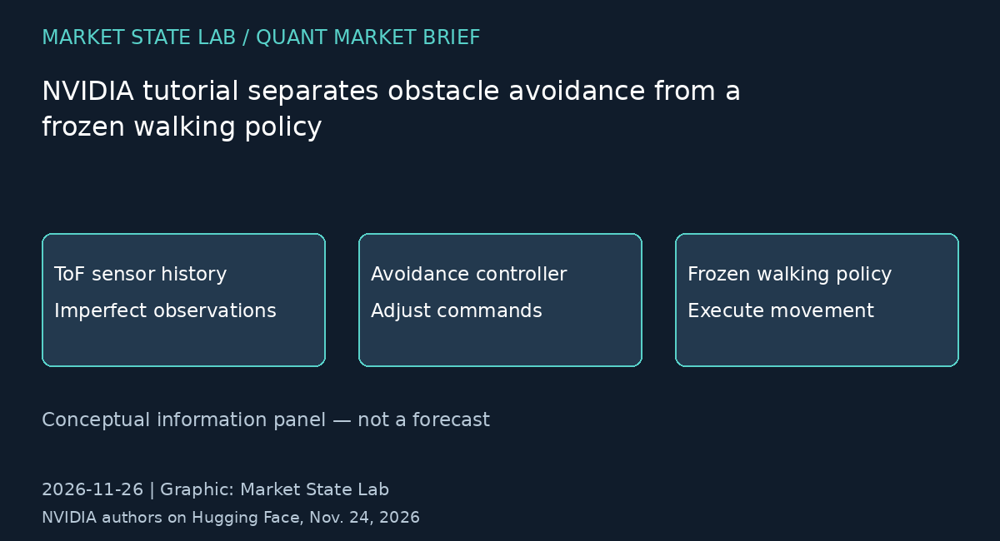
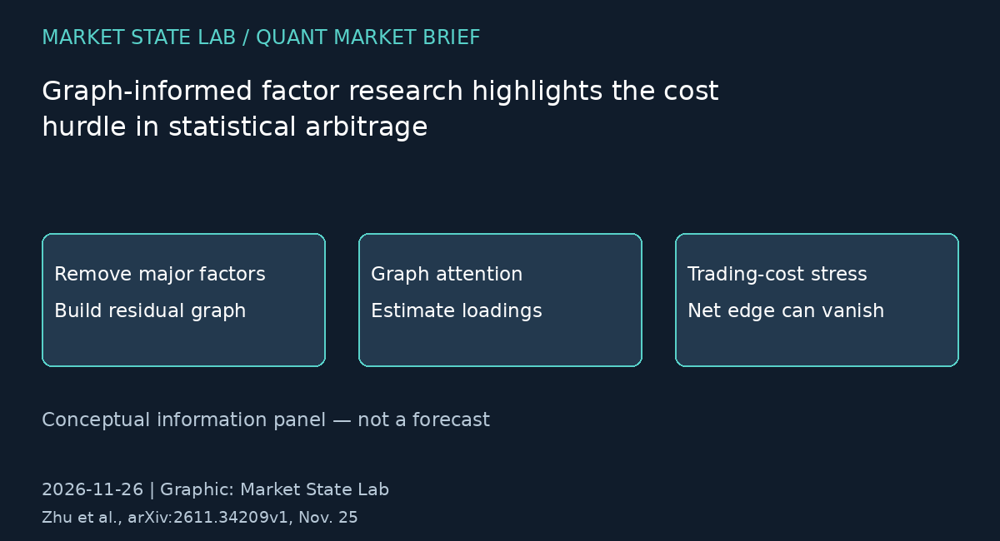
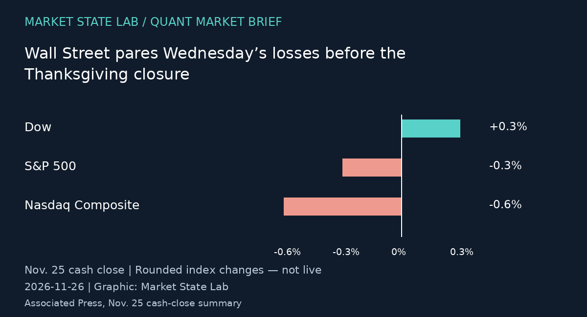
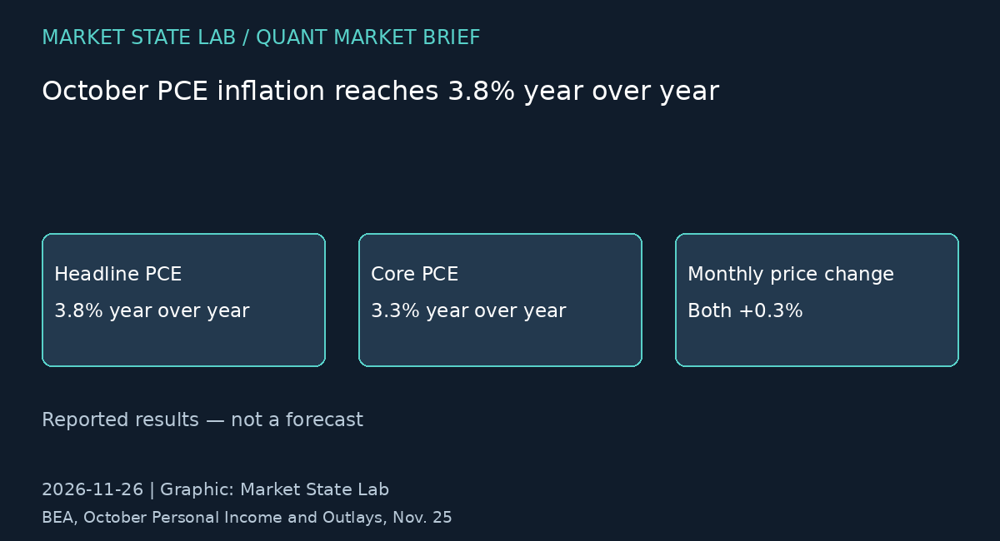
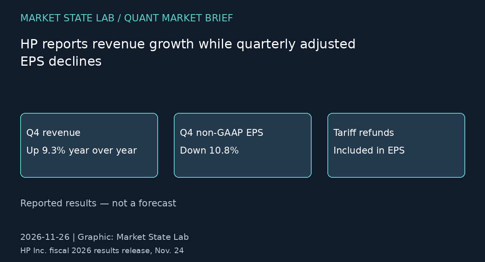

# Quant Market Brief — November 26, 2026: Graph Costs & Inflation

Research cutoff: November 26, 2026, 6:36 a.m. CST (12:36 UTC). Thanksgiving edition; U.S. cash equities are closed. Market observations are prior-close, not live executable data.

[Subscribe by email](https://market-state-lab.ghost.io/?utm_source=github&utm_medium=repository&utm_campaign=qmb_2026-11-26#/portal/signup).

## 1. NVIDIA tutorial separates obstacle avoidance from a frozen walking policy

*AI / machine learning | Published November 24, 2026*

Graphic: Market State Lab. Source: NVIDIA authors on Hugging Face, Nov. 24, 2026.

**Facts:** NVIDIA’s Microduck tutorial trains a separate obstacle-avoidance controller while keeping a walking policy fixed. Isaac Lab and Newton support simulation, sensor modeling, evaluation and deployment preparation; training includes noise, delay and missing measurements.

**Inference / Why it matters:** For MATLAB trading research, separate a signal policy from execution and independent risk controls, and stress imperfect observations before deployment.

**Uncertainty:** A robotics tutorial, not evidence of trading profitability. Simulation and hardware behavior can differ; the architectural analogy requires financial validation.

[Direct source](https://huggingface.co/blog/nvidia/microduck-obstacle-avoidance).

## 2. Graph-informed factor research highlights the cost hurdle in statistical arbitrage

*Algorithmic trading / quantitative finance | Submitted November 25; listed November 26, 2026*

Graphic: Market State Lab. Source: Zhu et al., arXiv:2611.34209v1, Nov. 25.

**Facts:** The preprint builds a signed stock network after removing dominant correlation modes, then uses graph attention in a deep factor model. Its historical U.S. equity tests report improved residual-arbitrage performance, but net Sharpe becomes negative at five basis points per unit traded.

**Inference / Why it matters:** Require an identity-graph ablation, equally tuned PCA benchmark and net-cost acceptance gate before adopting graph complexity.

**Uncertainty:** Unreplicated backtests covering 2015–2024. The headline results are gross of costs; borrow, impact, capacity and realistic fills remain implementation questions.

[Direct source](https://arxiv.org/html/2611.34209v1).

## 3. Wall Street pares Wednesday’s losses before the Thanksgiving closure

*U.S. markets / SPY / QQQ | November 25, 2026 cash close; AP report 3:17 p.m. CST*

Graphic: Market State Lab. Source: Associated Press, Nov. 25 cash-close summary.

**Facts:** AP reported Wednesday closes of about +0.3% for the Dow, −0.3% for the S&P 500 and −0.6% for the Nasdaq Composite after substantial intraday losses were pared.

**Inference / Why it matters:** Evaluate Friday’s gap and liquidity afresh rather than treating Wednesday’s late recovery as an execution signal.

**Uncertainty:** Rounded reported index returns, not SPY/QQQ returns or live holiday-session prices. The intraday recovery does not establish a durable reversal.

[Direct source](https://apnews.com/article/94fdb0ecb060ec65c0b02879ce0d2d09).

## 4. October PCE inflation reaches 3.8% year over year

*U.S. economy / Federal Reserve | BEA released November 25, 2026, 7:30 a.m. CST*

Graphic: Market State Lab. Source: BEA, October Personal Income and Outlays, Nov. 25.

**Facts:** BEA reported October PCE inflation of 3.8% year over year and core PCE inflation of 3.3%. Both price indexes increased 0.3% from September.

**Inference / Why it matters:** Stress rate-sensitive signals against persistent inflation and preserve release vintages; this is the result that was still unknown at yesterday’s cutoff.

**Uncertainty:** Economic estimates can be revised. The release does not by itself determine the next FOMC decision or the future inflation path.

[Direct source](https://www.bea.gov/news/2026/personal-income-and-outlays-october-2026).

## 5. HP reports revenue growth while quarterly adjusted EPS declines

*Major technology / business | Released November 24, 2026; fiscal 2026 fourth-quarter results*

Graphic: Market State Lab. Source: HP Inc. fiscal 2026 results release, Nov. 24.

**Facts:** HP reported fourth-quarter revenue growth of 9.3% year over year while non-GAAP EPS declined 10.8%. Its fiscal-year EPS measures included favorable tariff refunds.

**Inference / Why it matters:** Test earnings quality and margins separately from top-line hardware demand; isolate nonrecurring items before extrapolating profitability.

**Uncertainty:** Company-reported results using both GAAP and non-GAAP measures. Revenue growth alone does not establish sustainable earnings growth or a stock-price response.

[Direct source](https://www.hp.com/us-en/newsroom/press-releases/2026/hp-inc-reports-fiscal-2026-full-year-and-fourth-quarter-results.html).

## Quant & Market Dashboard

**Data status / overnight liquidity:** Today is Thanksgiving; U.S. cash equities are closed. Story 3 contains Wednesday prior-close index changes, not overnight futures or ETF quotes. Overnight futures/ETF spreads, depth and volume, funding/repo and Treasury bid/ask signals were not independently verified. No current funding or Treasury-market signal was independently verified; no liquidity direction is inferred from missing data.

**Volatility regime — high; medium confidence.** Yahoo Finance historical data reports November 25 prior-close VIX of 28.29, versus 26.36 on November 24. These are completed-session observations, not live Thursday readings. Editorial thresholds: below 15 low, 15–20 moderate, 20–30 high, 30 or above stressed. The prior-close reading does not establish current liquidity or today’s SPY/QQQ options surface. Source: https://finance.yahoo.com/quote/%5EVIX/history/

**Factors — performance unavailable, no rankings:**

| Exposure | ETF proxy | One session | Four weeks |
|---|---|---|---|
| Momentum | MTUM | Unavailable | Unavailable |
| Value | VLUE | Unavailable | Unavailable |
| Quality | QUAL | Unavailable | Unavailable |
| Size | IWM | Unavailable | Unavailable |
| Growth | IWF | Unavailable | Unavailable |
| Low volatility | SPLV | Unavailable | Unavailable |

Intended latest completed common-session end: **November 25**; preceding session **November 24**. Four-week target start freshly calculated as **October 28**, exactly 28 calendar days before November 25. Actual common start, comparable prices and adjustments: **unverified; no substitute date used**. Required basis is split-adjusted closing-price return excluding distributions, applying in-window splits once and excluding out-of-window actions. Alpha Vantage’s standard terms provide personal non-commercial use unless otherwise agreed in writing; publication permission for this repository and newsletter use was not verified. No Alpha Vantage prices, corporate actions or derived returns are exported. A publication-cleared comparable alternative was not verified. ETF proxies are not pure factors. Terms: https://www.alphavantage.co/terms_of_service/

**SPY/QQQ and options execution:** No regular U.S. cash opening auction today, November 26. Friday November 27 cash opens **8:30 a.m. CST** and closes **noon CST**; eligible options close **12:15 p.m. CST**, subject to contract and venue. Confirm futures holiday hours separately before routing orders; no holiday-session futures timetable or executable feed was verified. Use limits and staged participation, compare spreads and depth with shortened-session baselines, and stress partial fills and slippage. Dealer gamma sign, expiry concentrations and current options spreads are unverified; do not assume pinning. Stale Wednesday options marks, midpoint fills without size and isolated holiday prints are liquidity traps. Holiday-thin trading is a risk, not measured depth evidence. Calendar: https://www.nyse.com/trade/hours-calendars

**Microstructure implications / research watchlist:** Gate participation on fresh quotes, size and spread relative to baseline; stress partial fills and liquidity withdrawal. A recovery from an intraday low does not establish reliable execution liquidity. Monitor SPY, QQQ, IWM, MTUM, VLUE, QUAL, IWF, SPLV, TLT, NVDA, MU and HPQ. This is a research watchlist, not a recommendation to trade.

### DRL Improvements for the MATLAB System

- Enforce exposure, turnover, drawdown and capital-preservation limits outside the learned policy; log every veto and breach.
- Reward net performance after commissions, spread and impact, penalizing tail losses and unstable turnover. Simulate latency, partial fills and liquidity withdrawal.
- Use purged walk-forward evaluation with embargoes, frozen final holdouts and regime-stratified stress tests. Compare against cash and simple baselines; retain failed trials and execution-cost sensitivity results.

### Model Hygiene

Fit transforms only within training folds. Use point-in-time constituents and release timestamps to prevent survivorship, leakage and look-ahead bias. Version corporate actions and apply adjustments once. Reject stale, crossed or zero-size options quotes. Count all configurations, control multiple testing, and monitor calibration and drift; do not select retraining rules on the final holdout.

### MATLAB Optimization Patterns

- Align timezone-aware timetables before vectorizing features and returns; keep observation dates separate from publication timestamps.
- Profile before parallel Bayesian optimization. Freeze objective inputs and random streams, and archive trial order; parallel timing can still prevent exact reproducibility.
- Keep data, reward, independent risk gates and execution modules separate. Use GPUs for suitable large tensor workloads; benchmark transfer overhead and minimize host/device transfers.

Technical references: https://www.mathworks.com/help/stats/parallel_bayesian_optimization.html ; https://www.mathworks.com/help/reinforcement-learning/ug/train-reinforcement-learning-agents.html ; https://www.mathworks.com/help/parallel-computing/measure-and-improve-gpu-performance.html

**High-value quant research question:** Does a factor-stripped graph improve net residual mean-reversion versus an identity graph and equally tuned PCA after realistic spread, impact, borrow and turnover costs? Worth testing because the new paper’s gross advantage becomes negative under its higher cost assumption; graph ablation and implementation costs can separate useful structure from expensive complexity.

[Subscribe by email](https://market-state-lab.ghost.io/?utm_source=github&utm_medium=repository&utm_campaign=qmb_2026-11-26#/portal/signup). Please forward this edition to a colleague who tests systematic strategies.

Disclosure: Research and education, not individualized financial advice. Markets involve risk; research claims require independent validation. © Market State Lab.
