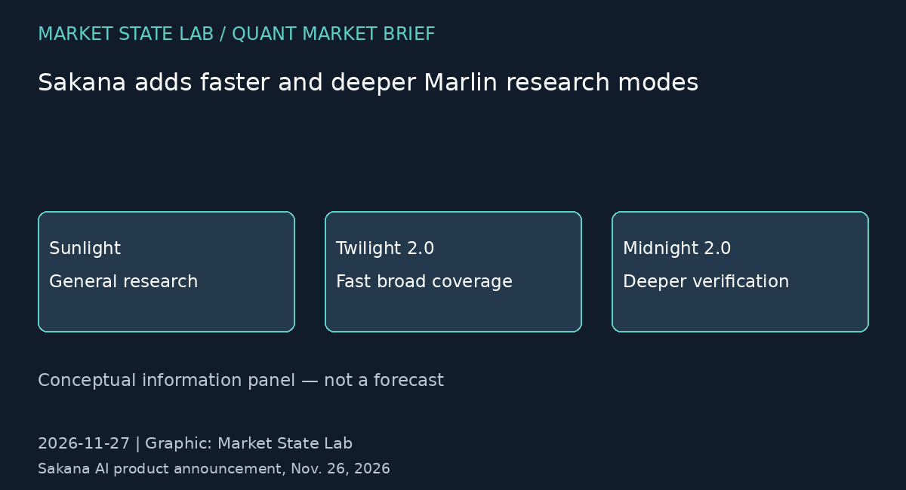
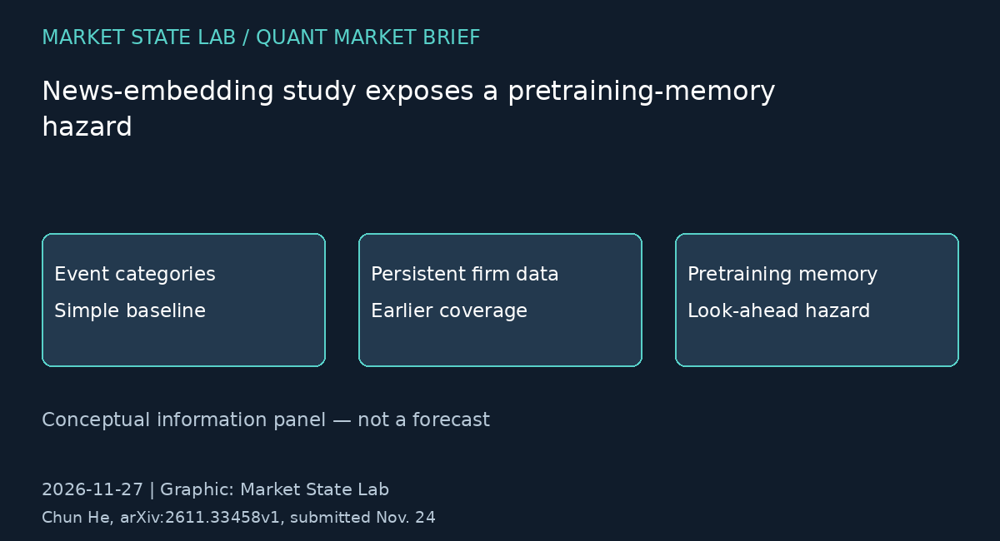
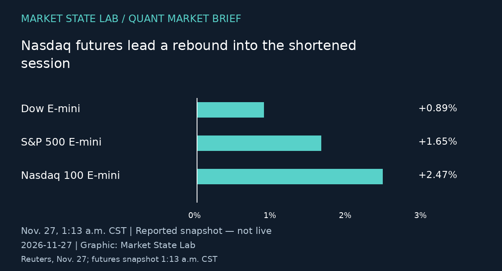
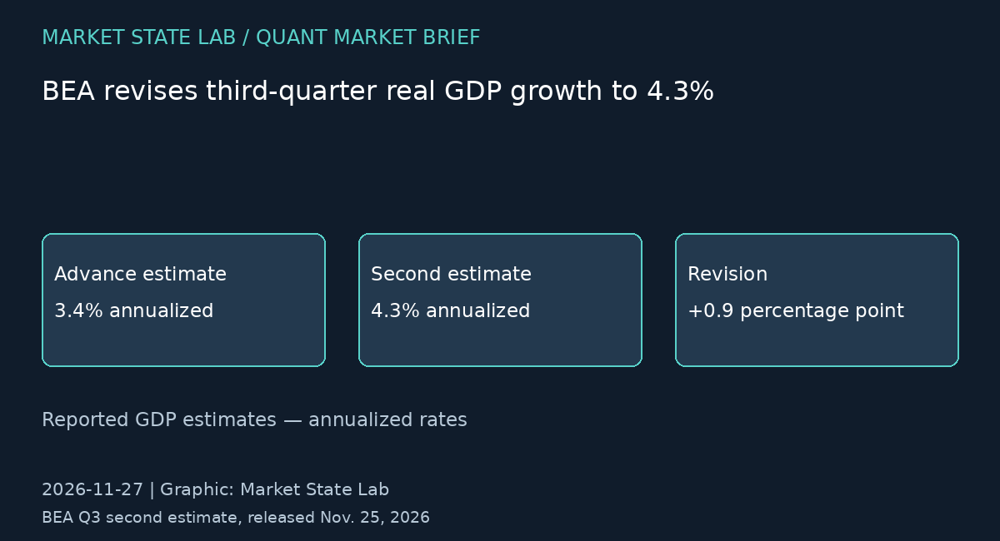
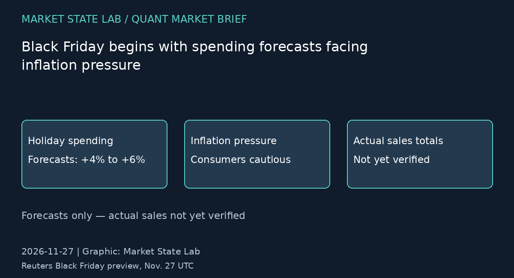

# Quant Market Brief — November 27, 2026: News Memory & Futures Rebound

Research cutoff: November 27, 2026, 6:36 a.m. CST (12:36 UTC). Shortened-session edition. Market observations are reported snapshots or prior-close, not live executable data.

[Subscribe by email](https://market-state-lab.ghost.io/?utm_source=github&utm_medium=repository&utm_campaign=qmb_2026-11-27#/portal/signup).

## 1. Sakana adds faster and deeper Marlin research modes

*AI / machine learning | Company announcement November 26, 2026*

Graphic: Market State Lab. Source: Sakana AI product announcement, Nov. 26, 2026.

**Facts:** Sakana AI added Twilight 2.0 and Midnight 2.0 to Marlin and redesigned PowerPoint export across all modes. Each new mode consumes 300 credits per investigation versus 100 for Sunlight.

**Inference / Why it matters:** Benchmark source accuracy, coverage, latency and cost on a fixed research task before choosing a deeper mode. More sources do not establish better decisions.

**Uncertainty:** Speed, breadth and verification improvements are vendor claims; no independent accuracy or financial-return validation was verified.

[Direct source](https://sakana.ai/marlin-update-2/).

## 2. News-embedding study exposes a pretraining-memory hazard

*Algorithmic trading / quantitative finance | Submitted November 24; q-fin listing November 26, 2026*

Graphic: Market State Lab. Source: Chun He, arXiv:2611.33458v1, submitted Nov. 24.

**Facts:** The preprint finds that simple event-category forecasts outperform embedding forecasts at short horizons. At longer horizons, earlier firm coverage explains substantial predictability; a calibration shows pretraining memory can reproduce part of the pattern.

**Inference / Why it matters:** Require an event-category baseline and an encoder trained before the evaluation period. Separate genuinely new information from firm identity and historical coverage.

**Uncertainty:** Unreplicated preprint. Memory attribution depends on calibration and cutoff-comparison assumptions; this is not proof that every news model leaks or that a live strategy is profitable.

[Direct source](https://arxiv.org/html/2611.33458v1).

## 3. Nasdaq futures lead a rebound into the shortened session

*U.S. markets / SPY / QQQ | Reuters published November 27, 2026, 1:34 a.m. CST; snapshot 1:13 a.m. CST*

Graphic: Market State Lab. Source: Reuters, Nov. 27; futures snapshot 1:13 a.m. CST.

**Facts:** Reuters reported Dow, S&P 500 and Nasdaq 100 E-mini futures up 0.89%, 1.65% and 2.47%, respectively, at 2:13 a.m. Eastern as investors returned from Thanksgiving.

**Inference / Why it matters:** Treat the growth-led rebound as a gap-risk input. Recheck SPY/QQQ spreads, displayed size and auction imbalances before execution.

**Uncertainty:** An early reported snapshot, not a current executable feed, SPY/QQQ return or evidence that the rebound will persist. Spreads, depth and slippage were not verified.

[Direct source](https://www.reuters.com/business/wall-st-futures-surge-investors-return-holiday-2026-11-27/).

[Additional reporting](https://www.aol.com/articles/wall-st-futures-surge-investors-073405000.html).

## 4. BEA revises third-quarter real GDP growth to 4.3%

*U.S. economy / Federal Reserve | BEA released November 25, 2026, 7:30 a.m. CST*

Graphic: Market State Lab. Source: BEA Q3 second estimate, released Nov. 25, 2026.

**Facts:** BEA revised third-quarter real GDP growth from 3.4% to 4.3% at a seasonally adjusted annual rate. Investment and consumer spending drove the upward revision; real private domestic final sales grew 5.8%.

**Inference / Why it matters:** Stress duration-sensitive and growth-sensitive signals against stronger demand. Archive the release vintage rather than replacing historical training inputs with revised data.

**Uncertainty:** A November 25 release, not a new release today. Annualized growth is not a year-over-year rate; further revisions are possible and no FOMC action follows mechanically.

[Direct source](https://www.bea.gov/news/2026/gdp-second-estimate-and-corporate-profits-3rd-quarter-2026).

## 5. Black Friday begins with spending forecasts facing inflation pressure

*Major technology / business | Reuters published November 27, 2026, 00:03 UTC (November 26, 6:03 p.m. CST)*

Graphic: Market State Lab. Source: Reuters Black Friday preview, Nov. 27 UTC.

**Facts:** Reuters reports holiday-spending forecasts of 4%–6% growth from last year while consumer sentiment remains shaky and inflation pressures shoppers.

**Inference / Why it matters:** For XRT/XLY research, separate nominal spending, unit demand and promotional margins. Wait for timestamped actual results before treating forecasts as realized demand.

**Uncertainty:** These are forecasts for holiday spending, not observed Black Friday sales growth or inflation-adjusted demand. Full-day sales and retailer margins remain unknown.

[Direct source](https://www.reuters.com/business/retail-consumer/cautious-consumers-gear-up-black-friday-inflation-woes-bite-2026-11-27/).

[Additional reporting](https://www.investing.com/news/stock-market-news/cautious-consumers-gear-up-for-black-friday-as-inflation-woes-bite-5052778).

## Quant & Market Dashboard

**Data status / overnight liquidity:** Friday is a shortened U.S. cash session. Story 3 contains a Reuters-reported futures snapshot at 1:13 a.m. CST, not live executable quotes. Overnight futures/ETF spreads, depth and volume, funding/repo and Treasury bid/ask signals were not independently verified. No current funding or Treasury-market signal was independently verified; no liquidity direction is inferred from missing data.

**Volatility regime — high; medium confidence.** YCharts reports November 25 prior-close VIX of 28.29, versus 26.36 on November 24. These are completed-session observations, not live Friday readings. Editorial thresholds: below 15 low, 15–20 moderate, 20–30 high, 30 or above stressed. The prior-close reading does not establish current liquidity or today’s SPY/QQQ options surface. Source: https://ycharts.com/indicators/vix_volatility_index

**Factors — performance unavailable, no rankings:**

| Exposure | ETF proxy | One session | Four weeks |
|---|---|---|---|
| Momentum | MTUM | Unavailable | Unavailable |
| Value | VLUE | Unavailable | Unavailable |
| Quality | QUAL | Unavailable | Unavailable |
| Size | IWM | Unavailable | Unavailable |
| Growth | IWF | Unavailable | Unavailable |
| Low volatility | SPLV | Unavailable | Unavailable |

Intended latest completed common-session end: **November 25**; preceding session **November 24**. Four-week target start freshly calculated as **October 28**, exactly 28 calendar days before November 25. Actual common start, comparable prices and adjustments: **unverified; no substitute date used**. Required basis is split-adjusted closing-price return excluding distributions, applying in-window splits once and excluding out-of-window actions. Alpha Vantage’s standard terms provide personal non-commercial use unless otherwise agreed in writing; publication permission for this repository and newsletter use was not verified. No Alpha Vantage prices, corporate actions or derived returns are exported. A publication-cleared comparable alternative was not verified. ETF proxies are not pure factors. Terms: https://www.alphavantage.co/terms_of_service/

**SPY/QQQ and options execution:** Today, November 27, cash opens **8:30 a.m. CST** and closes **noon CST**; eligible options close **12:15 p.m. CST**, subject to contract and venue. Confirm futures holiday hours separately before routing orders; no holiday-session futures timetable or executable feed was verified. Use limits and staged participation, compare spreads and depth with shortened-session baselines, and stress partial fills and slippage. Dealer gamma sign, expiry concentrations and current options spreads are unverified; do not assume pinning. Stale Wednesday options marks, midpoint fills without size and isolated holiday prints are liquidity traps. Holiday-thin trading is a risk, not measured depth evidence. Calendar: https://www.nyse.com/trade/hours-calendars

**Microstructure implications / research watchlist:** Gate participation on fresh quotes, size and spread relative to baseline; stress partial fills and liquidity withdrawal. A futures rebound does not establish executable ETF depth. Avoid chasing thin opening prints; monitor opening and early closing-auction imbalances. Monitor SPY, QQQ, IWM, MTUM, VLUE, QUAL, IWF, SPLV, TLT, NVDA, XRT and XLY. This is a research watchlist, not a recommendation to trade.

### DRL Improvements for the MATLAB System

- Enforce exposure, turnover, drawdown and capital-preservation limits outside the learned policy; log every veto and breach.
- Reward net performance after commissions, spread and impact, penalizing tail losses and unstable turnover. Simulate latency, partial fills and liquidity withdrawal.
- Use purged walk-forward evaluation with embargoes, frozen final holdouts and regime-stratified stress tests. Compare against cash and simple baselines; retain failed trials and execution-cost sensitivity results.

### Model Hygiene

Fit transforms only within training folds. Use point-in-time constituents and release timestamps to prevent survivorship, leakage and look-ahead bias. Version corporate actions and apply adjustments once. Reject stale, crossed or zero-size options quotes. Count all configurations, control multiple testing, and monitor calibration and drift; do not select retraining rules on the final holdout.

### MATLAB Optimization Patterns

- Align timezone-aware timetables before vectorizing features and returns; keep observation dates separate from publication timestamps.
- Profile before parallel Bayesian optimization. Freeze objective inputs and random streams, and archive trial order; parallel timing can still prevent exact reproducibility.
- Keep data, reward, independent risk gates and execution modules separate. Use GPUs for suitable large tensor workloads; benchmark transfer overhead and minimize host/device transfers.

Technical references: https://www.mathworks.com/help/stats/parallel_bayesian_optimization.html ; https://www.mathworks.com/help/reinforcement-learning/ug/train-reinforcement-learning-agents.html ; https://www.mathworks.com/help/parallel-computing/measure-and-improve-gpu-performance.html

**High-value quant research question:** Does a point-in-time news embedding beat a simple event-category baseline after costs when the encoder pretraining cutoff precedes every test observation? Worth testing because the new paper finds that category labels and persistent firm information explain much of the apparent predictive power; pretraining memory can contaminate historical comparisons.

[Subscribe by email](https://market-state-lab.ghost.io/?utm_source=github&utm_medium=repository&utm_campaign=qmb_2026-11-27#/portal/signup). Please forward this edition to a colleague who tests systematic strategies.

Disclosure: Research and education, not individualized financial advice. Markets involve risk; research claims require independent validation. © Market State Lab.
